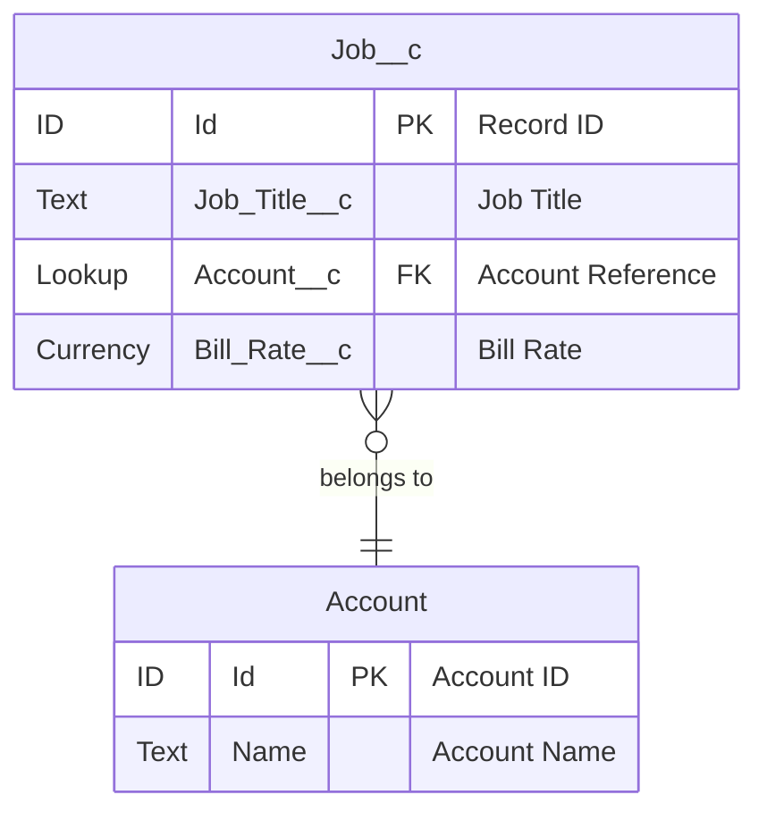

# ProductDocumentations style guide

Derived empirically from the original `master`-branch documentation (commit `15da284`) across
all five product folders, cross-checked against `Claude.md`'s stated methodology. Where the
original files were internally inconsistent or broken, that is called out below rather than
treated as a pattern to copy.

## File set per product

Every product folder follows this shape (file names vary, roles don't):

1. **`README.md`** — navigation/index page for the folder. Not present for ASM/asm (uses the
   package-doc file as the index) — treat README.md as the preferred entry point going forward.
2. **One main "Package Overview" / "Package Documentation" file** — the comprehensive reference
   (e.g. `ATS_Package_Documentation.md`, `AIN_Package_Overview.md`, `ASYMBL_TIME_PACKAGE_OVERVIEW.md`).
3. **Multiple `ERD_*.md` files**, one per functional domain.
4. **An `ERD_Index.md`** (ATS, ASM) acting as a master cross-reference — not present in every
   product; don't treat its absence elsewhere as a gap unless the product has enough ERD files
   to need one.
5. **A ULTRATHINK verification/gap-analysis report** (`*_ULTRATHINK_Verification_Report.md`,
   `ULTRATHINK_Gap_Analysis_Report.md`) — one per product, documenting the component-count audit.

## README.md conventions

- H1 title: `# <Product> Package Documentation` or `# <PRODUCT> (<Full Name>) — Documentation Index`.
- Emoji-headed `## Table of Contents` is common on ATS/ASM-style READMEs (📋, 🎯, 📊, 🗺️, 📖, 🏗️, 🔗)
  but not universal — AIN/TIME/ARA's refreshed READMEs skip emoji headers in favor of plain
  `##` sections. Either is acceptable; **do not mix emoji and non-emoji headers within the same
  file**.
- Early paragraph states: what the package is, its namespace, and its dependency relationship to
  other packages (e.g. "add-on dependent package" for ARA/AIN, explicit dependency chain for ASM).
- A **Package/Component Statistics table** near the top, sourced directly from `manifest/package.xml`,
  not estimated. Preferred table shape:

  | Component Type | Count |
  |---|---|
  | ApexClass | 174 |
  | ... | ... |
  | **TOTAL** | **818** |

  Include a `Source` column when citing non-obvious provenance (e.g. "manifest/package.xml
  CustomObject") — this is a refinement introduced in the 2026-10-30 pass and should be kept.
- A **Documentation Files in This Folder** or **Documentation Structure** list, describing what
  each file in the folder covers (one bullet per file, file name as a relative link).
- Ends with a **Quick Start / Quick Navigation** pointer telling different audiences (developers,
  admins, business users) where to start.

### Anti-pattern: do not replicate ARA's original dead-link navigation

The original `ARA/README.md` on `master` linked to `./docs/genai-functions/overview.md` and ~30
similar paths under a `docs/` subtree that **does not exist anywhere in the repository**. This was
a broken scaffold, not an intentional style choice. Do not treat a deep `docs/<topic>/<page>.md`
link structure as the convention — the real, working convention used by every other product (and
by ARA's own content files) is flat: one `.md` file per topic directly in the product folder.

## Package Overview / Package Documentation file conventions

- H1 title naming the package.
- `## Overview` paragraph(s) — plain prose, business-context framing before technical detail.
- A statistics block (`## Package Statistics` or `## Package Components Summary`), matching the
  README's numbers exactly — these two files must never disagree on a count.
- Component sections grouped by functional domain, not alphabetically (e.g. "Resume Parsing
  Services", "Controllers and UI Management" — not every class listed in isolation).
- When listing Apex classes/fields, use a flat bullet or table list with a one-line purpose
  annotation per item — `**ClassName** - purpose`. Avoid prose paragraphs per class; save prose
  for subsystems as a whole.
- Diagrams here favor `graph TB`/`graph TD` (box-and-arrow, not ER) when the goal is showing
  relationships/data flow in prose terms, with `style NodeName fill:#hex` per node — see the
  original `ATS_Package_Documentation.md` object-relationship diagram. Reserve `erDiagram` for
  files whose whole purpose is field-level ERD detail.
- ASCII-art box diagrams (as used in the new `AIN_Package_Overview.md` "High-Level Architecture"
  section) are an acceptable addition for integration-architecture framing where Mermaid would be
  harder to scan — not in the original master docs, but consistent with the methodology's goal of
  clarity, and used consistently within that one file.

## ERD_*.md file conventions

Structure, in order:

1. H1: `# <Domain Name> ERD - <Product> Package`.
2. `## Entity Relationship Diagram` section containing exactly one ```mermaid erDiagram``` block.
3. (Optional, encouraged for revisions) A blockquote **Revision note** immediately under the H1,
   dated, stating what changed and why — e.g.:

   > **Revision note (2026-10-30)**: This ERD was completely rebuilt against real field metadata
   > on `master`. The prior revision contained fabricated fields (...) that do not exist.

   This pattern did not exist in the original master docs but was introduced consistently across
   all five products in the 2026-10-30 refresh and is worth keeping as a standing convention —
   it gives future readers an audit trail without needing git blame.

### Mermaid erDiagram syntax (exact pattern from master)



Rules observed consistently across every original ERD file:
- Entity block opens with the object API name as written in Salesforce (`Job__c`, not `Job`).
- Each attribute line: `<SalesforceFieldType> <API_Name> [PK|FK|UK] "<human-readable label>"`.
  Field type uses the Salesforce type name as-is (`Text`, `Lookup`, `Currency`, `Checkbox`,
  `LongTextArea`, `MasterDetail`, `Picklist`, `MultiSelectPicklist`, `DateTime`) — not generic
  SQL types (`varchar`, `int`).
  - `ID Id PK "Record ID"` always appears first.
  - `Lookup`/`MasterDetail` fields get the `FK` marker and the referenced object named in the quoted label.
  - Audit fields (`Created_By__c`, `Created_Date__c`, `Last_Modified_By__c`, `Last_Modified_Date__c`)
    are included at the end of each entity's field list when the entity is a custom object.
- Standard objects referenced only as relationship endpoints (`Account`, `Contact`, `Opportunity`,
  `User`) get a minimal stub block — just `Id PK` and `Name` — not full field lists.
- Relationships expressed with standard Mermaid ER cardinality operators (`||--o{`, `}o--||`,
  `||--||`), with a quoted verb-phrase label.
- A `%%` comment at the top of the block (`%% Color coding for different object types`) is
  present in every original file — keep it even though the color-coding itself is described
  separately in `Claude.md`, not inline as `classDef`.

### Confidence/caveat disclosure

When a field's existence or type is uncertain, say so explicitly inline or in a dedicated note —
do not silently omit it and do not assert it as fact. Example from the 2026-10-30 ATS revision:
`Add_to_ATS__e has no fields/ subdirectory in the inspected tree, so its custom field list could
not be enumerated — documented as "uncertain" rather than asserted.` This is the correct pattern;
apply it whenever full verification wasn't possible.

## ULTRATHINK verification / gap-analysis report conventions

- H1: `# <Product> [Package] ULTRATHINK Verification Report` or `...Gap Analysis Report`.
- `## Executive Summary` — states total component count, what was verified against (always
  `manifest/package.xml` on the named branch/commit), and the headline finding (match, drift, or
  fabrication) in plain language before any tables.
- `## Component Verification Matrix` / `## Component Inventory and Verification Matrix` — a table
  with columns: `Component Type | package.xml Count | Documented Count | Status | Notes` (column
  names vary slightly — `Prior Doc Claimed` vs `Documented Count` — but the shape is fixed: one
  row per metadata type, one status cell per row).
- **Status column uses these exact icons, consistently**:
  - `✅` / `✓` — match / complete / correct
  - `⚠️` / `⚠` — mismatch, understated, or a finding that needs attention but isn't fabrication
  - `❌` — major mismatch or confirmed fabrication
  Pick one icon style (emoji `✅⚠️❌` or plain `✓⚠❌`) and use it consistently within a single file;
  both styles appear across different original files, so cross-product inconsistency in which
  variant is used is acceptable, but a file must not mix both styles internally.
- A verbatim `package.xml` component-count code block (fixed-width list of `Type` / `Count`) is a
  recurring secondary presentation of the same matrix data — optional, seen in TIME's report, not
  mandatory.
- Closing sections typically enumerate **specific named gaps** (missing classes, missing objects,
  missing fields) rather than only aggregate counts — this is the actual "ULTRATHINK" value-add
  per `Claude.md` and should never be skipped in favor of counts alone.
- When the prior documentation is found to be fabricated (not just stale), say so explicitly and
  distinguish the two in the executive summary — "materially stale" and "fabricated" are not
  interchangeable and readers need to know which occurred, since they imply different levels of
  trust in anything not re-verified.

## Tone and voice

- Plain, declarative, technical. No marketing superlatives ("revolutionary", "cutting-edge",
  "enterprise-grade") — the original ARA docs used this kind of language and it correlated
  directly with the fabricated content; avoid it as a matter of both style and honesty.
- First person plural is never used; no "we built" / "our solution" framing.
- Every quantitative claim should be traceable to a source (`manifest/package.xml`, a specific
  `.cls`/`.object-meta.xml` file, a specific commit). Prefer "Verified against X" phrasing over
  unqualified assertions.

## Cross-file and cross-product linking

- Within a product folder, link other files with relative paths: `[Job Management](ERD_Job_Management.md)`.
- A product's README and its ERD_Index (if present) should list the same files in the same order —
  do not let the two drift into different navigation orders.
- Cross-product references (e.g. AINTL calling into `asm`, or ARA referencing ATS base objects)
  should name the actual Apex method or object involved, not just "integrates with X" — see
  `ASM/asymbl-intelligence/README.md`'s citation of
  `bpats.ASM_CustomSearchService.aintlFetchContactDetails(...)` as the model to follow.
- For a repo/folder whose structure doesn't map 1:1 to Salesforce repos any more (e.g. the ASM
  group being split into `asm/`, `asymbl-intelligence/`, `AINTL-Unmanaged/` subfolders), the
  top-level README must state the real repo-to-folder mapping and the dependency chain explicitly,
  as `ASM/README.md` now does — don't assume the folder name alone conveys this.

## Branch/commit provenance

Every file produced or revised against a specific branch should state, near the top: which repo,
which branch, which commit hash, and the date read. This was inconsistently done in the original
master docs (some files have no provenance at all) but is now the standard going forward — do not
regress to undated, unattributed claims.

## When a source branch is itself in a degraded state

If the instructed branch doesn't reflect real/current work (e.g. `AINTL-Unmanaged`'s `master` being
nearly empty while `packaging` holds all real content), document both: what the instructed branch
actually contains, and what exists elsewhere, clearly labeled so a reader never mistakes one
branch's content for the other's. Do not silently substitute the "better" branch's content as if
it were what was asked for, and do not silently document the degraded branch without flagging that
something looks wrong.
