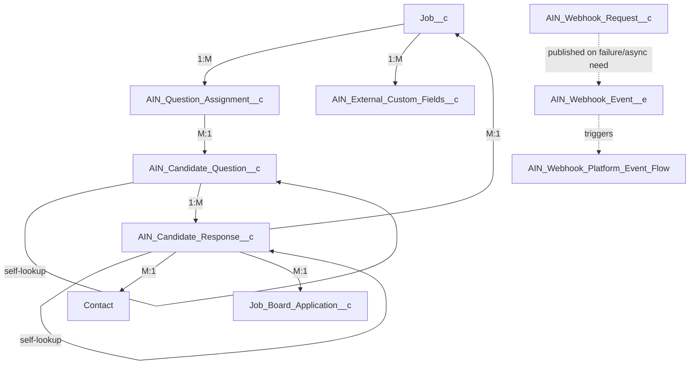

# AIN Custom Objects Documentation

## Overview

AIN ships **16 `CustomObject` entries** in `manifest/package.xml`: **6 true custom objects / platform events** that AIN owns outright, plus **10 Custom Metadata Type definitions**. (Prior documentation described only 6 CMDT types as "the custom objects" of the package — that section has been entirely rewritten below; it previously omitted every true custom object and 4 of the 10 CMDT types.)

## True Custom Objects & Platform Event (6)

### 1. `AIN_Candidate_Question__c`
**Purpose**: Question library for Indeed Apply screening/demographic questions. Supports hierarchical/conditional questions via self-lookup.
**Sharing Model**: Read (public read-only), `enableHistory=false`.
**Key Fields**: `AIN_External_ID__c` (unique key used for upsert from `AIN_Default_Question_Template__mdt`), `AIN_Question__c`, `AIN_Category__c` (Screening/Demographic), `AIN_Data_Type__c`, `AIN_Options_JSON__c`, `AIN_Conditional_Rules_JSON__c`, `AIN_Partner_Type__c`, `AIN_Is_Required__c`, `AIN_Is_Pre_Selected__c`, `AIN_isDefault__c`, `AIN_Parent_Question__c` (self-lookup for hierarchical questions), `AIN_Display_Order__c`.
**Seeded by**: `AIN_PostInstallScript.cloneDefaultQuestionTemplates()` on install, from `AIN_Default_Question_Template__mdt`.

### 2. `AIN_Candidate_Response__c`
**Purpose**: Stores a candidate's answer to a screening/demographic question for a specific application, with a point-in-time snapshot of the question so later edits to the question library don't retroactively change historical answers.
**Sharing Model**: `ControlledByParent`.
**Key Fields**: `AIN_Candidate_Question__c` (lookup), `AIN_Candidate_Question_Id__c`, `AIN_Question_Snapshot__c` (JSON snapshot), `AIN_Answer__c`, `AIN_Answer_Long_Text__c`, `AIN_Response_Type__c`, `AIN_Contact__c`, `AIN_Job__c`, `AIN_Job_Board_Application__c`, `AIN_Parent_Response__c` (self-lookup), `AIN_Level__c` (hierarchy depth).

### 3. `AIN_Question_Assignment__c`
**Purpose**: Junction object assigning specific `AIN_Candidate_Question__c` records to a specific `Job__c` (overriding the pre-selected default set for that job).
**Key Fields**: `AIN_Job__c`, `AIN_Candidate_Question__c`, `AIN_Is_Default__c`, `AIN_Is_Required__c`, `AIN_Question_Category__c`, `AIN_Question_Text__c` (denormalized copies for list display).
**Business logic**: If a job has no `AIN_Question_Assignment__c` records, `AIN_ScreeningQuestionController.getJobSpecificQuestions()` falls back to all pre-selected (`AIN_Is_Pre_Selected__c = true`) questions.

### 4. `AIN_External_Custom_Fields__c`
**Purpose**: Captures VMS-supplied (Beeline) candidate custom field *definitions* per job posting — fields the client/VMS requires that aren't part of the standard mapping.
**Key Fields**: `AIN_Job__c`, `AIN_Job_Posting_UID__c`, `AIN_Name__c`, `AIN_Mapped_Field_Name__c`, `AIN_Reference_Id__c`, `AIN_Reference_Key__c`, `AIN_Required__c`, `AIN_Type__c`, `AIN_Values__c`.
**Populated by**: `AIN_BeelineCalloutServices.getCandidateCustomFields()` / `AIN_BeelineJobController.getExternalMappingData()` when a Beeline job posting is released.
**Has a Custom Tab** (`AIN_External_Custom_Fields__c.tab-meta.xml`) and a dedicated page layout.

### 5. `AIN_Webhook_Request__c`
**Purpose**: Durable log of every inbound webhook request (Beeline, Indeed Apply, RedDot) — the backbone of the retry/cleanup framework.
**Key Fields**: `AIN_Platform_Name__c`, `AIN_Event_Type__c`, `AIN_Reference_Id__c`, `AIN_Salesforce_Id__c`, `AIN_Status__c` (Pending/Success/Failure), `AIN_Retry_Count__c`, `AIN_Error_Message__c`, `AIN_Preserve_Log__c` (excludes a record from scheduled cleanup).
**List Views**: `All`, `Failed_Webhook_Request`, `Success_Webhook_Request`.
**Quick Action**: `Retry_Webhooks` (manual retry, backed by `AIN_RetryWebhookController`).
**Has a Custom Tab** and dedicated page layout.

### 6. `AIN_Webhook_Event__e` (Platform Event, `HighVolume`, `PublishImmediately`)
**Purpose**: Decouples webhook receipt from processing — published when a webhook needs asynchronous handling, consumed by the `AIN_Webhook_Platform_Event_Flow` Flow which invokes `AIN_PlatformEventController`'s `@InvocableMethod`.
**Fields**: `AIN_Event_Type__c`, `AIN_PayLoad__c`, `AIN_Platform_Name__c`, `AIN_Reference_Id__c`.

## Custom Metadata Types (10)

See `AIN_Custom_Metadata_Documentation.md` for full field listings and record counts. Summary:

| Metadata Type | Records | Purpose |
|---|---|---|
| `AIN_Job_Mapping__mdt` | 67 | `Job__c` ⇄ Indeed job fields |
| `AIN_Vms_Job_Mapping__mdt` | 50 | `Job__c` ⇄ Beeline job fields |
| `AIN_Vms_Job_Board_Mapping__mdt` | 35 | Candidate submission fields ⇄ Beeline |
| `AIN_Job_Board_Mapping__mdt` | 32 | Inbound application fields ⇄ Salesforce |
| `AIN_Disposition_Value_Map__mdt` | 24 | SF picklist value ⇄ Indeed disposition status |
| `AIN_Disposition_Sync_Config__mdt` | 13 | Field-level disposition sync configuration |
| `AIN_Indeed_Apply_Mapping__mdt` | 6 | Indeed Apply form configuration |
| `AIN_Default_Question_Template__mdt` | 6 | Seed data for screening question library |
| `AIN_Integration_Credentials__mdt` | 4 | Beeline / Indeed / Indeed_Apply / RedDot credentials |
| `AIN_Webhook_Setup__mdt` | 1 | Webhook retry/cleanup scheduling |
| **Total** | **240** | |

**Note**: The prior "6 Custom Metadata Types" claim is stale — the package now has **10** CMDT types, and `AIN_Integration_Credentials__mdt` has 4 records (Beeline, Indeed, Indeed_Apply, **and RedDot** — RedDot was missing from prior documentation).

## Extended ATS Base Objects (not owned by AIN, extended with AIN fields)

- `Job__c` — 17 AIN fields (publishing/sync control; see `AIN_Custom_Fields_Documentation.md`)
- `ATS_Applicant__c` — 7 AIN fields (VMS/disposition sync tracking)
- `Job_Board_Application__c` — 4 AIN fields (application sync tracking)
- `Contact` — 1 AIN field (`AIN_BE_Worker_Id__c`)
- `ContentVersion` — 1 AIN field (`AIN_BE_Attachment_Id__c`)

## Relationship Summary

