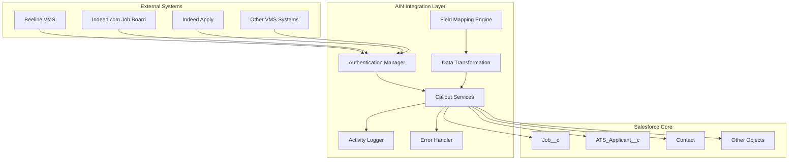
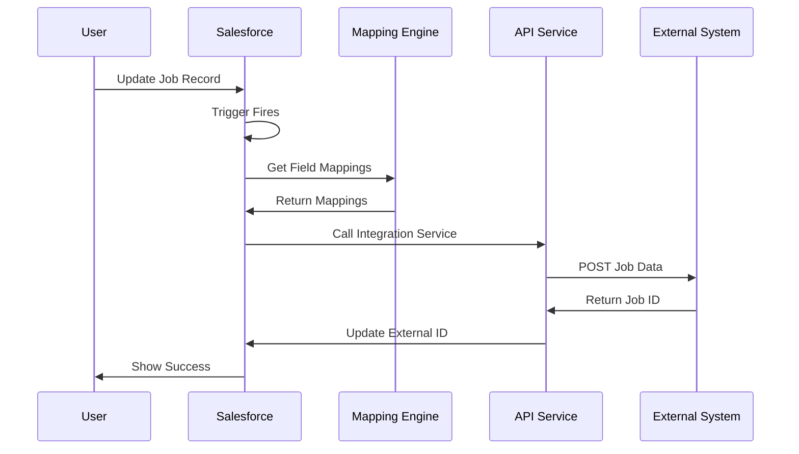
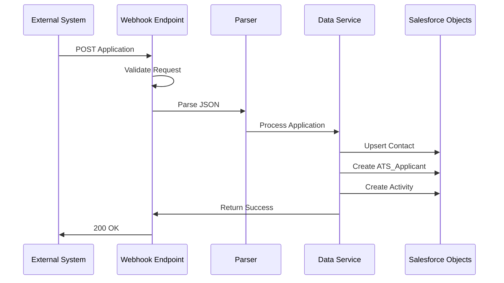

# AIN Integration Architecture Documentation

## Overview

The AIN (Asymbl Integration) package is an enterprise-grade integration platform that connects Salesforce with external recruiting and Vendor Management Systems (VMS). This architecture document provides a comprehensive overview of the system design, integration patterns, and technical implementation details.

## System Architecture

### High-Level Architecture Diagram



## Integration Components

### 1. Authentication Management

#### OAuth 2.0 Implementation (Beeline VMS)
- **Class**: `AIN_BeelineCalloutServices`
- **Features**:
  - Automatic token refresh
  - Secure credential storage via Custom Metadata
  - Multi-tenant support
  - Rate limiting and throttling

#### API Key Management (Indeed)
- **Class**: `AIN_IndeedCalloutService`
- **Features**:
  - Encrypted API key storage
  - Environment-specific configuration
  - Request signing and validation

### 2. Field Mapping Engine

#### Metadata-Driven Architecture
- **6 Custom Metadata Types**:
  - `AIN_Job_Mapping__mdt` (61 records)
  - `AIN_Job_Board_Mapping__mdt` (28 records)
  - `AIN_Vms_Job_Mapping__mdt` (50 records)
  - `AIN_Vms_Job_Board_Mapping__mdt` (42 records)
  - `AIN_Indeed_Apply_Mapping__mdt` (6 records)
  - `AIN_Integration_Credentials__mdt` (3 records)

#### Dynamic Field Transformation
```apex
// Example: Field mapping logic
public Map<String, Object> transformFields(sObject record, List<FieldMapping__mdt> mappings) {
    Map<String, Object> transformedData = new Map<String, Object>();
    for (FieldMapping__mdt mapping : mappings) {
        Object value = record.get(mapping.Source_Field__c);
        transformedData.put(mapping.Target_Field__c, transformValue(value, mapping));
    }
    return transformedData;
}
```

### 3. Integration Patterns

#### Pattern 1: Real-time Job Publishing
- **Trigger**: Job record update
- **Flow**: Job → Mapping → Transformation → API Call → Status Update
- **Error Handling**: Retry with exponential backoff

#### Pattern 2: Webhook-based Application Processing
- **Endpoint**: `/services/apexrest/ain/indeed/apply`
- **Security**: API key validation + IP whitelisting
- **Processing**: Async for large payloads

#### Pattern 3: Scheduled Synchronization
- **Frequency**: Configurable (default 15 minutes)
- **Scope**: Differential sync based on LastModifiedDate
- **Conflict Resolution**: Last-write-wins with audit trail

## Key Integration Flows

### 1. Job Publishing Flow



### 2. Application Processing Flow



## Data Models

### Integration Control Fields

#### On Job__c Object
- `AIN_Source_Posting_Id__c` - External system job ID
- `AIN_Sync_This_Record__c` - Sync control flag
- `AIN_Is_Synced__c` - Current sync status
- `AIN_Activity_History__c` - JSON activity log
- `AIN_Indeed_Apply__c` - Indeed Apply enabled flag

#### On ATS_Applicant__c Object
- `AIN_BE_Candidate_Id__c` - Beeline candidate ID
- `AIN_BE_Worker_Id__c` - Beeline worker ID

## Security Architecture

### Authentication & Authorization
1. **OAuth 2.0** for Beeline VMS
2. **API Keys** for Indeed integration
3. **Named Credentials** for secure storage
4. **Permission Sets** for access control:
   - `AIN_Admin` - Full administrative access
   - `AIN_Beeline_Admin` - Beeline-specific access
   - `AIN_IN_Integration_Guest_User` - Limited API access

### Data Security
- Field-level encryption for sensitive data
- IP whitelisting for webhook endpoints
- Request signing and validation
- Audit trail for all operations

## Error Handling & Recovery

### Error Categories
1. **Authentication Errors** - Token refresh and retry
2. **Network Errors** - Exponential backoff
3. **Data Validation** - Detailed error logging
4. **Rate Limiting** - Queue management

### Recovery Strategies
```apex
// Retry logic implementation
public class AIN_RetryHandler {
    private static final Integer MAX_RETRIES = 3;
    private static final Integer BASE_DELAY = 1000; // ms
    
    public static HttpResponse retryWithBackoff(HttpRequest req) {
        for (Integer i = 0; i < MAX_RETRIES; i++) {
            HttpResponse res = new Http().send(req);
            if (res.getStatusCode() == 200) return res;
            
            Integer delay = BASE_DELAY * (Integer)Math.pow(2, i);
            sleep(delay);
        }
        throw new AIN_IntegrationException('Max retries exceeded');
    }
}
```

## Performance Optimization

### Bulk Processing
- Batch size: 200 records per transaction
- Parallel processing for independent operations
- Async processing for large payloads

### Caching Strategy
- Metadata caching for field mappings
- Token caching for OAuth flows
- Response caching for idempotent operations

### Monitoring & Metrics
- Real-time dashboard (Lightning components)
- Activity timeline visualization
- Error rate monitoring
- Performance metrics tracking

## Scalability Considerations

### Horizontal Scaling
- Support for multiple external systems
- Configurable endpoints via metadata
- Dynamic field mapping

### Vertical Scaling
- Async processing for heavy operations
- Queue-based architecture
- Resource governor compliance

## Integration Endpoints

### REST Endpoints
1. **Indeed Apply Webhook**
   - URL: `/services/apexrest/ain/indeed/apply`
   - Method: POST
   - Authentication: API Key header

### External APIs
1. **Beeline VMS API**
   - Base URL: Configured in metadata
   - Authentication: OAuth 2.0
   - Operations: Job posting, candidate submission

2. **Indeed Job API**
   - Base URL: `https://secure.indeed.com/v2/`
   - Authentication: API Key
   - Operations: Job publishing, status updates

## Best Practices

### Development Guidelines
1. Use metadata for all configuration
2. Implement comprehensive error handling
3. Follow bulkification patterns
4. Maintain detailed activity logs

### Deployment Considerations
1. Deploy metadata before code
2. Configure credentials in target org
3. Test integrations in sandbox
4. Monitor initial production runs

### Maintenance
1. Regular token refresh validation
2. Monitor API rate limits
3. Review error logs weekly
4. Update field mappings as needed

## Future Enhancements

### Planned Features
1. GraphQL support for complex queries
2. Event-driven architecture with Platform Events
3. AI-powered field mapping suggestions
4. Real-time bi-directional sync

### Extensibility
- Plugin architecture for new systems
- Custom transformation functions
- Webhook framework for any source
- Generic API connector

## Conclusion

The AIN Integration Architecture provides a robust, scalable, and maintainable solution for connecting Salesforce with external recruiting systems. Its metadata-driven approach ensures flexibility while maintaining security and performance standards required for enterprise deployments.