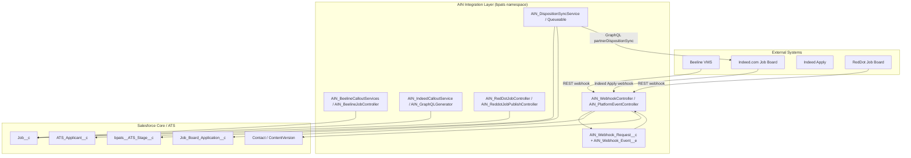

# AIN Integration Architecture Documentation

## Overview

AIN integrates Salesforce with three external systems — **Indeed** (job board + Indeed Apply + disposition sync-back), **Beeline** (VMS), and **RedDot** (job board) — through a combination of outbound REST/GraphQL callouts and inbound REST webhook endpoints, all routed through a shared, durable webhook-request logging layer. Field mapping for every direction is entirely metadata-driven (no hardcoded Salesforce or external field names in Apex), via the `AIN_*_Mapping__mdt` / `AIN_Disposition_*__mdt` custom metadata types.

## System Architecture Diagram

## Integration Components

### 1. Authentication Management

| System | Mechanism | Class(es) |
|---|---|---|
| Beeline | OAuth 2.0 client-credentials grant; token cached per batch/request lifecycle | `AIN_BeelineCalloutServices`, `AIN_BeelineAuthSettingController` |
| Indeed (job publishing/GraphQL) | OAuth 2.0 client-credentials (`/oauth/v2/tokens`) for server-to-server calls | `AIN_IndeedCalloutService`, `AIN_Constants.AUTH_ENDPOINT` |
| Indeed (employer login) | OAuth 2.0 authorization-code flow via Salesforce `ExternalClientApplication`/`NamedCredential` (`Indeed_Integration`, `AIN_AWS_Indeed_Integration`) | `AIN_IndeedOAuthController`, `AIN_IndeedOAuthCallbackController` |
| RedDot | Credential record in `AIN_Integration_Credentials__mdt` (`RedDot` record); webhook callback trusted via `Reddot_JobSplice` CSP Trusted Site | `AIN_RedDotAuthSettingController` |

All credentials are stored in `AIN_Integration_Credentials__mdt` (4 records: `Beeline`, `Indeed`, `Indeed_Apply`, `RedDot`), not in Protected Custom Settings, and not "field-level encrypted" as prior documentation claimed — there is no field-level encryption framework present in this package; `AIN_Client_Secret__c` is a plain Text field protected by CMDT access control (programmatic permission sets) only.

### 2. Field Mapping Engine

**10 Custom Metadata Types, 240 total records** (see `AIN_Custom_Metadata_Documentation.md` for the full breakdown):
- `AIN_Job_Mapping__mdt` (67 records) — Salesforce `Job__c` ⇄ Indeed GraphQL job fields
- `AIN_Vms_Job_Mapping__mdt` (50) — `Job__c` ⇄ Beeline job fields
- `AIN_Vms_Job_Board_Mapping__mdt` (35) — candidate submission fields ⇄ Beeline
- `AIN_Job_Board_Mapping__mdt` (32) — inbound application fields ⇄ Salesforce
- `AIN_Disposition_Value_Map__mdt` (24) — SF picklist value ⇄ Indeed disposition status
- `AIN_Disposition_Sync_Config__mdt` (13) — field-level disposition sync configuration
- `AIN_Indeed_Apply_Mapping__mdt` (6) — Indeed Apply form configuration (resume/cover-letter/phone requirements, name format)
- `AIN_Default_Question_Template__mdt` (6) — seed data for screening/demographic question library
- `AIN_Integration_Credentials__mdt` (4) — Beeline / Indeed / Indeed_Apply / RedDot credentials
- `AIN_Webhook_Setup__mdt` (1) — webhook retry/cleanup scheduling configuration

### 3. Integration Patterns in Use

#### Pattern 1 — Outbound job publishing (Indeed / Beeline / RedDot)
Job record change (or Quick Action: `Publish_Job`, `Publish_Job_RedDot`) → active field mappings resolved from CMDT → GraphQL/REST payload built → callout → external ID/status fields updated on `Job__c` (`AIN_Source_Posting_Id__c` / `AIN_BE_Job_Id__c`, `AIN_Is_Synced__c`, `AIN_Posting_Channel_History__c`).

#### Pattern 2 — Inbound webhook with durable logging
External system → `AIN_WebhookController` (Beeline, `/services/apexrest/webhook/*/receive`) or `AIN_IndeedApplyRestResource` (Indeed Apply) or `AIN_RedDotJobController` (`/services/apexrest/redDotJob/*`) → request persisted to `AIN_Webhook_Request__c` → processed synchronously where possible, or retried asynchronously by `AIN_WebhookRetryBatch` on failure/pending status. `AIN_PlatformEventController` also supports an async platform-event path (`AIN_Webhook_Event__e` → `AIN_Webhook_Platform_Event_Flow` → invocable method) for decoupled processing.

#### Pattern 3 — Disposition sync-back (Indeed only)
Scheduled/queued (`AIN_DispositionSyncQueueable`) query of `ATS_Applicant__c` / `bpats__ATS_Stage__c` records needing sync (per `AIN_Disposition_Sync_Config__mdt.AIN_Is_Synced__c` tracker fields) → `AIN_DispositionSyncService.buildPayloads()` resolves fields/values entirely from CMDT (including Stage-vs-Applicant status priority rules) → GraphQL `partnerDispositionSync` mutation sent to Indeed.

## Data Model — Integration Control Fields

### On `Job__c`
- `AIN_Source_Posting_Id__c`, `AIN_Source__c` — external posting identifier/source
- `AIN_Is_Synced__c`, `AIN_Sync_This_Record__c` — sync control
- `AIN_Activity_History__c`, `AIN_Posting_Channel_History__c`, `AIN_Posting_Locations__c` — JSON/CSV posting history and active channel tracking
- `AIN_Indeed_Apply__c` — Indeed Apply enablement
- `AIN_BE_Job_Id__c`, `AIN_BE_Client_Id__c`, `AIN_BE_Client_Name__c`, `AIN_BE_SN_Id__c`, `AIN_BE_Attachment_Ids__c` — Beeline-specific identifiers
- `AIN_IN_Period__c`, `AIN_IN_Salary_Currency__c`, `AIN_IN_Source_Name__c`, `AIN_IN_Source_Type__c`, `AIN_IN_Task_Description__c`, `AIN_IN_URL__c` — Indeed-specific job fields
- `AIN_Posting_URL__c` — generated external job posting URL

### On `ATS_Applicant__c`
- `AIN_BE_Candidate_Id__c`, `AIN_BE_Candidate_Status__c` — Beeline candidate tracking
- `AIN_Is_Sync_To_VMS__c`, `AIN_Sync_This_To_VMS__c` — VMS sync control
- `AIN_Is_Synced__c` — Indeed disposition-sync tracker
- `AIN_Failure_Reasons__c`, `AIN_Indeed_Apply_Id__c`

### On `Job_Board_Application__c`
- `AIN_Failure_Reasons__c`, `AIN_Indeed_Apply_Id__c`, `AIN_Is_Synced__c`, `AIN_Source__c`

### On `Contact`
- `AIN_BE_Worker_Id__c` — Beeline worker identifier (placement)

### On `ContentVersion`
- `AIN_BE_Attachment_Id__c` — Beeline attachment identifier

## Integration Endpoints (verified in `AIN_Constants` / `@RestResource` annotations)

| Endpoint | Direction | Class |
|---|---|---|
| `/services/apexrest/webhook/{platform}/receive` | Inbound (Beeline) | `AIN_WebhookController` |
| `/services/apexrest/redDotJob/*` | Inbound (RedDot) | `AIN_RedDotJobController` |
| Indeed Apply webhook (URL-mapped via `AIN_IndeedApplyRestResource`) | Inbound (Indeed Apply) | `AIN_IndeedApplyRestResource` |
| `https://apis.indeed.com` / `https://apis.indeedmock.asymbldevs.com/v1` (test) / `https://simulated-apis.indeed.com` | Outbound (Indeed GraphQL) | `AIN_IndeedCalloutService`, `AIN_Constants` |
| `/api/gwg/supplier/oauth/token`, `/api/gwg/supplier/webhook/subscriptions`, `/api/gwg/supplier/workers`, `/api/gwg/supplier/candidates` | Outbound (Beeline) | `AIN_BeelineCalloutServices` |
| `AIN_ScreeningQuestionURLPage` (Visualforce, guest-accessible) | Inbound (candidate-facing screening question URL) | `AIN_ScreeningQuestionURLController` |

## Corrections vs. prior documentation

- There is no generic "Authentication Manager" / "Data Transformation" / "Error Handler" class — each integration (Beeline/Indeed/RedDot) implements its own auth and transformation logic directly against CMDT, with shared logging via `bpats.ATS_LogHandler`.
- There is **no exponential-backoff `AIN_RetryHandler` class**. Retries are implemented as scheduled/batch re-processing of `AIN_Webhook_Request__c` records with status `Failure`/`Pending` (`AIN_WebhookRetryBatch`), not in-request retry loops.
- RedDot integration did not exist in the package version previously documented (2025-07) and is a material, previously-undocumented addition — including its own auth controller, job controller, webhook flow (`Flow_For_Update_RedDot_Job_Source`), quick action (`Publish_Job_RedDot`), and CSP Trusted Site.
- Disposition sync-back to Indeed is also a wholly new, previously-undocumented capability (CMDT types `AIN_Disposition_Sync_Config__mdt` / `AIN_Disposition_Value_Map__mdt` did not exist in the prior documented version).
