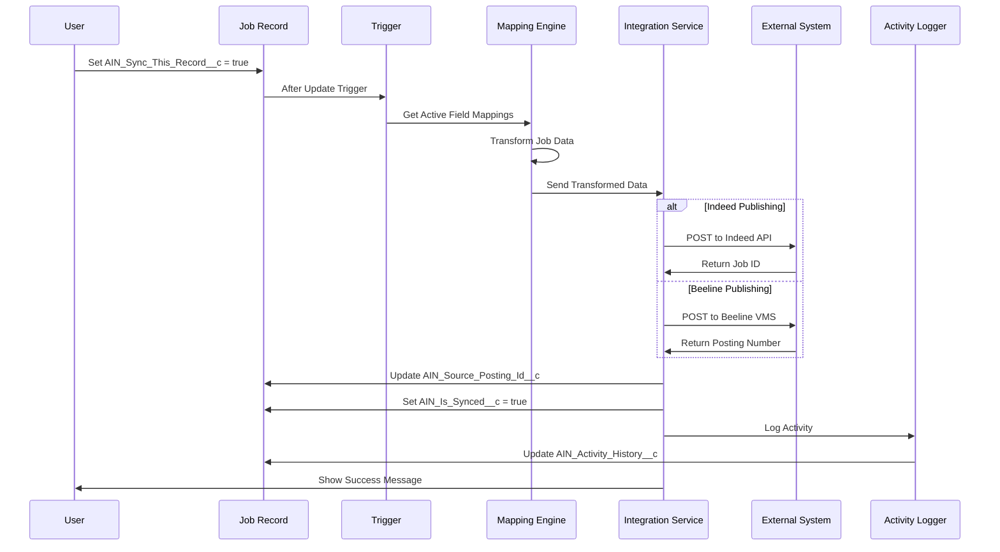
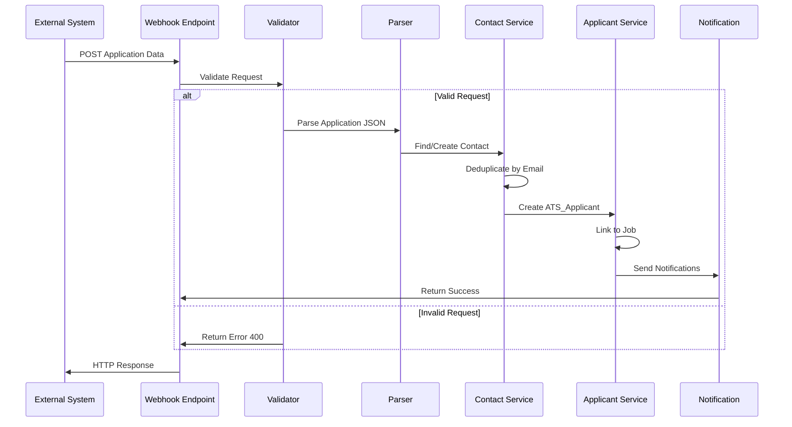
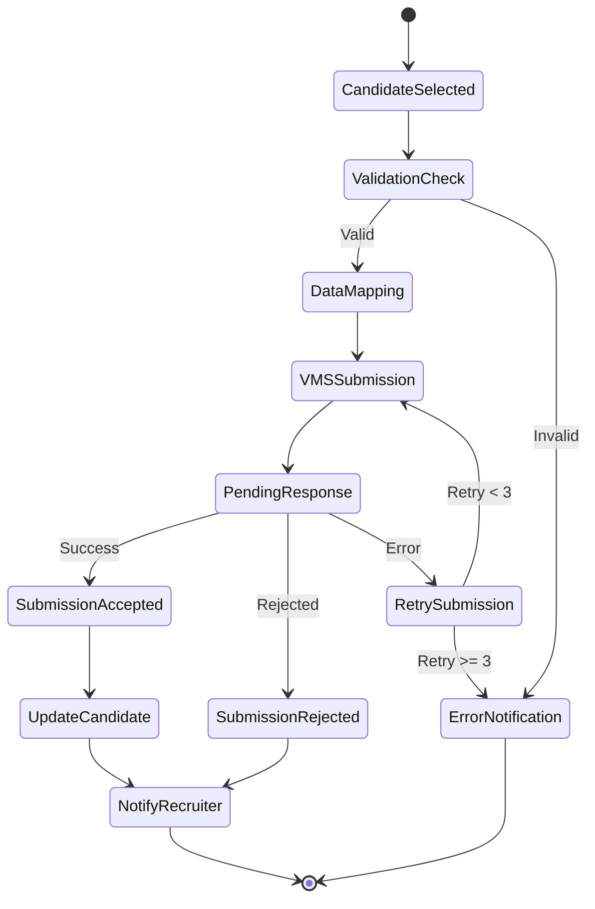
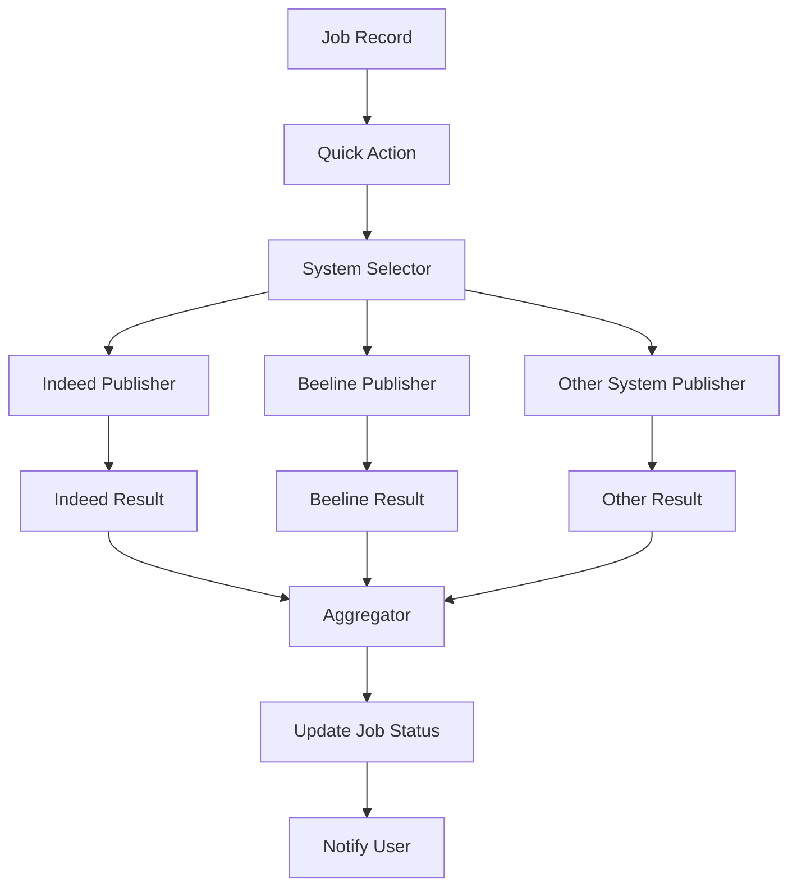
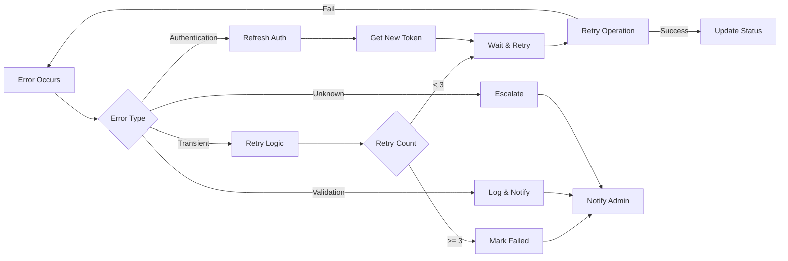

# AIN Integration Workflows Documentation

## Overview

This document details the complete integration workflows implemented in the AIN package, covering data flows between Salesforce and external systems including Beeline VMS, Indeed Job Board, and Indeed Apply.

## Workflow Categories

| Workflow Type | Systems Involved | Direction | Trigger |
|---|---|---|---|
| Job Publishing | Salesforce → External | Outbound | Manual/Automated |
| Application Processing | External → Salesforce | Inbound | Webhook/API |
| Status Synchronization | Bidirectional | Both | Scheduled/Real-time |
| Candidate Submission | Salesforce → VMS | Outbound | Manual Action |
| Worker Management | VMS ↔ Salesforce | Bidirectional | Event-driven |

## Detailed Workflow Documentation

### 1. Job Publishing Workflow

#### Overview
Publishes job postings from Salesforce to multiple external systems with field mapping and status tracking.

#### Workflow Diagram


#### Process Steps

1. **Initiation**
   - User selects job(s) for publishing
   - Sets sync flag via UI or bulk action
   - Validates required fields present

2. **Field Mapping**
   - Retrieves active mappings from metadata
   - Transforms Salesforce fields to API format
   - Handles data type conversions
   - Applies business rules

3. **API Execution**
   - Authenticates with external system
   - Sends transformed payload
   - Handles response and errors
   - Implements retry logic

4. **Status Update**
   - Updates external ID field
   - Sets synchronization status
   - Logs activity details
   - Notifies user of outcome

#### Configuration
```apex
// Metadata-driven field mapping
List<AIN_Job_Mapping__mdt> mappings = [
    SELECT AIN_Field_Api_Name__c, 
           AIN_Mapped_Field__c,
           AIN_Is_Required__c,
           AIN_Field_Type__c
    FROM AIN_Job_Mapping__mdt
    WHERE AIN_Is_Active__c = true
];
```

---

### 2. Application Processing Workflow

#### Overview
Processes incoming job applications from external sources, creates/updates contacts and applicants.

#### Workflow Diagram


#### Indeed Apply Integration
```json
// Sample Indeed Apply Payload
{
  "jobKey": "abc123",
  "jobTitle": "Software Engineer",
  "jobCompany": "Asymbl Inc",
  "applicant": {
    "fullName": "John Doe",
    "email": "john.doe@email.com",
    "phoneNumber": "+1234567890",
    "resume": {
      "text": "Resume content...",
      "json": {
        "skills": ["Salesforce", "Apex"],
        "experience": [...]
      }
    },
    "coverLetter": "Cover letter text..."
  },
  "appliedAt": "2024-01-15T10:30:00Z"
}
```

#### Processing Logic
```apex
@RestResource(urlMapping='/ain/indeed/apply')
global class AIN_IndeedApplyRestResource {
    @HttpPost
    global static void handleApplication() {
        RestRequest req = RestContext.request;
        
        // Validate webhook signature
        if (!validateSignature(req)) {
            sendError(401, 'Invalid signature');
            return;
        }
        
        // Parse application
        ApplicationData data = parseApplication(req.requestBody.toString());
        
        // Process asynchronously for large payloads
        if (data.resumeSize > 100000) {
            System.enqueueJob(new ApplicationProcessor(data));
        } else {
            processApplication(data);
        }
    }
}
```

---

### 3. Status Synchronization Workflow

#### Overview
Maintains data consistency between Salesforce and external systems through scheduled and real-time sync.

#### Sync Patterns

##### Pattern 1: Scheduled Batch Sync


##### Pattern 2: Real-time Event Sync


#### Implementation
```apex
global class AIN_SyncScheduler implements Schedulable {
    global void execute(SchedulableContext sc) {
        // Find records needing sync
        List<Job__c> jobsToSync = [
            SELECT Id, Name, LastModifiedDate,
                   AIN_Source_Posting_Id__c,
                   AIN_Is_Synced__c
            FROM Job__c
            WHERE AIN_Sync_This_Record__c = true
            AND AIN_Is_Synced__c = false
            AND LastModifiedDate > :DateTime.now().addHours(-24)
            LIMIT 200
        ];
        
        // Group by external system
        Map<String, List<Job__c>> jobsBySystem = groupBySystem(jobsToSync);
        
        // Process each system
        for (String system : jobsBySystem.keySet()) {
            processBatch(system, jobsBySystem.get(system));
        }
    }
}
```

---

### 4. VMS Candidate Submission Workflow

#### Overview
Submits qualified candidates from Salesforce ATS to Beeline VMS for client review.

#### Submission Flow


#### Candidate Mapping Configuration
```yaml
Required Fields:
  - First Name: Contact.FirstName
  - Last Name: Contact.LastName
  - Email: Contact.Email
  - Phone: Contact.Phone
  - Resume: Attachment or Rich Text
  - Bill Rate: ATS_Applicant__c.Bill_Rate__c
  - Available Date: ATS_Applicant__c.Available_Date__c

Optional Fields:
  - Skills: Contact.Skills__c
  - Certifications: Contact.Certifications__c
  - Previous Client: Contact.Former_Employee__c
```

---

### 5. Multi-System Publishing Workflow

#### Overview
Enables simultaneous job posting to multiple external systems with individual status tracking.

#### Parallel Publishing Architecture


#### Implementation Pattern
```apex
public class AIN_MultiSystemPublisher {
    public static PublishResult publishToAll(Id jobId, Set<String> systems) {
        Job__c job = getJobWithMappings(jobId);
        List<PublishRequest> requests = new List<PublishRequest>();
        
        // Create parallel requests
        for (String system : systems) {
            requests.add(new PublishRequest(job, system));
        }
        
        // Execute in parallel
        List<PublishResult> results = executeParallel(requests);
        
        // Aggregate results
        return aggregateResults(results);
    }
    
    @future(callout=true)
    private static void executeParallel(String requestsJson) {
        List<PublishRequest> requests = 
            (List<PublishRequest>)JSON.deserialize(requestsJson, List<PublishRequest>.class);
            
        // Use Queueable for each system
        for (PublishRequest req : requests) {
            System.enqueueJob(new SystemPublisher(req));
        }
    }
}
```

---

### 6. Error Handling and Recovery Workflow

#### Overview
Comprehensive error handling with automatic retry and manual intervention options.

#### Error Recovery Flow


#### Retry Implementation
```apex
public class AIN_RetryHandler {
    private static final Integer MAX_RETRIES = 3;
    private static final Integer BASE_WAIT_TIME = 1000; // ms
    
    public static Object executeWithRetry(Callable operation) {
        Exception lastException;
        
        for (Integer i = 0; i < MAX_RETRIES; i++) {
            try {
                return operation.call();
            } catch (Exception e) {
                lastException = e;
                
                if (!isRetryable(e) || i == MAX_RETRIES - 1) {
                    throw e;
                }
                
                // Exponential backoff
                Integer waitTime = BASE_WAIT_TIME * (Integer)Math.pow(2, i);
                sleep(waitTime);
            }
        }
        
        throw lastException;
    }
    
    private static Boolean isRetryable(Exception e) {
        return e.getMessage().contains('timeout') ||
               e.getMessage().contains('500') ||
               e.getMessage().contains('503');
    }
}
```

---

## Integration Patterns

### 1. Request-Response Pattern
Used for: Job publishing, candidate submission
```apex
HttpRequest req = buildRequest(endpoint, method, body);
HttpResponse res = http.send(req);
processResponse(res);
```

### 2. Webhook Pattern
Used for: Application processing, status updates
```apex
@RestResource(urlMapping='/ain/webhook/*')
global class WebhookHandler {
    @HttpPost
    global static void handleWebhook() {
        // Process incoming data
    }
}
```

### 3. Polling Pattern
Used for: Status synchronization
```apex
global class PollingJob implements Schedulable {
    global void execute(SchedulableContext sc) {
        // Check for updates
    }
}
```

### 4. Event-Driven Pattern
Used for: Real-time updates
```apex
// Platform Event
public class Job_Sync_Event__e {
    public String JobId__c;
    public String Action__c;
}

// Subscriber
trigger JobSyncEventTrigger on Job_Sync_Event__e (after insert) {
    // Process events
}
```

## Security Considerations

### API Security
1. **Authentication**
   - OAuth 2.0 for Beeline
   - API keys for Indeed
   - Webhook signatures for Indeed Apply

2. **Data Encryption**
   - TLS 1.2+ for all communications
   - Field-level encryption for sensitive data
   - Encrypted credential storage

3. **Access Control**
   - IP whitelisting for webhooks
   - Rate limiting per endpoint
   - Request validation and sanitization

### Audit Trail
```json
{
  "timestamp": "2024-01-15T10:30:00Z",
  "user": "005xx000001AbCD",
  "action": "job_published",
  "system": "Indeed",
  "recordId": "a01xx0000001234",
  "status": "success",
  "details": {
    "externalId": "IND-123456",
    "fieldsModified": ["title", "description"],
    "responseTime": 245
  }
}
```

## Performance Optimization

### Bulk Processing
- Batch jobs up to 200 records
- Use collection methods in Apex
- Implement cursor-based pagination

### Caching Strategy
- Cache authentication tokens
- Store field mappings in memory
- Use Platform Cache for frequent lookups

### Async Processing
- Use @future for single records
- Implement Queueable for chains
- Batch Apex for large volumes

## Monitoring and Alerting

### Key Metrics
1. **Integration Success Rate**
   - Target: >99.5%
   - Alert threshold: <95%

2. **Response Time**
   - Target: <3 seconds
   - Alert threshold: >10 seconds

3. **Error Rate**
   - Target: <0.5%
   - Alert threshold: >5%

### Dashboard Components
```apex
// Real-time monitoring
public class AIN_IntegrationMetrics {
    public static Map<String, Object> getCurrentMetrics() {
        return new Map<String, Object>{
            'successRate' => calculateSuccessRate(),
            'avgResponseTime' => getAverageResponseTime(),
            'activeIntegrations' => getActiveIntegrationCount(),
            'queueDepth' => getQueueDepth(),
            'lastError' => getLastError()
        };
    }
}
```

## Best Practices

### 1. Idempotency
- Use external IDs for deduplication
- Implement upsert operations
- Handle duplicate submissions gracefully

### 2. Error Recovery
- Implement exponential backoff
- Provide manual retry options
- Log all errors with context

### 3. Data Validation
- Validate before sending
- Handle partial success
- Provide clear error messages

### 4. Scalability
- Design for bulk operations
- Use async processing
- Implement rate limiting

## Summary

The AIN integration workflows provide:

1. **Reliable Data Exchange**: Robust error handling and retry logic
2. **Real-time Processing**: Webhook and event-driven patterns
3. **Scalable Architecture**: Bulk processing and async operations
4. **Comprehensive Monitoring**: Activity logging and metrics
5. **Flexible Configuration**: Metadata-driven field mappings

These workflows enable seamless integration between Salesforce and external recruiting systems while maintaining data integrity and system performance.