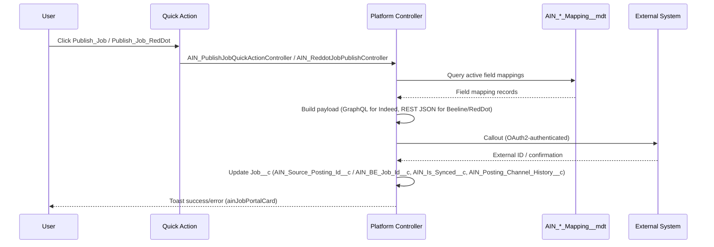
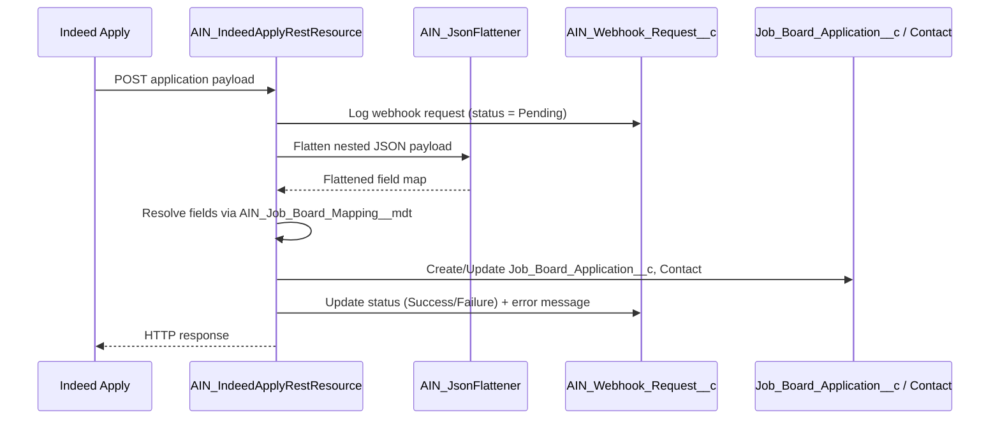
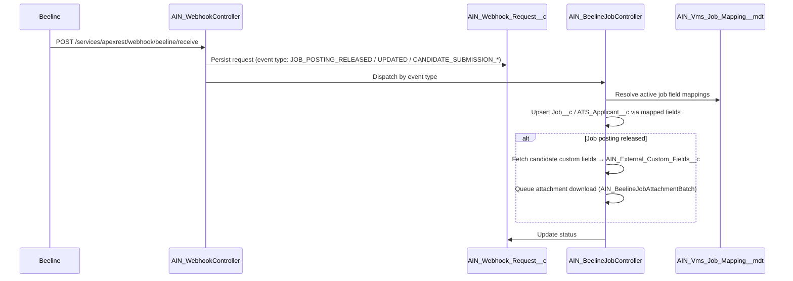
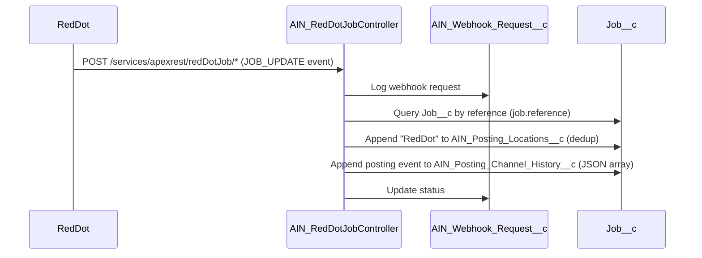
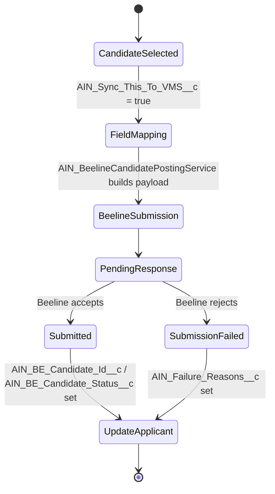
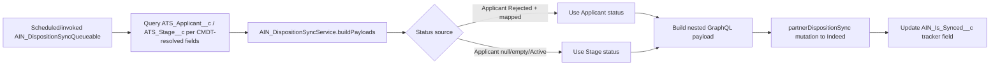
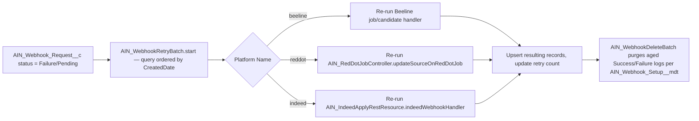

# AIN Integration Workflows Documentation

## Overview

This document describes the verified, code-level workflows implemented in the AIN package across Beeline, Indeed, Indeed Apply, and RedDot integrations, plus the webhook durability and disposition-sync-back subsystems added since the package was last documented.

## Workflow Categories

| Workflow | Systems | Direction | Trigger |
|---|---|---|---|
| Job Publishing | Salesforce → Indeed / Beeline / RedDot | Outbound | Quick Action (`Publish_Job`, `Publish_Job_RedDot`) or scheduled batch (`AIN_IndeedPostingBatch`, `AIN_SyncActiveJob`) |
| Indeed Apply Application Processing | Indeed Apply → Salesforce | Inbound | Webhook (`AIN_IndeedApplyRestResource`) |
| Beeline Job/Candidate Webhook Processing | Beeline → Salesforce | Inbound | Webhook (`AIN_WebhookController`) |
| RedDot Source Tracking | RedDot → Salesforce | Inbound | Webhook (`AIN_RedDotJobController`) |
| Candidate Submission to VMS | Salesforce → Beeline | Outbound | Batch (`AIN_BeelineCandidatePostingBatch`) triggered from `ATS_Applicant__c` changes |
| Webhook Retry & Cleanup | Internal | N/A | Scheduled batch (`AIN_WebhookRetryBatch`, `AIN_WebhookDeleteBatch`) or manual Quick Action (`Retry_Webhooks`) |
| Disposition Sync-back | Salesforce → Indeed | Outbound | Queueable (`AIN_DispositionSyncQueueable`), metadata-driven |
| Screening/Demographic Question Assignment | Admin UI → Job | Internal | LWC (`ainQuestionForm`, `ainQuestionTemplateManager`) via `AIN_ScreeningQuestionController` |

## 1. Job Publishing Workflow

### Sequence

Jobs can also be bulk-synced via `AIN_SyncActiveJob` (which drives `AIN_IndeedPostingBatch`) rather than only via manual Quick Action.

## 2. Indeed Apply — Inbound Application Processing

Screening and demographic question answers captured as part of the application are persisted against `AIN_Candidate_Response__c`, snapshotting the question text/options at time of answer (`AIN_Question_Snapshot__c`) so historical answers remain interpretable even if the question library changes later. Hierarchical/conditional questions are supported via `AIN_Candidate_Question__c.AIN_Parent_Question__c` self-lookup and `AIN_Candidate_Response__c.AIN_Parent_Response__c`/`AIN_Level__c`.

## 3. Beeline Webhook Processing

If processing fails or Beeline's attachment payload needs async handling, `AIN_WebhookRetryBatch` re-processes the `AIN_Webhook_Request__c` record later, re-authenticating and re-fetching job details as needed (see `handleJobCreationAndUpdation` in `AIN_WebhookRetryBatch`).

## 4. RedDot Source Tracking Workflow

RedDot job publishing (outbound) is a separate flow driven by the `Publish_Job_RedDot` Quick Action and `AIN_ReddotJobPublishController`; `Flow_For_Update_RedDot_Job_Source` is the Flow-based counterpart used for source/channel updates triggered outside of direct Apex.

## 5. Candidate Submission to Beeline VMS

Candidate field mapping uses `AIN_Vms_Job_Board_Mapping__mdt`, which (unlike the job mapping CMDT) also carries candidate-status and worker-id tracker field references (`AIN_Candidate_Status_Field_Api_Name__c`, `AIN_Candidate_Id_Mapped_Field_Api_Name__c`, `AIN_Worker_Field_Api_Name__c`).

## 6. Disposition Sync-back to Indeed

Records with a required field missing a value are skipped and logged with a specific reason string (not silently dropped) via `result.skippedRecordReasons`.

## 7. Webhook Retry & Cleanup

Manual retry is also available per-record via the `Retry_Webhooks` Quick Action on `AIN_Webhook_Request__c`, backed by `AIN_RetryWebhookController`.

## Corrections vs. prior documentation

- There is no generic "Request-Response / Webhook / Polling / Event-Driven pattern" abstraction layer, nor a `Job_Sync_Event__e` platform event — the actual platform event is `AIN_Webhook_Event__e`, driving `AIN_Webhook_Platform_Event_Flow`, not a custom `JobSyncEventTrigger`.
- There is no `AIN_SyncScheduler implements Schedulable` class with a 24-hour LastModifiedDate filter as previously documented; the real scheduled job for Indeed publishing is `AIN_IndeedJobSyncScheduler` (invoked via `AIN_PostInstallScript.onInstall()` → `scheduleDaily()`), and webhook cleanup/retry are handled by `AIN_WebhookDeleteBatch` / `AIN_WebhookRetryBatch`.
- RedDot, disposition sync, screening-question workflows, and the webhook durability framework (`AIN_Webhook_Request__c`) are all materially new since the package was last documented and were entirely absent from the prior workflow documentation.
