# Entity Relationship Diagram - AIN Integration Objects

## Overview

This ERD reflects the verified object model on `asymbl-integration` branch `master` (commit `3d45738`, 2026-10-22): 6 true custom objects/platform event owned by AIN, 10 custom metadata types, and 5 extended ATS/standard base objects. It supersedes the prior ERD, which covered only `Job__c`, `ATS_Applicant__c`, `Contact`, and the 6 original field-mapping CMDTs — entirely omitting the Candidate Question/Response/Assignment subsystem, the Webhook Request/Event subsystem, External Custom Fields, RedDot, and the Disposition Sync CMDTs.

## Entity Relationship Diagram

```mermaid
erDiagram
    %% Core ATS Objects (extended by AIN) - Blue
    JOB ||--o{ EXTERNAL_CUSTOM_FIELDS : "has VMS custom fields"
    JOB ||--o{ QUESTION_ASSIGNMENT : "assigns questions"
    JOB ||--o{ CANDIDATE_RESPONSE : "receives answers for"
    JOB ||--o{ JOB_BOARD_APPLICATION : "receives"
    JOB_BOARD_APPLICATION }o--|| CONTACT : "links to"
    JOB_BOARD_APPLICATION ||--o{ CANDIDATE_RESPONSE : "captures"

    %% Question Builder Subsystem - Purple
    CANDIDATE_QUESTION ||--o{ QUESTION_ASSIGNMENT : "assigned via"
    CANDIDATE_QUESTION ||--o{ CANDIDATE_QUESTION : "parent/child (hierarchical)"
    CANDIDATE_QUESTION ||--o{ CANDIDATE_RESPONSE : "answered by"
    CANDIDATE_RESPONSE ||--o{ CANDIDATE_RESPONSE : "parent/child (hierarchical)"
    CANDIDATE_RESPONSE }o--|| CONTACT : "submitted by"

    %% Webhook Durability Subsystem - Purple
    WEBHOOK_REQUEST }o..o{ WEBHOOK_EVENT : "published as (async path)"

    %% Metadata Configuration - Green
    JOB ||--o{ JOB_MAPPING : "configured by"
    JOB ||--o{ VMS_JOB_MAPPING : "configured by"
    JOB_BOARD_APPLICATION ||--o{ JOB_BOARD_MAPPING : "configured by"
    JOB_BOARD_APPLICATION ||--o{ VMS_JOB_BOARD_MAPPING : "configured by"
    ATS_APPLICANT ||--o{ DISPOSITION_SYNC_CONFIG : "configured by"
    ATS_APPLICANT ||--o{ VMS_JOB_BOARD_MAPPING : "configured by"
    CANDIDATE_QUESTION ||--o{ DEFAULT_QUESTION_TEMPLATE : "seeded from"
    INTEGRATION_CREDENTIALS ||--|| EXTERNAL_SYSTEM : "authenticates"

    JOB {
        string Id PK
        string Name
        string AIN_Source_Posting_Id__c
        string AIN_BE_Job_Id__c
        boolean AIN_Sync_This_Record__c
        boolean AIN_Is_Synced__c
        string AIN_Activity_History__c
        string AIN_Posting_Channel_History__c
        string AIN_Posting_Locations__c
        boolean AIN_Indeed_Apply__c
        string AIN_Posting_URL__c
    }

    ATS_APPLICANT {
        string Id PK
        string AIN_BE_Candidate_Id__c
        string AIN_BE_Candidate_Status__c
        boolean AIN_Is_Sync_To_VMS__c
        boolean AIN_Sync_This_To_VMS__c
        boolean AIN_Is_Synced__c
        string AIN_Failure_Reasons__c
    }

    JOB_BOARD_APPLICATION {
        string Id PK
        boolean AIN_Is_Synced__c
        string AIN_Source__c
        string AIN_Indeed_Apply_Id__c
        string AIN_Failure_Reasons__c
    }

    CONTACT {
        string Id PK
        string FirstName
        string LastName
        string Email
        string AIN_BE_Worker_Id__c FK
    }

    CANDIDATE_QUESTION {
        string Id PK
        string AIN_External_ID__c UK
        string AIN_Question__c
        string AIN_Category__c
        string AIN_Data_Type__c
        string AIN_Options_JSON__c
        string AIN_Conditional_Rules_JSON__c
        string AIN_Parent_Question__c FK
        boolean AIN_Is_Pre_Selected__c
        boolean AIN_isDefault__c
    }

    QUESTION_ASSIGNMENT {
        string Id PK
        string AIN_Job__c FK
        string AIN_Candidate_Question__c FK
        boolean AIN_Is_Default__c
        boolean AIN_Is_Required__c
    }

    CANDIDATE_RESPONSE {
        string Id PK
        string AIN_Candidate_Question__c FK
        string AIN_Contact__c FK
        string AIN_Job__c FK
        string AIN_Job_Board_Application__c FK
        string AIN_Parent_Response__c FK
        string AIN_Question_Snapshot__c
        string AIN_Answer__c
        number AIN_Level__c
    }

    EXTERNAL_CUSTOM_FIELDS {
        string Id PK
        string AIN_Job__c FK
        string AIN_Job_Posting_UID__c
        string AIN_Mapped_Field_Name__c
        boolean AIN_Required__c
        string AIN_Type__c
    }

    WEBHOOK_REQUEST {
        string Id PK
        string AIN_Platform_Name__c
        string AIN_Event_Type__c
        string AIN_Status__c
        number AIN_Retry_Count__c
        string AIN_Error_Message__c
    }

    WEBHOOK_EVENT {
        string AIN_Platform_Name__c
        string AIN_Event_Type__c
        string AIN_PayLoad__c
        string AIN_Reference_Id__c
    }

    INTEGRATION_CREDENTIALS {
        string Id PK
        string MasterLabel
        string AIN_Base_URL__c
        string AIN_Client_Id__c
        string AIN_Client_Secret__c
    }

    JOB_MAPPING {
        string Id PK
        string AIN_Field_Api_Name__c
        string AIN_Mapped_Field__c
        string AIN_Mapped_Object__c
        boolean AIN_Is_Active__c
    }

    VMS_JOB_MAPPING {
        string Id PK
        string AIN_Field_Api_Name__c
        string AIN_Mapped_Field__c
        string AIN_Mapped_Object__c
        boolean AIN_Is_Active__c
    }

    JOB_BOARD_MAPPING {
        string Id PK
        string AIN_Field_Api_Name__c
        string AIN_Mapped_Field__c
        string AIN_Mapped_Object__c
        boolean AIN_Is_Active__c
    }

    VMS_JOB_BOARD_MAPPING {
        string Id PK
        string AIN_Field_Api_Name__c
        string AIN_Mapped_Field__c
        string AIN_Mapped_Object__c
        string AIN_Candidate_Status_Field_Api_Name__c
        string AIN_Worker_Field_Api_Name__c
    }

    DISPOSITION_SYNC_CONFIG {
        string Id PK
        string AIN_Field_Api_Name__c
        string AIN_Object_API_Name__c
        string AIN_Mapped_Sf_Field__c
        boolean AIN_Is_Status__c
        boolean AIN_Is_Synced__c
    }

    DEFAULT_QUESTION_TEMPLATE {
        string Id PK
        string AIN_Category__c
        string AIN_Question__c
        string AIN_Data_Type__c
    }
```

## Color Coding (per `ProductDocumentations/Claude.md` conventions)

| Category | Objects |
|---|---|
| **Core Objects** (Blue `#E3F2FD`/`#1976D2`) | `Job__c`, `ATS_Applicant__c`, `Job_Board_Application__c`, `Contact` (extended ATS base objects) |
| **Supporting Objects** (Purple `#F3E5F5`/`#7B1FA2`) | `AIN_Candidate_Question__c`, `AIN_Candidate_Response__c`, `AIN_Question_Assignment__c`, `AIN_External_Custom_Fields__c`, `AIN_Webhook_Request__c`, `AIN_Webhook_Event__e` |
| **Configuration Objects** (Green `#E8F5E9`/`#388E3C`) | All 10 CMDT types (`AIN_Job_Mapping__mdt`, `AIN_Vms_Job_Mapping__mdt`, `AIN_Job_Board_Mapping__mdt`, `AIN_Vms_Job_Board_Mapping__mdt`, `AIN_Indeed_Apply_Mapping__mdt`, `AIN_Integration_Credentials__mdt`, `AIN_Disposition_Sync_Config__mdt`, `AIN_Disposition_Value_Map__mdt`, `AIN_Default_Question_Template__mdt`, `AIN_Webhook_Setup__mdt`) |
| **External Objects** (Orange `#FFF3E0`/`#F57C00`) | Indeed, Beeline, RedDot (not SF objects — represented conceptually only) |

## Relationship Descriptions

1. **`Job__c` → `AIN_Question_Assignment__c` → `AIN_Candidate_Question__c`** (new) — job-specific screening/demographic question sets; falls back to `AIN_Is_Pre_Selected__c = true` questions when no assignment exists for a job.
2. **`AIN_Candidate_Question__c` self-lookup (`AIN_Parent_Question__c`)** (new) — supports hierarchical/conditional question trees.
3. **`AIN_Candidate_Response__c` → `AIN_Candidate_Question__c` / `Contact` / `Job__c` / `Job_Board_Application__c`** (new) — captures a candidate's answer with a point-in-time question snapshot (`AIN_Question_Snapshot__c`), plus a self-lookup (`AIN_Parent_Response__c`) mirroring the question hierarchy.
4. **`Job__c` → `AIN_External_Custom_Fields__c`** (new) — VMS (Beeline)-supplied custom field definitions discovered per job posting.
5. **`AIN_Webhook_Request__c` ↔ `AIN_Webhook_Event__e`** (new) — not a formal SF relationship (platform events have no durable storage/FK), but functionally linked: webhook requests may trigger an event publish for async processing via `AIN_Webhook_Platform_Event_Flow`.
6. **`ATS_Applicant__c` / `bpats__ATS_Stage__c` ↔ `AIN_Disposition_Sync_Config__mdt` / `AIN_Disposition_Value_Map__mdt`** (new) — configuration-only "relationship": CMDT records reference SF object/field API names as semicolon-delimited strings, not formal lookups, resolved dynamically at runtime by `AIN_DispositionSyncService`.
7. **`Job__c` ↔ `AIN_Job_Mapping__mdt` / `AIN_Vms_Job_Mapping__mdt`**, **`Job_Board_Application__c` ↔ `AIN_Job_Board_Mapping__mdt` / `AIN_Vms_Job_Board_Mapping__mdt`** (carried over, still accurate) — field-mapping configuration relationships.
8. **`AIN_Integration_Credentials__mdt` ↔ External Systems** (expanded) — now 4 systems: Beeline, Indeed, Indeed_Apply, **RedDot** (RedDot was missing from the prior ERD).

## Metadata Type Summary (verified)

| Metadata Type | Record Count |
|---|---|
| `AIN_Job_Mapping__mdt` | 67 |
| `AIN_Vms_Job_Mapping__mdt` | 50 |
| `AIN_Vms_Job_Board_Mapping__mdt` | 35 |
| `AIN_Job_Board_Mapping__mdt` | 32 |
| `AIN_Disposition_Value_Map__mdt` | 24 |
| `AIN_Disposition_Sync_Config__mdt` | 13 |
| `AIN_Indeed_Apply_Mapping__mdt` | 6 |
| `AIN_Default_Question_Template__mdt` | 6 |
| `AIN_Integration_Credentials__mdt` | 4 |
| `AIN_Webhook_Setup__mdt` | 1 |
| **Total** | **240** |

## Corrections vs. prior ERD

- Prior ERD modeled a fictional `JOB_ACTIVITY` and `APPLICATION_ACTIVITY` entity with no backing object in the package — removed.
- Prior ERD was missing the entire Candidate Question/Response/Assignment subsystem, the Webhook Request/Event subsystem, `AIN_External_Custom_Fields__c`, and 4 of the 10 CMDT types.
- Prior ERD's metadata record counts (61/28/50/42/6/3 = 190) are stale; verified current counts total 240 across 10 types (table above).
