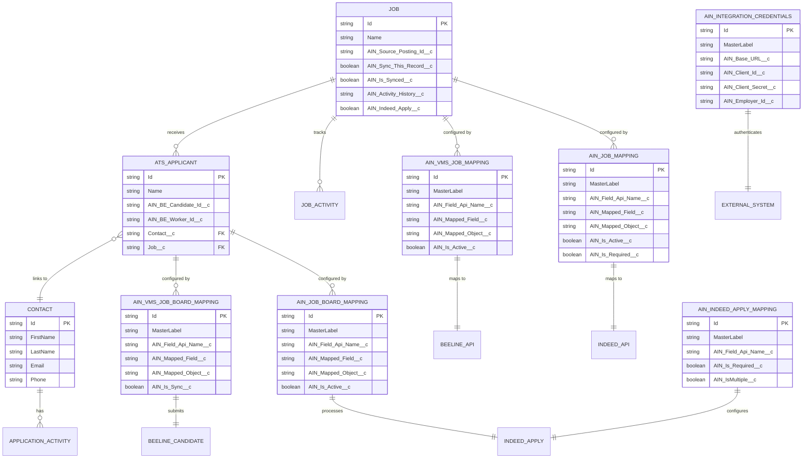

# Entity Relationship Diagram - AIN Integration Objects

## Overview

This ERD illustrates the relationships between integration objects, metadata configurations, and Salesforce standard/custom objects within the AIN package.

## Entity Relationship Diagram



## Relationship Descriptions

### Core Object Relationships

1. **Job__c ↔ ATS_Applicant__c**
   - Relationship: One-to-Many
   - Description: A job can receive multiple applications
   - Integration Impact: Applications are linked to source job postings

2. **ATS_Applicant__c ↔ Contact**
   - Relationship: Many-to-One
   - Description: Multiple applications can be from the same contact
   - Integration Impact: Deduplication based on contact matching

### Metadata Configuration Relationships

3. **Job__c ↔ AIN_Job_Mapping__mdt**
   - Relationship: Configured By (One-to-Many)
   - Description: Job fields are mapped to Indeed API fields
   - Record Count: 61 active mappings

4. **Job__c ↔ AIN_Vms_Job_Mapping__mdt**
   - Relationship: Configured By (One-to-Many)
   - Description: Job fields are mapped to Beeline VMS fields
   - Record Count: 50 active mappings

5. **ATS_Applicant__c ↔ AIN_Job_Board_Mapping__mdt**
   - Relationship: Configured By (One-to-Many)
   - Description: Application data mapped from job boards
   - Record Count: 28 active mappings

6. **ATS_Applicant__c ↔ AIN_Vms_Job_Board_Mapping__mdt**
   - Relationship: Configured By (One-to-Many)
   - Description: Candidate submission mapping for VMS
   - Record Count: 42 active mappings

### External System Relationships

7. **AIN_Integration_Credentials__mdt ↔ External Systems**
   - Relationship: Authenticates (One-to-One)
   - Systems: Beeline, Indeed, Indeed Apply
   - Description: Each external system has dedicated credentials

## Data Flow Patterns

### Outbound Job Publishing
```
Job__c → AIN_Job_Mapping__mdt → Indeed API
Job__c → AIN_Vms_Job_Mapping__mdt → Beeline API
```

### Inbound Application Processing
```
Indeed Apply → AIN_Job_Board_Mapping__mdt → Contact + ATS_Applicant__c
Job Board → AIN_Job_Board_Mapping__mdt → Contact + ATS_Applicant__c
```

### Candidate Submission to VMS
```
ATS_Applicant__c → AIN_Vms_Job_Board_Mapping__mdt → Beeline Candidate API
```

## Integration Control Fields

### On Job__c
- **AIN_Source_Posting_Id__c**: Stores external system job ID
- **AIN_Sync_This_Record__c**: Controls whether job should sync
- **AIN_Is_Synced__c**: Current synchronization status
- **AIN_Activity_History__c**: JSON log of integration activities
- **AIN_Indeed_Apply__c**: Indeed Apply enablement flag

### On ATS_Applicant__c
- **AIN_BE_Candidate_Id__c**: Beeline candidate identifier
- **AIN_BE_Worker_Id__c**: Beeline worker identifier for placed candidates

## Metadata Type Summary

| Metadata Type | Record Count | Purpose |
|---|---|---|
| AIN_Integration_Credentials__mdt | 3 | Store system credentials |
| AIN_Job_Mapping__mdt | 61 | Indeed job field mappings |
| AIN_Job_Board_Mapping__mdt | 28 | Application field mappings |
| AIN_Indeed_Apply_Mapping__mdt | 6 | Indeed Apply configuration |
| AIN_Vms_Job_Mapping__mdt | 50 | Beeline job field mappings |
| AIN_Vms_Job_Board_Mapping__mdt | 42 | Candidate submission mappings |
| **Total** | **190** | Complete integration configuration |

## Key Integration Points

### 1. Job Publishing
- Triggered by Job__c record changes
- Uses metadata mappings for field transformation
- Updates external IDs upon successful publishing

### 2. Application Receipt
- REST endpoint receives applications
- Creates/updates Contact records
- Creates ATS_Applicant__c records
- Maintains relationship to source Job__c

### 3. VMS Integration
- Bidirectional sync for jobs and candidates
- Worker ID tracking for placements
- Status updates from VMS system

### 4. Activity Tracking
- All integration events logged
- JSON-based activity history
- Error tracking and retry logic

## Security & Access Control

### Permission Sets
1. **AIN_Admin**: Full access to all integration objects
2. **AIN_Beeline_Admin**: VMS-specific access
3. **AIN_IN_Integration_Guest_User**: API endpoint access

### Field-Level Security
- Encrypted fields for credentials
- Read-only external IDs
- Restricted access to activity logs

## Best Practices

1. **Data Integrity**
   - Always populate external IDs
   - Maintain bidirectional references
   - Use upsert operations for idempotency

2. **Performance**
   - Index external ID fields
   - Bulk process where possible
   - Cache metadata configurations

3. **Error Handling**
   - Log all integration attempts
   - Implement retry mechanisms
   - Alert on repeated failures