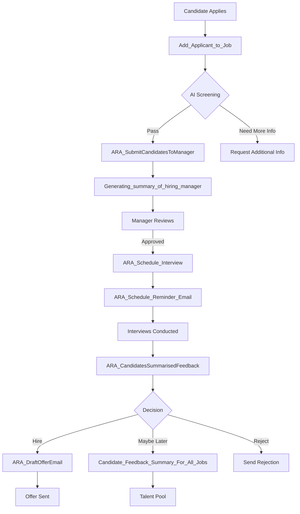

# ARA GenAI Functions Documentation

## Overview

The ARA (Asymbl Recruiting Agent) package leverages 8 sophisticated GenAI Functions to provide intelligent automation throughout the recruiting lifecycle. These functions work together to create a seamless, AI-powered recruiting workflow that enhances both recruiter productivity and candidate experience.

## Table of Contents

1. [ARA_SubmitCandidatesToManager](#1-ara_submitcandidatestomanager)
2. [Add_Applicant_to_Job](#2-add_applicant_to_job)
3. [ARA_Schedule_Interview](#3-ara_schedule_interview)
4. [ARA_Schedule_Reminder_Email](#4-ara_schedule_reminder_email)
5. [ARA_CandidatesSummarisedFeedback](#5-ara_candidatessummarisedfeedback)
6. [ARA_DraftOfferEmail](#6-ara_draftofferemail)
7. [Candidate_Feedback_Summary_For_All_Jobs](#7-candidate_feedback_summary_for_all_jobs)
8. [Generating_summary_of_hiring_manager](#8-generating_summary_of_hiring_manager)
9. [Intelligent Recruiting Workflow](#intelligent-recruiting-workflow)
10. [Best Practices](#best-practices)

---

## 1. ARA_SubmitCandidatesToManager

### Purpose and Business Use Case
This function intelligently formats and submits candidate profiles to hiring managers for review. It ensures that candidate information is presented in a consistent, professional manner that highlights the most relevant qualifications for the specific role.

### Input Parameters (JSON Schema)
```json
{
  "type": "object",
  "properties": {
    "jobId": {
      "type": "string",
      "description": "Salesforce ID of the job requisition"
    },
    "candidateIds": {
      "type": "array",
      "items": {
        "type": "string"
      },
      "description": "Array of candidate record IDs to submit"
    },
    "hiringManagerId": {
      "type": "string",
      "description": "Salesforce ID of the hiring manager"
    },
    "submissionNotes": {
      "type": "string",
      "description": "Additional notes from recruiter about the submission"
    },
    "urgencyLevel": {
      "type": "string",
      "enum": ["high", "medium", "low"],
      "description": "Priority level of the submission"
    }
  },
  "required": ["jobId", "candidateIds", "hiringManagerId"]
}
```

### Output Format
```json
{
  "success": true,
  "submissionId": "SUB-2024-001",
  "candidatesSubmitted": 3,
  "emailSent": true,
  "formattedContent": "HTML formatted submission content",
  "errors": []
}
```

### Associated Apex Classes
- **Main Class**: `ARA_SubmitCandidatesToManager`
- **Helper Class**: `ARA_SubmitCandidatesToManagerHelper`
- **Test Class**: `ARA_SubmitCandidatesToManagerTest`

### Integration with Prompt Templates
- **Email Template**: `ARA/Submit_Candidate_To_Hiring_Manager`
- Uses AI to generate personalized submission summaries
- Highlights key matching qualifications
- Formats candidate comparison tables

### Example Usage Scenarios
```apex
// Submit multiple candidates for a software engineer position
Map<String, Object> params = new Map<String, Object>{
    'jobId' => 'a0X1234567890ABC',
    'candidateIds' => new List<String>{'003XX000004TMM2', '003XX000004TMM3'},
    'hiringManagerId' => '005XX000001Svmx',
    'submissionNotes' => 'Both candidates have strong Java experience',
    'urgencyLevel' => 'high'
};

ARA_SubmitCandidatesToManager.submitCandidates(params);
```

### Error Handling
- **ARA_Empty_Applicants**: Thrown when candidateIds array is empty
- **ARA_Job_Not_Found**: Thrown when jobId doesn't exist
- **ARA_Error_While_Sending_Email**: Email delivery failure
- All errors are logged and return user-friendly messages via custom labels

---

## 2. Add_Applicant_to_Job

### Purpose and Business Use Case
Automates the process of adding candidates to job openings, including initial screening, stage assignment, and notification generation. This function uses AI to determine the most appropriate initial stage based on candidate qualifications.

### Input Parameters (JSON Schema)
```json
{
  "type": "object",
  "properties": {
    "contactId": {
      "type": "string",
      "description": "Salesforce Contact ID of the applicant"
    },
    "jobId": {
      "type": "string",
      "description": "Salesforce ID of the job opening"
    },
    "source": {
      "type": "string",
      "enum": ["website", "referral", "job_board", "direct", "agency"],
      "description": "Application source"
    },
    "resumeId": {
      "type": "string",
      "description": "ContentDocument ID of the resume"
    },
    "coverLetterId": {
      "type": "string",
      "description": "ContentDocument ID of the cover letter (optional)"
    },
    "autoScreen": {
      "type": "boolean",
      "default": true,
      "description": "Whether to perform AI screening"
    }
  },
  "required": ["contactId", "jobId", "source"]
}
```

### Output Format
```json
{
  "success": true,
  "applicationId": "APP-2024-001",
  "assignedStage": "Phone Screen",
  "screeningScore": 85,
  "matchedSkills": ["Java", "Spring Boot", "Microservices"],
  "nextSteps": ["Schedule phone screen within 48 hours"],
  "errors": []
}
```

### Associated Apex Classes
- **Main Class**: `CP_AddApplicantToJob`
- **Test Class**: `CP_AddApplicantToJobTest`
- Uses `CP_Constants` for status values

### Integration with Prompt Templates
- AI analyzes job requirements against candidate profile
- Automatically assigns appropriate recruiting stage
- Generates initial screening notes

### Example Usage Scenarios
```apex
// Add a referred candidate to a position
Map<String, Object> params = new Map<String, Object>{
    'contactId' => '003XX000004TMM2',
    'jobId' => 'a0X1234567890ABC',
    'source' => 'referral',
    'resumeId' => '069XX0000001ABC',
    'autoScreen' => true
};

CP_AddApplicantToJob.addApplicant(params);
```

### Error Handling
- **CP_Contact_Records_Not_Found_Label**: Invalid contactId
- **CP_Job_Records_Not_Found_Label**: Invalid jobId
- **CP_Job_Doesnt_Has_Stage_Label**: Job missing stage configuration
- **CP_Error_Occured_Label**: General processing error

---

## 3. ARA_Schedule_Interview

### Purpose and Business Use Case
Intelligently schedules interviews by analyzing interviewer availability, candidate preferences, and optimal timing. The AI considers multiple factors including time zones, interview type, and historical scheduling patterns.

### Input Parameters (JSON Schema)
```json
{
  "type": "object",
  "properties": {
    "candidateId": {
      "type": "string",
      "description": "Salesforce ID of the candidate"
    },
    "interviewerIds": {
      "type": "array",
      "items": {
        "type": "string"
      },
      "description": "Array of interviewer user IDs"
    },
    "interviewType": {
      "type": "string",
      "enum": ["phone", "video", "onsite", "panel"],
      "description": "Type of interview"
    },
    "duration": {
      "type": "integer",
      "description": "Interview duration in minutes"
    },
    "preferredDates": {
      "type": "array",
      "items": {
        "type": "string",
        "format": "date"
      },
      "description": "Candidate's preferred dates"
    },
    "timeZone": {
      "type": "string",
      "description": "Candidate's time zone"
    },
    "location": {
      "type": "string",
      "description": "Interview location (for onsite)"
    }
  },
  "required": ["candidateId", "interviewerIds", "interviewType", "duration"]
}
```

### Output Format
```json
{
  "success": true,
  "interviewId": "INT-2024-001",
  "scheduledDateTime": "2024-02-15T14:00:00Z",
  "meetingLink": "https://zoom.us/j/123456789",
  "calendarInvitesSent": true,
  "conflictsResolved": 2,
  "alternativeSlots": [
    "2024-02-15T15:00:00Z",
    "2024-02-16T14:00:00Z"
  ],
  "errors": []
}
```

### Associated Apex Classes
- **Main Class**: `ARA_ScheduleInterview`
- **Helper Class**: `ARA_ScheduleInterviewHelper`
- **Test Class**: `ARA_ScheduleInterviewTest`

### Integration with Prompt Templates
- AI optimizes scheduling based on:
  - Historical interview success rates at different times
  - Interviewer preferences and energy levels
  - Candidate availability patterns
  - Time zone considerations

### Example Usage Scenarios
```apex
// Schedule a panel interview with multiple interviewers
Map<String, Object> params = new Map<String, Object>{
    'candidateId' => '003XX000004TMM2',
    'interviewerIds' => new List<String>{'005XX001', '005XX002', '005XX003'},
    'interviewType' => 'panel',
    'duration' => 90,
    'preferredDates' => new List<String>{'2024-02-15', '2024-02-16'},
    'timeZone' => 'America/New_York'
};

ARA_ScheduleInterview.schedule(params);
```

### Error Handling
- **ARA_Invalid_Date_Time**: Invalid date/time format
- **ARA_Empty_List_of_Interviewers**: No interviewers specified
- **ARA_Error_Interview_Scheduling_Label**: Scheduling conflict
- **ARA_Candidate_Not_Found**: Invalid candidateId

---

## 4. ARA_Schedule_Reminder_Email

### Purpose and Business Use Case
Automatically schedules and sends reminder emails for interviews, follow-ups, and other recruiting activities. Uses AI to determine optimal reminder timing based on activity type and urgency.

### Input Parameters (JSON Schema)
```json
{
  "type": "object",
  "properties": {
    "recipientId": {
      "type": "string",
      "description": "Salesforce ID of the recipient"
    },
    "reminderType": {
      "type": "string",
      "enum": ["interview", "follow_up", "document_submission", "offer_expiry"],
      "description": "Type of reminder"
    },
    "eventDateTime": {
      "type": "string",
      "format": "date-time",
      "description": "Date/time of the event to remind about"
    },
    "reminderOffset": {
      "type": "integer",
      "description": "Hours before event to send reminder"
    },
    "customMessage": {
      "type": "string",
      "description": "Custom message to include in reminder"
    },
    "includeCalendarInvite": {
      "type": "boolean",
      "default": false,
      "description": "Whether to include calendar invite"
    }
  },
  "required": ["recipientId", "reminderType", "eventDateTime"]
}
```

### Output Format
```json
{
  "success": true,
  "reminderId": "REM-2024-001",
  "scheduledSendTime": "2024-02-14T10:00:00Z",
  "emailTemplateUsed": "ARA_Reminder_Email_Template",
  "recipientEmail": "candidate@example.com",
  "errors": []
}
```

### Associated Apex Classes
- **Main Class**: `ARA_ScheduleReminderEmail`
- **Test Class**: `ARA_ScheduleReminderEmailTest`
- **Utility Class**: `ARA_EmailUtility`
- **Batch Class**: `ARA_ScheduledEmailSender`

### Integration with Prompt Templates
- **Email Template**: `ARA/ARA_Reminder_Email_Template`
- AI determines optimal reminder timing based on:
  - Event type and importance
  - Recipient's historical response patterns
  - Day of week and time considerations

### Example Usage Scenarios
```apex
// Schedule interview reminder 24 hours before
Map<String, Object> params = new Map<String, Object>{
    'recipientId' => '003XX000004TMM2',
    'reminderType' => 'interview',
    'eventDateTime' => '2024-02-15T14:00:00Z',
    'reminderOffset' => 24,
    'customMessage' => 'Please bring two copies of your resume',
    'includeCalendarInvite' => true
};

ARA_ScheduleReminderEmail.scheduleReminder(params);
```

### Error Handling
- **ARA_Email_Not_Found**: Recipient has no email address
- **ARA_Email_Template_Not_Found**: Template missing
- **ARA_Invalid_Date_Time**: Invalid date format
- **ARA_Error_While_Sending_Email**: Email service failure

---

## 5. ARA_CandidatesSummarisedFeedback

### Purpose and Business Use Case
Aggregates and summarizes interview feedback from multiple interviewers using AI to identify patterns, strengths, concerns, and provide hiring recommendations. This function ensures objective, comprehensive feedback analysis.

### Input Parameters (JSON Schema)
```json
{
  "type": "object",
  "properties": {
    "candidateId": {
      "type": "string",
      "description": "Salesforce ID of the candidate"
    },
    "jobId": {
      "type": "string",
      "description": "Salesforce ID of the job"
    },
    "interviewIds": {
      "type": "array",
      "items": {
        "type": "string"
      },
      "description": "Array of interview record IDs to summarize"
    },
    "includeScoring": {
      "type": "boolean",
      "default": true,
      "description": "Whether to include numerical scoring analysis"
    },
    "generateRecommendation": {
      "type": "boolean",
      "default": true,
      "description": "Whether to generate hiring recommendation"
    }
  },
  "required": ["candidateId", "jobId"]
}
```

### Output Format
```json
{
  "success": true,
  "summaryId": "SUMM-2024-001",
  "overallScore": 4.2,
  "strengths": [
    "Strong technical skills in Java and Python",
    "Excellent communication during panel interview",
    "Good cultural fit based on team feedback"
  ],
  "concerns": [
    "Limited experience with cloud technologies",
    "Salary expectations above range"
  ],
  "recommendation": "PROCEED_WITH_OFFER",
  "nextSteps": "Proceed with reference checks and offer preparation",
  "interviewerConsensus": {
    "unanimous": false,
    "positiveCount": 3,
    "negativeCount": 1
  },
  "errors": []
}
```

### Associated Apex Classes
- **Main Class**: `ARA_CandidatesSummarisedFeedback`
- **Test Class**: `ARA_CandidatesSummarisedFeedbackTest`

### Integration with Prompt Templates
- **GenAI Prompt**: `Candidate_Feedback_Summary_For_All_Jobs`
- AI analyzes feedback to:
  - Identify recurring themes across interviews
  - Weight feedback based on interviewer expertise
  - Generate balanced, objective summaries
  - Provide data-driven recommendations

### Example Usage Scenarios
```apex
// Summarize feedback after final round interviews
Map<String, Object> params = new Map<String, Object>{
    'candidateId' => '003XX000004TMM2',
    'jobId' => 'a0X1234567890ABC',
    'interviewIds' => new List<String>{'INT-001', 'INT-002', 'INT-003'},
    'includeScoring' => true,
    'generateRecommendation' => true
};

ARA_CandidatesSummarisedFeedback.generateSummary(params);
```

### Error Handling
- **ARA_Feedback_Not_Shared**: No feedback available
- **ARA_Candidate_Not_On_Job**: Candidate not associated with job
- **ARA_Job_Not_Found**: Invalid jobId
- **ARA_Error_Occurred**: General processing error

---

## 6. ARA_DraftOfferEmail

### Purpose and Business Use Case
Generates personalized offer letters using AI that considers candidate profile, negotiation history, market rates, and company standards. Ensures consistent, compelling offer communications while maintaining flexibility for customization.

### Input Parameters (JSON Schema)
```json
{
  "type": "object",
  "properties": {
    "candidateId": {
      "type": "string",
      "description": "Salesforce ID of the candidate"
    },
    "jobId": {
      "type": "string",
      "description": "Salesforce ID of the job"
    },
    "offerDetails": {
      "type": "object",
      "properties": {
        "baseSalary": {
          "type": "number",
          "description": "Annual base salary"
        },
        "bonus": {
          "type": "number",
          "description": "Bonus amount or percentage"
        },
        "equity": {
          "type": "string",
          "description": "Equity package details"
        },
        "startDate": {
          "type": "string",
          "format": "date",
          "description": "Proposed start date"
        },
        "benefits": {
          "type": "array",
          "items": {
            "type": "string"
          },
          "description": "List of benefits to highlight"
        }
      }
    },
    "personalizedElements": {
      "type": "array",
      "items": {
        "type": "string"
      },
      "description": "Elements to personalize (e.g., 'career_growth', 'work_life_balance')"
    },
    "expiryDate": {
      "type": "string",
      "format": "date",
      "description": "Offer expiration date"
    }
  },
  "required": ["candidateId", "jobId", "offerDetails"]
}
```

### Output Format
```json
{
  "success": true,
  "offerId": "OFF-2024-001",
  "draftContent": "HTML formatted offer letter",
  "personalizedSections": [
    "Career growth paragraph tailored to candidate's goals",
    "Team culture section based on candidate's preferences"
  ],
  "complianceChecks": {
    "salaryWithinRange": true,
    "benefitsStandard": true,
    "legalReviewRequired": false
  },
  "emailScheduled": true,
  "errors": []
}
```

### Associated Apex Classes
- **Main Class**: `ARA_DraftOfferEmail`
- **Helper Class**: `ARA_DraftOfferEmailHelper`
- **Test Class**: `ARA_DraftOfferEmailTest`

### Integration with Prompt Templates
- **Email Template**: `ARA/ARA_Offer_Draft_Template`
- AI personalizes offers based on:
  - Candidate's expressed priorities during interviews
  - Market compensation data
  - Company culture and values alignment
  - Negotiation history and expectations

### Example Usage Scenarios
```apex
// Generate personalized offer for senior developer
Map<String, Object> params = new Map<String, Object>{
    'candidateId' => '003XX000004TMM2',
    'jobId' => 'a0X1234567890ABC',
    'offerDetails' => new Map<String, Object>{
        'baseSalary' => 150000,
        'bonus' => 20000,
        'equity' => '5000 RSUs over 4 years',
        'startDate' => '2024-03-01',
        'benefits' => new List<String>{'Health', 'Dental', '401k', 'Remote Work'}
    },
    'personalizedElements' => new List<String>{'career_growth', 'technical_challenges'},
    'expiryDate' => '2024-02-28'
};

ARA_DraftOfferEmail.generateOffer(params);
```

### Error Handling
- **ARA_Candidate_Not_Found**: Invalid candidateId
- **ARA_Job_Not_Found**: Invalid jobId
- **ARA_Email_Template_Not_Found**: Offer template missing
- **ARA_Error_While_Sending_Email**: Email delivery failure

---

## 7. Candidate_Feedback_Summary_For_All_Jobs

### Purpose and Business Use Case
Provides comprehensive feedback analysis across all jobs a candidate has applied for within the organization. This function helps identify patterns in candidate performance and provides insights for future opportunities.

### Input Parameters (JSON Schema)
```json
{
  "type": "object",
  "properties": {
    "candidateId": {
      "type": "string",
      "description": "Salesforce ID of the candidate"
    },
    "timeframe": {
      "type": "string",
      "enum": ["30days", "90days", "1year", "all"],
      "default": "1year",
      "description": "Timeframe for feedback analysis"
    },
    "includeRejected": {
      "type": "boolean",
      "default": true,
      "description": "Include feedback from rejected applications"
    },
    "jobCategories": {
      "type": "array",
      "items": {
        "type": "string"
      },
      "description": "Filter by job categories"
    }
  },
  "required": ["candidateId"]
}
```

### Output Format
```json
{
  "success": true,
  "candidateId": "003XX000004TMM2",
  "totalApplications": 4,
  "summaryReport": {
    "strongestSkills": ["Java", "Leadership", "Problem Solving"],
    "improvementAreas": ["Cloud Architecture", "System Design"],
    "consistentFeedback": [
      "Excellent communication skills noted in 3 of 4 interviews",
      "Technical depth praised by all technical interviewers"
    ],
    "performanceTrend": "improving",
    "bestFitRoles": ["Senior Developer", "Tech Lead"],
    "overallScore": 4.1
  },
  "jobSpecificSummaries": [
    {
      "jobId": "a0X123",
      "jobTitle": "Senior Software Engineer",
      "applicationDate": "2024-01-15",
      "outcome": "offered",
      "keyFeedback": "Strong technical skills, good culture fit"
    }
  ],
  "recommendations": [
    "Consider for senior technical roles",
    "Would benefit from cloud certification"
  ],
  "errors": []
}
```

### Associated Apex Classes
- Utilizes `ARA_CandidatesSummarisedFeedback` as base
- Extends functionality for cross-job analysis

### Integration with Prompt Templates
- **GenAI Prompt**: Extended version of feedback summary prompt
- AI performs:
  - Cross-job pattern recognition
  - Skill progression analysis
  - Cultural fit assessment across teams
  - Career trajectory recommendations

### Example Usage Scenarios
```apex
// Analyze candidate's performance across all applications
Map<String, Object> params = new Map<String, Object>{
    'candidateId' => '003XX000004TMM2',
    'timeframe' => '1year',
    'includeRejected' => true,
    'jobCategories' => new List<String>{'Engineering', 'Technical Lead'}
};

CandidateFeedbackSummaryForAllJobs.generateComprehensiveReport(params);
```

### Error Handling
- **ARA_Candidate_Not_Found**: Invalid candidateId
- **No_Applications_Found**: Candidate has no applications
- **Insufficient_Data**: Not enough feedback for analysis

---

## 8. Generating_summary_of_hiring_manager

### Purpose and Business Use Case
Creates intelligent summaries of hiring manager preferences, interview styles, team dynamics, and historical hiring patterns. This helps recruiters better prepare candidates and improve job matching.

### Input Parameters (JSON Schema)
```json
{
  "type": "object",
  "properties": {
    "hiringManagerId": {
      "type": "string",
      "description": "Salesforce User ID of the hiring manager"
    },
    "includeTeamInfo": {
      "type": "boolean",
      "default": true,
      "description": "Include team composition and dynamics"
    },
    "includeHistoricalData": {
      "type": "boolean",
      "default": true,
      "description": "Include historical hiring patterns"
    },
    "timeframe": {
      "type": "string",
      "enum": ["6months", "1year", "2years", "all"],
      "default": "1year",
      "description": "Timeframe for historical analysis"
    }
  },
  "required": ["hiringManagerId"]
}
```

### Output Format
```json
{
  "success": true,
  "hiringManagerId": "005XX000001Svmx",
  "summary": {
    "name": "John Smith",
    "title": "VP of Engineering",
    "department": "Engineering",
    "managementStyle": "Collaborative, data-driven",
    "teamSize": 25,
    "preferences": {
      "technicalSkills": ["Java", "AWS", "Microservices"],
      "softSkills": ["Leadership", "Communication", "Innovation"],
      "experience": "8-12 years preferred",
      "education": "BS required, MS preferred"
    },
    "interviewStyle": {
      "approach": "Technical deep-dive with behavioral questions",
      "duration": "Usually 60-90 minutes",
      "focusAreas": ["System design", "Problem solving", "Team collaboration"]
    },
    "historicalInsights": {
      "totalHires": 12,
      "averageTimeToHire": "45 days",
      "retentionRate": "91%",
      "commonRejectionReasons": ["Lack of hands-on experience", "Poor culture fit"],
      "successfulCandidateTraits": ["Self-motivated", "Strong technical foundation"]
    },
    "teamDynamics": {
      "culture": "Fast-paced, innovative, collaborative",
      "workStyle": "Agile, remote-friendly",
      "growthOpportunities": "Clear career progression, mentorship program"
    }
  },
  "recommendations": [
    "Prepare candidates for technical deep-dive questions",
    "Emphasize collaborative experience in candidate presentations",
    "Screen for self-motivation and innovation mindset"
  ],
  "errors": []
}
```

### Associated Apex Classes
- **Main Class**: `ARA_GetHiringManagerInfo`
- **Helper Class**: `ARA_HiringManagerInfoHelper`
- **Test Class**: `ARA_GetHiringManagerInfoTest`

### Integration with Prompt Templates
- AI analyzes:
  - Historical hiring decisions and patterns
  - Feedback patterns in interviews
  - Team composition and success factors
  - Communication style and preferences

### Example Usage Scenarios
```apex
// Generate comprehensive hiring manager profile
Map<String, Object> params = new Map<String, Object>{
    'hiringManagerId' => '005XX000001Svmx',
    'includeTeamInfo' => true,
    'includeHistoricalData' => true,
    'timeframe' => '1year'
};

ARA_GetHiringManagerInfo.generateSummary(params);
```

### Error Handling
- **Invalid_Hiring_Manager_Id**: User ID not found or not a hiring manager
- **Insufficient_Data**: Not enough historical data for analysis
- **ARA_Error_Occurred**: General processing error

---

## Intelligent Recruiting Workflow

### How These Functions Work Together

The 8 GenAI functions create a seamless, intelligent recruiting workflow:



### Workflow Integration Points

1. **Application Stage**
   - `Add_Applicant_to_Job` processes new applications
   - AI screens and assigns appropriate stage
   - Qualified candidates move to submission

2. **Submission Stage**
   - `Generating_summary_of_hiring_manager` provides context
   - `ARA_SubmitCandidatesToManager` formats and sends profiles
   - Managers receive AI-curated candidate information

3. **Interview Stage**
   - `ARA_Schedule_Interview` coordinates scheduling
   - `ARA_Schedule_Reminder_Email` ensures attendance
   - Multiple rounds handled seamlessly

4. **Feedback Stage**
   - `ARA_CandidatesSummarisedFeedback` aggregates all feedback
   - AI provides objective analysis and recommendations
   - Historical data enriches decision-making

5. **Offer Stage**
   - `ARA_DraftOfferEmail` creates personalized offers
   - AI ensures competitive and compelling packages
   - Automated follow-up and expiry handling

6. **Continuous Improvement**
   - `Candidate_Feedback_Summary_For_All_Jobs` tracks patterns
   - Insights improve future matching and screening
   - Talent pool maintained for future opportunities

---

## Best Practices

### 1. Configuration Best Practices

#### Initial Setup
```apex
// Configure AI functions with appropriate permissions
PermissionSet ps = [SELECT Id FROM PermissionSet WHERE Name = 'Asymbl_Recruiting_Agent_Admin'];
// Assign to appropriate users

// Set up email templates
EmailTemplate submitTemplate = new EmailTemplate(
    FolderName = 'ARA',
    DeveloperName = 'Submit_Candidate_To_Hiring_Manager',
    // ... template configuration
);
```

#### Custom Settings
```apex
// Configure AI behavior thresholds
ARA_Settings__c settings = ARA_Settings__c.getOrgDefaults();
settings.AI_Screening_Threshold__c = 75; // Minimum score to pass screening
settings.Auto_Schedule_Interviews__c = true;
settings.Reminder_Default_Hours__c = 24;
upsert settings;
```

### 2. Error Handling Best Practices

#### Comprehensive Try-Catch
```apex
public static Map<String, Object> processCandidate(Map<String, Object> params) {
    Map<String, Object> response = new Map<String, Object>();
    
    try {
        // Validate inputs
        validateRequiredParams(params);
        
        // Process with AI
        response = callGenAIFunction(params);
        
        // Handle response
        if (response.get('success') == false) {
            logError('AI Function Failed', response);
            // Fallback logic
        }
        
    } catch (RequiredParameterException e) {
        response.put('success', false);
        response.put('error', Label.get('ARA_Invalid_Parameters'));
        logError('Parameter Validation Failed', e);
        
    } catch (Exception e) {
        response.put('success', false);
        response.put('error', Label.get('ARA_Error_Occurred'));
        logError('Unexpected Error', e);
    }
    
    return response;
}
```

#### Graceful Degradation
```apex
// If AI fails, fall back to manual process
if (!aiResponse.success) {
    // Create task for manual review
    Task t = new Task(
        Subject = 'Manual Review Required - AI Processing Failed',
        Description = 'AI function failed for: ' + candidateName,
        OwnerId = recruiterUserId,
        ActivityDate = Date.today()
    );
    insert t;
}
```

### 3. Performance Optimization

#### Bulkification
```apex
// Process multiple candidates efficiently
public static List<Map<String, Object>> bulkProcessCandidates(List<String> candidateIds) {
    // Gather all data in single queries
    Map<Id, Contact> candidates = new Map<Id, Contact>([
        SELECT Id, Name, Email, Resume__c 
        FROM Contact 
        WHERE Id IN :candidateIds
    ]);
    
    // Process in batches for AI
    List<Map<String, Object>> results = new List<Map<String, Object>>();
    for (List<Id> batch : getBatches(candidateIds, 10)) {
        results.addAll(processAIBatch(batch, candidates));
    }
    
    return results;
}
```

#### Asynchronous Processing
```apex
// Use Queueable for heavy AI processing
public class ARA_AsyncAIProcessor implements Queueable {
    private List<String> candidateIds;
    
    public void execute(QueueableContext context) {
        // Process candidates with AI
        for (String candidateId : candidateIds) {
            // AI processing
            processWithRetry(candidateId, 3);
        }
    }
}
```

### 4. Security Best Practices

#### Data Access Controls
```apex
// Always check field and object permissions
public static Boolean canAccessCandidateData() {
    return Schema.sObjectType.Contact.isAccessible() &&
           Schema.sObjectType.Contact.fields.Email.isAccessible() &&
           Schema.sObjectType.Contact.fields.Resume__c.isAccessible();
}

// Use with sharing for proper data isolation
public with sharing class ARA_CandidateProcessor {
    // Implementation
}
```

#### Sensitive Data Handling
```apex
// Mask sensitive data in logs
private static String maskSensitiveData(String data) {
    // Mask SSN, phone numbers, etc.
    return data.replaceAll('\\d{3}-\\d{2}-\\d{4}', 'XXX-XX-XXXX');
}
```

### 5. Testing Best Practices

#### Mock AI Responses
```apex
@isTest
private class ARA_TestDataFactory {
    public static Map<String, Object> getMockAIResponse(String functionName) {
        Map<String, Object> mockResponse = new Map<String, Object>{
            'success' => true,
            'functionName' => functionName
        };
        
        // Add function-specific mock data
        switch on functionName {
            when 'ARA_Schedule_Interview' {
                mockResponse.put('scheduledDateTime', '2024-02-15T14:00:00Z');
                mockResponse.put('meetingLink', 'https://test.zoom.us/123');
            }
            // Add other functions
        }
        
        return mockResponse;
    }
}
```

#### Comprehensive Test Coverage
```apex
@isTest
static void testCandidateSubmission() {
    // Setup test data
    Test.startTest();
    
    // Test successful submission
    Map<String, Object> successResult = ARA_SubmitCandidatesToManager.submit(validParams);
    System.assertEquals(true, successResult.get('success'));
    
    // Test error handling
    Map<String, Object> errorResult = ARA_SubmitCandidatesToManager.submit(invalidParams);
    System.assertEquals(false, errorResult.get('success'));
    
    // Test bulk operations
    List<Map<String, Object>> bulkResults = ARA_SubmitCandidatesToManager.bulkSubmit(candidateList);
    System.assertEquals(candidateList.size(), bulkResults.size());
    
    Test.stopTest();
}
```

### 6. Monitoring and Analytics

#### AI Performance Tracking
```apex
// Track AI function performance
public static void logAIMetrics(String functionName, Long executionTime, Boolean success) {
    AI_Metrics__c metric = new AI_Metrics__c(
        Function_Name__c = functionName,
        Execution_Time_ms__c = executionTime,
        Success__c = success,
        Timestamp__c = DateTime.now()
    );
    insert metric;
}
```

#### Usage Analytics
```apex
// Dashboard metrics for AI usage
public static Map<String, Object> getAIUsageStats() {
    return new Map<String, Object>{
        'totalAICalls' => [SELECT COUNT() FROM AI_Metrics__c WHERE CreatedDate = LAST_N_DAYS:30],
        'successRate' => [SELECT AVG(Success__c) FROM AI_Metrics__c WHERE CreatedDate = LAST_N_DAYS:30],
        'avgExecutionTime' => [SELECT AVG(Execution_Time_ms__c) FROM AI_Metrics__c WHERE CreatedDate = LAST_N_DAYS:30]
    };
}
```

---

## Conclusion

The ARA GenAI Functions represent a comprehensive, intelligent approach to recruiting automation. By leveraging these 8 AI-powered functions, organizations can:

1. **Reduce Time-to-Hire**: Automated screening and scheduling accelerate the recruiting process
2. **Improve Quality of Hire**: AI-driven insights lead to better candidate-job matching
3. **Enhance Candidate Experience**: Personalized communications and timely responses
4. **Increase Recruiter Productivity**: Automation of repetitive tasks allows focus on strategic activities
5. **Make Data-Driven Decisions**: AI analysis provides objective insights for better hiring decisions

The modular architecture allows organizations to adopt these functions incrementally, starting with their most pressing needs and expanding usage as they see value. With proper configuration, security measures, and monitoring in place, these GenAI functions can transform the recruiting process into a competitive advantage.

For additional support and updates, refer to the main ARA documentation and stay current with Salesforce Agentforce developments.