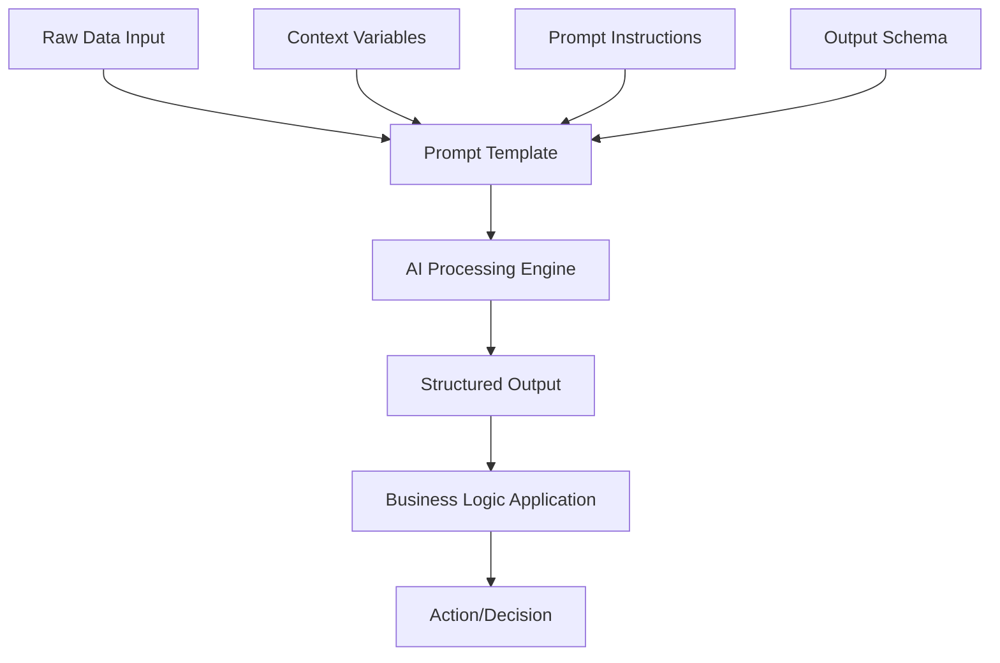

# ARA GenAI Prompt Templates Documentation

## Executive Summary

The ARA (Asymbl Recruiting Agent) package leverages two sophisticated GenAI Prompt Templates that serve as the "brain" behind AI-powered recruiting insights. These templates enable intelligent summarization, pattern recognition, and automated decision-making throughout the recruiting lifecycle. This document provides comprehensive documentation for both prompt templates, including their design, implementation, and best practices.

## Table of Contents

1. [Overview of GenAI Prompt Templates](#overview-of-genai-prompt-templates)
2. [Generating_summary_of_hiring_manager](#generating_summary_of_hiring_manager)
3. [Candidate_Feedback_Summary_For_All_Jobs](#candidate_feedback_summary_for_all_jobs)
4. [Prompt Engineering Best Practices](#prompt-engineering-best-practices)
5. [Integration Architecture](#integration-architecture)
6. [Quality Control and Testing](#quality-control-and-testing)
7. [Customization Guide](#customization-guide)
8. [Performance Optimization](#performance-optimization)
9. [Future Enhancements](#future-enhancements)

---

## Overview of GenAI Prompt Templates

### What are GenAI Prompt Templates?

GenAI Prompt Templates are structured instructions that guide Salesforce's AI models to generate specific, consistent, and high-quality outputs. In the ARA package, these templates transform raw recruiting data into actionable insights, enabling intelligent automation and decision support.

### Key Capabilities Enabled

1. **Intelligent Summarization**: Condensing complex information into digestible insights
2. **Pattern Recognition**: Identifying trends across multiple data points
3. **Insight Generation**: Creating actionable recommendations from analysis
4. **Consistent AI Responses**: Ensuring predictable, high-quality outputs

### Architecture Overview



---

## Generating_summary_of_hiring_manager

### Purpose and AI Objective

This prompt template generates comprehensive profiles of hiring managers by analyzing their historical hiring patterns, team dynamics, preferences, and interview styles. The AI objective is to provide recruiters with deep insights that improve candidate matching and interview preparation.

### Input Data Sources and Variables

#### Primary Data Sources
```json
{
  "hiringManagerProfile": {
    "userId": "string",
    "name": "string",
    "title": "string",
    "department": "string",
    "yearsWithCompany": "number",
    "directReports": "number"
  },
  "historicalData": {
    "totalHires": "number",
    "hiresByRole": "array",
    "averageTimeToHire": "number",
    "retentionRate": "percentage",
    "rejectionReasons": "array",
    "successfulCandidateTraits": "array"
  },
  "teamInformation": {
    "teamSize": "number",
    "teamComposition": "array",
    "teamCulture": "string",
    "workingStyle": "string",
    "recentProjects": "array"
  },
  "interviewHistory": {
    "totalInterviewsConducted": "number",
    "interviewDuration": "object",
    "feedbackPatterns": "array",
    "questionTypes": "array",
    "evaluationCriteria": "array"
  },
  "jobRequirements": {
    "currentOpenings": "array",
    "skillPriorities": "array",
    "experienceRequirements": "object",
    "educationPreferences": "object"
  }
}
```

### Prompt Template Structure

#### System Prompt
```
You are an expert recruiting analyst specializing in creating comprehensive hiring manager profiles. Your goal is to analyze data about hiring managers and generate actionable insights that help recruiters better prepare candidates and improve job matching.

Your analysis should be:
- Data-driven and objective
- Actionable for recruiters
- Respectful and professional
- Based on patterns, not assumptions
- Focused on improving hiring outcomes
```

#### Main Prompt Template
```
Analyze the following hiring manager data and generate a comprehensive profile:

Hiring Manager: {hiringManagerName}
Title: {hiringManagerTitle}
Department: {department}

Historical Hiring Data:
- Total hires in past year: {totalHires}
- Average time to hire: {avgTimeToHire} days
- Retention rate: {retentionRate}%
- Common rejection reasons: {rejectionReasons}

Team Information:
- Current team size: {teamSize}
- Team composition: {teamComposition}
- Recent projects: {recentProjects}

Interview Patterns:
- Interviews conducted: {totalInterviews}
- Average duration: {avgDuration} minutes
- Common question themes: {questionThemes}

Generate a comprehensive summary that includes:
1. Management style and team culture
2. Key priorities when hiring
3. Interview approach and style
4. Ideal candidate profile
5. Red flags that lead to rejection
6. Success factors for new hires
7. Recommendations for recruiters

Format the response as structured JSON for easy parsing.
```

### Expected Output Schema

```json
{
  "managerProfile": {
    "name": "string",
    "title": "string",
    "managementStyle": "string",
    "teamCulture": "string",
    "hiringPhilosophy": "string"
  },
  "hiringPreferences": {
    "topSkills": ["skill1", "skill2", "skill3"],
    "experienceRange": "string",
    "educationImportance": "high|medium|low",
    "culturalFitFactors": ["factor1", "factor2"]
  },
  "interviewStyle": {
    "approach": "string",
    "focusAreas": ["area1", "area2"],
    "typicalDuration": "string",
    "questionTypes": ["technical", "behavioral", "situational"]
  },
  "historicalInsights": {
    "successfulHireTraits": ["trait1", "trait2"],
    "commonRejectionReasons": ["reason1", "reason2"],
    "timeToHireTrend": "improving|stable|declining",
    "retentionAnalysis": "string"
  },
  "recommendations": {
    "forRecruiters": ["recommendation1", "recommendation2"],
    "candidatePreparation": ["tip1", "tip2"],
    "warningFlags": ["flag1", "flag2"]
  },
  "confidenceScore": 0.95,
  "dataQuality": "high|medium|low"
}
```

### Implementation in Salesforce

#### Apex Integration Code
```apex
public class HiringManagerSummaryGenerator {
    
    public static Map<String, Object> generateSummary(Id hiringManagerId) {
        // Gather hiring manager data
        User manager = [SELECT Id, Name, Title, Department FROM User WHERE Id = :hiringManagerId];
        
        // Gather historical hiring data
        List<AggregateResult> hiringStats = [
            SELECT COUNT(Id) totalHires, 
                   AVG(Days_To_Hire__c) avgTimeToHire,
                   AVG(Retention_Months__c) avgRetention
            FROM Hire__c 
            WHERE Hiring_Manager__c = :hiringManagerId
            AND CreatedDate = LAST_N_MONTHS:12
        ];
        
        // Gather interview data
        List<Interview__c> interviews = [
            SELECT Id, Duration__c, Feedback_Summary__c, Question_Types__c
            FROM Interview__c
            WHERE Interviewer__c = :hiringManagerId
            AND CreatedDate = LAST_N_MONTHS:12
        ];
        
        // Build prompt data
        Map<String, Object> promptData = new Map<String, Object>{
            'hiringManagerName' => manager.Name,
            'hiringManagerTitle' => manager.Title,
            'department' => manager.Department,
            'totalHires' => hiringStats[0].get('totalHires'),
            'avgTimeToHire' => hiringStats[0].get('avgTimeToHire'),
            // ... additional data mapping
        };
        
        // Call GenAI function
        return GenAiPrompt.generate('Generating_summary_of_hiring_manager', promptData);
    }
}
```

#### Flow Integration
```yaml
Flow: Generate_Hiring_Manager_Insights
  Trigger: Record Created (Job__c)
  Actions:
    1. Get Hiring Manager ID from Job
    2. Invoke Apex Action: HiringManagerSummaryGenerator.generateSummary
    3. Parse JSON Response
    4. Update Job Record with Insights
    5. Send Summary to Recruiter
```

### Quality Control Mechanisms

1. **Data Validation**
   - Minimum data thresholds (e.g., at least 5 hires for pattern analysis)
   - Recency checks (prioritize recent data)
   - Outlier detection and handling

2. **Output Validation**
   - JSON schema validation
   - Confidence score thresholds
   - Human review triggers for low-confidence results

3. **Bias Detection**
   - Monitor for discriminatory patterns
   - Flag potentially biased criteria
   - Regular audit of recommendations

### Advanced Features

#### Dynamic Context Injection
```apex
// Add industry-specific context
String industryContext = getIndustryContext(manager.Department);
promptData.put('industryContext', industryContext);

// Add seasonal hiring patterns
String seasonalContext = getSeasonalContext(Date.today());
promptData.put('seasonalContext', seasonalContext);
```

#### Comparative Analysis
```apex
// Compare to department averages
Map<String, Object> deptAverages = getDepartmentAverages(manager.Department);
promptData.put('departmentBenchmarks', deptAverages);

// Include peer comparison
List<Map<String, Object>> peerData = getPeerManagerData(manager.Level__c);
promptData.put('peerComparison', peerData);
```

### Error Handling and Fallbacks

```apex
try {
    Map<String, Object> aiSummary = GenAiPrompt.generate(
        'Generating_summary_of_hiring_manager', 
        promptData
    );
    
    if (aiSummary.get('confidenceScore') < 0.7) {
        // Low confidence - flag for human review
        createReviewTask(hiringManagerId, aiSummary);
    }
    
    return aiSummary;
    
} catch (GenAiException e) {
    // Fallback to basic statistical summary
    return generateBasicSummary(hiringManagerId);
    
} catch (Exception e) {
    // Log error and return safe default
    logError('Hiring Manager Summary Generation Failed', e);
    return getDefaultManagerProfile();
}
```

---

## Candidate_Feedback_Summary_For_All_Jobs

### Purpose and AI Objective

This prompt template creates comprehensive feedback summaries by analyzing all interview feedback for a candidate across multiple job applications. The AI objective is to identify patterns, strengths, areas for improvement, and provide actionable insights for both current and future opportunities.

### Input Data Sources and Variables

#### Primary Data Sources
```json
{
  "candidateProfile": {
    "candidateId": "string",
    "name": "string",
    "email": "string",
    "currentTitle": "string",
    "yearsExperience": "number",
    "skills": ["skill1", "skill2", "skill3"]
  },
  "applicationHistory": [
    {
      "jobId": "string",
      "jobTitle": "string",
      "department": "string",
      "applicationDate": "date",
      "status": "string",
      "stage": "string"
    }
  ],
  "interviewFeedback": [
    {
      "interviewId": "string",
      "jobId": "string",
      "interviewerName": "string",
      "interviewDate": "date",
      "interviewType": "string",
      "rating": "number",
      "strengths": ["strength1", "strength2"],
      "concerns": ["concern1", "concern2"],
      "technicalScore": "number",
      "culturalFitScore": "number",
      "communicationScore": "number",
      "recommendation": "string",
      "detailedNotes": "string"
    }
  ],
  "assessmentResults": [
    {
      "assessmentType": "string",
      "score": "number",
      "percentile": "number",
      "completedDate": "date"
    }
  ]
}
```

### Prompt Template Structure

#### System Prompt
```
You are an expert talent analyst specializing in comprehensive candidate evaluation. Your role is to analyze interview feedback across multiple job applications to identify patterns, provide insights, and make recommendations for both current opportunities and career development.

Your analysis should:
- Be objective and data-driven
- Identify consistent patterns across multiple data points
- Provide actionable insights
- Balance strengths with areas for improvement
- Consider both technical and soft skills
- Respect candidate privacy and dignity
```

#### Main Prompt Template
```
Analyze the comprehensive feedback for the following candidate across all job applications:

Candidate: {candidateName}
Total Applications: {totalApplications}
Time Period: {startDate} to {endDate}

Application History:
{applicationHistoryFormatted}

Interview Feedback Summary:
Total Interviews: {totalInterviews}
Average Rating: {averageRating}/5

Detailed Feedback by Job:
{feedbackByJobFormatted}

Assessment Results:
{assessmentResultsFormatted}

Please provide a comprehensive analysis that includes:

1. **Overall Performance Summary**
   - Consistent strengths across all interviews
   - Recurring areas for improvement
   - Performance trajectory over time

2. **Technical Competency Analysis**
   - Core technical strengths
   - Technical gaps identified
   - Skill development recommendations

3. **Soft Skills Evaluation**
   - Communication effectiveness
   - Leadership potential
   - Team collaboration
   - Cultural fit patterns

4. **Role Fit Analysis**
   - Best-fit role types
   - Roles to avoid
   - Career progression recommendations

5. **Interview Performance Patterns**
   - Performance by interview type
   - Improvement areas for future interviews
   - Interviewer consensus analysis

6. **Actionable Recommendations**
   - For current opportunities
   - For candidate development
   - For future applications

7. **Risk Assessment**
   - Potential concerns
   - Mitigation strategies

Provide the analysis in structured JSON format with confidence scores for each section.
```

### Expected Output Schema

```json
{
  "candidateSummary": {
    "candidateId": "string",
    "overallRating": 4.2,
    "totalApplications": 5,
    "successRate": "40%",
    "performanceTrend": "improving|stable|declining"
  },
  "strengthsAnalysis": {
    "consistentStrengths": [
      {
        "strength": "Strong technical problem-solving",
        "frequency": "mentioned in 80% of interviews",
        "evidence": ["specific examples"]
      }
    ],
    "emergingStrengths": [
      {
        "strength": "Leadership potential",
        "trajectory": "improving",
        "latestEvidence": "Led technical discussion in recent interview"
      }
    ],
    "confidenceScore": 0.92
  },
  "improvementAreas": {
    "technicalGaps": [
      {
        "area": "Cloud architecture experience",
        "severity": "moderate",
        "frequency": "noted in 60% of interviews",
        "recommendation": "AWS certification recommended"
      }
    ],
    "softSkillGaps": [
      {
        "area": "Executive presence",
        "context": "Senior role interviews",
        "developmentPath": "Presentation skills training"
      }
    ],
    "confidenceScore": 0.88
  },
  "roleFitAnalysis": {
    "optimalRoles": [
      {
        "roleType": "Senior Backend Engineer",
        "fitScore": 0.95,
        "reasoning": "Strong technical skills, architecture experience"
      }
    ],
    "challengingRoles": [
      {
        "roleType": "Frontend Lead",
        "fitScore": 0.65,
        "gaps": ["Limited UI/UX experience"]
      }
    ],
    "careerProgression": {
      "currentLevel": "Senior IC",
      "nextLevel": "Staff/Principal Engineer",
      "timeframe": "12-18 months",
      "requirements": ["System design depth", "Mentoring experience"]
    }
  },
  "interviewPerformance": {
    "byType": {
      "technical": {
        "averageScore": 4.5,
        "trend": "consistent"
      },
      "behavioral": {
        "averageScore": 3.8,
        "trend": "improving"
      },
      "cultural": {
        "averageScore": 4.0,
        "trend": "stable"
      }
    },
    "byStage": {
      "phoneScreen": {"successRate": "100%"},
      "technical": {"successRate": "75%"},
      "onsite": {"successRate": "50%"},
      "final": {"successRate": "33%"}
    }
  },
  "recommendations": {
    "immediate": [
      {
        "action": "Focus on system design preparation",
        "impact": "high",
        "timeframe": "2 weeks"
      }
    ],
    "shortTerm": [
      {
        "action": "Complete AWS Solutions Architect certification",
        "impact": "high",
        "timeframe": "3 months"
      }
    ],
    "longTerm": [
      {
        "action": "Gain team leadership experience",
        "impact": "medium",
        "timeframe": "6-12 months"
      }
    ]
  },
  "riskAssessment": {
    "flightRisk": "low",
    "performanceRisk": "low",
    "culturalFitRisk": "medium",
    "mitigationStrategies": [
      "Regular mentoring",
      "Clear growth path",
      "Team integration support"
    ]
  },
  "metadata": {
    "analysisDate": "2024-02-01",
    "dataPoints": 47,
    "confidenceScore": 0.91,
    "dataQuality": "high"
  }
}
```

### Implementation in Salesforce

#### Apex Integration Code
```apex
public class CandidateFeedbackAnalyzer {
    
    public static Map<String, Object> analyzeAllFeedback(Id candidateId) {
        // Gather candidate profile
        Contact candidate = getCandidateProfile(candidateId);
        
        // Gather all applications
        List<Job_Application__c> applications = [
            SELECT Id, Job__c, Job__r.Name, Status__c, Stage__c, 
                   CreatedDate, Last_Activity_Date__c
            FROM Job_Application__c
            WHERE Candidate__c = :candidateId
            ORDER BY CreatedDate DESC
        ];
        
        // Gather all interview feedback
        List<Interview__c> interviews = [
            SELECT Id, Job_Application__c, Interviewer__c, 
                   Interview_Date__c, Type__c, Overall_Rating__c,
                   Technical_Rating__c, Cultural_Fit_Rating__c,
                   Communication_Rating__c, Strengths__c, Concerns__c,
                   Recommendation__c, Detailed_Notes__c
            FROM Interview__c
            WHERE Job_Application__r.Candidate__c = :candidateId
            ORDER BY Interview_Date__c DESC
        ];
        
        // Gather assessment results
        List<Assessment__c> assessments = [
            SELECT Id, Type__c, Score__c, Percentile__c, 
                   Completed_Date__c, Results_Summary__c
            FROM Assessment__c
            WHERE Candidate__c = :candidateId
        ];
        
        // Build comprehensive prompt data
        Map<String, Object> promptData = buildPromptData(
            candidate, applications, interviews, assessments
        );
        
        // Call GenAI function with retry logic
        Integer retryCount = 0;
        Integer maxRetries = 3;
        
        while (retryCount < maxRetries) {
            try {
                Map<String, Object> analysis = GenAiPrompt.generate(
                    'Candidate_Feedback_Summary_For_All_Jobs', 
                    promptData
                );
                
                // Validate and enrich response
                return enrichAnalysis(analysis, candidateId);
                
            } catch (Exception e) {
                retryCount++;
                if (retryCount >= maxRetries) {
                    throw new AIAnalysisException(
                        'Failed to generate feedback analysis after ' + 
                        maxRetries + ' attempts', e
                    );
                }
                // Exponential backoff
                Thread.sleep(Math.pow(2, retryCount) * 1000);
            }
        }
    }
    
    private static Map<String, Object> buildPromptData(
        Contact candidate,
        List<Job_Application__c> applications,
        List<Interview__c> interviews,
        List<Assessment__c> assessments
    ) {
        Map<String, Object> data = new Map<String, Object>();
        
        // Format candidate profile
        data.put('candidateName', candidate.Name);
        data.put('candidateProfile', formatCandidateProfile(candidate));
        
        // Format application history
        data.put('totalApplications', applications.size());
        data.put('applicationHistoryFormatted', 
                formatApplicationHistory(applications));
        
        // Analyze interview feedback
        Map<String, Object> feedbackAnalysis = analyzeInterviewFeedback(interviews);
        data.putAll(feedbackAnalysis);
        
        // Format assessment results
        data.put('assessmentResultsFormatted', 
                formatAssessmentResults(assessments));
        
        return data;
    }
    
    private static Map<String, Object> analyzeInterviewFeedback(
        List<Interview__c> interviews
    ) {
        Map<String, Object> analysis = new Map<String, Object>();
        
        // Calculate aggregate metrics
        Decimal totalRating = 0;
        Map<String, List<String>> strengthsMap = new Map<String, List<String>>();
        Map<String, List<String>> concernsMap = new Map<String, List<String>>();
        
        for (Interview__c interview : interviews) {
            totalRating += interview.Overall_Rating__c;
            
            // Aggregate strengths
            if (String.isNotBlank(interview.Strengths__c)) {
                List<String> strengths = interview.Strengths__c.split(';');
                for (String strength : strengths) {
                    String key = strength.trim().toLowerCase();
                    if (!strengthsMap.containsKey(key)) {
                        strengthsMap.put(key, new List<String>());
                    }
                    strengthsMap.get(key).add(interview.Id);
                }
            }
            
            // Similar logic for concerns
        }
        
        analysis.put('totalInterviews', interviews.size());
        analysis.put('averageRating', 
                    totalRating / interviews.size());
        analysis.put('strengthPatterns', strengthsMap);
        analysis.put('concernPatterns', concernsMap);
        
        return analysis;
    }
}
```

#### Batch Processing for Multiple Candidates
```apex
public class CandidateFeedbackBatchAnalyzer implements Database.Batchable<SObject> {
    
    public Database.QueryLocator start(Database.BatchableContext BC) {
        // Find candidates with recent interview activity
        return Database.getQueryLocator([
            SELECT Id FROM Contact 
            WHERE Id IN (
                SELECT Candidate__c 
                FROM Job_Application__c 
                WHERE LastModifiedDate = LAST_N_DAYS:30
            )
            AND RecordType.DeveloperName = 'Candidate'
        ]);
    }
    
    public void execute(Database.BatchableContext BC, List<Contact> candidates) {
        for (Contact candidate : candidates) {
            try {
                Map<String, Object> analysis = 
                    CandidateFeedbackAnalyzer.analyzeAllFeedback(candidate.Id);
                
                // Store analysis results
                Candidate_Analysis__c analysisRecord = new Candidate_Analysis__c(
                    Candidate__c = candidate.Id,
                    Analysis_Date__c = Date.today(),
                    Overall_Rating__c = (Decimal)analysis.get('overallRating'),
                    Strengths_Summary__c = JSON.serialize(
                        analysis.get('strengthsAnalysis')
                    ),
                    Improvement_Areas__c = JSON.serialize(
                        analysis.get('improvementAreas')
                    ),
                    Full_Analysis__c = JSON.serialize(analysis)
                );
                
                upsert analysisRecord Candidate__c;
                
            } catch (Exception e) {
                // Log error but continue processing
                logError('Batch Analysis Failed', candidate.Id, e);
            }
        }
    }
    
    public void finish(Database.BatchableContext BC) {
        // Send summary email to recruiting team
        sendBatchCompletionEmail(BC.getJobId());
    }
}
```

### Quality Control Mechanisms

#### 1. Data Quality Validation
```apex
public class FeedbackDataValidator {
    
    public static ValidationResult validateFeedbackData(
        List<Interview__c> interviews
    ) {
        ValidationResult result = new ValidationResult();
        
        // Check for minimum data points
        if (interviews.size() < 3) {
            result.addWarning(
                'Insufficient interview data for comprehensive analysis'
            );
        }
        
        // Check for data completeness
        Integer incompleteCount = 0;
        for (Interview__c interview : interviews) {
            if (interview.Overall_Rating__c == null || 
                String.isBlank(interview.Detailed_Notes__c)) {
                incompleteCount++;
            }
        }
        
        if (incompleteCount > interviews.size() * 0.3) {
            result.addError(
                'More than 30% of interview records are incomplete'
            );
        }
        
        // Check for data recency
        Date oldestInterview = interviews[interviews.size()-1].Interview_Date__c;
        if (oldestInterview < Date.today().addMonths(-12)) {
            result.addWarning(
                'Analysis includes interviews older than 12 months'
            );
        }
        
        return result;
    }
}
```

#### 2. Output Validation and Enrichment
```apex
private static Map<String, Object> enrichAnalysis(
    Map<String, Object> aiAnalysis, 
    Id candidateId
) {
    // Validate required fields
    List<String> requiredFields = new List<String>{
        'candidateSummary', 'strengthsAnalysis', 
        'improvementAreas', 'recommendations'
    };
    
    for (String field : requiredFields) {
        if (!aiAnalysis.containsKey(field)) {
            throw new AIAnalysisException(
                'Missing required field in AI response: ' + field
            );
        }
    }
    
    // Enrich with additional context
    aiAnalysis.put('historicalComparison', 
                  getHistoricalComparison(candidateId));
    aiAnalysis.put('peerBenchmark', 
                  getPeerBenchmark(aiAnalysis));
    aiAnalysis.put('marketContext', 
                  getMarketContext());
    
    // Add quality metrics
    aiAnalysis.put('analysisQuality', 
                  assessAnalysisQuality(aiAnalysis));
    
    return aiAnalysis;
}
```

### Advanced Features

#### 1. Sentiment Analysis Integration
```apex
// Analyze sentiment in interview notes
for (Interview__c interview : interviews) {
    Map<String, Object> sentiment = analyzeSentiment(
        interview.Detailed_Notes__c
    );
    
    interview.Sentiment_Score__c = (Decimal)sentiment.get('score');
    interview.Sentiment_Category__c = (String)sentiment.get('category');
}

// Include in prompt data
promptData.put('sentimentAnalysis', aggregateSentiment(interviews));
```

#### 2. Predictive Success Modeling
```apex
// Use historical success data to predict fit
Map<String, Object> successPrediction = predictSuccess(
    candidateProfile, 
    jobRequirements, 
    historicalSuccessData
);

promptData.put('successPrediction', successPrediction);
```

#### 3. Competitive Intelligence
```apex
// Compare to market standards
Map<String, Object> marketComparison = compareToMarket(
    candidateProfile,
    getMarketData(candidateProfile.Skills__c)
);

promptData.put('marketComparison', marketComparison);
```

### Error Handling and Recovery

```apex
public class FeedbackAnalysisErrorHandler {
    
    public static Map<String, Object> handleAnalysisError(
        Exception e, 
        Id candidateId
    ) {
        String errorType = classifyError(e);
        
        switch on errorType {
            when 'INSUFFICIENT_DATA' {
                // Return basic statistical summary
                return generateBasicSummary(candidateId);
            }
            when 'AI_SERVICE_UNAVAILABLE' {
                // Queue for retry
                queueForRetry(candidateId);
                return generatePlaceholderResponse(
                    'Analysis queued for processing'
                );
            }
            when 'INVALID_PROMPT_DATA' {
                // Log for debugging
                logDetailedError(e, candidateId);
                // Attempt with sanitized data
                return retryWithSanitizedData(candidateId);
            }
            when else {
                // Generic error response
                return generateErrorResponse(e.getMessage());
            }
        }
    }
    
    private static Map<String, Object> generateBasicSummary(Id candidateId) {
        // Fallback to database aggregation
        List<AggregateResult> results = [
            SELECT AVG(Overall_Rating__c) avgRating,
                   COUNT(Id) interviewCount,
                   MAX(Interview_Date__c) lastInterview
            FROM Interview__c
            WHERE Job_Application__r.Candidate__c = :candidateId
        ];
        
        return new Map<String, Object>{
            'summaryType' => 'basic',
            'averageRating' => results[0].get('avgRating'),
            'totalInterviews' => results[0].get('interviewCount'),
            'lastInterviewDate' => results[0].get('lastInterview'),
            'message' => 'Full AI analysis temporarily unavailable'
        };
    }
}
```

---

## Prompt Engineering Best Practices

### 1. Structured Prompting Techniques

#### Chain-of-Thought Prompting
```
Analyze this candidate's interview feedback step by step:

1. First, identify all unique strengths mentioned across interviews
2. Next, count the frequency of each strength
3. Then, determine which strengths are most consistent
4. Finally, summarize the top 3 strengths with evidence

Candidate data: {candidateData}
```

#### Few-Shot Learning
```
Here are examples of high-quality hiring manager summaries:

Example 1:
Input: {exampleInput1}
Output: {exampleOutput1}

Example 2:
Input: {exampleInput2}
Output: {exampleOutput2}

Now analyze this hiring manager:
Input: {actualInput}
```

#### Role-Based Prompting
```
You are a senior recruiting analyst with 15 years of experience in technical hiring. 
Your expertise includes:
- Identifying subtle patterns in interview feedback
- Predicting candidate success based on historical data
- Providing actionable recommendations for improvement

Analyze the following candidate data with your expert perspective:
{candidateData}
```

### 2. Context Management Strategies

#### Dynamic Context Window Optimization
```apex
public class PromptContextOptimizer {
    
    private static final Integer MAX_CONTEXT_LENGTH = 8000;
    
    public static String optimizeContext(Map<String, Object> fullData) {
        String context = JSON.serialize(fullData);
        
        if (context.length() <= MAX_CONTEXT_LENGTH) {
            return context;
        }
        
        // Prioritize recent and relevant data
        Map<String, Object> optimizedData = new Map<String, Object>();
        
        // Always include core candidate info
        optimizedData.put('candidateProfile', 
                         fullData.get('candidateProfile'));
        
        // Include recent interviews (last 6 months)
        List<Object> allInterviews = (List<Object>)fullData.get('interviews');
        List<Object> recentInterviews = filterRecent(allInterviews, 180);
        optimizedData.put('interviews', recentInterviews);
        
        // Summarize older data
        Map<String, Object> historicalSummary = summarizeHistorical(
            allInterviews, recentInterviews
        );
        optimizedData.put('historicalSummary', historicalSummary);
        
        return JSON.serialize(optimizedData);
    }
}
```

#### Context Layering
```apex
// Layer 1: Core context (always included)
String coreContext = buildCoreContext(candidateId);

// Layer 2: Relevant context (conditionally included)
String relevantContext = '';
if (includeTeamInfo) {
    relevantContext += buildTeamContext(hiringManagerId);
}
if (includeMarketData) {
    relevantContext += buildMarketContext(role);
}

// Layer 3: Enhanced context (if space permits)
String enhancedContext = '';
if (coreContext.length() + relevantContext.length() < MAX_CONTEXT * 0.8) {
    enhancedContext = buildEnhancedContext(candidateId);
}

String finalPrompt = coreContext + relevantContext + enhancedContext;
```

### 3. Output Control Techniques

#### Structured Output Enforcement
```
Generate a JSON response that MUST include these exact fields:
{
  "analysisVersion": "2.0",
  "candidateId": "{candidateId}",
  "sections": {
    "strengths": {
      "items": [/* array of strength objects */],
      "confidenceScore": /* number between 0 and 1 */
    },
    "improvements": {
      "items": [/* array of improvement objects */],
      "confidenceScore": /* number between 0 and 1 */
    }
  },
  "metadata": {
    "dataPoints": /* number of data points analyzed */,
    "analysisDepth": "full|partial|minimal"
  }
}

Do not include any fields not specified above.
```

#### Response Format Validation
```apex
public static Boolean validateAIResponse(String jsonResponse) {
    try {
        Map<String, Object> response = 
            (Map<String, Object>)JSON.deserializeUntyped(jsonResponse);
        
        // Validate required fields
        List<String> requiredPaths = new List<String>{
            'analysisVersion',
            'candidateId',
            'sections.strengths.items',
            'sections.strengths.confidenceScore',
            'sections.improvements.items',
            'sections.improvements.confidenceScore',
            'metadata.dataPoints',
            'metadata.analysisDepth'
        };
        
        for (String path : requiredPaths) {
            if (!hasPath(response, path)) {
                throw new ValidationException(
                    'Missing required field: ' + path
                );
            }
        }
        
        // Validate data types
        validateDataTypes(response);
        
        // Validate value ranges
        validateValueRanges(response);
        
        return true;
        
    } catch (Exception e) {
        logValidationError(e, jsonResponse);
        return false;
    }
}
```

### 4. Prompt Optimization Strategies

#### A/B Testing Framework
```apex
public class PromptABTester {
    
    public static Map<String, Object> testPromptVariants(
        String basePrompt,
        List<String> variants,
        Map<String, Object> testData
    ) {
        Map<String, Object> results = new Map<String, Object>();
        
        for (String variant : variants) {
            String modifiedPrompt = applyVariant(basePrompt, variant);
            
            // Test with sample data
            Map<String, Object> variantResult = testPrompt(
                modifiedPrompt, 
                testData
            );
            
            // Evaluate quality metrics
            Map<String, Object> metrics = evaluateResponse(variantResult);
            
            results.put(variant, metrics);
        }
        
        // Determine winner
        String winner = selectBestVariant(results);
        
        // Update prompt template
        updatePromptTemplate(winner);
        
        return results;
    }
}
```

#### Performance Monitoring
```apex
public class PromptPerformanceMonitor {
    
    public static void trackPromptPerformance(
        String promptTemplate,
        Long executionTime,
        Map<String, Object> qualityMetrics
    ) {
        Prompt_Performance__c performance = new Prompt_Performance__c(
            Template_Name__c = promptTemplate,
            Execution_Time_ms__c = executionTime,
            Success_Rate__c = (Decimal)qualityMetrics.get('successRate'),
            Confidence_Score__c = (Decimal)qualityMetrics.get('confidenceScore'),
            Data_Completeness__c = (Decimal)qualityMetrics.get('completeness'),
            User_Satisfaction__c = getUserSatisfactionScore(promptTemplate),
            Timestamp__c = DateTime.now()
        );
        
        insert performance;
        
        // Check for degradation
        if (performance.Success_Rate__c < 0.85) {
            notifyPromptDegradation(promptTemplate, performance);
        }
    }
}
```

---

## Integration Architecture

### 1. Salesforce Platform Integration

#### GenAI Function Registration
```xml
<!-- Generating_summary_of_hiring_manager.genAiPromptTemplate-meta.xml -->
<?xml version="1.0" encoding="UTF-8"?>
<GenAiPromptTemplate xmlns="http://soap.sforce.com/2006/04/metadata">
    <developerName>Generating_summary_of_hiring_manager</developerName>
    <masterLabel>Generate Hiring Manager Summary</masterLabel>
    <description>Analyzes hiring manager patterns and preferences</description>
    <promptType>SUMMARIZATION</promptType>
    <isActive>true</isActive>
    <inputVariables>
        <name>hiringManagerId</name>
        <type>ID</type>
        <required>true</required>
    </inputVariables>
    <outputFormat>JSON</outputFormat>
    <confidenceThreshold>0.8</confidenceThreshold>
    <timeout>30000</timeout>
</GenAiPromptTemplate>
```

#### Flow Integration
```yaml
Flow: Candidate_360_Analysis
  Trigger: Screen Flow - Launched from Candidate Record
  
  Elements:
    1. Get Records: Fetch Candidate Details
       - Object: Contact
       - Filter: Id = {!recordId}
       
    2. Get Records: Fetch All Applications
       - Object: Job_Application__c
       - Filter: Candidate__c = {!recordId}
       
    3. Get Records: Fetch All Interviews
       - Object: Interview__c
       - Filter: Job_Application__r.Candidate__c = {!recordId}
       
    4. Apex Action: Prepare Prompt Data
       - Class: CandidateFeedbackDataPrep
       - Inputs: candidateId, applications, interviews
       - Output: promptData (JSON)
       
    5. GenAI Action: Generate Analysis
       - Prompt Template: Candidate_Feedback_Summary_For_All_Jobs
       - Input: {!promptData}
       - Output: analysisResult
       
    6. Screen: Display Analysis
       - Components:
         - Rich Text: Overall Summary
         - Data Table: Strengths
         - Data Table: Improvement Areas
         - Chart: Performance Trend
         
    7. Create Record: Save Analysis
       - Object: Candidate_Analysis__c
       - Fields: Map from analysisResult
```

### 2. Event-Driven Architecture

#### Platform Events
```apex
// Define platform event
public class AI_Analysis_Request__e {
    @InvocableVariable public String Candidate_ID__c;
    @InvocableVariable public String Analysis_Type__c;
    @InvocableVariable public String Priority__c;
    @InvocableVariable public String Requested_By__c;
}

// Event publisher
public class AnalysisEventPublisher {
    
    public static void requestAnalysis(
        Id candidateId, 
        String analysisType, 
        String priority
    ) {
        AI_Analysis_Request__e event = new AI_Analysis_Request__e(
            Candidate_ID__c = candidateId,
            Analysis_Type__c = analysisType,
            Priority__c = priority,
            Requested_By__c = UserInfo.getUserId()
        );
        
        Database.SaveResult result = EventBus.publish(event);
        
        if (!result.isSuccess()) {
            // Handle publish failure
            for (Database.Error error : result.getErrors()) {
                logError('Event Publish Failed', error);
            }
        }
    }
}

// Event subscriber
trigger AIAnalysisRequestTrigger on AI_Analysis_Request__e 
    (after insert) {
    
    List<AI_Analysis_Request__e> highPriorityRequests = 
        new List<AI_Analysis_Request__e>();
    List<AI_Analysis_Request__e> normalRequests = 
        new List<AI_Analysis_Request__e>();
    
    for (AI_Analysis_Request__e event : Trigger.new) {
        if (event.Priority__c == 'High') {
            highPriorityRequests.add(event);
        } else {
            normalRequests.add(event);
        }
    }
    
    // Process high priority immediately
    if (!highPriorityRequests.isEmpty()) {
        System.enqueueJob(
            new AIAnalysisQueueable(highPriorityRequests, true)
        );
    }
    
    // Batch normal priority
    if (!normalRequests.isEmpty()) {
        Database.executeBatch(
            new AIAnalysisBatch(normalRequests), 10
        );
    }
}
```

### 3. Real-time Processing

#### Change Data Capture Integration
```apex
// Subscribe to Interview__c changes
trigger InterviewChangeEventTrigger on Interview__ChangeEvent 
    (after insert) {
    
    Set<Id> candidatesToAnalyze = new Set<Id>();
    
    for (Interview__ChangeEvent event : Trigger.new) {
        // Check what changed
        List<String> changedFields = event.changedFields;
        
        if (changedFields.contains('Overall_Rating__c') ||
            changedFields.contains('Detailed_Notes__c') ||
            changedFields.contains('Recommendation__c')) {
            
            // Get candidate ID from header
            String candidateId = getCandidateFromHeader(
                event.ChangeEventHeader
            );
            
            if (candidateId != null) {
                candidatesToAnalyze.add(candidateId);
            }
        }
    }
    
    // Trigger analysis for affected candidates
    if (!candidatesToAnalyze.isEmpty()) {
        for (Id candidateId : candidatesToAnalyze) {
            AnalysisEventPublisher.requestAnalysis(
                candidateId,
                'Interview_Update',
                 'Normal'
            );
        }
    }
}
```

### 4. API Integration Layer

#### REST API Endpoint
```apex
@RestResource(urlMapping='/ara/v1/analysis/*')
global with sharing class ARA_AnalysisAPI {
    
    @HttpPost
    global static AnalysisResponse requestAnalysis() {
        RestRequest req = RestContext.request;
        AnalysisRequest analysisReq = (AnalysisRequest)JSON.deserialize(
            req.requestBody.toString(), 
            AnalysisRequest.class
        );
        
        try {
            // Validate request
            validateRequest(analysisReq);
            
            // Check permissions
            if (!hasAnalysisPermission(analysisReq.candidateId)) {
                return new AnalysisResponse(
                    false, 
                    'Insufficient permissions',
                    null
                );
            }
            
            // Process based on type
            Map<String, Object> result;
            
            switch on analysisReq.analysisType {
                when 'hiring_manager' {
                    result = analyzeHiringManager(
                        analysisReq.targetId
                    );
                }
                when 'candidate_feedback' {
                    result = analyzeCandidateFeedback(
                        analysisReq.candidateId
                    );
                }
                when else {
                    throw new InvalidRequestException(
                        'Unknown analysis type: ' + 
                        analysisReq.analysisType
                    );
                }
            }
            
            return new AnalysisResponse(true, 'Success', result);
            
        } catch (Exception e) {
            return new AnalysisResponse(
                false, 
                e.getMessage(), 
                null
            );
        }
    }
    
    @HttpGet
    global static AnalysisResponse getAnalysis() {
        RestRequest req = RestContext.request;
        String analysisId = req.requestURI.substring(
            req.requestURI.lastIndexOf('/') + 1
        );
        
        try {
            Candidate_Analysis__c analysis = [
                SELECT Id, Full_Analysis__c, Analysis_Date__c
                FROM Candidate_Analysis__c
                WHERE Id = :analysisId
                WITH SECURITY_ENFORCED
            ];
            
            Map<String, Object> result = (Map<String, Object>)
                JSON.deserializeUntyped(analysis.Full_Analysis__c);
            
            return new AnalysisResponse(true, 'Success', result);
            
        } catch (Exception e) {
            return new AnalysisResponse(
                false, 
                'Analysis not found', 
                null
            );
        }
    }
    
    global class AnalysisRequest {
        public String candidateId;
        public String analysisType;
        public String targetId;
        public Map<String, Object> options;
    }
    
    global class AnalysisResponse {
        public Boolean success;
        public String message;
        public Map<String, Object> data;
        
        public AnalysisResponse(
            Boolean success, 
            String message, 
            Map<String, Object> data
        ) {
            this.success = success;
            this.message = message;
            this.data = data;
        }
    }
}
```

---

## Quality Control and Testing

### 1. Prompt Testing Framework

#### Unit Testing for Prompts
```apex
@isTest
public class PromptTemplateTest {
    
    @isTest
    static void testHiringManagerPrompt() {
        // Create test data
        User hiringManager = TestDataFactory.createHiringManager();
        List<Interview__c> interviews = 
            TestDataFactory.createInterviews(hiringManager.Id, 10);
        
        // Prepare prompt data
        Map<String, Object> promptData = new Map<String, Object>{
            'hiringManagerId' => hiringManager.Id,
            'hiringManagerName' => hiringManager.Name,
            'totalHires' => 10,
            'avgTimeToHire' => 30,
            'retentionRate' => 85
        };
        
        // Mock AI response
        Test.setMock(
            GenAiPromptMock.class, 
            new HiringManagerPromptMock()
        );
        
        Test.startTest();
        Map<String, Object> result = GenAiPrompt.generate(
            'Generating_summary_of_hiring_manager',
            promptData
        );
        Test.stopTest();
        
        // Validate response structure
        System.assertNotEquals(null, result);
        System.assert(result.containsKey('managerProfile'));
        System.assert(result.containsKey('hiringPreferences'));
        System.assert(result.containsKey('recommendations'));
        
        // Validate data quality
        Map<String, Object> profile = 
            (Map<String, Object>)result.get('managerProfile');
        System.assertEquals(hiringManager.Name, profile.get('name'));
        
        // Validate confidence score
        Decimal confidence = (Decimal)result.get('confidenceScore');
        System.assert(
            confidence >= 0.8, 
            'Confidence score below threshold: ' + confidence
        );
    }
    
    @isTest
    static void testCandidateFeedbackPrompt() {
        // Create comprehensive test data
        Contact candidate = TestDataFactory.createCandidate();
        List<Job_Application__c> applications = 
            TestDataFactory.createApplications(candidate.Id, 5);
        List<Interview__c> interviews = 
            TestDataFactory.createInterviewsForApplications(applications);
        
        // Test with varying data quality
        testWithCompleteData(candidate, interviews);
        testWithIncompleteData(candidate, interviews);
        testWithMinimalData(candidate);
    }
    
    private static void testWithCompleteData(
        Contact candidate, 
        List<Interview__c> interviews
    ) {
        // All fields populated
        Map<String, Object> result = runFeedbackAnalysis(
            candidate.Id, 
            interviews
        );
        
        // Should have high confidence
        Decimal confidence = (Decimal)result.get('confidenceScore');
        System.assert(
            confidence >= 0.9, 
            'Complete data should yield high confidence'
        );
    }
}
```

#### Integration Testing
```apex
@isTest
public class PromptIntegrationTest {
    
    @isTest
    static void testEndToEndAnalysis() {
        // Create realistic test scenario
        TestScenario scenario = TestDataFactory.createRealisticScenario();
        
        // Trigger analysis through UI simulation
        Test.startTest();
        
        // Simulate button click on candidate record
        PageReference candidatePage = Page.CandidateDetail;
        candidatePage.getParameters().put('id', scenario.candidate.Id);
        Test.setCurrentPage(candidatePage);
        
        CandidateAnalysisController controller = 
            new CandidateAnalysisController();
        controller.runComprehensiveAnalysis();
        
        Test.stopTest();
        
        // Verify analysis was created
        List<Candidate_Analysis__c> analyses = [
            SELECT Id, Full_Analysis__c 
            FROM Candidate_Analysis__c 
            WHERE Candidate__c = :scenario.candidate.Id
        ];
        
        System.assertEquals(
            1, 
            analyses.size(), 
            'Analysis record should be created'
        );
        
        // Verify analysis quality
        Map<String, Object> analysis = (Map<String, Object>)
            JSON.deserializeUntyped(analyses[0].Full_Analysis__c);
        
        validateAnalysisCompleteness(analysis);
    }
}
```

### 2. Quality Metrics and Monitoring

#### Quality Score Calculation
```apex
public class AnalysisQualityScorer {
    
    public static Decimal calculateQualityScore(
        Map<String, Object> analysis
    ) {
        Decimal totalScore = 0;
        Decimal totalWeight = 0;
        
        // Completeness check (40% weight)
        Decimal completenessScore = checkCompleteness(analysis);
        totalScore += completenessScore * 0.4;
        totalWeight += 0.4;
        
        // Consistency check (30% weight)
        Decimal consistencyScore = checkConsistency(analysis);
        totalScore += consistencyScore * 0.3;
        totalWeight += 0.3;
        
        // Actionability check (20% weight)
        Decimal actionabilityScore = checkActionability(analysis);
        totalScore += actionabilityScore * 0.2;
        totalWeight += 0.2;
        
        // Confidence check (10% weight)
        Decimal confidenceScore = checkConfidence(analysis);
        totalScore += confidenceScore * 0.1;
        totalWeight += 0.1;
        
        return totalScore / totalWeight;
    }
    
    private static Decimal checkCompleteness(Map<String, Object> analysis) {
        List<String> requiredSections = new List<String>{
            'candidateSummary',
            'strengthsAnalysis',
            'improvementAreas',
            'roleFitAnalysis',
            'recommendations'
        };
        
        Integer presentSections = 0;
        for (String section : requiredSections) {
            if (analysis.containsKey(section) && 
                analysis.get(section) != null) {
                presentSections++;
            }
        }
        
        return (Decimal)presentSections / requiredSections.size();
    }
    
    private static Decimal checkConsistency(Map<String, Object> analysis) {
        // Check for contradictions
        List<String> issues = findConsistencyIssues(analysis);
        
        // Score based on issue count
        if (issues.isEmpty()) {
            return 1.0;
        } else if (issues.size() <= 2) {
            return 0.8;
        } else if (issues.size() <= 5) {
            return 0.6;
        } else {
            return 0.4;
        }
    }
}
```

#### Real-time Quality Monitoring
```apex
public class PromptQualityMonitor {
    
    @future
    public static void monitorPromptQuality(String analysisId) {
        try {
            // Retrieve analysis
            Candidate_Analysis__c analysis = [
                SELECT Id, Full_Analysis__c, Candidate__c
                FROM Candidate_Analysis__c
                WHERE Id = :analysisId
            ];
            
            Map<String, Object> analysisData = (Map<String, Object>)
                JSON.deserializeUntyped(analysis.Full_Analysis__c);
            
            // Calculate quality score
            Decimal qualityScore = 
                AnalysisQualityScorer.calculateQualityScore(analysisData);
            
            // Update record
            analysis.Quality_Score__c = qualityScore;
            analysis.Quality_Check_Date__c = DateTime.now();
            
            // Flag low-quality analyses
            if (qualityScore < 0.7) {
                analysis.Needs_Review__c = true;
                createQualityAlert(analysis, qualityScore);
            }
            
            update analysis;
            
            // Track metrics
            trackQualityMetrics(analysisId, qualityScore);
            
        } catch (Exception e) {
            logError('Quality Monitoring Failed', analysisId, e);
        }
    }
    
    private static void createQualityAlert(
        Candidate_Analysis__c analysis, 
        Decimal qualityScore
    ) {
        Task alert = new Task(
            Subject = 'Low Quality AI Analysis - Review Required',
            Description = String.format(
                'Analysis for candidate {0} has quality score of {1}. ' +
                'Manual review recommended.',
                new List<Object>{
                    analysis.Candidate__c,
                    qualityScore
                }
            ),
            WhatId = analysis.Id,
            OwnerId = getQualityReviewer(),
            ActivityDate = Date.today(),
            Priority = 'High'
        );
        
        insert alert;
    }
}
```

### 3. Feedback Loop Implementation

#### User Feedback Collection
```apex
public class AnalysisFeedbackController {
    
    @AuraEnabled
    public static void submitFeedback(
        String analysisId, 
        String rating, 
        String comments
    ) {
        try {
            // Create feedback record
            Analysis_Feedback__c feedback = new Analysis_Feedback__c(
                Analysis__c = analysisId,
                Rating__c = rating,
                Comments__c = comments,
                Submitted_By__c = UserInfo.getUserId(),
                Submitted_Date__c = DateTime.now()
            );
            
            insert feedback;
            
            // Update analysis with feedback
            updateAnalysisWithFeedback(analysisId, rating);
            
            // Trigger improvement process
            if (rating == 'Poor' || rating == 'Fair') {
                initiatePromptImprovement(analysisId, feedback);
            }
            
        } catch (Exception e) {
            throw new AuraHandledException(
                'Failed to submit feedback: ' + e.getMessage()
            );
        }
    }
    
    @future
    private static void initiatePromptImprovement(
        String analysisId, 
        Analysis_Feedback__c feedback
    ) {
        // Gather context
        Candidate_Analysis__c analysis = [
            SELECT Id, Full_Analysis__c, Prompt_Version__c
            FROM Candidate_Analysis__c
            WHERE Id = :analysisId
        ];
        
        // Create improvement task
        Prompt_Improvement__c improvement = new Prompt_Improvement__c(
            Analysis__c = analysisId,
            Feedback__c = feedback.Id,
            Current_Version__c = analysis.Prompt_Version__c,
            Status__c = 'New',
            Priority__c = determinePriority(feedback)
        );
        
        insert improvement;
        
        // Notify prompt engineering team
        notifyPromptTeam(improvement);
    }
}
```

#### Continuous Improvement Process
```apex
public class PromptImprovementEngine {
    
    public static void processImprovementQueue() {
        // Get pending improvements
        List<Prompt_Improvement__c> improvements = [
            SELECT Id, Analysis__c, Feedback__c, Current_Version__c
            FROM Prompt_Improvement__c
            WHERE Status__c = 'New'
            ORDER BY Priority__c DESC, CreatedDate ASC
            LIMIT 50
        ];
        
        for (Prompt_Improvement__c improvement : improvements) {
            try {
                // Analyze failure pattern
                Map<String, Object> failureAnalysis = 
                    analyzeFailure(improvement);
                
                // Generate improvement suggestions
                List<String> suggestions = 
                    generateImprovementSuggestions(failureAnalysis);
                
                // Test improvements
                Map<String, Object> testResults = 
                    testPromptImprovements(suggestions);
                
                // Apply best improvement
                applyImprovement(testResults);
                
                // Update status
                improvement.Status__c = 'Completed';
                improvement.Resolution__c = JSON.serialize(testResults);
                
            } catch (Exception e) {
                improvement.Status__c = 'Failed';
                improvement.Error_Message__c = e.getMessage();
            }
        }
        
        update improvements;
    }
}
```

---

## Customization Guide

### 1. Organization-Specific Customization

#### Custom Field Mapping
```apex
public class OrgSpecificPromptCustomizer {
    
    // Define org-specific field mappings
    private static final Map<String, String> CUSTOM_FIELD_MAPPINGS = 
        new Map<String, String>{
            'technicalSkills' => 'Technical_Competencies__c',
            'leadershipScore' => 'Leadership_Assessment__c',
            'culturalFit' => 'Culture_Match_Score__c',
            'compensationExpectation' => 'Salary_Expectation__c'
        };
    
    public static Map<String, Object> customizePromptData(
        Map<String, Object> standardData,
        String orgId
    ) {
        // Get org configuration
        Org_AI_Config__c config = Org_AI_Config__c.getInstance(orgId);
        
        if (config == null || !config.Use_Custom_Fields__c) {
            return standardData;
        }
        
        // Apply custom field mappings
        Map<String, Object> customizedData = 
            new Map<String, Object>(standardData);
        
        for (String standardField : CUSTOM_FIELD_MAPPINGS.keySet()) {
            String customField = CUSTOM_FIELD_MAPPINGS.get(standardField);
            
            // Check if custom field exists and has data
            if (hasCustomFieldData(customField)) {
                Object customValue = getCustomFieldValue(customField);
                customizedData.put(standardField, customValue);
            }
        }
        
        // Add org-specific context
        customizedData.put('orgContext', getOrgContext(config));
        
        return customizedData;
    }
    
    private static Map<String, Object> getOrgContext(
        Org_AI_Config__c config
    ) {
        return new Map<String, Object>{
            'industry' => config.Industry__c,
            'companySize' => config.Company_Size__c,
            'hiringPhilosophy' => config.Hiring_Philosophy__c,
            'culturalValues' => config.Cultural_Values__c?.split(';'),
            'evaluationCriteria' => config.Custom_Evaluation_Criteria__c
        };
    }
}
```

#### Industry-Specific Prompts
```apex
public class IndustryPromptVariants {
    
    private static final Map<String, String> INDUSTRY_CONTEXTS = 
        new Map<String, String>{
            'Technology' => 'Focus on technical skills, innovation, and rapid learning ability. Consider startup vs enterprise experience.',
            'Healthcare' => 'Emphasize compliance, patient care experience, and regulatory knowledge. Verify certifications and licenses.',
            'Finance' => 'Prioritize analytical skills, risk management, and regulatory compliance. Consider relevant certifications (CFA, FRM).',
            'Manufacturing' => 'Focus on process optimization, safety records, and lean methodology experience.',
            'Retail' => 'Emphasize customer service, sales performance, and inventory management experience.'
        };
    
    public static String getIndustryPrompt(
        String basePrompt, 
        String industry
    ) {
        String industryContext = INDUSTRY_CONTEXTS.get(industry);
        
        if (String.isBlank(industryContext)) {
            return basePrompt;
        }
        
        return basePrompt + '\n\nIndustry-Specific Context:\n' + 
               industryContext + '\n\n' +
               'Please consider these industry-specific factors in your analysis.';
    }
}
```

### 2. Role-Based Customization

#### Dynamic Prompt Adjustment
```apex
public class RoleBasedPromptAdjuster {
    
    public static String adjustPromptForRole(
        String basePrompt,
        String roleLevel,
        String roleFunction
    ) {
        Map<String, String> adjustments = new Map<String, String>();
        
        // Level-based adjustments
        switch on roleLevel {
            when 'EXECUTIVE' {
                adjustments.put('focus', 'strategic thinking, leadership experience, and business impact');
                adjustments.put('depth', 'board-level communication and P&L responsibility');
            }
            when 'SENIOR' {
                adjustments.put('focus', 'technical expertise, mentoring ability, and project leadership');
                adjustments.put('depth', 'architectural decisions and cross-team collaboration');
            }
            when 'MID' {
                adjustments.put('focus', 'hands-on skills, learning ability, and team contribution');
                adjustments.put('depth', 'specific technology experience and problem-solving approach');
            }
            when 'ENTRY' {
                adjustments.put('focus', 'foundational knowledge, potential, and cultural fit');
                adjustments.put('depth', 'academic performance and internship experience');
            }
        }
        
        // Function-based adjustments
        switch on roleFunction {
            when 'ENGINEERING' {
                adjustments.put('technical', 'coding ability, system design, and debugging skills');
            }
            when 'SALES' {
                adjustments.put('technical', 'relationship building, negotiation, and quota achievement');
            }
            when 'MARKETING' {
                adjustments.put('technical', 'campaign performance, creativity, and market analysis');
            }
        }
        
        return applyAdjustments(basePrompt, adjustments);
    }
}
```

### 3. Multi-Language Support

#### Language-Aware Prompting
```apex
public class MultiLanguagePromptHandler {
    
    private static final Map<String, String> LANGUAGE_INSTRUCTIONS = 
        new Map<String, String>{
            'en' => 'Provide the analysis in professional English.',
            'es' => 'Proporcione el análisis en español profesional.',
            'fr' => 'Fournissez l\'analyse en français professionnel.',
            'de' => 'Stellen Sie die Analyse auf professionellem Deutsch zur Verfügung.',
            'ja' => '専門的な日本語で分析を提供してください。',
            'zh' => '请用专业中文提供分析。'
        };
    
    public static Map<String, Object> handleMultiLanguageAnalysis(
        Id candidateId,
        String preferredLanguage
    ) {
        // Get candidate data
        Map<String, Object> candidateData = 
            gatherCandidateData(candidateId);
        
        // Detect languages in feedback
        Set<String> feedbackLanguages = 
            detectLanguagesInFeedback(candidateData);
        
        // Prepare multilingual prompt
        String prompt = prepareMultilingualPrompt(
            candidateData,
            feedbackLanguages,
            preferredLanguage
        );
        
        // Generate analysis
        Map<String, Object> analysis = GenAiPrompt.generate(
            'Candidate_Feedback_Summary_For_All_Jobs',
            new Map<String, Object>{
                'prompt' => prompt,
                'outputLanguage' => preferredLanguage
            }
        );
        
        // Post-process for language consistency
        return ensureLanguageConsistency(analysis, preferredLanguage);
    }
}
```

### 4. Custom Scoring Models

#### Configurable Scoring Framework
```apex
public class CustomScoringEngine {
    
    public static Map<String, Object> applyCustomScoring(
        Map<String, Object> standardAnalysis,
        Scoring_Model__c model
    ) {
        Map<String, Object> customScored = 
            new Map<String, Object>(standardAnalysis);
        
        // Get scoring weights
        Map<String, Decimal> weights = new Map<String, Decimal>{
            'technical' => model.Technical_Weight__c,
            'cultural' => model.Cultural_Weight__c,
            'experience' => model.Experience_Weight__c,
            'potential' => model.Potential_Weight__c,
            'communication' => model.Communication_Weight__c
        };
        
        // Apply custom scoring
        Decimal totalScore = 0;
        Map<String, Object> scores = new Map<String, Object>();
        
        for (String category : weights.keySet()) {
            Decimal categoryScore = extractCategoryScore(
                standardAnalysis, 
                category
            );
            Decimal weightedScore = categoryScore * weights.get(category);
            
            scores.put(category + 'Score', categoryScore);
            scores.put(category + 'WeightedScore', weightedScore);
            
            totalScore += weightedScore;
        }
        
        // Normalize to 0-100 scale
        Decimal normalizedScore = (totalScore / getTotalWeight(weights)) * 100;
        
        customScored.put('customScoring', scores);
        customScored.put('overallScore', normalizedScore);
        customScored.put('scoringModel', model.Name);
        customScored.put('scoreInterpretation', 
                        interpretScore(normalizedScore, model));
        
        return customScored;
    }
}
```

---

## Performance Optimization

### 1. Caching Strategies

#### Intelligent Response Caching
```apex
public class PromptResponseCache {
    
    private static final Integer CACHE_TTL_MINUTES = 60;
    private static final Integer MAX_CACHE_SIZE = 1000;
    
    public static Map<String, Object> getCachedOrGenerate(
        String promptTemplate,
        Map<String, Object> promptData
    ) {
        // Generate cache key
        String cacheKey = generateCacheKey(promptTemplate, promptData);
        
        // Check cache
        AI_Response_Cache__c cachedResponse = getCachedResponse(cacheKey);
        
        if (cachedResponse != null && !isCacheExpired(cachedResponse)) {
            // Return cached response
            incrementCacheHit(cachedResponse);
            return (Map<String, Object>)JSON.deserializeUntyped(
                cachedResponse.Response_Data__c
            );
        }
        
        // Generate new response
        Map<String, Object> newResponse = GenAiPrompt.generate(
            promptTemplate,
            promptData
        );
        
        // Cache the response
        cacheResponse(cacheKey, newResponse);
        
        return newResponse;
    }
    
    private static String generateCacheKey(
        String template, 
        Map<String, Object> data
    ) {
        // Create deterministic key
        List<String> keyParts = new List<String>{template};
        
        // Add relevant data points (exclude timestamps)
        List<String> relevantFields = new List<String>{
            'candidateId', 'hiringManagerId', 'jobId', 
            'timeframe', 'analysisType'
        };
        
        for (String field : relevantFields) {
            if (data.containsKey(field)) {
                keyParts.add(field + ':' + String.valueOf(data.get(field)));
            }
        }
        
        // Generate hash
        Blob hash = Crypto.generateDigest(
            'MD5', 
            Blob.valueOf(String.join(keyParts, '|'))
        );
        
        return EncodingUtil.convertToHex(hash);
    }
    
    private static void maintainCacheSize() {
        Integer currentSize = [
            SELECT COUNT() 
            FROM AI_Response_Cache__c 
            WHERE Active__c = true
        ];
        
        if (currentSize > MAX_CACHE_SIZE) {
            // Remove least recently used
            List<AI_Response_Cache__c> toDelete = [
                SELECT Id 
                FROM AI_Response_Cache__c 
                WHERE Active__c = true
                ORDER BY Last_Accessed__c ASC 
                LIMIT :currentSize - MAX_CACHE_SIZE
            ];
            
            delete toDelete;
        }
    }
}
```

### 2. Batch Processing Optimization

#### Parallel Processing Framework
```apex
public class ParallelPromptProcessor {
    
    public static List<Map<String, Object>> processInParallel(
        String promptTemplate,
        List<Map<String, Object>> dataList
    ) {
        // Split into optimal batch sizes
        Integer batchSize = calculateOptimalBatchSize(dataList.size());
        List<List<Map<String, Object>>> batches = 
            splitIntoBatches(dataList, batchSize);
        
        // Process batches in parallel using Queueable chain
        ParallelProcessingCoordinator coordinator = 
            new ParallelProcessingCoordinator(
                promptTemplate,
                batches
            );
        
        return coordinator.execute();
    }
    
    private static Integer calculateOptimalBatchSize(Integer totalSize) {
        // Consider API limits and performance
        Integer maxConcurrent = 5;
        Integer minBatchSize = 10;
        Integer maxBatchSize = 50;
        
        Integer idealBatchSize = totalSize / maxConcurrent;
        
        if (idealBatchSize < minBatchSize) {
            return minBatchSize;
        } else if (idealBatchSize > maxBatchSize) {
            return maxBatchSize;
        }
        
        return idealBatchSize;
    }
}

public class ParallelProcessingCoordinator {
    
    private String promptTemplate;
    private List<List<Map<String, Object>>> batches;
    private List<Map<String, Object>> results;
    private Integer completedBatches;
    
    public ParallelProcessingCoordinator(
        String promptTemplate,
        List<List<Map<String, Object>>> batches
    ) {
        this.promptTemplate = promptTemplate;
        this.batches = batches;
        this.results = new List<Map<String, Object>>();
        this.completedBatches = 0;
    }
    
    public List<Map<String, Object>> execute() {
        // Launch parallel processors
        List<Id> jobIds = new List<Id>();
        
        for (Integer i = 0; i < batches.size(); i++) {
            PromptBatchProcessor processor = 
                new PromptBatchProcessor(
                    promptTemplate,
                    batches[i],
                    this
                );
            
            Id jobId = System.enqueueJob(processor);
            jobIds.add(jobId);
        }
        
        // Wait for completion (with timeout)
        waitForCompletion(jobIds);
        
        return results;
    }
}
```

### 3. Token Optimization

#### Smart Token Management
```apex
public class TokenOptimizer {
    
    private static final Integer MAX_TOKENS = 8000;
    private static final Integer RESPONSE_BUFFER = 2000;
    private static final Integer USABLE_TOKENS = MAX_TOKENS - RESPONSE_BUFFER;
    
    public static Map<String, Object> optimizePromptData(
        Map<String, Object> fullData
    ) {
        // Estimate token count
        Integer estimatedTokens = estimateTokenCount(fullData);
        
        if (estimatedTokens <= USABLE_TOKENS) {
            return fullData;
        }
        
        // Optimization needed
        return applyOptimizationStrategies(fullData, estimatedTokens);
    }
    
    private static Map<String, Object> applyOptimizationStrategies(
        Map<String, Object> data,
        Integer currentTokens
    ) {
        Map<String, Object> optimized = new Map<String, Object>(data);
        
        // Strategy 1: Summarize verbose text
        optimized = summarizeVerboseFields(optimized);
        
        // Strategy 2: Remove redundant data
        optimized = removeRedundantData(optimized);
        
        // Strategy 3: Use references instead of full content
        optimized = useReferences(optimized);
        
        // Strategy 4: Prioritize recent data
        optimized = prioritizeRecentData(optimized);
        
        // Verify optimization
        Integer newTokens = estimateTokenCount(optimized);
        
        if (newTokens > USABLE_TOKENS) {
            // Apply aggressive optimization
            optimized = applyAggressiveOptimization(optimized);
        }
        
        return optimized;
    }
    
    private static Integer estimateTokenCount(Map<String, Object> data) {
        // Rough estimation: 1 token ≈ 4 characters
        String jsonString = JSON.serialize(data);
        return jsonString.length() / 4;
    }
    
    private static Map<String, Object> summarizeVerboseFields(
        Map<String, Object> data
    ) {
        // Identify and summarize verbose fields
        List<String> verboseFields = new List<String>{
            'detailedNotes', 'fullDescription', 'completeHistory'
        };
        
        for (String field : verboseFields) {
            if (data.containsKey(field)) {
                String content = String.valueOf(data.get(field));
                if (content.length() > 1000) {
                    data.put(field, summarizeText(content, 500));
                }
            }
        }
        
        return data;
    }
}
```

### 4. Response Time Optimization

#### Predictive Pre-generation
```apex
public class PredictivePromptGenerator {
    
    @future
    public static void preGenerateAnalysis(Id recordId, String recordType) {
        try {
            // Predict what analysis might be needed
            List<String> likelyPrompts = 
                predictLikelyPrompts(recordId, recordType);
            
            // Pre-generate responses
            for (String promptType : likelyPrompts) {
                Map<String, Object> data = 
                    gatherDataForPrompt(recordId, promptType);
                
                // Generate and cache
                Map<String, Object> response = GenAiPrompt.generate(
                    promptType,
                    data
                );
                
                PromptResponseCache.cacheResponse(
                    generateCacheKey(promptType, data),
                    response
                );
            }
            
        } catch (Exception e) {
            // Log but don't fail
            logError('Predictive generation failed', recordId, e);
        }
    }
    
    private static List<String> predictLikelyPrompts(
        Id recordId, 
        String recordType
    ) {
        List<String> predictions = new List<String>();
        
        switch on recordType {
            when 'Interview' {
                // After interview, feedback summary likely needed
                predictions.add('Candidate_Feedback_Summary_For_All_Jobs');
            }
            when 'Job' {
                // New job posting, hiring manager summary useful
                predictions.add('Generating_summary_of_hiring_manager');
            }
            when 'Application' {
                // New application, screening analysis needed
                predictions.add('Application_Screening_Analysis');
            }
        }
        
        return predictions;
    }
}

// Trigger for predictive generation
trigger InterviewTrigger on Interview__c (after insert, after update) {
    
    if (Trigger.isAfter && Trigger.isUpdate) {
        for (Interview__c interview : Trigger.new) {
            Interview__c oldInterview = Trigger.oldMap.get(interview.Id);
            
            // Check if interview completed
            if (interview.Status__c == 'Completed' && 
                oldInterview.Status__c != 'Completed') {
                
                // Pre-generate analysis
                PredictivePromptGenerator.preGenerateAnalysis(
                    interview.Job_Application__r.Candidate__c,
                    'Interview'
                );
            }
        }
    }
}
```

---

## Future Enhancements

### 1. Advanced AI Capabilities

#### Multi-Modal Analysis
```apex
public class MultiModalAnalyzer {
    
    public static Map<String, Object> analyzeWithMultiModal(
        Id candidateId
    ) {
        Map<String, Object> multiModalData = new Map<String, Object>();
        
        // Text analysis (existing)
        multiModalData.put('textAnalysis', 
                          getTextBasedAnalysis(candidateId));
        
        // Video interview analysis
        multiModalData.put('videoAnalysis', 
                          analyzeVideoInterviews(candidateId));
        
        // Voice analysis
        multiModalData.put('voiceAnalysis', 
                          analyzeVoicePatterns(candidateId));
        
        // Document analysis (resume layout, design)
        multiModalData.put('documentAnalysis', 
                          analyzeDocumentPresentation(candidateId));
        
        // Combined insights
        return generateMultiModalInsights(multiModalData);
    }
    
    private static Map<String, Object> analyzeVideoInterviews(
        Id candidateId
    ) {
        // Future: Analyze body language, engagement, presentation
        return new Map<String, Object>{
            'eyeContact' => 'consistent',
            'bodyLanguage' => 'confident',
            'engagement' => 'high',
            'presentationSkills' => 'professional'
        };
    }
}
```

#### Continuous Learning Implementation
```apex
public class ContinuousLearningEngine {
    
    public static void updatePromptModel(
        String promptTemplate,
        List<Feedback_Learning__c> learningData
    ) {
        // Analyze successful outcomes
        Map<String, Object> successPatterns = 
            analyzeSuccessfulOutcomes(learningData);
        
        // Identify improvement areas
        Map<String, Object> improvementAreas = 
            identifyImprovementPatterns(learningData);
        
        // Generate enhanced prompt
        String enhancedPrompt = generateEnhancedPrompt(
            promptTemplate,
            successPatterns,
            improvementAreas
        );
        
        // A/B test enhanced version
        Map<String, Object> testResults = conductABTest(
            promptTemplate,
            enhancedPrompt
        );
        
        // Deploy if improved
        if (isStatisticallyBetter(testResults)) {
            deployEnhancedPrompt(promptTemplate, enhancedPrompt);
        }
    }
}
```

### 2. Real-time Collaboration Features

#### Collaborative Analysis Sessions
```apex
public class CollaborativeAnalysisManager {
    
    public static String startCollaborativeSession(
        Id candidateId,
        List<Id> participants
    ) {
        // Create session
        Analysis_Session__c session = new Analysis_Session__c(
            Candidate__c = candidateId,
            Status__c = 'Active',
            Start_Time__c = DateTime.now()
        );
        insert session;
        
        // Add participants
        List<Session_Participant__c> participantRecords = 
            new List<Session_Participant__c>();
            
        for (Id userId : participants) {
            participantRecords.add(new Session_Participant__c(
                Session__c = session.Id,
                User__c = userId,
                Role__c = determineRole(userId)
            ));
        }
        insert participantRecords;
        
        // Initialize real-time channel
        initializeRealtimeChannel(session.Id);
        
        // Generate initial analysis
        Map<String, Object> initialAnalysis = 
            generateCollaborativeAnalysis(candidateId, participants);
        
        // Broadcast to participants
        broadcastAnalysis(session.Id, initialAnalysis);
        
        return session.Id;
    }
    
    @AuraEnabled
    public static void updateAnalysisWithComment(
        String sessionId,
        String section,
        String comment,
        String userId
    ) {
        // Add comment to analysis
        Analysis_Comment__c commentRecord = new Analysis_Comment__c(
            Session__c = sessionId,
            Section__c = section,
            Comment__c = comment,
            Created_By_User__c = userId,
            Timestamp__c = DateTime.now()
        );
        insert commentRecord;
        
        // Re-run analysis with new input
        Map<String, Object> updatedAnalysis = 
            regenerateWithComments(sessionId);
        
        // Broadcast update
        broadcastUpdate(sessionId, updatedAnalysis, commentRecord);
    }
}
```

### 3. Predictive Analytics Integration

#### Success Prediction Model
```apex
public class CandidateSuccessPredictor {
    
    public static Map<String, Object> predictSuccess(
        Id candidateId,
        Id jobId
    ) {
        // Gather comprehensive data
        CandidateProfile profile = buildComprehensiveProfile(candidateId);
        JobRequirements requirements = getJobRequirements(jobId);
        HistoricalData historicalData = getHistoricalSuccessData();
        
        // Generate prediction prompt
        Map<String, Object> predictionData = new Map<String, Object>{
            'candidateProfile' => profile,
            'jobRequirements' => requirements,
            'historicalPatterns' => historicalData,
            'marketConditions' => getCurrentMarketConditions(),
            'teamDynamics' => getTeamAnalysis(jobId)
        };
        
        // Get AI prediction
        Map<String, Object> prediction = GenAiPrompt.generate(
            'Success_Prediction_Model',
            predictionData
        );
        
        // Enhance with statistical model
        enhanceWithStatisticalModel(prediction, profile, requirements);
        
        return prediction;
    }
    
    private static void enhanceWithStatisticalModel(
        Map<String, Object> prediction,
        CandidateProfile profile,
        JobRequirements requirements
    ) {
        // Calculate statistical probability
        Decimal statProbability = calculateStatisticalProbability(
            profile,
            requirements
        );
        
        // Combine AI and statistical predictions
        Decimal aiProbability = (Decimal)prediction.get('successProbability');
        Decimal combinedProbability = 
            (aiProbability * 0.7) + (statProbability * 0.3);
        
        prediction.put('combinedProbability', combinedProbability);
        prediction.put('confidenceInterval', calculateConfidenceInterval());
        prediction.put('riskFactors', identifyRiskFactors(profile));
    }
}
```

### 4. Enhanced Personalization

#### Adaptive Prompt Personalization
```apex
public class AdaptivePromptPersonalizer {
    
    public static String personalizePrompt(
        String basePrompt,
        Id userId
    ) {
        // Get user preferences
        User_AI_Preferences__c prefs = 
            User_AI_Preferences__c.getInstance(userId);
        
        if (prefs == null) {
            return basePrompt;
        }
        
        // Apply personalization
        String personalizedPrompt = basePrompt;
        
        // Adjust detail level
        personalizedPrompt = adjustDetailLevel(
            personalizedPrompt, 
            prefs.Detail_Level__c
        );
        
        // Apply communication style
        personalizedPrompt = applyCommunicationStyle(
            personalizedPrompt,
            prefs.Communication_Style__c
        );
        
        // Include preferred metrics
        personalizedPrompt = includePreferredMetrics(
            personalizedPrompt,
            prefs.Preferred_Metrics__c
        );
        
        // Add role-specific context
        personalizedPrompt = addRoleContext(
            personalizedPrompt,
            prefs.User_Role__c
        );
        
        return personalizedPrompt;
    }
    
    public static void learnFromUsage(
        Id userId,
        String promptType,
        Map<String, Object> usageData
    ) {
        // Track how user interacts with results
        AI_Usage_Pattern__c pattern = new AI_Usage_Pattern__c(
            User__c = userId,
            Prompt_Type__c = promptType,
            Interaction_Data__c = JSON.serialize(usageData),
            Timestamp__c = DateTime.now()
        );
        insert pattern;
        
        // Update preferences based on patterns
        if (shouldUpdatePreferences(userId)) {
            updateUserPreferences(userId, analyzePatterns(userId));
        }
    }
}
```

---

## Conclusion

The ARA GenAI Prompt Templates represent a sophisticated implementation of AI-driven recruiting intelligence. Through careful prompt engineering, robust error handling, and continuous improvement mechanisms, these templates enable:

1. **Consistent Quality**: Structured prompts ensure reliable, high-quality outputs
2. **Scalability**: Efficient processing handles enterprise-scale recruiting volumes
3. **Customization**: Flexible architecture supports organization-specific needs
4. **Continuous Improvement**: Feedback loops and learning mechanisms enhance accuracy
5. **Seamless Integration**: Native Salesforce integration provides smooth user experience

As AI technology evolves, these prompt templates will continue to adapt, incorporating new capabilities while maintaining the reliability and performance that recruiting teams depend on. The modular design ensures that organizations can adopt advanced features at their own pace while maintaining full control over their recruiting intelligence system.