# ERD: ARA (Asymbl Copilot) Recruiting Objects

*Regenerated 2026-10-30 against `ara` repo, branch `master`, commit `ba1083bd605581d3da5ca881a9e10db9e86fb878`.*

## Correction Notice

The prior version's ULTRATHINK report stated ARA has **0 CustomObjects** ("uses existing objects only"). This is incorrect: ARA ships **7 custom objects/metadata types** of its own, plus extends 7 ATS/standard objects with new fields. This file documents both.

## Legend (per documentation methodology — see ProductDocumentations `CLAUDE.md`)

- 🔵 **Core Objects** (ARA-owned, carries primary business data): light blue
- 🟣 **Supporting Objects** (ARA-owned, operational/log data): light purple
- 🟢 **Configuration Objects** (ARA-owned, Custom Metadata Types): light green
- 🟠 **External Objects** (ATS base / standard Salesforce objects extended by ARA, not owned by ARA): light orange

## ARA-Owned Objects (7)

| Object | Type | Category | Purpose |
|---|---|---|---|
| `ARA_Voice_Agent_Call_Log__c` | Custom Object | 🟣 Supporting | One record per AI voice-agent call (scheduling, rescheduling, or screening) |
| `ARA_Summary_Related_Objects__mdt` | Custom Metadata Type | 🟢 Configuration | Drives which related-object data feeds into candidate/job/hiring-manager summaries |
| `ARA_Generic_Org_Setting__mdt` | Custom Metadata Type | 🟢 Configuration | Org-wide toggle (`Store_Resolved_Prompt__c`) |
| `ARA_Action_Component_Configuration__mdt` | Custom Metadata Type | 🟢 Configuration | JSON-driven configuration for Lightning action components (e.g. Notes Cleanup) |
| `ARA_Screening_Question_Config__mdt` | Custom Metadata Type | 🟢 Configuration | Maps screening question fields to object/contact lookup configuration |
| `ARA_Voice_Agent_Parameter_Mapping__mdt` | Custom Metadata Type | 🟢 Configuration | Per-voice-agent business hours, slot duration, call limits, retry/notification settings |
| `ARA_Voice_Interview_Setting__mdt` | Custom Metadata Type | 🟢 Configuration | Voice provider connection settings (API key, endpoint URL, from-number) |

## Mermaid ERD

```mermaid
erDiagram
    %% ARA-owned Supporting Object
    ARA_VOICE_AGENT_CALL_LOG {
        string Id PK
        string Account FK
        string Candidate FK "Contact"
        string Job FK "Job__c"
        string Recruiter FK "User"
        string Status "Connected / Not Connected"
        string Type "Screen Applied Candidate / Schedule Interview / Reschedule Interview"
        datetime Call_Start_Time
        datetime Call_End_Time
        number Call_Duration_in_sec
        string Transcript
        string Call_Detail_JSON
        boolean isConnected
        boolean isConsent
        boolean isInterviewScheduled
        boolean Asymbl_Is_Screening_Email_Sent
    }

    %% ARA-owned Configuration Objects (Custom Metadata Types)
    ARA_SUMMARY_RELATED_OBJECTS_MDT {
        string Object_Name
        string Fields
        boolean Is_All_Records
        boolean Is_Hiring_Manager_Summary
        boolean Is_Job_Where_Clause
        number Record_Limit
        boolean isActive
        boolean isEnabled
    }

    ARA_VOICE_AGENT_PARAMETER_MAPPING_MDT {
        string Agent_ID
        string Agent_Name
        number Business_Start_Hour
        number Business_End_Hour
        number Interview_Slot_Duration
        number Call_Limit
        string Reschedule_Agent_ID
    }

    ARA_VOICE_INTERVIEW_SETTING_MDT {
        string API_Key
        string Endpoint_URL
        string From_Phone_Number
    }

    ARA_SCREENING_QUESTION_CONFIG_MDT {
        string Object_API_Name
        string Field_API_Names
        string Contact_Lookup_Field_Name
        boolean Is_Contact_Lookup
        boolean Is_Active
    }

    ARA_ACTION_COMPONENT_CONFIGURATION_MDT {
        string Configuration_JSON
        string Description
        boolean Is_Active
    }

    ARA_GENERIC_ORG_SETTING_MDT {
        boolean Store_Resolved_Prompt
    }

    %% External (ATS / standard) objects extended by ARA
    CONTACT {
        string Id PK
        string Overall_summary "ARA field"
        string Candidate_Summary "ARA field"
        boolean Is_Candidate_Summary_Generated "ARA field"
        string Hiring_Manager_Summary "ARA field"
        string Account_Name "ARA field"
    }

    JOB {
        string Id PK
        string Job_Summary "ARA field"
        number Job_Open_Days "ARA field"
        boolean Is_Job_Summary_Generated "ARA field"
        date Job_Close_Date "ARA field"
        date Postion_Fill_Date "ARA field"
    }

    ATS_APPLICANT {
        string Id PK
        string Enhanced_Application_Notes "ARA field"
        boolean Is_Application_Notes_Generated "ARA field"
        string Candidate_Job_Comparison "ARA field"
    }

    JOB_BOARD_APPLICATION {
        string Id PK
        string Full_Name "ARA field"
    }

    INTERVIEW {
        string Id PK
        string Call_Details_JSON "ARA field"
    }

    INTERVIEW_FEEDBACK {
        string Id PK
        string Old_Feedback "ARA field"
    }

    ATS_QUESTION_RESPONSE {
        string Id PK
        string Voice_Agent_Call_Log FK "ARA field, points to ARA_Voice_Agent_Call_Log__c"
    }

    ACCOUNT {
        string Id PK
    }

    USER {
        string Id PK
    }

    %% Relationships
    ACCOUNT ||--o{ ARA_VOICE_AGENT_CALL_LOG : "logs calls for"
    CONTACT ||--o{ ARA_VOICE_AGENT_CALL_LOG : "is candidate on"
    JOB ||--o{ ARA_VOICE_AGENT_CALL_LOG : "is job for"
    USER ||--o{ ARA_VOICE_AGENT_CALL_LOG : "recruiter on"
    ATS_QUESTION_RESPONSE }o--|| ARA_VOICE_AGENT_CALL_LOG : "references"
    JOB ||--o{ ATS_APPLICANT : "receives"
    JOB ||--o{ JOB_BOARD_APPLICATION : "receives"
    CONTACT ||--o{ ATS_APPLICANT : "applies as"
    CONTACT ||--o{ INTERVIEW : "attends"
    INTERVIEW ||--o{ INTERVIEW_FEEDBACK : "generates"
```

## Relationship Notes

- `ARA_Voice_Agent_Call_Log__c` is the only ARA-owned object with real Salesforce lookup relationships (to `Account`, `Contact`, `Job__c`, `User`); all four lookup fields share the relationship name `ARA_Voice_Agent_Call_Logs`, meaning Account/Contact/Job/User each expose an `ARA_Voice_Agent_Call_Logs` related list.
- `ATS_Question_Response__c` (an ATS base object) has a lookup field `Voice_Agent_Call_Log__c` pointing back to `ARA_Voice_Agent_Call_Log__c` — this is the one place where an ATS base object was extended specifically to integrate with the Voice Interview subsystem.
- The 6 Custom Metadata Types are **configuration-only** — they have no lookup/master-detail relationships to transactional data; they are read by Apex at runtime (e.g. `ARA_ActionComponentConfigurationUtil` reads `ARA_Action_Component_Configuration__mdt`, `ARA_SummaryRelatedObjects` consumers read `ARA_Summary_Related_Objects__mdt`) rather than being joined via SOQL relationship traversal.
- ARA's primary "data model" impact is **field extension**, not new objects — see the External Objects section of the ERD for the 7 ATS/standard objects carrying new ARA fields.

## Scale Comparison

Previously documented: 0 CustomObjects, 0 CustomFields attributable to ARA. Actual: 7 CustomObjects (6 mdt + 1 custom object), 85 CustomFields (most of which are additions to the 7 external objects shown above plus fields on the 7 ARA-owned objects themselves).
