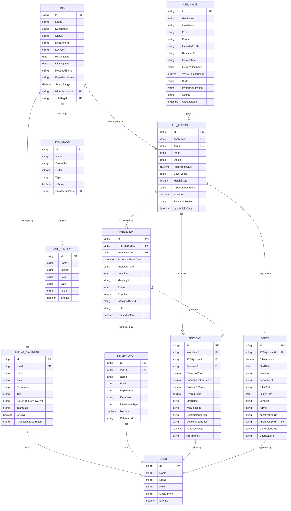

# ARA (Asymbl Recruiting Agent) Entity Relationship Diagram

## Overview
This document presents the Entity Relationship Diagram (ERD) for the ARA package's recruiting objects and their relationships. The diagram illustrates how these objects support the AI-powered recruiting workflow.

## Entity Relationship Diagram

## Object Descriptions

### Core Recruiting Objects

#### 1. **Job__c** (Blue - Job Management)
Central object representing job openings in the organization.
- **Key Fields**: Name, Description, Status, Required Skills, Hiring Manager
- **Relationships**: 
  - One-to-Many with ATS_Applicant__c
  - Many-to-One with Hiring_Manager__c
  - Many-to-One with Job_Stage__c

#### 2. **Applicant__c** (Green - Candidate Data)
Master record for all candidates in the system.
- **Key Fields**: Contact information, Resume, Skills, Experience
- **Relationships**: 
  - One-to-Many with ATS_Applicant__c (can apply to multiple jobs)

#### 3. **ATS_Applicant__c** (Green - Application Tracking)
Junction object linking candidates to specific job applications.
- **Key Fields**: Stage, Status, Match Score, AI Recommendation
- **Relationships**:
  - Many-to-One with Job__c
  - Many-to-One with Applicant__c
  - One-to-Many with Interview__c
  - One-to-Many with Feedback__c
  - One-to-One with Offer__c

### Interview Management Objects

#### 4. **Interview__c** (Orange - Interview Process)
Manages interview scheduling and tracking.
- **Key Fields**: Scheduled DateTime, Type, Status, Meeting Link
- **Relationships**:
  - Many-to-One with ATS_Applicant__c
  - Many-to-One with Interviewer__c
  - One-to-One with Feedback__c

#### 5. **Feedback__c** (Orange - Assessment)
Captures interview feedback and assessments.
- **Key Fields**: Various scores, Recommendation, AI Summary
- **Relationships**:
  - Many-to-One with Interview__c
  - Many-to-One with ATS_Applicant__c
  - Many-to-One with User (Reviewer)

### Offer Management Objects

#### 6. **Offer__c** (Purple - Offer Process)
Manages job offers to selected candidates.
- **Key Fields**: Offer Amount, Start Date, Status, Terms
- **Relationships**:
  - One-to-One with ATS_Applicant__c
  - Many-to-One with User (Approver)

### Supporting Objects

#### 7. **Hiring_Manager__c** (Red - People)
Extended profile for hiring managers.
- **Key Fields**: Department, Preferred Interview Style, AI Summary
- **Relationships**:
  - One-to-One with User
  - One-to-Many with Job__c

#### 8. **Interviewer__c** (Red - People)
Profile for interviewers with availability tracking.
- **Key Fields**: Expertise, Calendar ID, Interviewer Type
- **Relationships**:
  - One-to-One with User
  - One-to-Many with Interview__c

#### 9. **Job_Stage__c** (Yellow - Configuration)
Configurable stages for the recruitment pipeline.
- **Key Fields**: Name, Order, Type, Email Template
- **Relationships**:
  - One-to-Many with Job__c
  - Many-to-One with Email_Template__c

#### 10. **Email_Template__c** (Yellow - Configuration)
Email templates for automated communications.
- **Key Fields**: Subject, Body, Type, Folder
- **Relationships**:
  - One-to-Many with Job_Stage__c

#### 11. **User** (Gray - System)
Standard Salesforce User object.
- **Relationships**:
  - One-to-One with Hiring_Manager__c
  - One-to-One with Interviewer__c

## Color Coding by Functional Area

- **Blue**: Job Management (Job)
- **Green**: Candidate/Application Management (Applicant, ATS_Applicant)
- **Orange**: Interview Process (Interview, Feedback)
- **Purple**: Offer Management (Offer)
- **Red**: People/Users (Hiring_Manager, Interviewer)
- **Yellow**: Configuration (Job_Stage, Email_Template)
- **Gray**: System Objects (User)

## AI-Powered Workflow Support

The object model supports AI-powered recruiting through:

1. **AI Matching**: ATS_Applicant__c stores AI match scores and recommendations
2. **Intelligent Scheduling**: Interview__c integrates with AI scheduling functions
3. **Automated Feedback**: Feedback__c includes AI-generated summaries
4. **Smart Communications**: Email templates triggered at different stages
5. **Hiring Manager Insights**: AI-generated summaries in Hiring_Manager__c

## Key Business Rules

1. **Application Uniqueness**: One applicant can only have one active application per job
2. **Interview Sequence**: Interviews follow rounds defined in the job configuration
3. **Feedback Required**: Feedback must be provided before moving to offer stage
4. **Offer Approval**: Offers require approval from designated approvers
5. **Stage Progression**: Applications must follow the defined stage sequence

## Data Volume Considerations

- **High Volume**: ATS_Applicant__c, Interview__c, Feedback__c
- **Medium Volume**: Job__c, Applicant__c, Offer__c
- **Low Volume**: Hiring_Manager__c, Interviewer__c, Job_Stage__c, Email_Template__c

## Security Model

- **Public Read/Write**: None
- **Private**: Offer__c, Feedback__c
- **Public Read Only**: Job__c
- **Controlled by Sharing**: ATS_Applicant__c, Interview__c
- **Permission Set**: Asymbl_Recruiting_Agent_Admin controls access to all ARA functionality