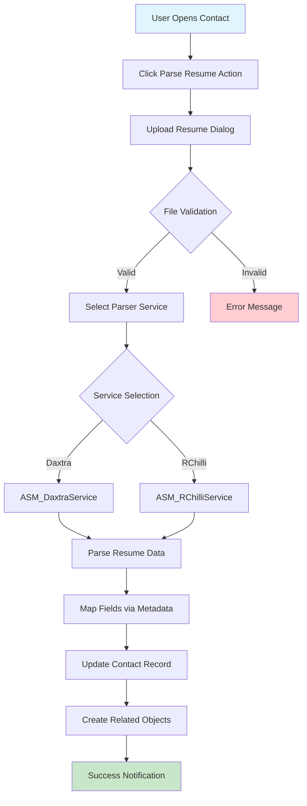
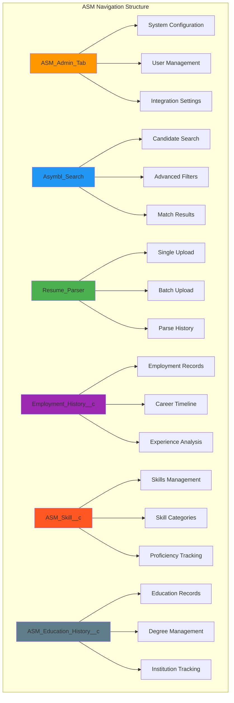
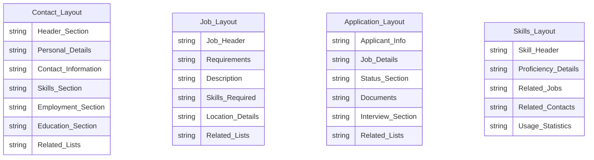
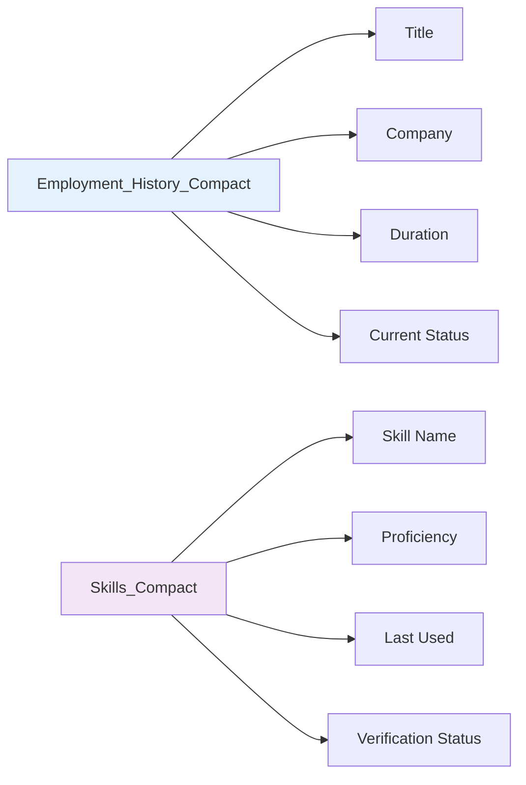
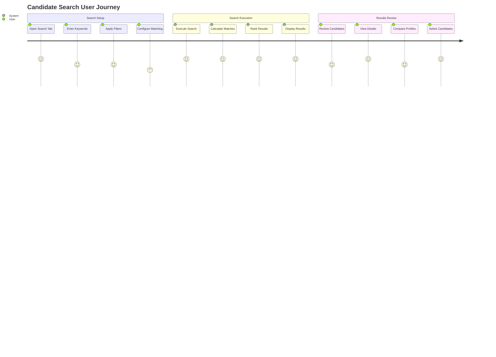
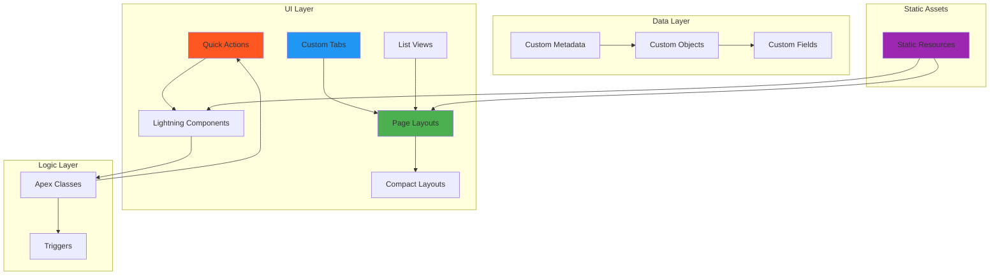

# ASM UI Components Architecture Documentation

## Overview
This document provides comprehensive documentation for the 19 UI components that were identified as missing from the initial ASM package analysis. These components are critical for user interaction and define the complete user experience within the ASM (Asymbl Search & Match) system.

## Missing UI Components Summary

| Component Type | Count | Components |
|---------------|-------|------------|
| **QuickAction** | 1 | Contact.Parse_Resume |
| **CustomTab** | 6 | ASM_Admin_Tab, Asymbl_Search, Resume_Parser, etc. |
| **Layout** | 8 | Page layouts for all objects |
| **CompactLayout** | 2 | Employment_History, ASM_Skill |
| **ListView** | 1 | ASM_Education_History.All |
| **StaticResource** | 1 | ASM_Resources |
| **TOTAL** | **19** | Critical UI components |

## 1. Quick Actions (1 Component)

### Contact.Parse_Resume (CRITICAL COMPONENT)

**Purpose**: Primary entry point for resume parsing functionality directly from Contact records.

**Workflow Architecture**:



**Implementation Details**:
- **Object**: Contact
- **Type**: Lightning Quick Action
- **Controller**: ASM_ResumeParsingController
- **Backend Services**: ASM_DaxtraService, ASM_RChilliService
- **File Types**: PDF, DOC, DOCX, TXT
- **Max File Size**: 10MB

**Field Mappings**:
- Contact fields: Name, Email, Phone, Address
- Education History: Degree, School, Major
- Employment History: Title, Company, Duration
- Skills: Skill Name, Proficiency Level

## 2. Custom Tabs (6 Components)

### Tab Navigation Architecture



### Tab Details

#### 1. ASM_Admin_Tab
- **Purpose**: System administration and configuration
- **Users**: System administrators, IT staff
- **Features**: Credential management, service configuration, field mapping setup

#### 2. Asymbl_Search
- **Purpose**: Main candidate search and matching interface
- **Users**: Recruiters, hiring managers
- **Features**: Advanced search, filtering, candidate matching

#### 3. Resume_Parser
- **Purpose**: Resume upload and parsing operations
- **Users**: HR staff, recruiters
- **Features**: Single/batch upload, parsing status, error management

#### 4. Employment_History__c
- **Purpose**: Employment history record management
- **Users**: HR staff, career counselors
- **Features**: Employment tracking, career progression analysis

#### 5. ASM_Skill__c
- **Purpose**: Skills management and tracking
- **Users**: HR staff, hiring managers
- **Features**: Skills catalog, proficiency tracking, skill matching

#### 6. ASM_Education_History__c
- **Purpose**: Education history record management
- **Users**: HR staff, academic coordinators
- **Features**: Education tracking, degree verification, institution management

## 3. Page Layouts (8 Components)

### Layout Architecture



### Layout Details

#### 1. ASM_Candidate_Layout (Contact)
- **Sections**: Personal Info, Contact Details, Skills Summary, Employment History
- **Related Lists**: Education History, Skills, Employment Records
- **Quick Actions**: Parse Resume, Add Skill, Update Status

#### 2. ASM_Job_Order_Layout
- **Sections**: Job Details, Requirements, Skills Needed, Location
- **Related Lists**: Applications, Matching Candidates, Required Skills
- **Quick Actions**: Post Job, Find Candidates, Update Status

#### 3. ASM_Application_Layout
- **Sections**: Applicant Summary, Job Information, Application Status
- **Related Lists**: Interview History, Documents, Notes
- **Quick Actions**: Schedule Interview, Update Status, Send Email

#### 4. ASM_Skills_Layout
- **Sections**: Skill Information, Proficiency Level, Usage Context
- **Related Lists**: Related Jobs, Candidates with Skill
- **Quick Actions**: Update Proficiency, Link to Job, Merge Skills

#### 5. ASM_Education_Layout
- **Sections**: Institution Details, Degree Information, Timeline
- **Related Lists**: Related Contacts, Verification Documents
- **Quick Actions**: Verify Degree, Add Document, Update Status

#### 6. ASM_Employment_Layout
- **Sections**: Employer Information, Position Details, Timeline
- **Related Lists**: Related Skills, Projects, References
- **Quick Actions**: Verify Employment, Add Reference, Update Dates

#### 7. ASM_Search_Results_Layout
- **Sections**: Search Criteria, Results Summary, Match Score
- **Related Lists**: Matched Candidates, Filter History
- **Quick Actions**: Refine Search, Save Search, Export Results

#### 8. ASM_Admin_Layout
- **Sections**: System Settings, Integration Status, Usage Statistics
- **Related Lists**: Error Logs, Audit Trail, User Activity
- **Quick Actions**: Run Sync, Clear Cache, Update Settings

## 4. Compact Layouts (2 Components)

### Compact Layout Architecture



#### 1. Employment_History__c.Employment_History_Compact_Layout
- **Fields Displayed**:
  - Title__c (Primary)
  - Employer_Org_Name__c
  - Start_Date__c - End_Date__c
  - Position_Type__c
- **Use Cases**: Mobile view, related lists, search results

#### 2. ASM_Skill__c.Skill_Compact_Layout
- **Fields Displayed**:
  - Skill_Name__c (Primary)
  - Skill_Proficiency__c
  - Last_Used__c
  - Type__c
- **Use Cases**: Mobile view, skill summaries, quick reference

## 5. List Views (1 Component)

### ASM_Education_History__c.All

**Purpose**: Default view for all Education History records with filtering capabilities.

**Configuration**:
- **Object**: ASM_Education_History__c
- **Columns**: 
  - Contact Name
  - School Name
  - Degree Type
  - Degree Name
  - Major
  - School Type
- **Filter Criteria**: All records where Contact__c != null
- **Sort Order**: Contact Name (ascending), School Name (ascending)

## 6. Static Resources (1 Component)

### ASM_Resources

**Purpose**: Contains static assets for the ASM user interface including styles, scripts, and images.

**Contents Structure**:
```
ASM_Resources/
├── css/
│   ├── asm-main.css
│   ├── asm-mobile.css
│   └── asm-themes.css
├── js/
│   ├── asm-utils.js
│   ├── resume-parser.js
│   └── search-components.js
├── images/
│   ├── icons/
│   ├── logos/
│   └── illustrations/
└── templates/
    ├── email-templates/
    └── report-templates/
```

**Key Files**:
- **asm-main.css**: Main styling for ASM components
- **resume-parser.js**: Client-side resume parsing utilities
- **asm-utils.js**: Common JavaScript utilities
- **Email templates**: Standardized communication templates

## User Journey Documentation

### Resume Parsing Journey


### Candidate Search Journey



## Component Relationships



## Implementation Best Practices

### 1. Quick Actions
- Use Lightning components for modern UX
- Implement proper error handling
- Provide clear success/failure feedback
- Support bulk operations where applicable

### 2. Custom Tabs
- Follow consistent naming conventions
- Implement proper security controls
- Design for mobile compatibility
- Include help documentation

### 3. Page Layouts
- Group related fields logically
- Use appropriate field types
- Implement field dependencies
- Consider screen real estate

### 4. Performance Optimization
- Minimize page load times
- Use lazy loading for large datasets
- Implement efficient queries
- Cache frequently accessed data

## Security Considerations

### Access Control
- Profile-based tab visibility
- Field-level security implementation
- Object-level permissions
- Custom permission sets

### Data Protection
- Sensitive data encryption
- Audit trail maintenance
- Data retention policies
- GDPR compliance measures

## Deployment Guidelines

### Pre-Deployment Checklist
- [ ] Validate all component references
- [ ] Test in sandbox environment
- [ ] Verify user permissions
- [ ] Check mobile compatibility
- [ ] Validate integration points

### Post-Deployment Validation
- [ ] Test all Quick Actions
- [ ] Verify tab navigation
- [ ] Check layout rendering
- [ ] Validate list view filters
- [ ] Test static resource loading

## Maintenance and Updates

### Regular Maintenance Tasks
- Monitor component usage
- Update layouts based on user feedback
- Refresh static resources
- Validate security settings
- Review and update documentation

### Version Control
- Track component changes
- Maintain deployment packages
- Document customizations
- Backup configurations

## Conclusion

The 19 UI components documented here represent critical missing pieces of the ASM package that define the complete user experience. The Parse_Resume Quick Action serves as the primary entry point for the core functionality, while the Custom Tabs provide the navigation structure, and the Page Layouts control the user interface design.

These components, when properly implemented, will provide users with a comprehensive, intuitive interface for managing the complete talent acquisition and candidate management lifecycle within the ASM system.