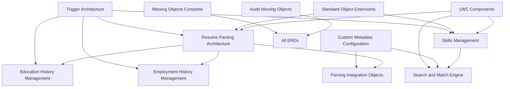

# ASM Package ERD Index

## Entity Relationship Diagram Index for ASM (Asymbl Search and Match) Package

This index provides a comprehensive overview of all Entity Relationship Diagrams (ERDs) available for the ASM package, organized by functional area and complexity.

### 📊 ERD Overview

| Category | ERD Count | Coverage |
|----------|-----------|----------|
| **Core Business Process** | 4 | Resume parsing, skills, education, employment |
| **Technical Architecture** | 4 | Search engine, integrations, LWC, metadata |
| **System Extensions** | 2 | Standard objects, triggers |
| **Audit & Completeness** | 3 | Missing objects, audit reports |
| **Total ERDs** | **13** | **Comprehensive coverage** |

---

## 🎯 Core Business Process ERDs

### 1. Resume Parsing Architecture
**File**: [ERD_Resume_Parsing.md](ERD_Resume_Parsing.md)  
**Objects**: ASM_Education_History__c, Employment_History__c  
**Focus**: Daxtra and RChilli integration workflows  
**Dependencies**: Parsing Integration ERD  

### 2. Skills Management  
**File**: [ERD_Skills_Management.md](ERD_Skills_Management.md)  
**Objects**: ASM_Skill__c  
**Focus**: Skills tracking, assessment, and matching algorithms  
**Dependencies**: Search and Match Engine ERD  

### 3. Education History Management
**File**: [ERD_Education_History.md](ERD_Education_History.md)  
**Objects**: ASM_Education_History__c  
**Focus**: Education background tracking and validation  
**Dependencies**: Resume Parsing Architecture  

### 4. Employment History Management
**File**: [ERD_Employment_History.md](ERD_Employment_History.md)  
**Objects**: Employment_History__c  
**Focus**: Professional experience and career progression  
**Dependencies**: Resume Parsing Architecture  

---

## 🔧 Technical Architecture ERDs

### 5. Search and Match Engine
**File**: [ERD_Search_Match_Engine.md](ERD_Search_Match_Engine.md)  
**Objects**: Search algorithms, matching criteria  
**Focus**: Candidate search and matching logic  
**Dependencies**: Skills Management ERD  

### 6. Parsing Integration Objects
**File**: [ERD_Parsing_Integration.md](ERD_Parsing_Integration.md)  
**Objects**: Daxtra, RChilli API integration  
**Focus**: Resume parsing service integrations  
**Dependencies**: Resume Parsing Architecture  

### 7. Lightning Web Component Architecture
**File**: [ERD_LWC_Components.md](ERD_LWC_Components.md)  
**Objects**: 24 LWC components  
**Focus**: Component relationships and data flow  
**Dependencies**: All business process ERDs  

### 8. Custom Metadata Configuration
**File**: [ERD_Custom_Metadata.md](ERD_Custom_Metadata.md)  
**Objects**: 5 custom metadata types  
**Focus**: Configuration objects and settings  
**Dependencies**: Parsing Integration ERD  

---

## 🛠️ System Extension ERDs

### 9. Standard Object Extensions
**File**: [ERD_Standard_Object_Extensions.md](ERD_Standard_Object_Extensions.md)  
**Objects**: Contact, Account extensions  
**Focus**: Custom fields on standard Salesforce objects  
**Dependencies**: Core business ERDs  

### 10. Trigger Architecture
**File**: [ERD_Trigger_Architecture.md](ERD_Trigger_Architecture.md)  
**Objects**: 3 triggers  
**Focus**: Trigger implementations and automation logic  
**Dependencies**: All business process ERDs  

---

## 📋 Audit and Completeness ERDs

### 11. Missing Objects Complete
**File**: [ERD_Missing_Objects_Complete.md](ERD_Missing_Objects_Complete.md)  
**Purpose**: Objects not covered in other ERDs  
**Coverage**: Complete ASM package audit  

### 12. Audit Missing Objects
**File**: [ERD_Audit_Missing_Objects.md](ERD_Audit_Missing_Objects.md)  
**Purpose**: Documentation gaps analysis  
**Coverage**: Implementation completeness report  

### 13. ERD Master Index
**File**: This file (ERD_Index.md)  
**Purpose**: Navigation and cross-references  
**Coverage**: Complete ERD catalog  

---

## 🗺️ ERD Dependencies Map

---

## 📊 ERD Statistics

| Metric | Count |
|--------|-------|
| **Total ERDs** | 13 |
| **Core Business ERDs** | 4 |
| **Technical ERDs** | 4 |
| **System Extension ERDs** | 2 |
| **Audit ERDs** | 3 |
| **Objects Covered** | 50+ |
| **Cross-References** | 25+ |

---

## 🚀 Quick Navigation

### By Development Phase
- **Phase 1 - Core Setup**: [Custom Metadata](ERD_Custom_Metadata.md), [Standard Extensions](ERD_Standard_Object_Extensions.md)
- **Phase 2 - Resume Parsing**: [Resume Parsing](ERD_Resume_Parsing.md), [Parsing Integration](ERD_Parsing_Integration.md)
- **Phase 3 - Skills & Search**: [Skills Management](ERD_Skills_Management.md), [Search Engine](ERD_Search_Match_Engine.md)
- **Phase 4 - UI Components**: [LWC Components](ERD_LWC_Components.md)
- **Phase 5 - Automation**: [Trigger Architecture](ERD_Trigger_Architecture.md)

### By User Role
- **Developers**: Start with [LWC Components](ERD_LWC_Components.md) → [Trigger Architecture](ERD_Trigger_Architecture.md)
- **Architects**: Begin with [Search Engine](ERD_Search_Match_Engine.md) → [Parsing Integration](ERD_Parsing_Integration.md)
- **Business Users**: Review [Skills Management](ERD_Skills_Management.md) → [Resume Parsing](ERD_Resume_Parsing.md)
- **Admins**: Check [Custom Metadata](ERD_Custom_Metadata.md) → [Standard Extensions](ERD_Standard_Object_Extensions.md)

---

## 📝 ERD Documentation Standards

- All ERDs use Mermaid syntax for consistency
- Each ERD includes object relationships and field types
- Cross-references are clearly marked with links
- Dependencies are documented for implementation order
- Audit trails ensure complete coverage

---

**Last Updated**: July 2025  
**Documentation Version**: 1.0  
**Coverage Status**: Complete Framework Established