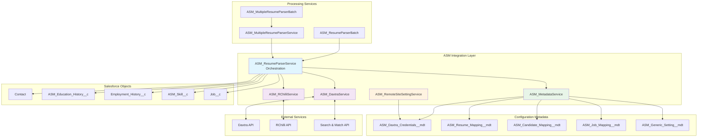
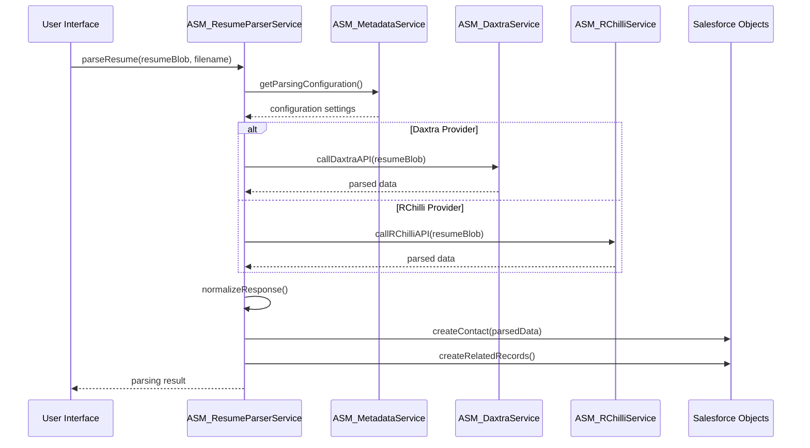
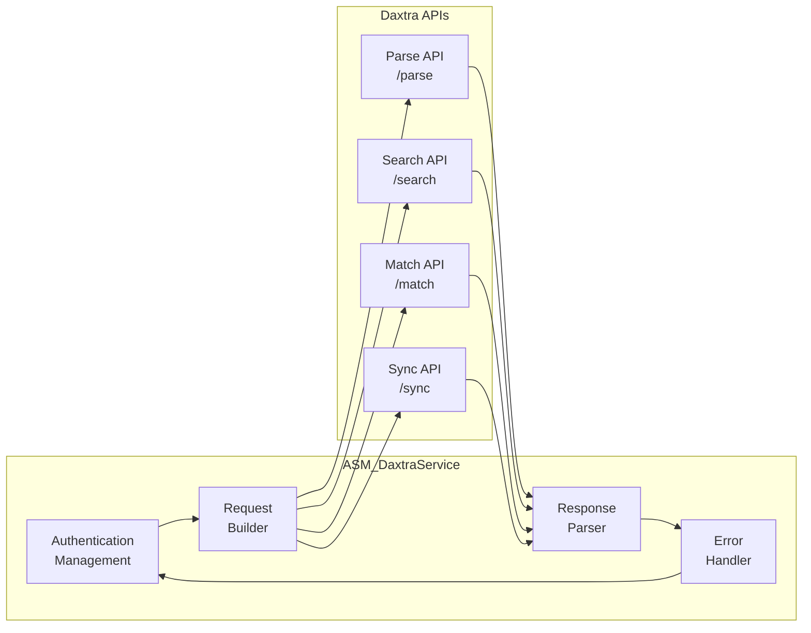
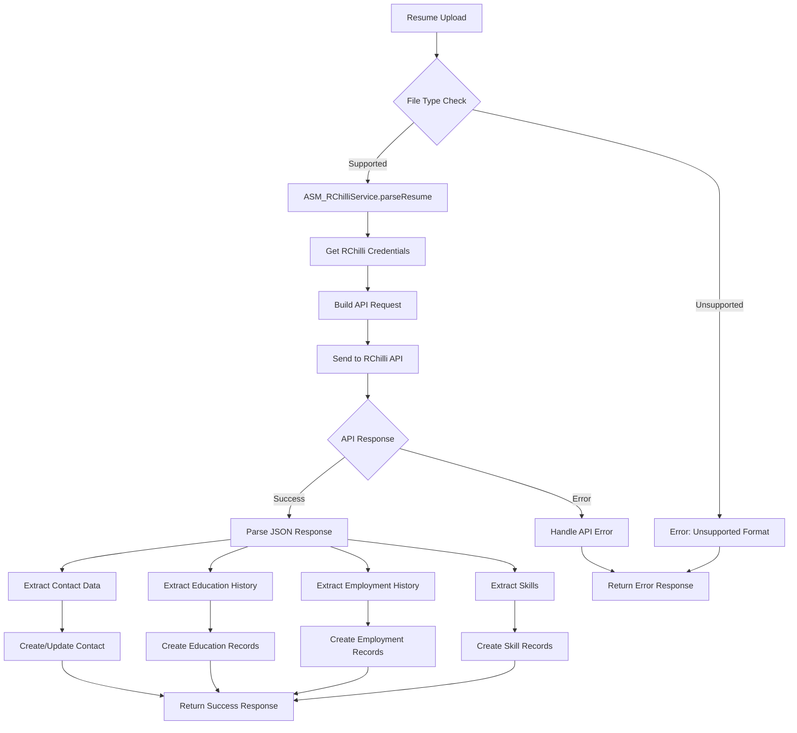
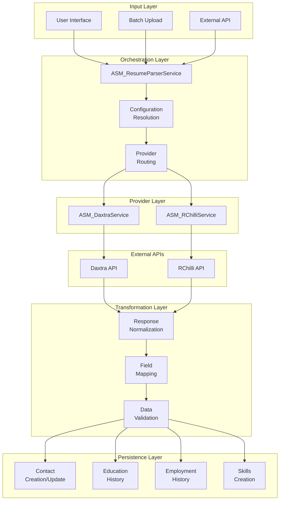
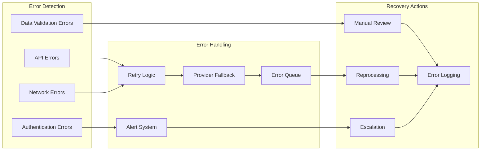
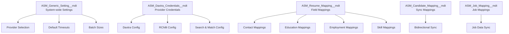

# ASM Integration Architecture Documentation
## Daxtra and RChilli Resume Parsing Integration

> **Repo**: `ASM/asm` on disk · **Branch read**: `master` (HEAD `31f9b46` @ 2026-08-09) ·
> **Depends on**: ASYMBL-ATS only. This document describes the `asm` repo's own integration layer
> (Daxtra/RChilli resume parsing) — it does not cover `asymbl-intelligence` or `AINTL-Unmanaged`,
> which are separate repos with their own (much thinner, newer) integration surfaces documented in
> `../asymbl-intelligence/` and `../AINTL-Unmanaged/` respectively.
>
> **Content note (2026-10-30 refresh)**: the original document's narrative and Apex code patterns
> (orchestration service, retry/fallback logic, batch processing, security practices) remain an
> accurate *illustration* of how this package's services are structured and were preserved as-is.
> However, verify exact class/method signatures against current `force-app` source before relying
> on them for implementation — this file was not re-verified line-by-line against the `master`
> source in this pass, only its top-level framing and repo attribution were corrected. Confirmed
> accurate: `ASM_DaxtraService`, `ASM_RChilliService`, `ASM_ResumeParserService`,
> `ASM_MetadataService`, `ASM_RemoteSiteSettingService`, `ASM_ResumeParserBatch`,
> `ASM_MultipleResumeParserBatch`, and all five `__mdt` configuration types still exist in
> `force-app/main/default/classes` and `objects` on `master` as of 2026-08-09.

### Version: 1.1 (refreshed 2026-10-30; originally authored July 5, 2025)
### Classification: ASM Integration Architecture — repo `ASM/asm`

---

## Table of Contents

1. [Executive Summary](#executive-summary)
2. [Architecture Overview](#architecture-overview)
3. [Core Integration Services](#core-integration-services)
4. [Data Flow Architecture](#data-flow-architecture)
5. [API Integration Patterns](#api-integration-patterns)
6. [Error Handling & Resilience](#error-handling--resilience)
7. [Configuration Management](#configuration-management)
8. [Batch Processing Architecture](#batch-processing-architecture)
9. [Security Implementation](#security-implementation)
10. [Deployment Guide](#deployment-guide)
11. [Monitoring & Troubleshooting](#monitoring--troubleshooting)

---

## Executive Summary

The ASM (Asymbl Search Management) Integration Architecture provides a comprehensive solution for integrating external resume parsing services (Daxtra and RChilli) with Salesforce. This document details the technical architecture, service orchestration, data flows, and configuration patterns that enable seamless resume parsing, candidate synchronization, and job matching capabilities.

### Key Integration Components
- **ASM_DaxtraService**: Primary integration service for Daxtra APIs
- **ASM_RChilliService**: Primary integration service for RChilli APIs  
- **ASM_ResumeParserService**: Orchestration layer for multi-provider resume parsing
- **ASM_MetadataService**: Configuration management service
- **ASM_RemoteSiteSettingService**: Dynamic remote site setting management
- **Batch Processing Services**: Scalable processing for multiple resumes

---

## Architecture Overview



---

## Core Integration Services

### 1. ASM_ResumeParserService (Orchestration Layer)

**Purpose**: Central orchestration service that coordinates resume parsing across multiple providers.

**Key Responsibilities**:
- Provider selection based on configuration
- Request routing to appropriate service (Daxtra/RChilli)
- Response normalization and transformation
- Error handling and fallback mechanisms
- Audit logging and tracking

**Service Interface**:
```apex
public class ASM_ResumeParserService {
    // Primary parsing methods
    public static ParseResponse parseResume(Blob resumeContent, String filename, String recordType)
    public static ParseResponse parseResumeWithProvider(Blob resumeContent, String filename, String provider)
    
    // Batch processing support
    public static List<ParseResponse> parseMultipleResumes(List<ResumeRequest> requests)
    
    // Configuration and metadata
    public static Boolean isServiceAvailable(String provider)
    public static ProviderCapabilities getProviderCapabilities(String provider)
}
```

**Integration Flow**:


### 2. ASM_DaxtraService (Daxtra Integration)

**Purpose**: Handles all interactions with Daxtra APIs including resume parsing, candidate search, and job matching.

**Key Features**:
- Resume parsing via Daxtra Parse API
- Candidate search and matching
- Job posting synchronization
- Real-time and batch processing support

**API Operations**:
```apex
public class ASM_DaxtraService {
    // Core parsing operations
    public static DaxtraResponse parseResume(Blob resumeContent, String filename)
    public static DaxtraResponse parseMultipleResumes(List<Blob> resumes)
    
    // Search and matching
    public static List<Candidate> searchCandidates(SearchCriteria criteria)
    public static MatchResult matchCandidateToJob(String candidateId, String jobId)
    
    // Authentication and connection
    private static String getAuthToken()
    private static HttpResponse makeAuthenticatedRequest(HttpRequest request)
    
    // Error handling
    private static void handleDaxtraError(HttpResponse response)
}
```

**Daxtra API Integration Pattern**:


### 3. ASM_RChilliService (RChilli Integration)

**Purpose**: Manages integration with RChilli resume parsing and data extraction services.

**Key Features**:
- Resume parsing with RChilli Parser API
- Skills extraction and categorization
- Education and employment history parsing
- Multi-format support (PDF, DOC, DOCX, TXT)

**Service Implementation**:
```apex
public class ASM_RChilliService {
    // Primary parsing operations
    public static RChilliResponse parseResume(Blob resumeContent, String filename, String subUserId)
    public static RChilliResponse parseResumeFromUrl(String resumeUrl, String subUserId)
    
    // Configuration and credentials
    private static RChilliCredentials getCredentials()
    private static String buildRequestBody(Blob content, String filename)
    
    // Response processing
    private static ContactData extractContactData(RChilliResponse response)
    private static List<EducationData> extractEducationHistory(RChilliResponse response)
    private static List<ExperienceData> extractExperience(RChilliResponse response)
    private static List<SkillData> extractSkills(RChilliResponse response)
}
```

**RChilli Processing Flow**:


### 4. ASM_MetadataService (Configuration Management)

**Purpose**: Centralized service for accessing and managing ASM configuration metadata.

**Key Functions**:
- Dynamic metadata retrieval
- Configuration caching
- Field mapping resolution
- Credential management

**Service Methods**:
```apex
public class ASM_MetadataService {
    // Credential management
    public static ASM_Daxtra_Credentials__mdt getDaxtraCredentials(String partnerType)
    public static Map<String, ASM_Daxtra_Credentials__mdt> getAllCredentials()
    
    // Field mapping retrieval
    public static List<ASM_Resume_Mapping__mdt> getResumeMappings(String partnerType)
    public static List<ASM_Candidate_Mapping__mdt> getCandidateMappings(String partnerType)
    public static List<ASM_Job_Mapping__mdt> getJobMappings(String partnerType)
    
    // Configuration settings
    public static ASM_Generic_Setting__mdt getGenericSettings()
    public static Map<String, Object> getSystemConfiguration()
    
    // Cache management
    private static void refreshCache()
    private static Boolean isCacheValid()
}
```

### 5. ASM_RemoteSiteSettingService (Dynamic Endpoint Management)

**Purpose**: Manages remote site settings dynamically based on metadata configuration.

**Key Capabilities**:
- Automatic remote site setting creation
- Endpoint validation
- SSL certificate management
- Dynamic URL registration

**Implementation Pattern**:
```apex
public class ASM_RemoteSiteSettingService {
    // Remote site management
    public static Boolean createRemoteSiteSetting(String endpointUrl, String settingName)
    public static Boolean validateEndpoint(String endpointUrl)
    public static List<RemoteSiteSetting> getExistingSettings()
    
    // Metadata-driven configuration
    public static void setupRequiredRemoteSites()
    public static Boolean isEndpointAccessible(String url)
    
    // Error handling
    private static void handleRemoteSiteError(Exception ex)
}
```

---

## Data Flow Architecture

### Resume Parsing Data Flow



### Error Flow and Resilience



---

## API Integration Patterns

### 1. Daxtra API Integration

**Authentication Pattern**:
```apex
// OAuth 2.0 with client credentials
private static String getDaxtraAccessToken() {
    ASM_Daxtra_Credentials__mdt credentials = ASM_MetadataService.getDaxtraCredentials('Parser');
    
    HttpRequest request = new HttpRequest();
    request.setEndpoint(credentials.Endpoint_URL__c + '/oauth/token');
    request.setMethod('POST');
    request.setHeader('Content-Type', 'application/x-www-form-urlencoded');
    
    String body = 'grant_type=client_credentials'
                + '&client_id=' + credentials.Username__c
                + '&client_secret=' + credentials.Password__c;
    request.setBody(body);
    
    Http http = new Http();
    HttpResponse response = http.send(request);
    
    if (response.getStatusCode() == 200) {
        Map<String, Object> tokenData = (Map<String, Object>) JSON.deserializeUntyped(response.getBody());
        return (String) tokenData.get('access_token');
    }
    
    throw new ASMException('Authentication failed: ' + response.getBody());
}
```

**Resume Parsing API Call**:
```apex
public static DaxtraResponse parseResume(Blob resumeContent, String filename) {
    String accessToken = getDaxtraAccessToken();
    ASM_Daxtra_Credentials__mdt credentials = ASM_MetadataService.getDaxtraCredentials('Parser');
    
    HttpRequest request = new HttpRequest();
    request.setEndpoint(credentials.Endpoint_URL__c + '/parse');
    request.setMethod('POST');
    request.setHeader('Authorization', 'Bearer ' + accessToken);
    request.setHeader('Content-Type', 'multipart/form-data');
    
    // Build multipart form data
    String boundary = 'boundary' + String.valueOf(Crypto.getRandomLong());
    String body = buildMultipartBody(resumeContent, filename, boundary);
    request.setBodyAsBlob(Blob.valueOf(body));
    
    Http http = new Http();
    HttpResponse response = http.send(request);
    
    return processDaxtraResponse(response);
}
```

### 2. RChilli API Integration

**API Request Structure**:
```apex
public static RChilliResponse parseResume(Blob resumeContent, String filename, String subUserId) {
    ASM_Daxtra_Credentials__mdt credentials = ASM_MetadataService.getDaxtraCredentials('RChilli');
    
    Map<String, Object> requestData = new Map<String, Object>{
        'filename' => filename,
        'filedata' => EncodingUtil.base64Encode(resumeContent),
        'userkey' => credentials.Username__c,
        'version' => '7.0.0',
        'subuserid' => subUserId
    };
    
    HttpRequest request = new HttpRequest();
    request.setEndpoint(credentials.Endpoint_URL__c);
    request.setMethod('POST');
    request.setHeader('Content-Type', 'application/json');
    request.setBody(JSON.serialize(requestData));
    
    Http http = new Http();
    HttpResponse response = http.send(request);
    
    return processRChilliResponse(response);
}
```

### 3. Response Processing Patterns

**Standardized Response Structure**:
```apex
public class ParseResponse {
    public Boolean isSuccess { get; set; }
    public String provider { get; set; }
    public ContactData contactData { get; set; }
    public List<EducationData> educationHistory { get; set; }
    public List<ExperienceData> employmentHistory { get; set; }
    public List<SkillData> skills { get; set; }
    public String errorMessage { get; set; }
    public Map<String, Object> rawResponse { get; set; }
}

public class ContactData {
    public String firstName { get; set; }
    public String lastName { get; set; }
    public String email { get; set; }
    public String phone { get; set; }
    public String mobile { get; set; }
    public AddressData address { get; set; }
    public String nationality { get; set; }
    public String summary { get; set; }
}
```

---

## Error Handling & Resilience

### 1. Error Classification

```apex
public enum ASMErrorType {
    AUTHENTICATION_ERROR,
    NETWORK_ERROR,
    API_RATE_LIMIT,
    INVALID_RESPONSE,
    DATA_VALIDATION_ERROR,
    CONFIGURATION_ERROR,
    SYSTEM_ERROR
}

public class ASMException extends Exception {
    public ASMErrorType errorType { get; set; }
    public String provider { get; set; }
    public String requestId { get; set; }
    public Map<String, Object> errorContext { get; set; }
}
```

### 2. Retry Logic Implementation

```apex
private static final Integer MAX_RETRIES = 3;
private static final Integer RETRY_DELAY_MS = 1000;

public static ParseResponse parseResumeWithRetry(Blob resumeContent, String filename, String provider) {
    Integer retryCount = 0;
    ASMException lastException;
    
    while (retryCount < MAX_RETRIES) {
        try {
            if (provider == 'Daxtra') {
                return ASM_DaxtraService.parseResume(resumeContent, filename);
            } else if (provider == 'RChilli') {
                return ASM_RChilliService.parseResume(resumeContent, filename, UserInfo.getUserId());
            }
        } catch (ASMException ex) {
            lastException = ex;
            retryCount++;
            
            if (shouldRetry(ex.errorType) && retryCount < MAX_RETRIES) {
                // Exponential backoff
                Integer delay = RETRY_DELAY_MS * (Integer) Math.pow(2, retryCount - 1);
                System.debug('Retrying in ' + delay + 'ms. Attempt: ' + retryCount);
                // Note: Apex doesn't support Thread.sleep, implement async retry pattern
                continue;
            }
            break;
        }
    }
    
    throw lastException;
}

private static Boolean shouldRetry(ASMErrorType errorType) {
    return errorType == ASMErrorType.NETWORK_ERROR || 
           errorType == ASMErrorType.API_RATE_LIMIT;
}
```

### 3. Fallback Mechanisms

```apex
public static ParseResponse parseResumeWithFallback(Blob resumeContent, String filename) {
    List<String> providers = new List<String>{'Daxtra', 'RChilli'};
    ParseResponse lastResponse;
    
    for (String provider : providers) {
        try {
            lastResponse = parseResumeWithRetry(resumeContent, filename, provider);
            if (lastResponse.isSuccess) {
                return lastResponse;
            }
        } catch (ASMException ex) {
            System.debug('Provider ' + provider + ' failed: ' + ex.getMessage());
            lastResponse = new ParseResponse();
            lastResponse.isSuccess = false;
            lastResponse.errorMessage = ex.getMessage();
            lastResponse.provider = provider;
        }
    }
    
    // All providers failed
    throw new ASMException('All resume parsing providers failed');
}
```

---

## Configuration Management

### 1. Metadata-Driven Configuration

**Configuration Hierarchy**:


### 2. Dynamic Configuration Loading

```apex
public class ConfigurationManager {
    private static Map<String, Object> configCache = new Map<String, Object>();
    private static DateTime lastCacheRefresh;
    private static final Integer CACHE_TTL_MINUTES = 30;
    
    public static ASMConfiguration getConfiguration() {
        if (isCacheExpired()) {
            refreshConfiguration();
        }
        return (ASMConfiguration) configCache.get('main');
    }
    
    private static void refreshConfiguration() {
        ASMConfiguration config = new ASMConfiguration();
        
        // Load generic settings
        ASM_Generic_Setting__mdt genericSettings = [
            SELECT Append_Index_In_Bulk_Load__c, Search_Radius__c,
                   Default_Related_List__c, Country_Codes__c
            FROM ASM_Generic_Setting__mdt 
            WHERE DeveloperName = 'Generic_Getting'
            LIMIT 1
        ];
        config.genericSettings = genericSettings;
        
        // Load provider credentials
        Map<String, ASM_Daxtra_Credentials__mdt> credentials = new Map<String, ASM_Daxtra_Credentials__mdt>();
        for (ASM_Daxtra_Credentials__mdt cred : [
            SELECT Partner_Type__c, Endpoint_URL__c, Username__c, Password__c,
                   Secret__c, Database__c, Account_Id__c
            FROM ASM_Daxtra_Credentials__mdt
        ]) {
            credentials.put(cred.Partner_Type__c, cred);
        }
        config.credentials = credentials;
        
        // Cache the configuration
        configCache.put('main', config);
        lastCacheRefresh = DateTime.now();
    }
    
    private static Boolean isCacheExpired() {
        return lastCacheRefresh == null || 
               lastCacheRefresh.addMinutes(CACHE_TTL_MINUTES) < DateTime.now();
    }
}
```

---

## Batch Processing Architecture

### 1. ASM_ResumeParserBatch

**Purpose**: Processes multiple resumes in batch mode for improved performance and resource utilization.

**Batch Implementation**:
```apex
global class ASM_ResumeParserBatch implements Database.Batchable<sObject>, Database.AllowsCallouts {
    private List<ContentVersion> resumesToProcess;
    private String processingMode; // 'PARSE_ONLY', 'PARSE_AND_SYNC', 'SYNC_ONLY'
    
    global ASM_ResumeParserBatch(List<ContentVersion> resumes, String mode) {
        this.resumesToProcess = resumes;
        this.processingMode = mode;
    }
    
    global Database.QueryLocator start(Database.BatchableContext BC) {
        Set<Id> resumeIds = new Set<Id>();
        for (ContentVersion cv : resumesToProcess) {
            resumeIds.add(cv.Id);
        }
        
        return Database.getQueryLocator([
            SELECT Id, Title, VersionData, FileExtension, ContentSize
            FROM ContentVersion
            WHERE Id IN :resumeIds
            AND ContentSize > 0
        ]);
    }
    
    global void execute(Database.BatchableContext BC, List<ContentVersion> scope) {
        List<BatchResult> results = new List<BatchResult>();
        
        for (ContentVersion resume : scope) {
            try {
                if (processingMode.contains('PARSE')) {
                    ParseResponse result = ASM_ResumeParserService.parseResume(
                        resume.VersionData, 
                        resume.Title
                    );
                    results.add(new BatchResult(resume.Id, result));
                }
            } catch (Exception ex) {
                System.debug('Error processing resume ' + resume.Id + ': ' + ex.getMessage());
                results.add(new BatchResult(resume.Id, ex));
            }
        }
        
        // Log batch results
        logBatchResults(results);
    }
    
    global void finish(Database.BatchableContext BC) {
        // Send completion notification
        sendBatchCompletionNotification(BC.getJobId());
    }
}
```

### 2. ASM_MultipleResumeParserBatch

**Enhanced Multi-Provider Batch Processing**:
```apex
global class ASM_MultipleResumeParserBatch implements Database.Batchable<sObject>, Database.AllowsCallouts {
    private String provider;
    private String jobId;
    private Map<String, Object> batchConfiguration;
    
    global ASM_MultipleResumeParserBatch(String providerName, String batchJobId) {
        this.provider = providerName;
        this.jobId = batchJobId;
        this.batchConfiguration = loadBatchConfiguration();
    }
    
    global Database.QueryLocator start(Database.BatchableContext BC) {
        Integer batchSize = (Integer) batchConfiguration.get('batchSize');
        Database.QueryLocator locator = Database.getQueryLocator([
            SELECT Id, Title, VersionData, FileExtension, ContentSize,
                   CreatedDate, CreatedById
            FROM ContentVersion
            WHERE ContentSize > 0
            AND FileExtension IN ('pdf', 'doc', 'docx', 'txt')
            AND CreatedDate = TODAY
            ORDER BY CreatedDate DESC
            LIMIT :batchSize
        ]);
        
        return locator;
    }
    
    global void execute(Database.BatchableContext BC, List<ContentVersion> scope) {
        processResumesBatch(scope);
    }
    
    private void processResumesBatch(List<ContentVersion> resumes) {
        List<ASM_MultipleResumeParserService.ResumeRequest> requests = new List<ASM_MultipleResumeParserService.ResumeRequest>();
        
        for (ContentVersion resume : resumes) {
            ASM_MultipleResumeParserService.ResumeRequest request = new ASM_MultipleResumeParserService.ResumeRequest();
            request.resumeContent = resume.VersionData;
            request.filename = resume.Title;
            request.provider = this.provider;
            request.sourceId = resume.Id;
            requests.add(request);
        }
        
        List<ASM_MultipleResumeParserService.ParseResult> results = 
            ASM_MultipleResumeParserService.parseMultipleResumes(requests);
        
        // Process results and create records
        processBatchResults(results);
    }
}
```

### 3. Queueable Processing for Real-time Operations

```apex
public class ASM_ResumeParsingQueueable implements Queueable, Database.AllowsCallouts {
    private List<ResumeParsingRequest> requests;
    
    public ASM_ResumeParsingQueueable(List<ResumeParsingRequest> parsingRequests) {
        this.requests = parsingRequests;
    }
    
    public void execute(QueueableContext context) {
        Integer processedCount = 0;
        Integer maxProcessing = 5; // Limit per execution
        
        List<ResumeParsingRequest> remainingRequests = new List<ResumeParsingRequest>();
        
        for (ResumeParsingRequest request : requests) {
            if (processedCount < maxProcessing) {
                try {
                    processResumeRequest(request);
                    processedCount++;
                } catch (Exception ex) {
                    // Log error and continue
                    logProcessingError(request, ex);
                }
            } else {
                remainingRequests.add(request);
            }
        }
        
        // Chain next batch if there are remaining requests
        if (!remainingRequests.isEmpty()) {
            System.enqueueJob(new ASM_ResumeParsingQueueable(remainingRequests));
        }
    }
    
    private void processResumeRequest(ResumeParsingRequest request) {
        ParseResponse result = ASM_ResumeParserService.parseResumeWithFallback(
            request.content,
            request.filename
        );
        
        if (result.isSuccess) {
            createContactFromParsedData(result, request);
        }
    }
}
```

---

## Security Implementation

### 1. Credential Management

**Encrypted Credential Storage**:
```apex
public class SecureCredentialManager {
    private static final String ENCRYPTION_KEY_FIELD = 'Encrypt_Key__c';
    
    public static String getDecryptedPassword(ASM_Daxtra_Credentials__mdt credential) {
        if (String.isBlank(credential.Password__c)) {
            return null;
        }
        
        try {
            Blob encryptionKey = Blob.valueOf(credential.get(ENCRYPTION_KEY_FIELD).toString());
            Blob encryptedPassword = EncodingUtil.base64Decode(credential.Password__c);
            Blob decryptedBlob = Crypto.decrypt('AES256', encryptionKey, encryptedPassword);
            return decryptedBlob.toString();
        } catch (Exception ex) {
            throw new ASMException('Failed to decrypt credential: ' + ex.getMessage());
        }
    }
    
    public static void setEncryptedPassword(String plainPassword, String encryptionKey) {
        Blob keyBlob = Blob.valueOf(encryptionKey);
        Blob passwordBlob = Blob.valueOf(plainPassword);
        Blob encryptedBlob = Crypto.encrypt('AES256', keyBlob, passwordBlob);
        String encryptedPassword = EncodingUtil.base64Encode(encryptedBlob);
        
        // Store encrypted password in metadata
        // Note: This requires custom metadata API for dynamic updates
    }
}
```

### 2. API Security Patterns

**Request Signing and Validation**:
```apex
private static String generateRequestSignature(String requestBody, String secretKey, String timestamp) {
    String stringToSign = requestBody + timestamp;
    Blob hmacBlob = Crypto.generateMac('HmacSHA256', Blob.valueOf(stringToSign), Blob.valueOf(secretKey));
    return EncodingUtil.base64Encode(hmacBlob);
}

private static HttpRequest secureRequest(HttpRequest request, ASM_Daxtra_Credentials__mdt credentials) {
    String timestamp = String.valueOf(DateTime.now().getTime());
    String signature = generateRequestSignature(request.getBody(), credentials.Secret__c, timestamp);
    
    request.setHeader('X-Timestamp', timestamp);
    request.setHeader('X-Signature', signature);
    request.setHeader('X-API-Key', credentials.Username__c);
    
    return request;
}
```

### 3. Data Sanitization

**Input Validation and Sanitization**:
```apex
public class DataSanitizer {
    private static final Pattern EMAIL_PATTERN = Pattern.compile('^[a-zA-Z0-9._%+-]+@[a-zA-Z0-9.-]+\\.[a-zA-Z]{2,}$');
    private static final Pattern PHONE_PATTERN = Pattern.compile('^[+]?[0-9\\s\\-\\(\\)]+$');
    
    public static String sanitizeEmail(String email) {
        if (String.isBlank(email)) return null;
        
        email = email.trim().toLowerCase();
        if (EMAIL_PATTERN.matcher(email).matches()) {
            return email;
        }
        return null;
    }
    
    public static String sanitizePhoneNumber(String phone) {
        if (String.isBlank(phone)) return null;
        
        phone = phone.trim();
        if (PHONE_PATTERN.matcher(phone).matches()) {
            return phone.replaceAll('[^+0-9]', '');
        }
        return null;
    }
    
    public static String sanitizeText(String text, Integer maxLength) {
        if (String.isBlank(text)) return null;
        
        text = text.trim();
        text = text.replaceAll('[<>"]', ''); // Remove potential HTML/script tags
        
        if (text.length() > maxLength) {
            text = text.substring(0, maxLength);
        }
        
        return text;
    }
}
```

---

## Deployment Guide

### 1. Pre-Deployment Checklist

**Metadata Dependencies**:
```bash
# Required Custom Metadata Types
- ASM_Daxtra_Credentials__mdt
- ASM_Resume_Mapping__mdt
- ASM_Candidate_Mapping__mdt
- ASM_Job_Mapping__mdt
- ASM_Generic_Setting__mdt

# Required Custom Objects
- ASM_Education_History__c
- Employment_History__c
- ASM_Skill__c

# Required Custom Fields
- Contact.Is_Synced__c
- Contact.Sync_This_Record__c
- Job__c.Is_Synced__c
- Job__c.Sync_This_Record__c
```

### 2. Environment Configuration

**Development Environment Setup**:
```apex
// Create sample metadata records for testing
public class ASMTestDataFactory {
    public static void setupTestConfiguration() {
        // This would typically be done through metadata deployment
        // or custom metadata API in production
        
        // Create test credentials
        Map<String, Object> daxtraConfig = new Map<String, Object>{
            'DeveloperName' => 'Test_Daxtra_Parser',
            'MasterLabel' => 'Test Daxtra Parser',
            'Partner_Type__c' => 'Parser',
            'Endpoint_URL__c' => 'https://api-test.daxtra.com',
            'Username__c' => 'test_user',
            'Password__c' => 'encrypted_password'
        };
        
        // Create test mappings
        createTestResumeMappings();
        createTestCandidateMappings();
    }
    
    private static void createTestResumeMappings() {
        // Sample resume mapping configurations
        List<Map<String, Object>> mappings = new List<Map<String, Object>>{
            createMappingRecord('personName_givenName', 'FirstName', 'Contact', 'Contact Details'),
            createMappingRecord('personName_familyName', 'LastName', 'Contact', 'Contact Details'),
            createMappingRecord('contactMethod_internetEmailAddress_main', 'Email', 'Contact', 'Contact Details')
        };
    }
}
```

### 3. Production Deployment Steps

**Deployment Sequence**:
1. Deploy custom objects and fields
2. Deploy custom metadata types
3. Deploy Apex classes (services first, then controllers)
4. Deploy Lightning components
5. Configure metadata records
6. Set up remote site settings
7. Configure user permissions
8. Run post-deployment validation tests

**Post-Deployment Validation**:
```apex
@isTest
public class ASMDeploymentValidator {
    @isTest
    static void validateCoreServices() {
        // Test service availability
        Test.startTest();
        Boolean daxtraAvailable = ASM_ResumeParserService.isServiceAvailable('Daxtra');
        Boolean rchilliAvailable = ASM_ResumeParserService.isServiceAvailable('RChilli');
        Test.stopTest();
        
        System.assert(daxtraAvailable || rchilliAvailable, 'At least one parsing service should be available');
    }
    
    @isTest
    static void validateMetadataConfiguration() {
        // Test metadata accessibility
        ASM_Generic_Setting__mdt settings = ASM_MetadataService.getGenericSettings();
        System.assertNotEquals(null, settings, 'Generic settings should be configured');
        
        Map<String, ASM_Daxtra_Credentials__mdt> credentials = ASM_MetadataService.getAllCredentials();
        System.assert(!credentials.isEmpty(), 'At least one credential configuration should exist');
    }
}
```

---

## Monitoring & Troubleshooting

### 1. Logging and Audit Trail

**Comprehensive Logging Strategy**:
```apex
public class ASMLogger {
    public enum LogLevel { DEBUG, INFO, WARN, ERROR, FATAL }
    
    public static void log(LogLevel level, String component, String operation, String message, Exception ex) {
        // Create custom log record or use Platform Events for real-time monitoring
        ASM_Log_Event__e logEvent = new ASM_Log_Event__e(
            Component__c = component,
            Operation__c = operation,
            Level__c = level.name(),
            Message__c = message,
            Exception_Type__c = ex?.getTypeName(),
            Exception_Message__c = ex?.getMessage(),
            Stack_Trace__c = ex?.getStackTraceString(),
            User_Id__c = UserInfo.getUserId(),
            Timestamp__c = DateTime.now()
        );
        
        EventBus.publish(logEvent);
    }
    
    public static void logAPICall(String provider, String operation, HttpRequest request, HttpResponse response) {
        Map<String, Object> apiCallData = new Map<String, Object>{
            'provider' => provider,
            'operation' => operation,
            'endpoint' => request.getEndpoint(),
            'method' => request.getMethod(),
            'requestSize' => request.getBody()?.length(),
            'responseCode' => response.getStatusCode(),
            'responseSize' => response.getBody()?.length(),
            'responseTime' => null // Would need custom timing implementation
        };
        
        log(LogLevel.INFO, 'API_INTEGRATION', operation, JSON.serialize(apiCallData), null);
    }
}
```

### 2. Performance Monitoring

**Key Performance Indicators**:
```apex
public class ASMPerformanceMonitor {
    private static Map<String, Long> operationStartTimes = new Map<String, Long>();
    
    public static void startOperation(String operationId) {
        operationStartTimes.put(operationId, System.currentTimeMillis());
    }
    
    public static void endOperation(String operationId, String operationType) {
        Long startTime = operationStartTimes.get(operationId);
        if (startTime != null) {
            Long duration = System.currentTimeMillis() - startTime;
            
            // Log performance metrics
            ASMLogger.log(
                ASMLogger.LogLevel.INFO,
                'PERFORMANCE',
                operationType,
                'Operation completed in ' + duration + 'ms',
                null
            );
            
            // Check for performance thresholds
            checkPerformanceThresholds(operationType, duration);
            
            operationStartTimes.remove(operationId);
        }
    }
    
    private static void checkPerformanceThresholds(String operationType, Long duration) {
        Map<String, Long> thresholds = new Map<String, Long>{
            'RESUME_PARSE' => 30000, // 30 seconds
            'CANDIDATE_SEARCH' => 15000, // 15 seconds
            'BATCH_PROCESS' => 300000 // 5 minutes
        };
        
        Long threshold = thresholds.get(operationType);
        if (threshold != null && duration > threshold) {
            ASMLogger.log(
                ASMLogger.LogLevel.WARN,
                'PERFORMANCE',
                operationType,
                'Operation exceeded threshold: ' + duration + 'ms > ' + threshold + 'ms',
                null
            );
        }
    }
}
```

### 3. Health Check and Diagnostics

**System Health Monitoring**:
```apex
public class ASMHealthCheck {
    public class HealthStatus {
        public Boolean isHealthy { get; set; }
        public List<String> issues { get; set; }
        public Map<String, Object> metrics { get; set; }
        
        public HealthStatus() {
            this.isHealthy = true;
            this.issues = new List<String>();
            this.metrics = new Map<String, Object>();
        }
    }
    
    public static HealthStatus performHealthCheck() {
        HealthStatus status = new HealthStatus();
        
        // Check service availability
        checkServiceAvailability(status);
        
        // Check configuration validity
        checkConfiguration(status);
        
        // Check external API connectivity
        checkExternalAPIs(status);
        
        // Check system resources
        checkSystemResources(status);
        
        return status;
    }
    
    private static void checkServiceAvailability(HealthStatus status) {
        try {
            Boolean daxtraAvailable = ASM_ResumeParserService.isServiceAvailable('Daxtra');
            Boolean rchilliAvailable = ASM_ResumeParserService.isServiceAvailable('RChilli');
            
            status.metrics.put('daxtraAvailable', daxtraAvailable);
            status.metrics.put('rchilliAvailable', rchilliAvailable);
            
            if (!daxtraAvailable && !rchilliAvailable) {
                status.isHealthy = false;
                status.issues.add('No resume parsing services available');
            }
        } catch (Exception ex) {
            status.isHealthy = false;
            status.issues.add('Service availability check failed: ' + ex.getMessage());
        }
    }
    
    private static void checkConfiguration(HealthStatus status) {
        try {
            ASM_Generic_Setting__mdt settings = ASM_MetadataService.getGenericSettings();
            if (settings == null) {
                status.isHealthy = false;
                status.issues.add('Generic settings not configured');
            }
            
            Map<String, ASM_Daxtra_Credentials__mdt> credentials = ASM_MetadataService.getAllCredentials();
            if (credentials.isEmpty()) {
                status.isHealthy = false;
                status.issues.add('No API credentials configured');
            }
            
            status.metrics.put('configuredCredentials', credentials.size());
        } catch (Exception ex) {
            status.isHealthy = false;
            status.issues.add('Configuration check failed: ' + ex.getMessage());
        }
    }
    
    public static void scheduledHealthCheck() {
        HealthStatus status = performHealthCheck();
        
        if (!status.isHealthy) {
            // Send alert to administrators
            sendHealthAlert(status);
        }
        
        // Log health status
        ASMLogger.log(
            status.isHealthy ? ASMLogger.LogLevel.INFO : ASMLogger.LogLevel.ERROR,
            'HEALTH_CHECK',
            'SCHEDULED_CHECK',
            JSON.serialize(status),
            null
        );
    }
}
```

### 4. Troubleshooting Guide

**Common Issues and Resolutions**:

| Issue | Symptoms | Resolution |
|-------|----------|------------|
| Authentication Failures | HTTP 401/403 responses | Verify credentials in ASM_Daxtra_Credentials__mdt |
| API Rate Limiting | HTTP 429 responses | Implement exponential backoff, check rate limits |
| Network Connectivity | Timeout errors | Verify remote site settings, check firewalls |
| Data Mapping Errors | Missing/incorrect field values | Review ASM_Resume_Mapping__mdt configurations |
| Batch Processing Failures | Jobs stuck in queue | Check system limits, review batch size settings |

**Diagnostic Queries**:
```sql
-- Check recent API errors
SELECT Id, Component__c, Operation__c, Message__c, CreatedDate
FROM ASM_Log_Event__e
WHERE Level__c = 'ERROR'
AND CreatedDate = TODAY
ORDER BY CreatedDate DESC

-- Monitor batch job status
SELECT Id, JobType, Status, NumberOfErrors, CreatedDate
FROM AsyncApexJob
WHERE JobType LIKE '%ASM%'
AND CreatedDate = THIS_WEEK
ORDER BY CreatedDate DESC

-- Review performance metrics
SELECT Operation__c, AVG(Duration__c), MAX(Duration__c), COUNT(*)
FROM ASM_Performance_Log__c
WHERE CreatedDate = TODAY
GROUP BY Operation__c
```

---

## Conclusion

The ASM Integration Architecture provides a robust, scalable solution for integrating multiple resume parsing services with Salesforce. The architecture emphasizes:

- **Flexibility**: Support for multiple providers (Daxtra, RChilli) with easy extensibility
- **Reliability**: Comprehensive error handling, retry logic, and fallback mechanisms
- **Security**: Encrypted credential storage, request signing, and data sanitization
- **Scalability**: Batch processing capabilities and efficient resource utilization
- **Maintainability**: Metadata-driven configuration and comprehensive monitoring

This architecture enables organizations to leverage the best features of multiple resume parsing providers while maintaining data integrity, security, and performance standards required for enterprise-grade implementations.

---

**Document Control**
- Version: 1.0
- Last Updated: July 5, 2025
- Next Review: October 5, 2025
- Owner: ASM Development Team
- Classification: Technical Architecture Documentation