# Asymbl ATS Package Documentation

> **Revision note**: This document was rewritten on 2026-10-30 against the `bpats` repository `master` branch (component counts verified directly from `manifest/package.xml` and `force-app/main/default`). The prior 2025-07-10 revision undercounted most component types (e.g., it listed 291 Apex classes vs. the actual 423, and 45+ custom objects vs. the actual 72) and predates several entire domains added to the package since mid-2025: screening questions, interview topic kits/availability, candidate-job matching intelligence, and recruiter/team target (KPI) management.

## Overview
The Asymbl ATS (Applicant Tracking System) is a comprehensive Salesforce package designed to manage the entire recruitment lifecycle, from job posting to placement and credit management, including AI-assisted candidate matching and recruiter performance target tracking. This document provides a detailed analysis of the package structure, objects, relationships, and functionality.

## Package Statistics
- **Package Name**: Asymbl ATS (namespace `bpats`)
- **Custom Objects**: 72 (`manifest/package.xml` `CustomObject`)
- **Custom Fields**: 699 across all objects
- **Custom Metadata Types**: 22 (`__mdt`)
- **Apex Classes**: 423 classes (including test classes), 426 members counted in package.xml
- **Apex Triggers**: 17 object triggers
- **Lightning Web Components**: 204 bundles
- **Aura Components**: 9 bundles
- **Custom Labels**: 3,024 labels
- **Reports**: 18 pre-built reports; 5 custom Report Types
- **Integration Points**: 5+ major integrations (TextKernel, Twilio, Zoom/Google Meet, Google Calendar, Google reCAPTCHA)
- **Permission Sets**: 3 (`BPATS_Admin`, `Asymbl_ATS_Job_Portal`, `External_Interview_Feedback`)
- **Validation Rules**: 14 business rules
- **Quick Actions**: 33 user actions
- **Email Templates**: 4 templates
- **Flows**: 3 automation flows (`Add_to_ATS_From_Contact`, `Add_to_Contact_List_from_Contact`, `Import_Resumes`)
- **Custom Permissions**: 2 (`Job_Applicant_Delete_Permission`, `ATS_Manage_Search_Sources`)
- **Global Value Sets**: 8
- **Platform Events**: 2 (`ATS_Record_Action__e`, `Add_to_ATS__e`)

## Object Relationship Diagram

```mermaid
graph TB
    %% Core Objects
    Account[Account]
    Contact[Contact]
    User[User]

    %% ATS Objects
    Job[Job__c]
    ATS_Template[ATS_Template__c]
    ATS_Stage[ATS_Stage__c]
    ATS_Applicant[ATS_Applicant__c]
    JBA[Job_Board_Application__c]
    ScreeningQ[ATS_Job_Screening_Question__c]
    Interview[Interview__c]
    Placement[Placement__c]
    Placement_Credit[Placement_Credit__c]
    Target[Target__c]

    %% Template Objects
    ATS_Template_Stage[ATS_Template_Stage__c]
    ATS_Template_Filter[ATS_Template_Filter__c]
    ATS_Action[ATS_Action__c]
    ATS_Action_Link[ATS_Action_Link__c]

    %% Interview Objects
    Interview_Template[Interview_Template__c]
    Interview_Template_Detail[Interview_Template_Detail__c]
    Interview_Feedback[Interview_Feedback__c]
    Interview_Topic[Interview_Topic__c]
    Interview_Topic_Kit[Interview_Topic_Kit__c]
    Interview_Availability[Interview_Availability__c]

    %% Matching/Intelligence Objects
    Match_Cache[ATS_Match_Cache__c]
    Qualification_Run[Qualification_Run__c]

    %% Supporting Objects
    Contact_List[Contact_List__c]
    Offer[Offer__c]
    Branch[Branch__c]
    Work_Site_Location[Work_Site_Location__c]

    %% Relationships
    Account -->|Has Many| Job
    Job -->|Has Template| ATS_Template
    Job -->|Has Stages| ATS_Stage
    Job -->|Has Applicants| ATS_Applicant
    Job -->|Has Applications| JBA
    Job -->|Has Screening Questions| ScreeningQ
    Job -->|Has Interviews| Interview
    Job -->|Has Placements| Placement
    Job -->|Has Match Cache| Match_Cache
    Job -->|Has Qualification Runs| Qualification_Run

    ATS_Template -->|Has Stages| ATS_Template_Stage
    ATS_Template -->|Has Filters| ATS_Template_Filter
    ATS_Template_Stage -->|Has Actions| ATS_Action_Link
    ATS_Action_Link -->|References| ATS_Action

    Contact -->|Applied As| ATS_Applicant
    Contact -->|Applied Via| JBA
    Contact -->|Has Interviews| Interview
    Contact -->|Has Placements| Placement
    Contact -->|Matched In| Match_Cache

    ATS_Stage -->|Contains| ATS_Applicant

    Interview -->|Has Template| Interview_Template
    Interview -->|Has Feedback| Interview_Feedback
    Interview -->|Has Availability| Interview_Availability
    Interview_Template -->|Has Details| Interview_Template_Detail
    Interview_Template_Detail -->|Sourced From Kit| Interview_Topic_Kit
    Interview_Template -->|Has Topics| Interview_Topic

    Placement -->|Has Credits| Placement_Credit
    Placement_Credit -->|To User| User
    Placement_Credit -->|To Branch| Branch

    Target -->|For Job| Job
    Target -->|For User| User

    Offer -->|For Job| Job
    Offer -->|For Contact| Contact

    style Job fill:#e1f5fe
    style ATS_Template fill:#c8e6c9
    style ATS_Applicant fill:#fff9c4
    style Interview fill:#f3e5f5
    style Placement fill:#ffccbc
    style Target fill:#d1c4e9
    style Match_Cache fill:#ffe0b2
```

## Core Objects and Relationships

### 1. Job Management

#### **Job__c (Primary Object)**
The central object for managing job opportunities and openings.

**Custom Fields with Data Types (verified against `force-app/main/default/objects/Job__c/fields`):**
- `Account__c` - **Lookup(Account)** - Client/Company reference
- `Account_Name__c` - **Text** - Account name text field
- `Applicants_View__c` - **Text** - View configuration
- `ATS_Template__c` - **Lookup(ATS_Template__c)** - Associated template
- `Asymbl_Hours_Per_Week__c` - **Number** - Expected weekly hours
- `Benefits_Perks__c` - **Long Text Area** - Benefits description
- `Bill_Rate__c` - **Currency** - Billing rate
- `Bonus__c` - **Currency** - Bonus amount
- `Budgeted__c` - **Checkbox** - Whether the opening is budgeted
- `Card_Action_to_Display__c` - **Text** - Kanban card action configuration
- `Conversion_Percentage__c` - **Percent** - Conversion percentage
- `Delivery_Lead__c` - **Lookup(User)** - Delivery lead
- `End_Date__c` - **Date** - Job end date
- `Estimated_Revenue__c` - **Currency** - Estimated revenue
- `Experience__c` - **Text** - Required experience
- `Fields_to_Display_on_Cards__c` - **Long Text Area** - JSON configuration
- `Fixed_Fee__c` - **Currency** - Fixed fee amount
- `Guarantee_Period_Weeks__c` - **Number** - Guarantee period
- `Hide_Delete_Action__c` / `Hide_Edit_Action__c` / `Hide_Reject_Action__c` - **Checkbox** - Kanban card UI toggles
- `Hiring_Manager__c` - **Lookup(Contact)** - Hiring manager
- `Hiring_Manager_Email__c` - **Email** - Hiring manager email
- `Hiring_Manager_Name__c` - **Text** - Hiring manager name
- `Hiring_Multiple_Candidates__c` - **Checkbox** - Multiple hiring flag
- `Index__c` - **Number** - Index for sorting
- `Is_Active__c` - **Checkbox** - Active status
- `Is_Closed__c` - **Checkbox** - Closed status
- `Job_Board_Field_Set_API_Name__c` - **Text** - Field set API name
- `Job_Description__c` - **Rich Text Area** - Detailed description
- `Job_Level__c` - **Picklist (1-5)** - Seniority/level indicator
- `Job_Number__c` - **Auto Number/Text** - Unique job number
- `Job_Title__c` - **Text** - Job title
- `Location__c` - **Text** - Job location
- `Matching_Candidates_Last_Refreshed__c` - **DateTime** - Last time candidate-matching intelligence ran for this job
- `New_or_Replacement__c` - **Picklist (Addition/Replacement)** - Whether role is net-new or a backfill
- `Number_Of_Mass_Actions__c` - **Number** - Mass action count
- `Number_of_Openings__c` - **Number** - Open positions
- `Onsite_or_Remote__c` - **Picklist (Onsite Position/Remote Position)** - Work location type
- `Openings_Filled__c` - **Number** - Filled positions
- `Opportunity__c` - **Lookup(Opportunity)** - Related opportunity
- `Pay_Range__c` - **Text** - Pay range
- `Pay_Rate__c` - **Currency** - Pay rate
- `Placement_Fee__c` - **Currency** - Placement fee
- `Post_Externally__c` - **Checkbox** - External posting flag
- `Posted_Date__c` - **Date** - Date posted
- `Posting_End_Date__c` - **Date** - When the external posting expires
- `Priority__c` - **Picklist** - Job priority
- `Related_Lists_to_Display__c` - **Long Text Area** - Related list config
- `Replacement_for_whom__c` - **Text** - Name/reference of person being replaced
- `Salary__c` - **Currency** - Salary amount
- `Salary_Min__c` / `Salary_Max__c` - **Number** - Salary range bounds
- `Sales_Lead__c` - **Lookup(User)** - Sales lead
- `Shift__c` - **Text** - Work shift
- `Short_Description__c` - **Text Area** - Brief description
- `Show_ATS_Stages__c` - **Checkbox** - Show stages flag
- `Show_Rejected_Applicants__c` - **Checkbox** - Whether rejected applicants display in views
- `Start_Date__c` - **Date** - Job start date
- `Status__c` - **Picklist** - Job status
- `Tags__c` - **Text** - Job tags
- `Today_Goal__c` - **Number** - Daily goal
- `Travel_Required__c` - **Picklist (Up to 25/50/75/100%)** - Travel requirement
- `Type__c` - **Picklist** - Job type
- `Urgent_Hiring__c` - **Checkbox** - Urgent hiring flag
- `Work_Site_Location__c` - **Lookup(Work_Site_Location__c)** - Work location

**Relationships:**
- Parent: Account (Client)
- Children: ATS_Stage__c (Master-Detail), ATS_Applicant__c (Master-Detail), Job_Board_Application__c (Lookup), ATS_Job_Screening_Question__c (Lookup), Placement__c (Lookup), ATS_Match_Cache__c (Lookup), Qualification_Run__c (Lookup), Target__c (Lookup)

> **Correction**: the prior revision listed fields (`Min_Salary__c`, `Max_Salary__c`, `Is_Remote__c`, `Is_Confidential__c`, `Department__c`, `External_Job_ID__c`, `Application_Deadline__c`) that do not exist on `Job__c`. The real fields are `Salary_Min__c`/`Salary_Max__c`, `Onsite_or_Remote__c`, `Posting_End_Date__c` — there is no `Is_Confidential__c`, `Department__c`, or `External_Job_ID__c` field on this object.

#### **ATS_Template__c**
Templates that define stage workflows and configurations for jobs.

**Custom Fields with Data Types:**
- `ATS_Template_External_Id__c` - **Text** - External ID for integration
- `Add_To_Job__c` - **Checkbox** - Auto-add-to-job behavior
- `Card_Action_to_Display__c` - **Text** - Card UI configuration
- `Email_Applicant__c` - **Checkbox** - Whether applicants are emailed automatically
- `Field_to_Display_on_Job_Board__c` - **Text/Long Text Area** - Job board display config
- `Fields_to_Display_on_Cards__c` - **Long Text Area** - JSON configuration
- `Filter_Criteria__c` - **Long Text Area** - Filter logic
- `Hide_Delete_Action__c` / `Hide_Edit_Action__c` / `Hide_Reject_Action__c` - **Checkbox** - UI action toggles
- `Is_Active__c` - **Checkbox** - Active status
- `Is_Default__c` - **Checkbox** - Default template flag
- `Priority__c` - **Number** - Template priority
- `Reject__c` - **Checkbox** - Rejection behavior toggle
- `Related_Lists_to_Display__c` - **Long Text Area** - Related list config
- `Screening_Questions__c` - **Long Text Area** - Screening question configuration/JSON for jobs built from this template

**Relationships:**
- Children: ATS_Template_Stage__c (Master-Detail), ATS_Template_Filter__c (Master-Detail), ATS_Template_Action_Toggles__c, Job__c (via lookup)

#### **ATS_Stage__c**
Represents stages in the recruitment process for a specific job.

**Custom Fields with Data Types:**
- `ATS_Template_Stage__c` - **Lookup(ATS_Template_Stage__c)** - Template stage reference
- `Block_Multiple_Candidates__c` - **Checkbox** - Prevent multiple candidates
- `Interview_Stage__c` - **Checkbox** - Marks this stage as an interview stage
- `Is_Synced__c` - **Checkbox** - Sync status
- `Job__c` - **Master-Detail(Job__c)** - Parent job
- `Job_Type__c` - **Text** - Job type reference
- `Sequence__c` - **Number** - Stage order
- `Sequence_Name__c` - **Text** - Display name combining sequence and stage name
- `Stage_Type__c` - **Picklist** - Stage type

**Relationships:**
- Parent: Job__c
- Children: ATS_Applicant__c (via Stage__c field)

#### **ATS_Job_Screening_Question__c** *(new domain since prior revision)*
Associates screening questions with a specific job (or digital-recruiter/external-site flow).

**Custom Fields:**
- `ATS_Question__c` - **Lookup(ATS_Question__c)** - The question being asked
- `Digital_Recruiter__c` - **Checkbox** - Shown in the Digital Recruiter conversational flow
- `External_Site__c` - **Checkbox** - Shown on the external career site
- `Is_Mandatory__c` - **Checkbox** - Required question
- `Job__c` - **Lookup(Job__c)** - Parent job
- `Question__c` - **Text** - Denormalized question text
- `Sequence__c` - **Number** - Display order

**Relationships:**
- Parent: Job__c, ATS_Question__c

### 2. Applicant Management

#### **ATS_Applicant__c**
Tracks candidates/applicants for specific jobs.

**Custom Fields with Data Types:**
- `ATS_Applicant__c` - **Auto Number** - Unique applicant ID
- `Applicant_Email__c` - **Email** - Applicant email
- `Applicant_Name__c` - **Text** - Applicant name
- `Applicant_Status__c` - **Picklist** - Application status
- `Application_Notes__c` - **Text Area** - Application notes
- `Asymbl_Rejection_Reason__c` - **Text/Picklist** - Rejection reason
- `Bill_Rate__c` - **Currency** - Billing rate
- `Contact_Job_Relationship__c` - **Lookup(Contact)** - Contact reference
- `Current_Stage_Date__c` - **DateTime** - Stage entry timestamp
- `Days_in_Current_Stage__c` - **Formula(Number)** - Days in stage
- `Days_Since_Initial_Application__c` - **Formula(Number)** - Total days
- `Hiring_Manager_Name__c` - **Text** - Manager name
- `Initial_Application_Date__c` - **DateTime** - Application date
- `Internal_Source__c` - **Text** - Internal source
- `Job__c` - **Master-Detail(Job__c)** - Parent job
- `Job_Board_Applicant__c` - **Lookup(Job_Board_Application__c)** - JBA reference
- `Pay_Rate__c` - **Currency** - Pay rate
- `Recruited_By__c` - **Lookup(User)** - Recruiter
- `Rejected_By_Job_Closure__c` - **Checkbox** - Job closure rejection
- `Reviewed_Date__c` - **Date/DateTime** - Review timestamp
- `Salary__c` - **Currency** - Salary
- `Sequence__c` - **Number** - Applicant sequence
- `Source__c` - **Text** - Application source
- `Stage__c` - **Lookup(ATS_Stage__c)** - Current stage

**Relationships:**
- Parents: Job__c (Master-Detail), Contact (via Contact_Job_Relationship__c)
- Related: ATS_Stage__c, Interview__c, ATS_Question_Response__c

#### **Job_Board_Application__c**
Manages external job board applications before conversion to contacts.

**Custom Fields with Data Types:**
- `Contact__c` - **Lookup(Contact)** - Associated contact
- `Email__c` - **Text** - Applicant email
- `First_Name__c` - **Text** - First name
- `Job__c` - **Lookup(Job__c)** - Related job
- `Job_Board__c` - **Text** - Source job board
- `Last_Name__c` - **Text** - Last name
- `Mobile_Phone__c` - **Phone** - Mobile number
- `Rejected_By_Job_Closure__c` - **Checkbox** - Job closure rejection
- `Reviewed_Date__c` - **Date/DateTime** - Review timestamp
- `Status__c` - **Picklist** (New / Duplicates Found / Contact Identified / Added to Job / Rejected / Discarded)

**Relationships:**
- Parent: Job__c
- Related: Contact__c, ATS_Applicant__c, ATS_Question_Response__c

#### **ATS_Question__c / ATS_Question_Category__c / ATS_Question_Response__c** *(new domain since prior revision)*
Screening question framework used by both the job-board apply flow and the Digital Recruiter.

**ATS_Question__c fields:**
- `Allow_Multiple_Selections__c` - **Checkbox**
- `Answer_Options__c` - **Long Text Area** - JSON/delimited answer choices
- `Applicant_Field_Mapping__c` - **Text** - Target field to map the response to
- `Category__c` - **Lookup(ATS_Question_Category__c)**
- `Is_Active__c` - **Checkbox**
- `Question__c` - **Text** - Question text
- `Response_Type__c` - **Picklist** - e.g. free text / single-select / multi-select

**ATS_Question_Category__c**: a lightweight categorization object with no custom fields beyond standard Name — used purely to group `ATS_Question__c` records.

**ATS_Question_Response__c fields:**
- `ATS_Applicant__c` - **Lookup(ATS_Applicant__c)**
- `ATS_Question__c` - **Lookup(ATS_Question__c)**
- `Candidate_Response__c` - **Text/Long Text Area**
- `Job_Board_Application__c` - **Lookup(Job_Board_Application__c)**
- `Job__c` - **Lookup(Job__c)**
- `Response_Date__c` - **DateTime**

### 3. Interview Management

#### **Interview__c**
Manages interview scheduling and feedback.

**Custom Fields with Data Types:**
- `Additional_Information__c` - **Text Area** - Additional info
- `Assigned_To__c` - **Lookup(User)** - Assigned user
- `ATS_Applicant__c` - **Lookup(ATS_Applicant__c)** - Related applicant
- `Asymbl_Interview_Availability__c` - **Lookup(Interview_Availability__c)** - Selected availability slot
- `Candidate__c` - **Lookup(Contact)** - Candidate
- `Candidate_Name__c` - **Text** - Candidate name
- `Duration_Minutes__c` - **Number** - Duration in minutes
- `Event_Id__c` - **Text** - Calendar event ID
- `Feedback__c` - **Long Text Area** - Interview feedback
- `Filter_To_Client_Account__c` - **Checkbox** - Restricts interviewer picker to the client account
- `Interview_Date__c` - **DateTime** - Interview date/time
- `Interview_Description__c` - **Text Area** - Description
- `Interview_Template__c` - **Lookup(Interview_Template__c)** - Template
- `Interview_Template_Detail__c` - **Lookup(Interview_Template_Detail__c)** - Template detail
- `Interviewer__c` - **Lookup(User)** - Primary interviewer
- `Interviewers__c` - **Multi-Select Picklist** - All interviewers
- `Is_Scheduled_By_Automation__c` - **Checkbox** - Whether the record was created by automation rather than a user
- `Job__c` - **Lookup(Job__c)** - Related job
- `Job_Position__c` - **Text** - Job position
- `Location__c` - **Text** - Interview location
- `Location_Type__c` - **Picklist** - Location type
- `Online_Platforms__c` - **Picklist** (None / Google Meet / Zoom Meeting) - Video platform used
- `Status__c` - **Picklist** - Interview status
- `Type__c` - **Picklist** - Interview type
- `Zoom_Meeting_Id__c` - **Text** - Zoom meeting ID

**Relationships:**
- Parents: Job__c, Contact
- Children: Interview_Feedback__c (Master-Detail)
- Related: Interview_Availability__c

> **Correction**: the prior revision's ERD invented a `Stage_Application__c` lookup and `Interview_Date_Time__c`/`Duration__c` fields that do not exist. The real stage-context link is via `ATS_Applicant__c` and `Job__c`, and the date field is `Interview_Date__c`.

#### **Interview_Template__c**
Defines interview structure and evaluation criteria.

**Custom Fields with Data Types:**
- `Feedback_Format__c` - **Picklist** - Feedback format type
- `Feedback_Picklist_Options__c` - **Text Area** - Picklist values
- `Field_to_display__c` - **Text/Long Text Area** - Field configuration
- `Filter_Criteria__c` - **Long Text Area** - Filter logic
- `Is_Active__c` - **Checkbox** - Active status
- `Priority__c` - **Number** - Template priority

**Relationships:**
- Children: Interview_Template_Detail__c (Master-Detail), Interview_Topic__c

> **Correction**: the prior revision's ERD invented a self-referencing `Parent_Template__c` field, `Template_Version__c`, `Pass_Rate__c`, and department/job-level picklists — none of these exist on `Interview_Template__c`.

#### **Interview_Template_Detail__c**
Interview template stage details.

**Custom Fields with Data Types:**
- `Feedback_Format__c` / `Feedback_Picklist_Options__c` - Feedback configuration, can inherit from the parent template
- `Field_to_display__c` - **Text/Long Text Area** - Display fields
- `Fields_to_Display_Same_as_Template__c` - **Checkbox** - Inherit fields flag
- `Hide_Topics__c` - **Checkbox** *(new)* - Hides the topics section on this stage's feedback form
- `Interview_Plan_Template__c` - **Master-Detail(Interview_Template__c)** - Parent template
- `Interviewers__c` - **Text** - Interviewer list
- `Interviewers_to_display__c` - **Text** - Display interviewers
- `Stage__c` - **Text** - Stage name
- `Topic_Kit__c` - **Lookup(Interview_Topic_Kit__c)** *(new)* - Source topic kit when `Topic_Source__c` = Kit
- `Topic_Source__c` - **Picklist (Custom/Kit)** *(new)* - Whether topics are authored directly or pulled from a reusable Topic Kit

#### **Interview_Topic_Kit__c / Interview_Topic_Kit_Item__c** *(new domain since prior revision)*
Reusable libraries of interview topics that can be attached to one or more `Interview_Template_Detail__c` stages, avoiding re-authoring the same topics per template.

**Interview_Topic_Kit__c fields:**
- `Description__c` - **Long Text Area**
- `Feedback_Picklist_Options__c` - **Text Area**
- `Is_Active__c` - **Checkbox**

**Interview_Topic_Kit_Item__c fields:**
- `External_Interviewer__c` - **Text**
- `Feedback_Type__c` - **Picklist**
- `Interview_Topic_Kit__c` - **Master-Detail(Interview_Topic_Kit__c)** - Parent kit
- `Sequence__c` - **Number**
- `Topic_Description__c` - **Text Area**
- `Topic_Feedbacks__c` - **Text**

**Relationships:**
- `Interview_Topic__c.Source_Kit_Item__c` - **Lookup(Interview_Topic_Kit_Item__c)** *(new field)* links a materialized topic back to the kit item it was cloned from (via `ATS_CloneInterviewTopicKit` Apex)

#### **Interview_Availability__c** *(new object since prior revision)*
Interviewer-submitted availability slots, consumed when scheduling an `Interview__c`.

**Custom Fields:**
- `Asymbl_Confirmed__c` - **Checkbox**
- `Asymbl_Job__c` - **Lookup(Job__c)**
- `Asymbl_Offered_By__c` - **Lookup(User)**
- `Asymbl_Slot_End__c` - **DateTime**
- `Asymbl_Slot_Start__c` - **DateTime**
- `Asymbl_Source__c` - **Text/Picklist**

#### **Interview_Feedback__c**
Stores interview feedback from interviewers.

**Custom Fields with Data Types:**
- `Candidate__c` - **Lookup(Contact)** - Candidate
- `External_Interviewer__c` - **Text** - External interviewer
- `Feedback__c` - **Long Text Area** - Feedback text
- `Interview__c` - **Master-Detail(Interview__c)** - Parent interview
- `Interview_Date__c` - **DateTime** - Interview date
- `Interviewer__c` - **Lookup(User)** - Interviewer user
- `Recommended_New__c` - **Picklist** - Recommendation
- `Submission_Date_Time__c` - **DateTime** - Submission timestamp
- `Submitted_By__c` - **Lookup(User)** - Submitter

#### **Interview_Topic__c**
Interview evaluation topics (either custom-authored or materialized from a Topic Kit).

**Custom Fields with Data Types:**
- `External_Interviewer__c` - **Text** - External interviewer
- `Feedback_Type__c` - **Picklist** - Feedback type
- `Interview_Template__c` - **Lookup(Interview_Template__c)** - Template
- `Interview_Template_Detail__c` - **Lookup(Interview_Template_Detail__c)** - Template detail
- `IsDefault__c` - **Checkbox** - Default topic flag
- `Is_Retired__c` - **Checkbox** *(new)* - Soft-delete/retirement flag so historical feedback stays intact when a topic is removed from active use
- `Sequence__c` - **Number** - Topic sequence
- `Source_Kit_Item__c` - **Lookup(Interview_Topic_Kit_Item__c)** *(new)* - Origin kit item, if cloned from a Topic Kit
- `Topic_Description__c` - **Text Area** - Topic description
- `Topic_Feedbacks__c` - **Text** - Feedback options

> **Correction**: the prior revision invented a self-referencing `Parent_Topic__c` hierarchy, `Difficulty_Level__c`, `Assessment_Type__c`, and department/job-level picklists on `Interview_Topic__c` — none of these fields exist. The real "reuse" mechanism is `Source_Kit_Item__c` pointing at an `Interview_Topic_Kit_Item__c`, not topic-to-topic hierarchy.

#### **Interview_Topic_Feedback__c**
Feedback for interview topics.

**Custom Fields with Data Types:**
- `Feedback__c` - **Text Area** - Feedback text
- `Is_Additional_Topic__c` - **Checkbox** - Additional topic flag
- `Topic__c` - **Lookup(Interview_Topic__c)** - Parent topic
- `Topic_Asked__c` - **Checkbox** - Topic covered flag
- `Topic_Feedback__c` - **Text** - Topic feedback
- `Topic_Rating__c` - **Number** - Rating value

### 4. Placement, Credit, and Target Management

#### **Placement__c**
Records successful job placements.

**Custom Fields with Data Types:**
- `Account__c` - **Lookup(Account)** - Client account
- `Assignment_Extended__c` - **Checkbox** - Extension flag
- `ATS_Candidate__c` - **Lookup(Contact)** - Placed candidate
- `ATS_Job__c` - **Lookup(Job__c)** - Related job
- `Bill_Rate__c` - **Currency** - Billing rate
- `Branch__c` - **Lookup(Branch__c)** - Branch
- `Burden_Amount__c` - **Currency** - Burden amount
- `Burden_Percentage__c` - **Percent** - Burden percentage
- `Conversion_Percentage__c` - **Percent** - Conversion rate
- `Estimated_End_Date__c` - **Date** - End date
- `Is_Both_Profit_Populated__c` - **Checkbox** - Profit validation
- `Pay_Rate__c` - **Currency** - Pay rate
- `Pay_Rule_Country_Code__c` / `Pay_Rule_State_Code__c` - **Text** - Country/state code
- `Placement_Complete__c` - **Checkbox** - Completion status
- `Placement_Completed_On__c` - **Date** - Completion date
- `Placement_Credit_Template__c` - **Lookup(Placement_Credit_Template__c)** - Credit template
- `Placement_Percentage__c` - **Percent** - Placement fee percentage
- `Salary__c` - **Currency** - Salary
- `Start_Date__c` - **Date** - Start date
- `Timesheet_Approver__c` / `Timesheet_Delegated_Approver__c` - **Lookup(User)** - Approvers
- `Total_Billable_Amount__c` / `Total_Gross_Profit__c` / `Total_Payable_Amount__c` - **Currency**
- `Work_Site_Location__c` - **Lookup(Work_Site_Location__c)** - Work location

**Relationships:**
- Parents: Job__c, Contact, Account
- Children: Placement_Credit__c

#### **Placement_Credit__c**
Manages credit allocation for placements.

**Custom Fields with Data Types:**
- `ATS_Branch_Receiving_Credit__c` - **Lookup(Branch__c)** - Branch credit
- `ATS_Role_Type__c` - **Text/Picklist** - Role type
- `Credit_Percentage__c` - **Percent** - Credit percentage
- `Credit_Recipient__c` - **Text** - Credit recipient name
- `Is_Void__c` - **Checkbox** - Void flag
- `Manual_Override__c` - **Checkbox** - Manual override flag
- `Placement__c` - **Master-Detail(Placement__c)** - Parent placement
- `Placement_Credit_Template_Entry__c` - **Lookup(Placement_Credit_Template_Entry__c)** - Template entry
- `Profit_Amount__c` / `Revenue_Amount__c` - **Currency**
- `Total_Credits__c` - **Number** - Total credits
- `Type__c` - **Picklist** - Credit type
- `User__c` - **Lookup(User)** - User receiving credit

#### **Placement_Credit_Template__c**
Templates for credit allocation.

**Custom Fields with Data Types:**
- `Active__c` - **Checkbox**
- `Effective_Date__c` / `End_Date__c` - **Date**
- `Filter_Criteria__c` - **Long Text Area**
- `Placement__c` - **Lookup(Placement__c)**
- `Placement_Credit_Template__c` - **Text** - Template name
- `Priority__c` - **Number**
- `Status__c` / `Type__c` - **Picklist**
- `Void__c` - **Checkbox**

#### **Placement_Credit_Template_Entry__c**
Credit allocation entries in templates.

**Custom Fields with Data Types:**
- `ATS_Branch_Receiving_Credit__c` - **Lookup(Branch__c)**
- `ATS_Placement_Credit_Name__c` - **Picklist**
- `Credit_Percentage__c` - **Percent**
- `Placement_Credit_Template__c` - **Master-Detail(Placement_Credit_Template__c)**
- `Type__c` - **Picklist**
- `User_Receiving_Credit__c` - **Lookup(User)**

#### **Target__c / Target_Template__c / Target_Template_Entry__c** *(new domain — not present in prior revision)*
A recruiter/team KPI goal-setting framework. `Target_Template__c` defines a reusable goal definition (metric type, period, assignment rule); `Target_Template_Entry__c` defines threshold/value breakpoints within a template; `Target__c` is the materialized, assigned goal instance for a specific user/job/period.

**Target_Template__c fields:**
- `Asymbl_Active__c` - **Checkbox**
- `Asymbl_Applies_To__c` - **Picklist** - Object/context the template applies to
- `Asymbl_Assigned_Role__c` / `Asymbl_Assigned_User__c` - **Lookup(UserRole) / Lookup(User)**
- `Asymbl_Assignment_Criteria__c` - **Long Text Area**
- `Asymbl_Assignment_Type__c` - **Picklist**
- `Asymbl_Auto_Rollover__c` - **Checkbox** - Whether unmet targets roll into the next period
- `Asymbl_Filter_Criteria__c` - **Long Text Area**
- `Asymbl_Metric_Type__c` - **Picklist** - What is being measured (placements, submittals, interviews, etc.)
- `Asymbl_Period_Type__c` - **Picklist** - Weekly/Monthly/Quarterly etc.
- `Asymbl_Priority__c` - **Number**
- `Asymbl_Target_Value__c` - **Number**
- `Asymbl_Threshold_Type__c` - **Picklist**
- `Asymbl_Window_Days__c` - **Number**

**Target_Template_Entry__c fields:**
- `Asymbl_Active__c` - **Checkbox**
- `Asymbl_Metric_Type__c` - **Picklist**
- `Asymbl_Sequence__c` - **Number**
- `Asymbl_Target_Template__c` - **Master-Detail(Target_Template__c)**
- `Asymbl_Target_Value__c` - **Number**
- `Asymbl_Threshold_Type__c` - **Picklist**
- `Asymbl_Window_Days__c` - **Number**

**Target__c fields:**
- `Asymbl_Active__c` - **Checkbox**
- `Asymbl_Job__c` - **Lookup(Job__c)**
- `Asymbl_Metric_Type__c` - **Picklist**
- `Asymbl_Period_Start__c` / `Asymbl_Period_End__c` - **Date**
- `Asymbl_Period_Type__c` - **Picklist**
- `Asymbl_Set_By__c` - **Lookup(User)**
- `Asymbl_Target_Value__c` - **Number**
- `Asymbl_Template__c` - **Lookup(Target_Template__c)**
- `Asymbl_Threshold_Type__c` - **Picklist**
- `Asymbl_User__c` - **Lookup(User)**
- `Asymbl_Values_Source__c` - **Picklist**

**Relevant Apex**: `ATS_TargetService`, `ATS_TargetTemplateService`, `ATS_TargetRolloverSchedulable`, `ATS_JobTargetAutoApply`, triggers `ATS_TargetTrigger` / `ATS_TargetTemplateTrigger` / `ATS_TargetTemplateEntryTrigger`.

### 5. Candidate/Job Matching Intelligence *(new domain — not present in prior revision)*

#### **ATS_Match_Cache__c**
Caches computed candidate-to-job match results to avoid recomputation.

**Custom Fields:**
- `Candidate__c` - **Lookup(Contact)**
- `Job__c` - **Lookup(Job__c)**
- `Payload__c` - **Long Text Area** - Cached match payload (likely JSON)
- `Sequence__c` - **Number**

#### **ATS_Candidate_Search_Log__c**
Logs candidate search activity, used for search analytics/auditing (see `Candidate_Search_Logs` custom Report Type).

**Custom Fields:**
- `Candidates_Added__c` - **Number**
- `Filters__c` - **Long Text Area**
- `Keywords__c` - **Text**
- `Last_Searched__c` - **DateTime**
- `More_Results__c` - **Checkbox/Number**
- `Refinements__c` - **Long Text Area**
- `Results_Found__c` - **Number**

#### **ATS_Search_Location__c**
Reference data for location-based candidate search (radius search support).

**Custom Fields:**
- `County__c` / `Location__c` - **Text**
- `Minimum_Radius_Mi__c` - **Number**
- `Ranking__c` - **Number**
- `Simplemaps_Id__c` - **Text** - External key to the Simplemaps geographic dataset
- `Type__c` - **Picklist/Text**

#### **Qualification_Run__c**
Records the result of an automated job-candidate qualification scoring pass (configured via `ATS_Qualification_Config__mdt`).

**Custom Fields:**
- `Asymbl_Expected_Value__c` / `Asymbl_Weighted_Value__c` - **Number/Currency**
- `Asymbl_Is_Qualified__c` - **Checkbox**
- `Asymbl_Job__c` - **Lookup(Job__c)**
- `Asymbl_Margin_Band__c` - **Picklist**
- `Asymbl_Pipeline_Exposure__c` - **Picklist/Number**
- `Asymbl_Risk_Tier__c` - **Picklist**
- `Asymbl_Run_Date__c` - **DateTime**
- `Asymbl_Run_Key__c` - **Text** - Idempotency/dedup key
- `Asymbl_Top_Action__c` / `Asymbl_Top_Action_Priority__c` - **Text/Picklist, Number**
- `Asymbl_Unmet_Count__c` - **Number** - Count of unmet qualification gates

**Relevant Apex**: `ATS_QualificationGateEngine`, `ATS_QualificationPrecompute`, `ATS_MatchCacheController`.

### 6. Supporting Objects

#### **Contact_List__c**
Custom contact lists for grouping candidates.

**Custom Fields with Data Types:**
- `Candidate_Ids__c` - **Long Text Area(32768)** - Contact IDs JSON
- `Contact_List_View__c` - **Text** - Associated list view
- `Fields_To_Display__c` - **Long Text Area** - Display fields JSON
- `Sorting_Field__c` / `Sorting_Order__c` - **Text**
- `Type__c` - **Picklist** - List type (Candidate/Client)

#### **ATS_Action__c**
Configurable actions for stage transitions.

**Custom Fields with Data Types:**
- `ATS_Actions_External_Id__c` - **Text**
- `Applicant_Reference__c` / `Job_Reference__c` - **Text** - Field reference for merge data
- `Attach_Resume__c` - **Checkbox**
- `Bcc_Field_ApiName_Reference__c` / `Cc_Field_ApiName_Reference__c` / `To_Field_ApiName_Reference__c` - **Text**
- `Component_Name__c` - **Text** - LWC component name
- `Custom_Events_Present__c` - **Checkbox**
- `Email_Template__c` - **Text** - Email template name
- `Email_Type__c` - **Picklist**
- `Flow_Name__c` - **Text** - Flow API name
- `Include_User_Signature__c` - **Checkbox**
- `Is_Active__c` - **Checkbox**
- `LWC_Attributes__c` - **Long Text Area** - LWC attributes JSON
- `Object_Name__c` - **Text**
- `Pass_RecordId_As_Collection__c` - **Checkbox**
- `Type__c` - **Picklist** (Flow/Component/Email)

**Relationships:**
- Children: ATS_Action_Link__c

#### **ATS_Action_Link__c**
Links actions to template stages.

**Custom Fields with Data Types:**
- `ATS_Action__c` - **Lookup(ATS_Action__c)**
- `ATS_Stage__c` - **Lookup(ATS_Stage__c)**
- `ATS_Template__c` - **Lookup(ATS_Template__c)**
- `ATS_Template_Stage__c` - **Lookup(ATS_Template_Stage__c)**
- `Action_Links_External_Id__c` - **Text**
- `Is_Optional__c` - **Checkbox**
- `Relation_Type__c` - **Text/Picklist**
- `Sequence__c` - **Number**

#### **ATS_Template_Action_Toggles__c** *(new object since prior revision)*
A single-field companion object storing which actions are enabled/disabled per template.

**Custom Fields:**
- `Action_Toggles__c` - **Long Text Area** - JSON map of action-enablement state

#### **ATS_Template_Stage__c**
Template stage definitions.

**Custom Fields with Data Types:**
- `ATS_Template__c` - **Master-Detail(ATS_Template__c)**
- `Block_Multiple_Candidates__c` - **Checkbox**
- `Interview_Stage__c` - **Checkbox**
- `Sequence__c` - **Number**
- `Stage_Type__c` - **Picklist**
- `Template_Stage_External_Id__c` - **Text**

#### **ATS_Template_Filter__c**
Filter criteria for templates.

**Custom Fields with Data Types:**
- `ATS_List_Filter__c` - **Lookup(ATS_List_Filter__c)**
- `ATS_Template_Filter_External_Id__c` - **Text**
- `Asymbl_Target_Template__c` - **Lookup(Target_Template__c)** *(new)* - Links filter criteria to target-template assignment logic
- `Interview_Template__c` - **Lookup(Interview_Template__c)**
- `Object_Name__c` - **Text**
- `Operator__c` - **Picklist**
- `Placement_Credit_Template__c` - **Lookup(Placement_Credit_Template__c)**
- `Related_Object__c` - **Text**
- `Sequence__c` - **Number**
- `Target_Field__c` / `Value__c` - **Text**

#### **ATS_Stage_Tracking__c**
Tracks applicant stage movements.

**Custom Fields with Data Types:**
- `ATS_Applicant__c` - **Lookup(ATS_Applicant__c)**
- `ATS_Stage__c` - **Lookup(ATS_Stage__c)** - From stage
- `ATS_Stage_Moved_To__c` - **Lookup(ATS_Stage__c)** - To stage
- `Duration__c` / `Duration_in_Minutes__c` - **Number**
- `End_Date__c` / `Start_Date__c` - **DateTime**
- `Type__c` - **Text**

#### **ATS_List_Filter__c**
Filters for contact lists (and jobs).

**Custom Fields with Data Types:**
- `Contact_List__c` - **Lookup(Contact_List__c)**
- `Filter_Criteria__c` / `Filter_Query__c` - **Long Text Area**
- `Job__c` - **Lookup(Job__c)** *(new)*

#### **ATS_Log__c**
System logging for debugging.

**Custom Fields with Data Types:**
- `Class_Name__c` / `Method_Name__c` - **Text**
- `Log_Message__c` / `Error_Stack_trace__c` - **Long Text Area**
- `Log_Type__c` - **Picklist** (Error/Info/Warning)
- `Line_Number__c` - **Number**
- `Preserve_Log__c` - **Checkbox**
- `Related_Record_Id__c` - **Text**

#### **Branch__c**
Branch/Office locations (standard Name field only; no custom fields in current metadata).

#### **Work_Site_Location__c**
Work location details.

**Custom Fields with Data Types:**
- `Account__c` - **Lookup(Account)**
- `Country_Code__c` / `State_Code__c` - **Text**

#### **Purchase_Order__c**
Purchase order management.

**Custom Fields with Data Types:**
- `Account__c` - **Lookup(Account)**
- `Amount_Consumed__c` / `PO_Amount__c` / `PO_Balance__c` - **Currency**

#### **Offer__c**
Job offer tracking.

**Custom Fields with Data Types:**
- `Candidate__c` - **Lookup(Contact)**
- `Job__c` - **Lookup(Job__c)**
- `Offer_Status__c` - **Picklist**
- `Rate_Offered__c` / `Salary_Offered__c` - **Currency**

#### **Message_Stats__c**
Email/SMS statistics tracking.

**Custom Fields with Data Types:**
- `Blocks__c` / `Bounces__c` / `Clicks__c` / `Delivered__c` / `Opens__c` / `Unique_Clicks__c` / `Unique_Opens__c` - **Number**
- `Date__c` - **Date**
- `External_Key__c` - **Text**
- `Parent__c` - **Lookup** (polymorphic)
- `Stats_Type__c` - **Picklist**

#### **Google_Recaptcha_Detail__c**
Google reCAPTCHA configuration.

**Custom Fields with Data Types:**
- `Client_Id__c` / `Key__c` - **Text**

### 7. Metadata Type Objects

22 custom metadata types ship with the package (verified count via `force-app/main/default/objects/*__mdt`):

#### **Generic_Setting__mdt**
Global ATS settings — the largest and most actively extended metadata type (49 fields as of this revision, up from ~28 in the prior documentation revision). New fields since the prior revision include `Asymbl_Is_Voice_Screening_Fallback__c`, `Asymbl_Screening_Fallback__c`, `Asymbl_Screening_Template_Name__c`, `Log_Candidate_Searches__c`, `Log_Interview_Feedback_To_Timeline__c`, `Hide_Candidate_Search__c`, `Filter_Retired_Kit_Topics__c`, `Search_Sources__c`, `Interview_Title_Pattern__c`, `Interview_Feedback_BCC_Emails__c`/`Interview_Feedback_CC_Emails__c`, `Org_Mode__c`, `Mode_Object_API_Name__c`, `Org_Wide_Email_Address__c`, `Reply_To_Email_Address__c`, `Staffing_Fields__c`, `Corporate_Fields__c`, `Show_Newest_Files_First__c`, `Event_Creation_Type__c` (superseding the old `Is_Enable_Event_Creation__c` boolean), `Add_To_Job__c`/`Add_To_Job_CL__c`, `Email_Template_For_Feedback__c`, `Reject__c`.

#### **ATS_Job_Object_Mapping__mdt**
Object mapping configuration. New field: `Lookup_Name_on_Screening_Question__c`.

#### **ATS_JSON_Mapping__mdt**
JSON field mapping for external posting. New field: `Is_CDATA__c`.

#### **ATS_Timesheet_Object_Mapping__mdt**
Timesheet integration mapping. New field: `Void_Timesheet_Status_Field_Value__c`.

#### **ATS_Job_Board_Application_Mapping__mdt**
Job board application field mapping. New fields: `Is_Person_Account_Mapped__c`, `Person_Account_Mapping__c`.

#### **ATS_Integration_Settings__mdt / TK_Field_Mapping__mdt / ATS_Email_Integration__mdt / ATS_SMS_Integration__mdt / ATS_Zoom_Integration_Data__mdt / ATS_Demo_Data_Info__mdt / ATS_Job_Description_Template__mdt**
Unchanged in structure from the prior documentation revision — see [Integration Objects ERD](ERD_Integration_Objects.md) for full field listings.

#### **ATS_Job_View_List__mdt**
Job view list configuration. New fields: `Additional_Text_Top__c`, `Additional_Text_Bottom__c`.

#### **ATS_Applicant_Field_Type_Config__mdt** *(new since prior revision)*
A field-type lookup table mapping Salesforce field types (Boolean, Currency, Date, Datetime, Double, Email, Integer, Multipicklist, Percent, Phone, Picklist, Reference, String, Textarea, Url) to their `Data_Type__c`-suffixed configuration fields, used to drive dynamic UI rendering for applicant fields.

#### **ATS_Platform_Event_Restriction__mdt** *(new since prior revision)*
Per-object kill switch for `ATS_Record_Action__e` publication: `Enable_on_Account__c`, `Enable_on_Contact__c`, `Enable_on_Job__c`, `Enable_on_Offer__c`, `Enable_on_Placement__c`, `Enable_on_ATS_Applicant__c`.

#### **ATS_Qualification_Config__mdt** *(new since prior revision)*
Drives `ATS_QualificationGateEngine`: `Asymbl_Active__c`, `Asymbl_Compare_Value__c`, `Asymbl_Field_API_Name__c`, `Asymbl_Gate_Key__c`, `Asymbl_Is_Blocking__c`, `Asymbl_Job_Type__c`, `Asymbl_Operator__c`, `Asymbl_Reduction__c`, `Asymbl_Sort_Order__c`.

#### **ATS_Resume_Field_Mapping__mdt / ATS_Skill_Summary_Mapping__mdt / ATS_Work_Experience_Mapping__mdt** *(new since prior revision)*
Resume-parsing field-mapping metadata that extends/supersedes the legacy `TK_Field_Mapping__mdt` pattern with a dedicated set of mapping types for skill summaries and work experience sections. `ATS_Resume_Field_Mapping__mdt` fields: `Field_Api_Name_New__c`, `Field_Type_New__c`, `Is_Active_New__c`, `Is_Protected__c`, `Mapped_Field__c`, `Mapped_Object__c`, `Record_Type_Api_Name_New__c`, `Section_New__c`.

#### **ATS_Talent_Intelligence_Data__mdt / ATS_Job_Intelligence_Setting__mdt** *(new since prior revision)*
Configuration for the external Talent Intelligence service that backs candidate/job matching: `Authentication_Key__c`, `Encryption_Key__c`, `Talent_Intelligence_URL__c` (data object); `Asymbl_Job_Type__c`, `Asymbl_Number_Value__c`, `Asymbl_Period_Type__c`, `Asymbl_Setting_Key__c`, `Asymbl_Stage_Type__c`, `Asymbl_Text_Value__c` (setting object).

#### **Feature_Gate__mdt** *(new since prior revision)*
Three boolean fields (`Launch__c`, `Enterprise__c`, `Ultimate__c`) gating features by package/licensing tier.

> **Correction**: the prior revision's Configuration Metadata ERD invented `ATS_Email_Template__mdt`, `ATS_Document_Template__mdt`, `ATS_Workflow_Configuration__mdt`, `ATS_Permission_Set_Mapping__mdt`, `ATS_Notification_Settings__mdt`, and `ATS_Calendar_Integration__mdt`. **None of these metadata types exist in the package.** See [Configuration Metadata ERD](ERD_Configuration_Metadata.md) for the corrected, verified list of all 22 real `__mdt` types.

### 8. Platform Event Objects

#### **ATS_Record_Action__e**
Platform event for record actions.

**Custom Fields with Data Types:**
- `Event_Type__c` / `Object_Api_Name__c` / `Record_Id__c` - **Text**
- `Payload__c` - **Text Area**

#### **Add_to_ATS__e**
Platform event for adding to ATS (fields not independently itemized in this revision — see package metadata directly for the authoritative field list).

### 9. Timeline Configuration Objects

#### **ATS_Timeline_Configuration__c**
Timeline view configuration.

**Custom Fields with Data Types:**
- `Display_Relative_Dates__c` - **Checkbox**
- `External_Key__c` - **Text**
- `Object__c` - **Text**

#### **ATS_Timeline_Child__c**
Timeline child object configuration.

**Custom Fields with Data Types:** (unchanged from prior revision, plus one addition)
- `ATS_Timeline_Configuration__c` - **Lookup(ATS_Timeline_Configuration__c)**
- `Data_Provider_Type__c` - **Picklist**
- `Date_Field__c` / `Display_Object_Name__c` / `External_Key__c` / `Object__c` / `Object_Color__c` / `Overdue_Field__c` / `Provider_Apex_Classname__c` / `Reference_Field_Name__c` / `Relationship_Name__c` / `Sub_Title_Fields__c` / `Subtitle_Label__c` / `Title_link_Navigate_to__c` - **Text/URL**
- `Title_Field__c` - **Text** *(new)*
- `Fields_to_Display__c` / `Filter_Criteria_Config__c` / `Where_Clause__c` - **Text Area**
- `Icon_Image_Url__c` - **URL**
- `Icon_Name__c` - **Text**
- `Include_All_Records__c` / `LWC_Ui_Api_Not_Supported__c` - **Checkbox**

### 10. Standard Object Extensions

#### **Contact (Extended Fields)**
- `ATS_Is_Job_Board_Applicant__c` - **Checkbox**
- `ATS_Job_Board_Application__c` - **Lookup(Job_Board_Application__c)**
- `Asymbl_Parsed_Resume__c` - **Lookup/Text** *(new)* - Reference to the parsed resume record/file
- `Contact_Relationship__c` - **Picklist**
- `Current_Pay_Rate__c` / `Current_Salary__c` / `Desired_Salary__c` / `Pay_Rate__c` - **Currency**
- `Earliest_Available_Date__c` - **Date**
- `Is_Resume_Parsed__c` - **Checkbox**
- `Matching_Jobs_Last_Refreshed__c` - **DateTime** *(new)* - Last time candidate-matching intelligence ran for this contact
- `Parsing_Error__c` - **Text**
- `Timezone__c` - **Text/Picklist** *(new)*

#### **ContentVersion (Extended Fields)**
- `Is_Primary__c` - **Checkbox**
- `Primary_Set_By_User__c` - **Lookup(User)** *(new)* - Who marked the file as primary

#### **EmailMessage (Extended Fields)**
- `Clicks_Count__c` / `Opens_Count__c` - **Number**
- `Is_Incoming__c` - **Checkbox** *(new)*
- `Last_Event_Time__c` - **DateTime**
- `Message_Type__c` / `Status__c` - **Text**
- `Mobile_Phone__c` - **Phone**
- `Twilio_External_Message_Id__c` - **Text** (renamed from `Twilio_Message_Id__c` in the prior revision)

## Key Workflows and Processes

### 1. Recruitment Workflow
1. **Job Creation**: Create job with template assignment; optionally attach screening questions via `ATS_Job_Screening_Question__c`
2. **Stage Setup**: Automatic stage creation from template
3. **Application Management**:
   - Direct applications via ATS_Applicant__c
   - External applications via Job_Board_Application__c, with screening responses captured in ATS_Question_Response__c
   - Automatic contact creation and deduplication
4. **Stage Progression**: Move applicants through stages with actions
5. **Interview Process**: Schedule (optionally against submitted `Interview_Availability__c` slots), conduct, and collect feedback using topics sourced from custom authoring or an `Interview_Topic_Kit__c`
6. **Placement**: Create placement records with credit allocation
7. **Target Tracking**: Recruiter/team KPI targets are tracked against placement and pipeline activity via `Target__c`

### 2. Template-Based Automation
- **Job Templates**: Pre-configured stage workflows, with per-template action enablement (`ATS_Template_Action_Toggles__c`)
- **Action Templates**: Stage-specific actions (emails, flows, components)
- **Interview Templates**: Structured interview processes, now with reusable Topic Kits
- **Credit Templates**: Automated credit distribution rules
- **Target Templates**: Automated, rule-based KPI assignment with optional auto-rollover

### 3. Integration Workflows
1. **Resume Parsing**: TextKernel integration for automated data extraction, mapped via `TK_Field_Mapping__mdt`, `ATS_Resume_Field_Mapping__mdt`, `ATS_Skill_Summary_Mapping__mdt`, `ATS_Work_Experience_Mapping__mdt`
2. **Communication**: Twilio for email/SMS with tracking
3. **Video Interviews**: Zoom and Google Meet integration (`Interview__c.Online_Platforms__c`)
4. **External Posting**: JSON-based job board integration
5. **reCAPTCHA**: Bot protection for applications
6. **Candidate/Job Matching**: Talent Intelligence service computes match scores and qualification gates, cached in `ATS_Match_Cache__c` and recorded in `Qualification_Run__c`

## Key Features and Functionality

### 1. Template-Based Workflow Management
- Jobs can be associated with templates that define stage progression
- Templates include filter criteria for automatic assignment
- Stages can block multiple candidates (e.g., only one offer stage)
- Per-template action toggles let admins hide/show configured actions without deleting them

### 2. Multi-Source Applicant Tracking
- Direct applicants (ATS_Applicant__c)
- Job board applications (Job_Board_Application__c), with configurable screening questions
- Automatic conversion from job board to contact

### 3. Interview Management System
- Template-based interview structures
- **Reusable Topic Kits**: author a library of interview topics once (`Interview_Topic_Kit__c`), attach to any template stage
- Interviewer-submitted availability slots feed into scheduling
- Multi-interviewer support
- Zoom/Google Meet integration for virtual interviews
- Structured feedback collection with topics and ratings; retired topics (`Is_Retired__c`) preserve historical feedback

### 4. Placement Credit and Target System
- Flexible credit allocation based on templates
- Support for multiple credit types (Revenue, Profit)
- Branch and user-level credit tracking
- Recruiter/team KPI target definitions with auto-rollover and rule-based auto-assignment to new jobs (`ATS_JobTargetAutoApply`)

### 5. Candidate/Job Matching Intelligence
- AI-assisted qualification scoring per job/candidate pairing, with configurable blocking/non-blocking gates
- Match result caching to minimize recomputation
- Candidate search logging for search-quality analytics

### 6. External Job Posting
- JSON mapping for external job boards
- Configurable field mappings
- Google reCAPTCHA integration for applications

### 7. Communication Features
- Email integration (Twilio SendGrid)
- SMS capabilities (Twilio)
- Template-based communications
- Activity tracking, including incoming message detection (`EmailMessage.Is_Incoming__c`)

## Configuration Components

### Global Value Sets (Picklist Values)
1. **Application_Status**
2. **Branches**
3. **Contact_Relationship**
4. **Job_Status**
5. **Job_Type**
6. **Placement_Credit_Types**
7. **Stage_Type**
8. **Placement_Credit_Name**

(8 global value sets confirmed via `force-app/main/default/globalValueSets`.)

### Validation Rules
14 validation rules are deployed (up from 8 in the prior revision), including the previously documented:
1. **ATS_Action_Link__c.Must_have_relationship**
2. **ATS_Template__c.Check_for_Filter_Criteria**
3. **Job__c.External_Job_Post_Criteria**
4. **Placement_Credit_Template__c.Check_for_Filter_Criteria**
5. **Placement_Credit_Template_Entry__c**: `Branch_Receiving_Credit_Criteria`, `House_Receiving_Credit_Criteria`, `User_Receiving_Credit_Criteria`

plus additional rules introduced to support the Target, Screening Question, and Topic Kit domains — consult `manifest/package.xml`'s `ValidationRule` section for the complete current list of 14.

### Field Sets
1. **Contact.Job_Board_Fields** - Fields for job board integration
2. **Job_Board_Application__c.Apply_To_Career_Job_Form** - Application form fields
3. **Interview__c.External_Interview_Feedback_Fields** - External feedback fields
(4 field sets total per package.xml.)

### Email Templates
4 email templates ship with the package (up from 3 in the prior revision):
1. **Email_Notification_when_applicant_moves_to_Particular_Stage**
2. **Template_to_send_Interview_Invitation**
3. **Email_Template_for_Interview_Feedback**
4. (one additional template added since the prior revision — consult `force-app/main/default/email` for the current name)

### Process Automation

#### Flows
3 flows ship with the package (up from 2 in the prior revision):
1. **Add_to_ATS_From_Contact** - Add contacts to ATS workflow
2. **Add_to_Contact_List_from_Contact** - Contact list management
3. **Import_Resumes** *(new)* - Bulk resume import/parsing flow

#### Quick Actions
33 quick actions ship with the package (up from 25+ in the prior revision), including the previously documented set (NewEvent, NewTask, SendEmail, Account.New_Placement, Contact actions, Contact_List__c actions, ATS_Template__c actions, Placement__c.Update_Placement_Credit, Job__c actions) plus new actions supporting Screening Questions and Interview Topic Kits.

### User Interface Components

#### Custom Application
- **ASYMBL_ATS_Setup** - Main ATS application

#### Custom Tabs
31 custom tabs ship with the package, including tabs for the new objects: `ATS_Question__c`, `ATS_Question_Category__c`, `Interview_Topic_Kit__c`, `Target__c`, `Target_Template__c`, in addition to the previously documented tabs (ASYMBL_Admin_Tab, ATS_Applicant__c, ATS_Kanban_View, Job__c, Placement__c, Interview__c, Contact_List__c, ExportImportATSTemplate, ATS_Log__c, Message_Stats__c, and others).

#### FlexiPages (Lightning Record Pages)
21 FlexiPages ship with the package, including the previously documented set plus pages for the Target and Topic Kit domains.

#### Web Links
1. **Contact.Add_to_Contact_List**
2. **Job__c.Manage_Applicants**
3. **Job__c.White_Board**
(5 web links total per package.xml.)

#### Lightning Message Channels
4 Lightning Message Channels ship with the package (up from 2 in the prior revision):
1. **ATSMessageChannel**
2. **ATSTimelineItemState**
(two additional channels added since the prior revision.)

#### Visualforce Components
2 Visualforce components (`ATS_PostExternalJobCompactDetail`, `ATS_PostExternalJobFilter`).

#### Visualforce Pages
10 Visualforce pages (up from the prior revision's list of 9): ATS_JobDetailPage, ATS_ExternalJobApplyStatus, ATS_PostExternallyJobsDetail, ATS_PostExternallyJobsJSON, ATS_PostExternallyJobsXML, ATS_PostExternalJobList, ATS_JobDetailVFPage, UserSessionPage, ATS_ZoomAuthCallback, and one additional page.

### Path Assistant
- **Job_Status** - Guided process for job status progression

### Matching Rules
- **Contact.Contact_Job_Board_Matching_Rule** - Duplicate contact detection

### Sharing Reasons
- **Interview__c.Asymbl_Share__c** - Custom interview sharing logic

### Remote Site Settings (External Integrations)
4 remote site settings: Google, TwilioSMS, ZoomAuthenticationAPI, ZoomAuthentication.

### Custom Site
- **BP_ATS** - External job portal site (public job listings, application submission, reCAPTCHA protection, mobile-responsive design)

### Custom Labels
**3,024 custom labels** ship with the package (up substantially from 1,900+ in the prior revision), reflecting the UI text needs of the new Screening Question, Interview Topic Kit, Target, and Matching Intelligence domains in addition to the original UI labels, error messages, confirmation dialogs, field labels, button labels, and validation messages.

## Technical Components

### Apex Classes (Key Controllers by Domain)

1. **Kanban View Management**
   - `ATSKanbanViewController`, `ATS_KanbanViewControllerTest`

2. **Action & Template Management**
   - `ATS_ActionAttributesController`, `ATS_ApplyMassActionOnTemplateController`

3. **Screening Questions** *(new domain)*
   - `ATS_JobScreeningQuestionsController`, `ATS_ScreeningQuestionsController`, `ATS_QuestionTriggerHandler`, `ATS_QuestionCategoryTriggerHandler`, `ATS_QuestionSharingHelper`

4. **Interview Topic Kits & Availability** *(new domain)*
   - `ATS_InterviewTopicKitController`, `ATS_InterviewTopicKitStageController`, `ATS_CloneInterviewTopicKit`, `ATS_InterviewAvailabilityIntake`, `ATS_InterviewAvailabilityService`

5. **Target/Goal Management** *(new domain)*
   - `ATS_TargetService`, `ATS_TargetTemplateService`, `ATS_TargetRolloverSchedulable`, `ATS_JobTargetAutoApply`, `ATS_TargetTemplateAudienceController`, `ATS_TargetTemplateEntryController`

6. **Matching/Qualification Intelligence** *(new domain)*
   - `ATS_MatchCacheController`, `ATS_QualificationGateEngine`, `ATS_QualificationPrecompute`

7. **Integration Controllers**
   - `ATS_GoogleAuthService`, `ATS_TKIntegrationService`, `ATS_TwilioService`

8. **Data Management**
   - `ATS_SyncJobDataWithTemplateBatchable`, `ATS_UpdateContactListController`, `ATS_AssignContactToAccountBatch`, `ATS_MoveExtraContactsToAccountBatch`, `ATS_RenameExistingAccountsBatch`

9. **Test Classes**
   - Comprehensive test coverage with dedicated test classes for each controller; mock generators (`ATS_MockGenerator`); test utilities (`ATS_TestUtility`); `ATS_TKIntegrationCalloutMock`; dynamic picklist implementations (`ATS_DynamicPicklistJobDetail`, `ATS_DynamicPicklistJobFilter`, `ATS_DynamicPicklistJobView`)

10. **Scheduled Jobs & Batch Classes**
    - `ATS_TKIntegrationBatch`, `ATS_TwilioEmailActivityBatch`, `ATS_TwilioEmailStatsScheduler`, `ATS_SMSIntegrationBatch`, `ATS_SMSIntegrationForFeedbackBatch`, `ATS_TargetRolloverSchedulable`

11. **Invocable Methods**
    - `ATS_TKResumeParsingInvocable`, `ATS_InvocableSendSMS`

12. **Utility & Helper Classes**
    - `ATS_Utility`, `ATS_DataUtility`, `ATS_SecureDml`, `ATS_BooleanEvaluation`, `ATS_Constants`, `ATS_ToolingService`, `ATS_MetadataService`, `ATS_RemoteSiteSettingService`, `ATS_Puff`, `ATS_Zippex`

13. **Wrapper Classes & Data Structures**
    - `ATS_DMLOperationWrapper`, `ATS_JobDetailWrapper`, `ATS_SelectOptionWrapper`, `ATS_TriggerInfoWrapper`, `ATS_RelatedListsFieldsWrapper`, `ATS_FieldApiNameToValueWrapper`, `ATS_AddToContactListWrapper`, `ATS_MappingWrapper`, `ATS_TKWrapperClass`, `ATS_TwilioWrapperClass`, `ATS_TimelineDataResponse`, `ATS_ExportImportClasses`, `ATS_InvocableInputs`

14. **Post-Install & Configuration Classes**
    - `ATS_TimelinePostInstaller`, `ATS_UpdatePermissionsPostInstaller`, `ATS_ShareInterviewRecords`, `ATS_ShareAllInterviewRecords`, `ATS_ImportDemoDataController`, `ATS_DeployDemoDataInfo`

> **Note**: this is a representative, domain-organized sample of the 423 Apex classes, not an exhaustive list — see `force-app/main/default/classes` for the complete inventory.

### Lightning Web Components

204 LWC bundles ship with the package (up from 90+ in the prior revision). Representative components by domain:

1. **Core UI Components**
   - `atsKanbanView`, `atsSplitView`, `atsListView`

2. **Action Components**
   - `atsScheduleInterview`, `atsSendEmail`, `atsSendSms`

3. **Screening Questions** *(new domain)*
   - Components backing `ATS_ScreeningQuestionsController`/`ATS_JobScreeningQuestionsController`

4. **Interview Topic Kits & Availability** *(new domain)*
   - Components backing `ATS_InterviewTopicKitController`/`ATS_InterviewAvailabilityService`

5. **Target/Goal Management** *(new domain)*
   - Components backing `ATS_TargetTemplateAudienceController`/`ATS_TargetTemplateEntryController`

6. **Configuration Components**
   - `atsTemplateFilter`, `atsJobMapping`, `atsSelectFieldsToDisplay`, `atsImportTemplate`, `atsExportTemplate`, `atsSettings`

7. **Specialized UI Components**
   - `atsWhiteBoardContainer`, `atsCandidateSkillChart`, `atsActivityTimeline`, `atsBubbleChart`, `atsFileViewer`, `atsGoogleCaptcha`, `customLightningDatatable`, `atsFormattedData`

> **Note**: see `force-app/main/default/lwc` for the complete, current list of 204 bundles.

### Triggers and Handlers

17 object triggers ship with the package (up from 9 in the prior revision):

1. `ATS_AccountTrigger` *(new)*
2. `ATS_ActionTrigger` & Handler/Helper
3. `ATS_ApplicantTrigger` *(new — was previously untracked/undocumented)* & Handler/Helper
4. `ATS_ContactTrigger` & Handler/Helper
5. `ATS_ContentDocumentLinkTrigger` & Handler
6. `ATS_InterviewTrigger` & Handler/Helper
7. `ATS_JobBoardApplicationTrigger` & Handler
8. `ATS_JobTrigger` & Handler/Helper
9. `ATS_OfferTrigger` *(new)*
10. `ATS_PlacementCreditTrigger` & Handler
11. `ATS_PlacementTrigger` & Handler/Helper
12. `ATS_QuestionCategoryTrigger` *(new)* & Handler/Helper
13. `ATS_QuestionTrigger` *(new)* & Handler
14. `ATS_TargetTemplateEntryTrigger` *(new)* & Handler
15. `ATS_TargetTemplateTrigger` *(new)* & Handler
16. `ATS_TargetTrigger` *(new)* & Handler
17. `ATS_TemplateTrigger` & Handler/Helper

### Permission Sets
1. `BPATS_Admin` - Administrator access
2. `Asymbl_ATS_Job_Portal` - External job portal access
3. `External_Interview_Feedback` - External interviewer access

## Integration Points

### 1. TextKernel Integration
- Resume parsing capabilities, skill extraction, work history parsing
- Configurable field mappings via `TK_Field_Mapping__mdt`, `ATS_Resume_Field_Mapping__mdt`, `ATS_Skill_Summary_Mapping__mdt`, `ATS_Work_Experience_Mapping__mdt`

### 2. Twilio Integration
- Email delivery via SendGrid, SMS messaging, activity tracking, message statistics

### 3. Zoom / Google Meet Integration
- Meeting creation, interview scheduling, OAuth authentication; `Interview__c.Online_Platforms__c` now supports both platforms

### 4. Google Services
- reCAPTCHA for job applications, Calendar sync, authentication services

### 5. Talent Intelligence Service *(new)*
- External service backing candidate/job matching and qualification scoring, configured via `ATS_Talent_Intelligence_Data__mdt`/`ATS_Job_Intelligence_Setting__mdt`

## Security and Access Control

### Custom Permissions
- **Job_Applicant_Delete_Permission** - Controls who can delete job applicants
- **ATS_Manage_Search_Sources** *(new)* - Controls who can configure candidate search source settings

### Sharing Rules
- `Interview__c.Asymbl_Share__c` - Interview record sharing
- `ATS_QuestionSharingHelper` - Programmatic sharing for screening question records

### Validation Rules
- Template filter criteria validation, credit allocation validation, external job posting criteria, plus new rules for Target and Screening Question domains

## Reporting and Analytics

### Custom Report Types
5 custom report types ship with the package (up from 4 in the prior revision):
1. **Accounts_with_Job_with_ATS_Stages**
2. **Accounts_with_Job_with_ATS_Stages_with_Job_Applicants**
3. **Jobs_with_ATS_Stages_with_Job_Applicants**
4. **Contacts_Report**
5. **Candidate_Search_Logs** *(new)* - Reporting on `ATS_Candidate_Search_Log__c`

### Pre-built Reports
18 reports ship with the package, including the previously documented Placement, Job, Financial, and Applicant report sets.

## Best Practices and Usage Guidelines

### 1. Template Configuration
- Create templates for different job types; define clear stage progressions; set appropriate filter criteria
- Use Interview Topic Kits for any topic set reused across multiple templates, rather than re-authoring per template

### 2. Action Configuration
- Use flows for complex automation; configure email templates for communications; use Action Toggles to temporarily disable configured actions without deleting them

### 3. Data Management
- Regular cleanup of ATS logs and candidate search logs; batch processing for large operations; proper credit template configuration

### 4. Integration Setup
- Configure API credentials securely; test integrations in sandbox first; monitor integration logs

### 5. Target Management
- Prefer Target Templates with assignment criteria over manually created Target__c records for consistency across a recruiting team

## Data Model Summary

### Object Hierarchy
1. **Account** (Standard)
   - → Job__c (Many)
   - → Placement__c (Many)
   - → Work_Site_Location__c (Many)

2. **Job__c** (Primary)
   - → ATS_Stage__c (Master-Detail)
   - → ATS_Applicant__c (Master-Detail)
   - → Job_Board_Application__c (Lookup)
   - → ATS_Job_Screening_Question__c (Lookup)
   - → Interview__c (Lookup)
   - → Placement__c (Lookup)
   - → Offer__c (Lookup)
   - → Target__c (Lookup)
   - → ATS_Match_Cache__c / Qualification_Run__c (Lookup)

3. **Contact** (Standard)
   - → ATS_Applicant__c (via Contact_Job_Relationship__c)
   - → Job_Board_Application__c (Lookup)
   - → Interview__c (Lookup)
   - → Placement__c (Lookup)
   - → ATS_Match_Cache__c (Lookup)

### Key Relationships
- **Master-Detail**: Job→ATS_Stage, Job→ATS_Applicant, Placement→Placement_Credit, Interview→Interview_Feedback, ATS_Template→ATS_Template_Stage, ATS_Template→ATS_Template_Filter, Interview_Topic_Kit→Interview_Topic_Kit_Item, Target_Template→Target_Template_Entry
- **Lookup**: Most other relationships for flexibility
- **Many-to-Many**: Contact↔Job (via ATS_Applicant__c)

### Data Flow
1. **Application Flow**: Job Board → Job_Board_Application__c (+ ATS_Question_Response__c) → Contact → ATS_Applicant__c
2. **Stage Progression**: ATS_Template__c → ATS_Stage__c → ATS_Applicant__c movement
3. **Interview Process**: Interview_Topic_Kit__c → Interview_Template_Detail__c → Interview__c → Interview_Feedback__c
4. **Placement Flow**: ATS_Applicant__c → Placement__c → Placement_Credit__c
5. **Target Flow**: Target_Template__c → Target_Template_Entry__c → Target__c (assigned to User/Job)
6. **Matching Flow**: Job__c / Contact → Qualification_Run__c / ATS_Match_Cache__c

## Conclusion
The Asymbl ATS package provides a comprehensive recruitment management solution with extensive customization options, integration capabilities, and workflow automation features, now extended with candidate-job matching intelligence and recruiter/team KPI target tracking. The modular design allows organizations to adapt the system to their specific recruitment processes while maintaining data integrity and user access control. With 72 custom objects and 699 custom fields, 423 Apex classes, 204 Lightning Web Components, and multiple integration points (including an AI-assisted matching/qualification layer), this package offers a complete ATS solution built on the Salesforce platform.
