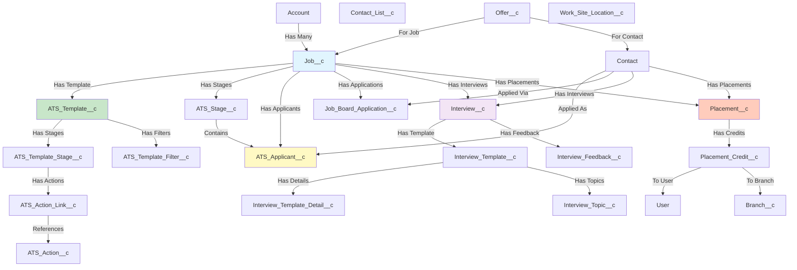

# Asymbl ATS Package Documentation

## Overview
The Asymbl ATS (Applicant Tracking System) is a comprehensive Salesforce package designed to manage the entire recruitment lifecycle, from job posting to placement and credit management. This document provides a detailed analysis of the package structure, objects, relationships, and functionality.

## Package Statistics
- **Package Name**: Asymbl ATS
- **API Version**: 60.0
- **Custom Objects**: 45+ custom objects
- **Custom Fields**: 500+ fields across all objects
- **Apex Classes**: 291 classes (including test classes)
- **Lightning Web Components**: 90+ components
- **Triggers**: 9 object triggers
- **Custom Labels**: 1,911 labels
- **Metadata Types**: 20+ configuration objects
- **Reports**: 14 pre-built reports
- **Integration Points**: 5 major integrations
- **Permission Sets**: 3 pre-configured sets
- **Validation Rules**: 8 business rules
- **Quick Actions**: 25+ user actions
- **Email Templates**: 3 templates
- **Flows**: 2 automation flows

## Object Relationship Diagram

## Core Objects and Relationships

### 1. Job Management

#### **Job__c (Primary Object)**
The central object for managing job opportunities and openings.

**Custom Fields with Data Types:**
- `Account__c` - **Lookup(Account)** - Client/Company reference
- `Account_Name__c` - **Text** - Account name formula/text field
- `Applicants_View__c` - **Text** - View configuration
- `ATS_Template__c` - **Lookup(ATS_Template__c)** - Associated template
- `Benefits_Perks__c` - **Text/Long Text Area** - Benefits description
- `Bill_Rate__c` - **Currency** - Billing rate
- `Bonus__c` - **Currency** - Bonus amount
- `Conversion_Percentage__c` - **Percent** - Conversion percentage
- `Delivery_Lead__c` - **Lookup(User)** - Delivery lead
- `End_Date__c` - **Date** - Job end date
- `Estimated_Revenue__c` - **Currency** - Estimated revenue
- `Experience__c` - **Text** - Required experience
- `Fields_to_Display_on_Cards__c` - **Text/Long Text Area** - JSON configuration
- `Fixed_Fee__c` - **Currency** - Fixed fee amount
- `Guarantee_Period_Weeks__c` - **Number** - Guarantee period
- `Hiring_Manager__c` - **Lookup(Contact)** - Hiring manager
- `Hiring_Manager_Email__c` - **Email** - Hiring manager email
- `Hiring_Manager_Name__c` - **Text** - Hiring manager name
- `Hiring_Multiple_Candidates__c` - **Checkbox** - Multiple hiring flag
- `Index__c` - **Number** - Index for sorting
- `Is_Active__c` - **Checkbox** - Active status
- `Is_Closed__c` - **Checkbox** - Closed status
- `Job_Description__c` - **Rich Text Area** - Detailed description
- `Job_Number__c` - **Auto Number/Text** - Unique job number
- `Job_Title__c` - **Text** - Job title
- `Location__c` - **Text** - Job location
- `Number_Of_Mass_Actions__c` - **Number** - Mass action count
- `Number_of_Openings__c` - **Number** - Open positions
- `Openings_Filled__c` - **Number** - Filled positions
- `Opportunity__c` - **Lookup(Opportunity)** - Related opportunity
- `Pay_Range__c` - **Text** - Pay range
- `Pay_Rate__c` - **Currency** - Pay rate
- `Placement_Fee__c` - **Currency** - Placement fee
- `Post_Externally__c` - **Checkbox** - External posting flag
- `Posted_Date__c` - **Date** - Date posted
- `Priority__c` - **Picklist** - Job priority
- `Related_Lists_to_Display__c` - **Text/Long Text Area** - Related list config
- `Salary__c` - **Currency** - Salary amount
- `Sales_Lead__c` - **Lookup(User)** - Sales lead
- `Shift__c` - **Text** - Work shift
- `Short_Description__c` - **Text Area** - Brief description
- `Show_ATS_Stages__c` - **Checkbox** - Show stages flag
- `Start_Date__c` - **Date** - Job start date
- `Status__c` - **Picklist** - Job status
- `Tags__c` - **Text** - Job tags
- `Today_Goal__c` - **Number** - Daily goal
- `Type__c` - **Picklist** - Job type
- `Urgent_Hiring__c` - **Checkbox** - Urgent hiring flag
- `Work_Site_Location__c` - **Lookup(Work_Site_Location__c)** - Work location
- `Job_Board_Field_Set_API_Name__c` - **Text** - Field set API name

**Relationships:**
- Parent: Account (Client)
- Children: ATS_Stage__c, ATS_Applicant__c, Job_Board_Application__c, Placement__c

#### **ATS_Template__c**
Templates that define stage workflows and configurations for jobs.

**Custom Fields with Data Types:**
- `ATS_Template_External_Id__c` - **Text** - External ID for integration
- `Fields_to_Display_on_Cards__c` - **Text/Long Text Area** - JSON configuration
- `Is_Active__c` - **Checkbox** - Active status
- `Is_Default__c` - **Checkbox** - Default template flag
- `Filter_Criteria__c` - **Text/Long Text Area** - Filter logic
- `Priority__c` - **Number** - Template priority

**Relationships:**
- Children: ATS_Template_Stage__c, ATS_Template_Filter__c, Job__c

#### **ATS_Stage__c**
Represents stages in the recruitment process for a specific job.

**Custom Fields with Data Types:**
- `Block_Multiple_Candidates__c` - **Checkbox** - Prevent multiple candidates
- `ATS_Template_Stage__c` - **Lookup(ATS_Template_Stage__c)** - Template stage reference
- `Is_Synced__c` - **Checkbox** - Sync status
- `Job__c` - **Master-Detail(Job__c)** - Parent job
- `Sequence__c` - **Number** - Stage order
- `Stage_Type__c` - **Picklist** - Stage type
- `Job_Type__c` - **Text** - Job type reference

**Relationships:**
- Parent: Job__c
- Children: ATS_Applicant__c (via Stage__c field)

### 2. Applicant Management

#### **ATS_Applicant__c**
Tracks candidates/applicants for specific jobs.

**Custom Fields with Data Types:**
- `Stage__c` - **Lookup(ATS_Stage__c)** - Current stage
- `ATS_Applicant__c` - **Auto Number** - Unique applicant ID
- `Applicant_Name__c` - **Text** - Applicant name
- `Applicant_Email__c` - **Email** - Applicant email
- `Applicant_Status__c` - **Picklist** - Application status
- `Bill_Rate__c` - **Currency** - Billing rate
- `Contact_Job_Relationship__c` - **Lookup(Contact)** - Contact reference
- `Current_Stage_Date__c` - **DateTime** - Stage entry timestamp
- `Days_in_Current_Stage__c` - **Formula(Number)** - Days in stage
- `Days_Since_Initial_Application__c` - **Formula(Number)** - Total days
- `Hiring_Manager_Name__c` - **Text** - Manager name
- `Initial_Application_Date__c` - **DateTime** - Application date
- `Job__c` - **Master-Detail(Job__c)** - Parent job
- `Job_Board_Applicant__c` - **Lookup(Job_Board_Application__c)** - JBA reference
- `Pay_Rate__c` - **Currency** - Pay rate
- `Recruited_By__c` - **Lookup(User)** - Recruiter
- `Application_Notes__c` - **Text Area** - Application notes
- `Salary__c` - **Currency** - Salary
- `Source__c` - **Text** - Application source
- `Asymbl_Rejection_Reason__c` - **Text/Picklist** - Rejection reason
- `Internal_Source__c` - **Text** - Internal source
- `Sequence__c` - **Number** - Applicant sequence
- `Rejected_By_Job_Closure__c` - **Checkbox** - Job closure rejection

**Relationships:**
- Parents: Job__c, Contact (via Contact_Job_Relationship__c)
- Related: ATS_Stage__c, Interview__c

#### **Job_Board_Application__c**
Manages external job board applications before conversion to contacts.

**Custom Fields with Data Types:**
- `Contact__c` - **Lookup(Contact)** - Associated contact
- `Email__c` - **Email** - Applicant email
- `First_Name__c` - **Text** - First name
- `Job__c` - **Lookup(Job__c)** - Related job
- `Last_Name__c` - **Text** - Last name
- `Mobile_Phone__c` - **Phone** - Mobile number
- `Status__c` - **Picklist** - Application status
- `Job_Board__c` - **Text** - Source job board
- `Rejected_By_Job_Closure__c` - **Checkbox** - Job closure rejection

**Relationships:**
- Parent: Job__c
- Related: Contact__c, ATS_Applicant__c

### 3. Interview Management

#### **Interview__c**
Manages interview scheduling and feedback.

**Custom Fields with Data Types:**
- `Additional_Information__c` - **Text Area** - Additional info
- `Assigned_To__c` - **Lookup(User)** - Assigned user
- `Candidate__c` - **Lookup(Contact)** - Candidate
- `Duration_Minutes__c` - **Number** - Duration in minutes
- `Event_Id__c` - **Text** - Calendar event ID
- `Feedback__c` - **Long Text Area** - Interview feedback
- `Interview_Template_Detail__c` - **Lookup(Interview_Template_Detail__c)** - Template detail
- `Location_Type__c` - **Picklist** - Location type
- `Interview_Date__c` - **DateTime** - Interview date/time
- `Interviewer__c` - **Lookup(User)** - Primary interviewer
- `Job__c` - **Lookup(Job__c)** - Related job
- `Location__c` - **Text** - Interview location
- `Type__c` - **Picklist** - Interview type
- `ATS_Applicant__c` - **Lookup(ATS_Applicant__c)** - Related applicant
- `Status__c` - **Picklist** - Interview status
- `Interviewers__c` - **Multi-Select Picklist** - All interviewers
- `Zoom_Meeting_Id__c` - **Text** - Zoom meeting ID
- `Job_Position__c` - **Text** - Job position
- `Duration__c` - **Text** - Duration display
- `Candidate_Name__c` - **Text** - Candidate name
- `Interview_Description__c` - **Text Area** - Description
- `Interview_Template__c` - **Lookup(Interview_Template__c)** - Template

**Relationships:**
- Parents: Job__c, Contact
- Children: Interview_Feedback__c

#### **Interview_Template__c**
Defines interview structure and evaluation criteria.

**Custom Fields with Data Types:**
- `Priority__c` - **Number** - Template priority
- `Is_Active__c` - **Checkbox** - Active status
- `Field_to_display__c` - **Text/Long Text Area** - Field configuration
- `Filter_Criteria__c` - **Text/Long Text Area** - Filter logic
- `Feedback_Format__c` - **Picklist** - Feedback format type
- `Feedback_Picklist_Options__c` - **Text Area** - Picklist values

**Relationships:**
- Children: Interview_Template_Detail__c, Interview_Topic__c

### 4. Placement and Credit Management

#### **Placement__c**
Records successful job placements.

**Custom Fields with Data Types:**
- `Account__c` - **Lookup(Account)** - Client account
- `Assignment_Extended__c` - **Checkbox** - Extension flag
- `ATS_Candidate__c` - **Lookup(Contact)** - Placed candidate
- `Branch__c` - **Lookup(Branch__c)** - Branch
- `Estimated_End_Date__c` - **Date** - End date
- `ATS_Job__c` - **Lookup(Job__c)** - Related job
- `Placement_Complete__c` - **Checkbox** - Completion status
- `Start_Date__c` - **Date** - Start date
- `Bill_Rate__c` - **Currency** - Billing rate
- `Conversion_Percentage__c` - **Percent** - Conversion rate
- `Placement_Percentage__c` - **Percent** - Placement fee percentage
- `Placement_Credit_Template__c` - **Lookup(Placement_Credit_Template__c)** - Credit template
- `Pay_Rate__c` - **Currency** - Pay rate
- `Salary__c` - **Currency** - Salary
- `Work_Site_Location__c` - **Lookup(Work_Site_Location__c)** - Work location
- `Pay_Rule_Country_Code__c` - **Text** - Country code
- `Pay_Rule_State_Code__c` - **Text** - State code
- `Is_Both_Profit_Populated__c` - **Checkbox** - Profit validation
- `Burden_Amount__c` - **Currency** - Burden amount
- `Burden_Percentage__c` - **Percent** - Burden percentage
- `Timesheet_Approver__c` - **Lookup(User)** - Approver
- `Timesheet_Delegated_Approver__c` - **Lookup(User)** - Delegated approver
- `Total_Billable_Amount__c` - **Currency** - Total billable
- `Total_Gross_Profit__c` - **Currency** - Gross profit
- `Total_Payable_Amount__c` - **Currency** - Total payable
- `Placement_Completed_On__c` - **Date** - Completion date

**Relationships:**
- Parents: Job__c, Contact, Account
- Children: Placement_Credit__c

#### **Placement_Credit__c**
Manages credit allocation for placements.

**Custom Fields with Data Types:**
- `ATS_Branch_Receiving_Credit__c` - **Lookup(Branch__c)** - Branch credit
- `Credit_Percentage__c` - **Percent** - Credit percentage
- `Placement_Credit_Template_Entry__c` - **Lookup(Placement_Credit_Template_Entry__c)** - Template entry
- `Placement__c` - **Master-Detail(Placement__c)** - Parent placement
- `Profit_Amount__c` - **Currency** - Profit amount
- `Revenue_Amount__c` - **Currency** - Revenue amount
- `ATS_Role_Type__c` - **Text/Picklist** - Role type
- `Total_Credits__c` - **Number** - Total credits
- `Type__c` - **Picklist** - Credit type
- `User__c` - **Lookup(User)** - User receiving credit
- `Credit_Recipient__c` - **Text** - Credit recipient name
- `Manual_Override__c` - **Checkbox** - Manual override flag

**Relationships:**
- Parent: Placement__c
- Related: Placement_Credit_Template__c

### 5. Supporting Objects

#### **Contact_List__c**
Custom contact lists for grouping candidates.

**Custom Fields with Data Types:**
- `Candidate_Ids__c` - **Long Text Area(32768)** - Contact IDs JSON
- `Fields_To_Display__c` - **Long Text Area** - Display fields JSON
- `Sorting_Field__c` - **Text** - Sort field
- `Sorting_Order__c` - **Text** - Sort order (ASC/DESC)
- `Type__c` - **Picklist** - List type (Candidate/Client)

#### **ATS_Action__c**
Configurable actions for stage transitions.

**Custom Fields with Data Types:**
- `Attach_Resume__c` - **Checkbox** - Attach resume flag
- `ATS_Actions_External_Id__c` - **Text** - External ID
- `Component_Name__c` - **Text** - LWC component name
- `Custom_Events_Present__c` - **Checkbox** - Custom events flag
- `Flow_Name__c` - **Text** - Flow API name
- `Is_Active__c` - **Checkbox** - Active status
- `LWC_Attributes__c` - **Long Text Area** - LWC attributes JSON
- `Object_Name__c` - **Text** - Object API name
- `Type__c` - **Picklist** - Action type (Flow/Component/Email)
- `Email_Template__c` - **Text** - Email template name
- `Email_Type__c` - **Picklist** - Email type
- `Applicant_Reference__c` - **Text** - Applicant field reference
- `Job_Reference__c` - **Text** - Job field reference
- `To_Field_ApiName_Reference__c` - **Text** - To field API
- `Cc_Field_ApiName_Reference__c` - **Text** - CC field API
- `Bcc_Field_ApiName_Reference__c` - **Text** - BCC field API
- `Pass_RecordId_As_Collection__c` - **Checkbox** - Collection flag
- `Include_User_Signature__c` - **Checkbox** - Include signature

**Relationships:**
- Children: ATS_Action_Link__c

#### **ATS_Action_Link__c**
Links actions to template stages.

**Custom Fields with Data Types:**
- `ATS_Action__c` - **Lookup(ATS_Action__c)** - Related action
- `Action_Links_External_Id__c` - **Text** - External ID
- `ATS_Stage__c` - **Lookup(ATS_Stage__c)** - Stage reference
- `ATS_Template__c` - **Lookup(ATS_Template__c)** - Template reference
- `ATS_Template_Stage__c` - **Lookup(ATS_Template_Stage__c)** - Template stage
- `Is_Optional__c` - **Checkbox** - Optional action flag
- `Relation_Type__c` - **Text/Picklist** - Relationship type
- `Sequence__c` - **Number** - Action sequence

#### **ATS_Template_Stage__c**
Template stage definitions.

**Custom Fields with Data Types:**
- `ATS_Template__c` - **Master-Detail(ATS_Template__c)** - Parent template
- `Sequence__c` - **Number** - Stage sequence
- `Stage_Type__c` - **Picklist** - Stage type
- `Template_Stage_External_Id__c` - **Text** - External ID

#### **ATS_Template_Filter__c**
Filter criteria for templates.

**Custom Fields with Data Types:**
- `ATS_Template_Filter_External_Id__c` - **Text** - External ID
- `Object_Name__c` - **Text** - Object API name
- `Operator__c` - **Picklist** - Filter operator
- `Placement_Credit_Template__c` - **Lookup(Placement_Credit_Template__c)** - Credit template
- `Related_Object__c` - **Text** - Related object name
- `Sequence__c` - **Number** - Filter sequence
- `Target_Field__c` - **Text** - Target field API
- `Value__c` - **Text** - Filter value
- `Interview_Template__c` - **Lookup(Interview_Template__c)** - Interview template
- `ATS_List_Filter__c` - **Lookup(ATS_List_Filter__c)** - List filter

#### **Interview_Feedback__c**
Stores interview feedback from interviewers.

**Custom Fields with Data Types:**
- `Interview__c` - **Master-Detail(Interview__c)** - Parent interview
- `Interview_Date__c` - **DateTime** - Interview date
- `Feedback__c` - **Long Text Area** - Feedback text
- `Recommended_New__c` - **Picklist** - Recommendation
- `Candidate__c` - **Lookup(Contact)** - Candidate
- `Interviewer__c` - **Lookup(User)** - Interviewer user
- `External_Interviewer__c` - **Text** - External interviewer
- `Submitted_By__c` - **Lookup(User)** - Submitter
- `Submission_Date_Time__c` - **DateTime** - Submission timestamp

#### **Interview_Template_Detail__c**
Interview template stage details.

**Custom Fields with Data Types:**
- `Interview_Plan_Template__c` - **Master-Detail(Interview_Template__c)** - Parent template
- `Interviewers__c` - **Text** - Interviewer list
- `Stage__c` - **Text** - Stage name
- `Field_to_display__c` - **Text/Long Text Area** - Display fields
- `Fields_to_Display_Same_as_Template__c` - **Checkbox** - Inherit fields flag
- `Interviewers_to_display__c` - **Text** - Display interviewers
- `Feedback_Format__c` - **Picklist** - Feedback format
- `Feedback_Picklist_Options__c` - **Text Area** - Picklist options

#### **Placement_Credit_Template__c**
Templates for credit allocation.

**Custom Fields with Data Types:**
- `Active__c` - **Checkbox** - Active status
- `Effective_Date__c` - **Date** - Start date
- `End_Date__c` - **Date** - End date
- `Filter_Criteria__c` - **Text/Long Text Area** - Filter logic
- `Priority__c` - **Number** - Template priority
- `Placement__c` - **Lookup(Placement__c)** - Related placement
- `Placement_Credit_Template__c` - **Text** - Template name
- `Status__c` - **Picklist** - Template status
- `Type__c` - **Picklist** - Template type
- `Void__c` - **Checkbox** - Void flag

#### **Placement_Credit_Template_Entry__c**
Credit allocation entries in templates.

**Custom Fields with Data Types:**
- `ATS_Placement_Credit_Name__c` - **Picklist** - Credit name
- `ATS_Branch_Receiving_Credit__c` - **Lookup(Branch__c)** - Branch
- `Credit_Percentage__c` - **Percent** - Credit percentage
- `Placement_Credit_Template__c` - **Master-Detail(Placement_Credit_Template__c)** - Parent
- `Type__c` - **Picklist** - Entry type
- `User_Receiving_Credit__c` - **Lookup(User)** - User

#### **ATS_Stage_Tracking__c**
Tracks applicant stage movements.

**Custom Fields with Data Types:**
- `ATS_Applicant__c` - **Lookup(ATS_Applicant__c)** - Applicant
- `ATS_Stage__c` - **Lookup(ATS_Stage__c)** - From stage
- `ATS_Stage_Moved_To__c` - **Lookup(ATS_Stage__c)** - To stage
- `Start_Date__c` - **DateTime** - Stage start
- `End_Date__c` - **DateTime** - Stage end
- `Duration__c` - **Number** - Duration days
- `Duration_in_Minutes__c` - **Number** - Duration minutes
- `Type__c` - **Text** - Tracking type

#### **ATS_List_Filter__c**
Filters for contact lists.

**Custom Fields with Data Types:**
- `Contact_List__c` - **Lookup(Contact_List__c)** - Parent list
- `Filter_Criteria__c` - **Text/Long Text Area** - Filter logic
- `Filter_Query__c` - **Text/Long Text Area** - SOQL query

#### **ATS_Log__c**
System logging for debugging.

**Custom Fields with Data Types:**
- `Class_Name__c` - **Text** - Apex class name
- `Method_Name__c` - **Text** - Method name
- `Log_Message__c` - **Long Text Area** - Log message
- `Log_Type__c` - **Picklist** - Log type (Error/Info/Warning)
- `Error_Stack_trace__c` - **Long Text Area** - Stack trace
- `Line_Number__c` - **Number** - Line number
- `Preserve_Log__c` - **Checkbox** - Preserve flag
- `Related_Record_Id__c` - **Text** - Related record

#### **Branch__c**
Branch/Office locations.

**Custom Fields with Data Types:**
- Standard object with branch information

#### **Work_Site_Location__c**
Work location details.

**Custom Fields with Data Types:**
- `Account__c` - **Lookup(Account)** - Related account
- `Country_Code__c` - **Text** - Country code
- `State_Code__c` - **Text** - State code

#### **Purchase_Order__c**
Purchase order management.

**Custom Fields with Data Types:**
- `Account__c` - **Lookup(Account)** - Client account
- `Amount_Consumed__c` - **Currency** - Consumed amount
- `PO_Amount__c` - **Currency** - Total PO amount
- `PO_Balance__c` - **Currency** - Remaining balance

#### **Offer__c**
Job offer tracking.

**Custom Fields with Data Types:**
- `Candidate__c` - **Lookup(Contact)** - Candidate
- `Job__c` - **Lookup(Job__c)** - Related job
- `Offer_Status__c` - **Picklist** - Offer status
- `Rate_Offered__c` - **Currency** - Offered rate
- `Salary_Offered__c` - **Currency** - Offered salary

#### **Interview_Topic__c**
Interview evaluation topics.

**Custom Fields with Data Types:**
- `Interview_Template__c` - **Lookup(Interview_Template__c)** - Template
- `Interview_Template_Detail__c` - **Lookup(Interview_Template_Detail__c)** - Template detail
- `Sequence__c` - **Number** - Topic sequence
- `Topic_Description__c` - **Text Area** - Topic description
- `IsDefault__c` - **Checkbox** - Default topic flag
- `Feedback_Type__c` - **Picklist** - Feedback type
- `External_Interviewer__c` - **Text** - External interviewer
- `Topic_Feedbacks__c` - **Text** - Feedback options

#### **Interview_Topic_Feedback__c**
Feedback for interview topics.

**Custom Fields with Data Types:**
- `Feedback__c` - **Text Area** - Feedback text
- `Topic_Rating__c` - **Number** - Rating value
- `Topic__c` - **Lookup(Interview_Topic__c)** - Parent topic
- `Topic_Asked__c` - **Checkbox** - Topic covered flag
- `Topic_Feedback__c` - **Text** - Topic feedback
- `Is_Additional_Topic__c` - **Checkbox** - Additional topic flag

#### **Message_Stats__c**
Email/SMS statistics tracking.

**Custom Fields with Data Types:**
- `Blocks__c` - **Number** - Blocked messages
- `Bounces__c` - **Number** - Bounced messages
- `Clicks__c` - **Number** - Click count
- `Date__c` - **Date** - Statistics date
- `Delivered__c` - **Number** - Delivered count
- `External_Key__c` - **Text** - External reference
- `Invalid_Emails__c` - **Number** - Invalid emails
- `Opens__c` - **Number** - Open count
- `Parent__c` - **Lookup** - Parent record
- `Stats_Type__c` - **Picklist** - Statistics type
- `Unique_Clicks__c` - **Number** - Unique clicks
- `Unique_Opens__c` - **Number** - Unique opens

#### **Google_Recaptcha_Detail__c**
Google reCAPTCHA configuration.

**Custom Fields with Data Types:**
- `Client_Id__c` - **Text** - Client ID
- `Key__c` - **Text** - API key

### 6. Metadata Type Objects

#### **Generic_Setting__mdt**
Global ATS settings.

**Custom Fields with Data Types:**
- `Account_Candidate_Pool_Name__c` - **Text** - Pool name
- `Account_Candidate_Pool_Number__c` - **Text** - Pool number
- `Account_Reference__c` - **Text** - Account reference
- `Assign_Contacts_to_Account__c` - **Checkbox** - Auto-assign flag
- `Candidate_Contact_List_Default_Tab__c` - **Text** - Default tab
- `Candidate_Related_Lists__c` - **Text Area** - Candidate lists
- `Client_Related_Lists__c` - **Text Area** - Client lists
- `Contacts_Allowed_In_Account__c` - **Number** - Contact limit
- `Contact_Filter_Fields__c` - **Text Area** - Filter fields
- `Default_Burden_Percentage__c` - **Number** - Default burden
- `Default_Related_Lists__c` - **Text Area** - Default lists
- `External_Jobs_Limit__c` - **Number** - Job limit
- `Template_Related_Lists__c` - **Text Area** - Template lists
- `Job_Filter_Criteria__c` - **Text Area** - Job filters
- `Contact_Filter_Criteria__c` - **Text Area** - Contact filters
- `Is_TK_Parsing_Enabled__c` - **Checkbox** - TextKernel flag
- `Candidate_Mass_Actions__c` - **Text Area** - Candidate actions
- `Client_Mass_Actions__c` - **Text Area** - Client actions
- `Convert_JBA_to_Contact__c` - **Checkbox** - Auto-convert flag
- `Show_Rejection_Reason__c` - **Checkbox** - Show rejection
- `Job_Filter_Fields__c` - **Text Area** - Job filter fields
- `Community_URL__c` - **URL** - Community URL
- `Is_Enable_Event_Creation__c` - **Checkbox** - Event creation
- `ATS_Custom_Schedule_Setting__c` - **Text** - Schedule settings
- `ATS_Interview_Feedback_Scheduling__c` - **Text** - Feedback schedule
- `ATS_Max_Schedule_Time__c` - **Number** - Max schedule time
- `JBA_Mass_Actions__c` - **Text Area** - JBA actions
- `Applicant_Mass_Actions__c` - **Text Area** - Applicant actions

#### **ATS_Job_Object_Mapping__mdt**
Object mapping configuration.

**Custom Fields with Data Types:**
- `Lookup_Name_on_Applicant_Object__c` - **Text** - Applicant lookup
- `Lookup_Name_on_Interview_Object__c` - **Text** - Interview lookup
- `Lookup_Name_on_Mapped_Object__c` - **Text** - Mapped object lookup
- `Lookup_Name_on_Stage_Object__c` - **Text** - Stage lookup
- `Is_Closed_Field__c` - **Text** - Closed field name
- `Object_Name__c` - **Text** - Object API name
- `Deletion_Frequency__c` - **Text** - Deletion frequency
- `Days_Prior__c` - **Number** - Days to keep
- `Is_Trigger_Deployed__c` - **Checkbox** - Trigger deployed
- `Job_Board_URL_Field__c` - **Text** - URL field

#### **ATS_JSON_Mapping__mdt**
JSON field mapping for external posting.

**Custom Fields with Data Types:**
- `Is_Active__c` - **Checkbox** - Active mapping
- `Field_Api_Name__c` - **Text** - Field API name
- `Field_Label__c` - **Text** - Field label
- `Object_Api_Name__c` - **Text** - Object API name
- `Remove_HTML__c` - **Checkbox** - Strip HTML
- `Text_Length__c` - **Number** - Max text length

#### **ATS_Timesheet_Object_Mapping__mdt**
Timesheet integration mapping.

**Custom Fields with Data Types:**
- `Conversion_Profit_Amount_Field_Mapping__c` - **Text** - Conversion profit field
- `Lookup_To_Timesheet_On_Placement_Credit__c` - **Text** - Timesheet lookup
- `Object_Name__c` - **Text** - Object API name
- `Permanent_Profit_Amount_Field_Mapping__c` - **Text** - Permanent profit field
- `Timesheet_Placement_Field_Mapping__c` - **Text** - Placement field
- `Timesheet_Profit_Amount_Field_Mapping__c` - **Text** - Profit field
- `Timesheet_Revenue_Amount_Field_Mapping__c` - **Text** - Revenue field
- `Timesheet_Status_Field_Mapping__c` - **Text** - Status field
- `Timesheet_Status_Field_Value__c` - **Text** - Status value
- `Timesheet_Start_Date_Field_Mapping__c` - **Text** - Start date field
- `Is_Trigger_Deployed__c` - **Checkbox** - Trigger deployed

#### **ATS_Job_Board_Application_Mapping__mdt**
Job board application field mapping.

**Custom Fields with Data Types:**
- `ATS_Applicant_Mapping__c` - **Text** - Applicant field mapping
- `Contact_Mapping__c` - **Text** - Contact field mapping

#### **ATS_Integration_Settings__mdt**
Integration credentials and settings.

**Custom Fields with Data Types:**
- `Account_Name__c` - **Text** - Account name
- `Encryption_Key__c` - **Text** - Encryption key
- `Endpoint_URL__c` - **URL** - API endpoint
- `Password__c` - **Text** - Encrypted password
- `Username__c` - **Text** - Username

#### **TK_Field_Mapping__mdt**
TextKernel resume parsing field mappings.

**Custom Fields with Data Types:**
- `Field_Api_Name__c` - **Text** - Salesforce field API
- `Field_Label__c` - **Text** - Field label
- `Field_Type__c` - **Text** - Field data type
- `Is_Active__c` - **Checkbox** - Active mapping
- `Is_Required__c` - **Checkbox** - Required field
- `Is_Protected__c` - **Checkbox** - Protected field
- `Mapped_Field__c` - **Text** - TK field name
- `Mapped_Object__c` - **Text** - Target object
- `Section__c` - **Text** - Resume section

#### **ATS_Email_Integration__mdt**
Email integration settings.

**Custom Fields with Data Types:**
- `API_key__c` - **Text** - API key
- `Create_Activity_Record__c` - **Checkbox** - Create activities
- `Email_Activity_Last_Job_Run_Time__c` - **DateTime** - Last run
- `Encryption_Key__c` - **Text** - Encryption key
- `Endpoint_URL__c` - **URL** - Service endpoint
- `Is_Active__c` - **Checkbox** - Active status

#### **ATS_SMS_Integration__mdt**
SMS integration settings.

**Custom Fields with Data Types:**
- `Account_ID__c` - **Text** - Twilio account ID
- `Encryption_Key__c` - **Text** - Encryption key
- `Authentication_Token__c` - **Text** - Auth token
- `Is_Integration_Active__c` - **Checkbox** - Active status
- `Create_Activity_Record__c` - **Checkbox** - Create activities
- `From_Number__c` - **Phone** - From number
- `URL__c` - **URL** - API endpoint

#### **ATS_Zoom_Integration_Data__mdt**
Zoom integration configuration.

**Custom Fields with Data Types:**
- `Auth_URL__c` - **URL** - OAuth URL
- `Client_Id__c` - **Text** - Client ID
- `Client_Secret__c` - **Text** - Client secret
- `Last_Refresh_Date__c` - **DateTime** - Token refresh
- `Refresh_Token__c` - **Text** - Refresh token
- `Token_URL__c` - **URL** - Token endpoint
- `Base_Url__c` - **URL** - API base URL
- `Encryption_Key__c` - **Text** - Encryption key

#### **ATS_Demo_Data_Info__mdt**
Demo data configuration.

**Custom Fields with Data Types:**
- `Created_Record_Ids_JSON__c` - **Text Area** - Created records
- `Interview_Template_Record_Id_JSON__c` - **Text Area** - Interview templates
- `Placement_Credit_Record_Ids_JSON__c` - **Text Area** - Credit records

#### **ATS_Job_View_List__mdt**
Job view list configuration.

**Custom Fields with Data Types:**
- `Filter_JSON__c` - **Text Area** - Filter configuration
- `Index__c` - **Number** - Display order
- `Field_Set_API_Name__c` - **Text** - Field set name

#### **ATS_Job_Description_Template__mdt**
Job description templates.

**Custom Fields with Data Types:**
- `Template__c` - **Long Text Area(32768)** - Template content

### 7. Platform Event Objects

#### **ATS_Record_Action__e**
Platform event for record actions.

**Custom Fields with Data Types:**
- `Event_Type__c` - **Text** - Event type
- `Object_Api_Name__c` - **Text** - Object name
- `Payload__c` - **Text Area** - Event payload
- `Record_Id__c` - **Text** - Record ID

#### **Add_to_ATS__e**
Platform event for adding to ATS.

**Custom Fields with Data Types:**
- Standard platform event fields

### 8. Timeline Configuration Objects

#### **ATS_Timeline_Configuration__c**
Timeline view configuration.

**Custom Fields with Data Types:**
- `Display_Relative_Dates__c` - **Checkbox** - Relative dates
- `External_Key__c` - **Text** - External key
- `Object__c` - **Text** - Object name

#### **ATS_Timeline_Child__c**
Timeline child object configuration.

**Custom Fields with Data Types:**
- `ATS_Timeline_Configuration__c` - **Lookup(ATS_Timeline_Configuration__c)** - Parent
- `Data_Provider_Type__c` - **Picklist** - Provider type
- `Date_Field__c` - **Text** - Date field name
- `Display_Object_Name__c` - **Text** - Display name
- `External_Key__c` - **Text** - External key
- `Fields_to_Display__c` - **Text Area** - Display fields
- `Filter_Criteria_Config__c` - **Text Area** - Filter config
- `Icon_Image_Url__c` - **URL** - Icon URL
- `Icon_Name__c` - **Text** - Icon name
- `Include_All_Records__c` - **Checkbox** - Include all
- `LWC_Ui_Api_Not_Supported__c` - **Checkbox** - API support flag
- `Object__c` - **Text** - Object name
- `Object_Color__c` - **Text** - Color code
- `Overdue_Field__c` - **Text** - Overdue field
- `Provider_Apex_Classname__c` - **Text** - Apex class
- `Reference_Field_Name__c` - **Text** - Reference field
- `Relationship_Name__c` - **Text** - Relationship name
- `Sub_Title_Fields__c` - **Text** - Subtitle fields
- `Subtitle_Label__c` - **Text** - Subtitle label
- `Title_link_Navigate_to__c` - **Text** - Navigation
- `Where_Clause__c` - **Text Area** - WHERE clause

### 9. Standard Object Extensions

#### **Contact (Extended Fields)**
Additional fields on Contact object.

**Custom Fields with Data Types:**
- `Contact_Relationship__c` - **Picklist** - Relationship type
- `Current_Salary__c` - **Currency** - Current salary
- `Earliest_Available_Date__c` - **Date** - Availability
- `Current_Pay_Rate__c` - **Currency** - Current rate
- `Pay_Rate__c` - **Currency** - Desired rate
- `Desired_Salary__c` - **Currency** - Desired salary
- `ATS_Is_Job_Board_Applicant__c` - **Checkbox** - JBA flag
- `ATS_Job_Board_Application__c` - **Lookup(Job_Board_Application__c)** - JBA link
- `Is_Resume_Parsed__c` - **Checkbox** - Parsing flag
- `Parsing_Error__c` - **Text** - Parsing error

#### **ContentVersion (Extended Fields)**
File management extensions.

**Custom Fields with Data Types:**
- `Is_Primary__c` - **Checkbox** - Primary file flag

#### **EmailMessage (Extended Fields)**
Email tracking extensions.

**Custom Fields with Data Types:**
- `Clicks_Count__c` - **Number** - Click count
- `Last_Event_Time__c` - **DateTime** - Last event
- `Opens_Count__c` - **Number** - Open count
- `Status__c` - **Text** - Email status
- `Twilio_Message_Id__c` - **Text** - Twilio ID
- `Message_Type__c` - **Text** - Message type
- `Mobile_Phone__c` - **Phone** - Mobile number

## Key Workflows and Processes

### 1. Recruitment Workflow
1. **Job Creation**: Create job with template assignment
2. **Stage Setup**: Automatic stage creation from template
3. **Application Management**: 
   - Direct applications via ATS_Applicant__c
   - External applications via Job_Board_Application__c
   - Automatic contact creation and deduplication
4. **Stage Progression**: Move applicants through stages with actions
5. **Interview Process**: Schedule, conduct, and collect feedback
6. **Placement**: Create placement records with credit allocation

### 2. Template-Based Automation
- **Job Templates**: Pre-configured stage workflows
- **Action Templates**: Stage-specific actions (emails, flows, components)
- **Interview Templates**: Structured interview processes
- **Credit Templates**: Automated credit distribution rules

### 3. Integration Workflows
1. **Resume Parsing**: TextKernel integration for automated data extraction
2. **Communication**: Twilio for email/SMS with tracking
3. **Video Interviews**: Zoom integration with meeting creation
4. **External Posting**: JSON-based job board integration
5. **reCAPTCHA**: Bot protection for applications

## Key Features and Functionality

### 1. Template-Based Workflow Management
- Jobs can be associated with templates that define stage progression
- Templates include filter criteria for automatic assignment
- Stages can block multiple candidates (e.g., only one offer stage)

### 2. Multi-Source Applicant Tracking
- Direct applicants (ATS_Applicant__c)
- Job board applications (Job_Board_Application__c)
- Automatic conversion from job board to contact

### 3. Interview Management System
- Template-based interview structures
- Multi-interviewer support
- Zoom integration for virtual interviews
- Structured feedback collection with topics and ratings

### 4. Placement Credit System
- Flexible credit allocation based on templates
- Support for multiple credit types (Revenue, Profit)
- Branch and user-level credit tracking

### 5. External Job Posting
- JSON mapping for external job boards
- Configurable field mappings
- Google reCAPTCHA integration for applications

### 6. Communication Features
- Email integration (Twilio SendGrid)
- SMS capabilities (Twilio)
- Template-based communications
- Activity tracking

## Configuration Components

### Global Value Sets (Picklist Values)
1. **Application_Status** - Status values for applications
2. **Branches** - Branch/office locations
3. **Contact_Relationship** - Types of contact relationships
4. **Job_Status** - Job lifecycle statuses
5. **Job_Type** - Types of jobs (Contract, Permanent, etc.)
6. **Placement_Credit_Types** - Credit allocation types
7. **Stage_Type** - Recruitment stage types
8. **Placement_Credit_Name** - Named credit types

### Validation Rules
1. **ATS_Action_Link__c.Must_have_relationship** - Ensures action links have proper relationships
2. **ATS_Template__c.Check_for_Filter_Criteria** - Validates template filter logic
3. **Job__c.External_Job_Post_Criteria** - Validates external posting requirements
4. **Placement_Credit_Template__c.Check_for_Filter_Criteria** - Credit template validation
5. **Placement_Credit_Template_Entry__c**:
   - `Branch_Receiving_Credit_Criteria`
   - `House_Receiving_Credit_Criteria`
   - `User_Receiving_Credit_Criteria`

### Field Sets
1. **Contact.Job_Board_Fields** - Fields for job board integration
2. **Job_Board_Application__c.Apply_To_Career_Job_Form** - Application form fields
3. **Interview__c.External_Interview_Feedback_Fields** - External feedback fields

### Email Templates
1. **Email_Notification_when_applicant_moves_to_Particular_Stage** - Stage transition notifications
2. **Template_to_send_Interview_Invitation** - Interview scheduling
3. **Email_Template_for_Interview_Feedback** - Feedback requests

### Process Automation

#### Flows
1. **Add_to_ATS_From_Contact** - Add contacts to ATS workflow
2. **Add_to_Contact_List_from_Contact** - Contact list management

#### Quick Actions
- NewEvent, NewTask, SendEmail
- Account.New_Placement
- Contact.Placement_Details, Add_to_Contact_List, Add_Candidate_to_Job
- Contact_List__c.Add_Contacts, Clone, Edit
- ATS_Template__c actions (Apply_Changes, Clone, Select_Lists, etc.)
- Placement__c.Update_Placement_Credit
- Job__c actions (Sync_Template, Add_Candidates, Close_Job, Reopen_Job)
- Interview actions and more

### User Interface Components

#### Custom Application
- **ASYMBL_ATS_Setup** - Main ATS application

#### Custom Tabs
- ASYMBL_Admin_Tab, ATS_Applicant__c, ATS_Kanban_View
- Job__c, Placement__c, Interview__c, Contact_List__c
- ExportImportATSTemplate, ATS_Log__c, Message_Stats__c
- And more supporting tabs

#### FlexiPages (Lightning Record Pages)
- ATS_Action_Record_Page, ATS_Stage_Record_Page
- ATS_Template_Record_Page, ATS_Applicant_Record_Page
- Job_Record_Page, Placement_Record_Page
- Interview_Template_Record_Page
- And other object-specific pages

#### Web Links
1. **Contact.Add_to_Contact_List** - Quick add to list
2. **Job__c.Manage_Applicants** - Applicant management
3. **Job__c.White_Board** - Whiteboard view

#### Lightning Message Channels
1. **ATSMessageChannel** - Component communication
2. **ATSTimelineItemState** - Timeline state management

### Visualforce Components
1. **ATS_PostExternalJobCompactDetail** - Job detail display
2. **ATS_PostExternalJobFilter** - Job filtering

### Visualforce Pages
- ATS_JobDetailPage, ATS_ExternalJobApplyStatus
- ATS_PostExternallyJobsDetail, ATS_PostExternallyJobsJSON
- ATS_PostExternallyJobsXML, ATS_PostExternalJobList
- ATS_JobDetailVFPage, UserSessionPage, ATS_ZoomAuthCallback

### Path Assistant
- **Job_Status** - Guided process for job status progression

### Matching Rules
- **Contact.Contact_Job_Board_Matching_Rule** - Duplicate contact detection

### Sharing Reasons
- **Interview__c.Asymbl_Share__c** - Custom interview sharing logic

### Remote Site Settings (External Integrations)
1. **Google** - Google services integration
2. **TwilioSMS** - SMS messaging
3. **ZoomAuthenticationAPI** - Zoom API access
4. **ZoomAuthentication** - Zoom OAuth

### Custom Site
- **BP_ATS** - External job portal site
  - Public access for job listings
  - Application submission capability
  - reCAPTCHA protection
  - Mobile-responsive design

### Page Layouts
The package includes comprehensive page layouts for all custom objects:
- ATS_Action__c-ATS Action Layout
- ATS_Applicant__c-ATS Applicant Layout
- ATS_Stage__c-ATS Stage Layout
- ATS_Template__c-ATS Template Layout
- Job__c-Job Layout
- Placement__c-Placement Layout
- Interview__c-Interview Layout
- Contact_List__c-Contact List Layout
- And 30+ additional layouts for supporting objects

### List Views
All major objects include "All" list views with additional custom views available for filtering and segmentation.

### Compact Layouts
Optimized compact layouts for mobile and quick view:
- ATS_Action__c.ATS_Action_Compact_Layout
- Job__c.Job_Compact_Layout
- Placement__c.Placement_Compact_Layout
- Interview__c.Interview_Compact_Layout
- And layouts for all other custom objects

### Resources and Assets

#### Static Resources
- **ATS_Resources** - JavaScript, CSS, and other client resources

#### Content Assets
1. **Asymbl_ATS** - ATS branding
2. **Asymbl_Logo** - Company logo
3. **Asymbl_New_Logo** - Updated logo

#### Documents
- **Asymbl_ATS/Asymbl_Logo.jpeg** - Logo image file

### Custom Labels
The package includes **1,900+ custom labels** for internationalization and UI text management, including:
- UI labels and messages
- Error messages
- Confirmation dialogs
- Field labels
- Button labels
- Info messages
- Validation messages

## Technical Components

### Apex Classes (Key Controllers)
1. **Kanban View Management**
   - `ATSKanbanViewController` - Main kanban board controller
   - `ATS_KanbanViewControllerTest` - Test class

2. **Action Management**
   - `ATS_ActionAttributesController` - Manages action attributes
   - `ATS_ApplyMassActionOnTemplateController` - Bulk actions

3. **Integration Controllers**
   - `ATS_GoogleAuthService` - Google OAuth integration
   - `ATS_TKIntegrationService` - TextKernel resume parsing
   - `ATS_TwilioService` - Twilio communications

4. **Data Management**
   - `ATS_SyncJobDataWithTemplateBatchable` - Batch job sync
   - `ATS_UpdateContactListController` - Contact list management
   - `ATS_AssignContactToAccountBatch` - Contact-account assignment
   - `ATS_MoveExtraContactsToAccountBatch` - Contact consolidation
   - `ATS_RenameExistingAccountsBatch` - Account management
   
5. **Test Classes**
   - Comprehensive test coverage with dedicated test classes for each controller
   - Mock generators (`ATS_MockGenerator`) for test data
   - Test utilities (`ATS_TestUtility`) for common test operations
   - `ATS_TKIntegrationCalloutMock` - TextKernel API mocks
   - Dynamic picklist implementations:
     - `ATS_DynamicPicklistJobDetail`
     - `ATS_DynamicPicklistJobFilter`
     - `ATS_DynamicPicklistJobView`

6. **Scheduled Jobs & Batch Classes**
   - `ATS_TKIntegrationBatch` - Resume parsing batch
   - `ATS_TwilioEmailActivityBatch` - Email activity sync
   - `ATS_TwilioEmailStatsScheduler` - Email statistics scheduler
   - `ATS_SMSIntegrationBatch` - SMS processing
   - `ATS_SMSIntegrationForFeedbackBatch` - Feedback SMS batch

7. **Invocable Methods**
   - `ATS_TKResumeParsingInvocable` - Flow-accessible resume parsing
   - `ATS_InvocableSendSMS` - Flow-accessible SMS sending

8. **Utility & Helper Classes**
   - `ATS_Utility` - Common utility methods
   - `ATS_DataUtility` - Data manipulation utilities
   - `ATS_SecureDml` - Secure DML operations
   - `ATS_BooleanEvaluation` - Boolean expression evaluator
   - `ATS_Constants` - System constants
   - `ATS_ToolingService` - Tooling API wrapper
   - `ATS_MetadataService` - Metadata API wrapper
   - `ATS_RemoteSiteSettingService` - Remote site management
   - `ATS_Puff` & `ATS_Zippex` - File compression utilities

9. **Wrapper Classes & Data Structures**
   - `ATS_DMLOperationWrapper` - DML operation handling
   - `ATS_JobDetailWrapper` - Job detail container
   - `ATS_SelectOptionWrapper` - Select option data
   - `ATS_TriggerInfoWrapper` - Trigger context info
   - `ATS_RelatedListsFieldsWrapper` - Related list configuration
   - `ATS_FieldApiNameToValueWrapper` - Field mapping
   - `ATS_AddToContactListWrapper` - Contact list operations
   - `ATS_MappingWrapper` - Generic mapping structure
   - `ATS_TKWrapperClass` - TextKernel data wrapper
   - `ATS_TwilioWrapperClass` - Twilio data wrapper
   - `ATS_TimelineDataResponse` - Timeline data structure
   - `ATS_ExportImportClasses` - Export/import utilities
   - `ATS_InvocableInputs` - Flow input parameters

10. **Post-Install & Configuration Classes**
    - `ATS_TimelinePostInstaller` - Timeline setup
    - `ATS_UpdatePermissionsPostInstaller` - Permission configuration
    - `ATS_ShareInterviewRecords` - Interview sharing setup
    - `ATS_ShareAllInterviewRecords` - Bulk interview sharing
    - `ATS_ImportDemoDataController` - Demo data loader
    - `ATS_DeployDemoDataInfo` - Demo data configuration

### Lightning Web Components
1. **Core UI Components**
   - `atsKanbanView` - Main kanban board
   - `atsSplitView` - Split view interface
   - `atsListView` - List view component

2. **Action Components**
   - `atsScheduleInterview` - Interview scheduling
   - `atsSendEmail` - Email communication
   - `atsSendSms` - SMS communication

3. **Configuration Components**
   - `atsTemplateFilter` - Template filtering
   - `atsJobMapping` - Field mapping configuration
   - `atsSelectFieldsToDisplay` - Field selection
   - `atsImportTemplate` & `atsExportTemplate` - Template migration
   - `atsSettings` - Global settings management

4. **Specialized UI Components**
   - `atsWhiteBoardContainer` - Whiteboard view for jobs
   - `atsCandidateSkillChart` - Skill visualization
   - `atsActivityTimeline` - Activity history view
   - `atsBubbleChart` - Data visualization
   - `atsFileViewer` - Document preview
   - `atsGoogleCaptcha` - reCAPTCHA integration
   - `customLightningDatatable` - Enhanced data tables
   - `atsFormattedData` - Data formatting utilities

### Triggers and Handlers
1. **ATS_JobTrigger** & `ATS_JobTriggerHandler/Helper`
   - Job record automation
   - Template synchronization
   - Stage creation

2. **ATS_PlacementTrigger** & `ATS_PlacementTriggerHandler/Helper`
   - Placement processing
   - Credit calculation
   - Timesheet integration

3. **ATS_TemplateTrigger** & `ATS_TemplateTriggerHandler/Helper`
   - Template validation
   - Job synchronization
   - Default template management

4. **ATS_ContentDocumentLinkTrigger** & Handler
   - File attachment handling
   - Primary resume management
   - Document sharing

5. **ATS_JobBoardApplicationTrigger** & Handler
   - Application processing
   - Contact creation/matching
   - Duplicate prevention

6. **ATS_ContactTrigger** & `ATS_ContactTriggerHandler/Helper`
   - Contact automation
   - Job board applicant linking
   - Resume parsing initiation

7. **ATS_InterviewTrigger** & `ATS_InterviewTriggerHandler/Helper`
   - Interview scheduling
   - Calendar event creation
   - Feedback reminders

8. **ATS_ActionTrigger** & `ATS_ActionTriggerHandler/Helper`
   - Action execution
   - Stage transition automation

9. **ATS_PlacementCreditTrigger** & Handler
   - Credit allocation
   - Profit/revenue calculation

### Permission Sets
1. `BPATS_Admin` - Administrator access
2. `Asymbl_ATS_Job_Portal` - External job portal access
3. `External_Interview_Feedback` - External interviewer access

## Integration Points

### 1. TextKernel Integration
- Resume parsing capabilities
- Skill extraction
- Work history parsing
- Configurable field mappings via `TK_Field_Mapping__mdt`

### 2. Twilio Integration
- Email delivery via SendGrid
- SMS messaging
- Activity tracking
- Message statistics

### 3. Zoom Integration
- Meeting creation
- Interview scheduling
- OAuth authentication

### 4. Google Services
- reCAPTCHA for job applications
- Authentication services

## Security and Access Control

### Custom Permissions
- **Job_Applicant_Delete_Permission** - Controls who can delete job applicants, preventing accidental data loss

### Sharing Rules
- `Interview__c.Asymbl_Share__c` - Interview record sharing

### Validation Rules
- Template filter criteria validation
- Credit allocation validation
- External job posting criteria

## Reporting and Analytics

### Custom Report Types
1. **Accounts_with_Jobs_with_ATS_Stages** - Account-centric job analysis
2. **Accounts_with_Jobs_with_ATS_Stages_with_Job_Applicants** - Full recruitment pipeline
3. **Jobs_with_ATS_Stages_with_Job_Applicants** - Job-focused applicant tracking
4. **Contact_Report** - Contact/candidate reporting

### Pre-built Reports (ATSReports Folder)
1. **Placement Reports**
   - Placement_Ends_Next_30_days_SFi - Upcoming placement endings
   - Placements_All_Time_qdI - Historical placements
   - Placements_by_Month_WQg - Monthly placement trends
   - Total_Active_Placements_dxl - Current active placements

2. **Job Reports**
   - Jobs_Created_by_Month_NBs - Job creation trends
   - Open_Jobs_by_Type_Iln - Job type distribution
   - Average_Bill_Rate_MpU - Billing rate analysis

3. **Financial Reports**
   - Gross_Profit_by_Week_5m4 - Weekly profit tracking
   - Placement_Credits_pZD - Credit allocation report

4. **Applicant Reports**
   - Applicants_by_Stage_BZF - Stage distribution
   - Job_Board_Applicant_by_Status_qhZ - Application status
   - New_Candidates_Created_by_Month_lt0 - Candidate growth
   - Average_Stage_Duration_bi5 - Process efficiency

### BPATS Report Folder
- Record_Page_Donut_Chart_9nb - Visual dashboard component

## Best Practices and Usage Guidelines

### 1. Template Configuration
- Create templates for different job types
- Define clear stage progressions
- Set appropriate filter criteria

### 2. Action Configuration
- Use flows for complex automation
- Configure email templates for communications
- Set up stage-specific actions

### 3. Data Management
- Regular cleanup of ATS logs
- Batch processing for large operations
- Proper credit template configuration

### 4. Integration Setup
- Configure API credentials securely
- Test integrations in sandbox first
- Monitor integration logs

## Data Model Summary

### Object Hierarchy
1. **Account** (Standard)
   - → Job__c (Many)
   - → Placement__c (Many)
   - → Work_Site_Location__c (Many)

2. **Job__c** (Primary)
   - → ATS_Stage__c (Master-Detail)
   - → ATS_Applicant__c (Master-Detail)
   - → Job_Board_Application__c (Lookup)
   - → Interview__c (Lookup)
   - → Placement__c (Lookup)
   - → Offer__c (Lookup)

3. **Contact** (Standard)
   - → ATS_Applicant__c (via Contact_Job_Relationship__c)
   - → Job_Board_Application__c (Lookup)
   - → Interview__c (Lookup)
   - → Placement__c (Lookup)

### Key Relationships
- **Master-Detail**: Job→ATS_Stage, Job→ATS_Applicant, Placement→Placement_Credit
- **Lookup**: Most other relationships for flexibility
- **Many-to-Many**: Contact↔Job (via ATS_Applicant__c)

### Data Flow
1. **Application Flow**: Job Board → Job_Board_Application__c → Contact → ATS_Applicant__c
2. **Stage Progression**: ATS_Template__c → ATS_Stage__c → ATS_Applicant__c movement
3. **Interview Process**: Interview_Template__c → Interview__c → Interview_Feedback__c
4. **Placement Flow**: ATS_Applicant__c → Placement__c → Placement_Credit__c

## Conclusion
The Asymbl ATS package provides a comprehensive recruitment management solution with extensive customization options, integration capabilities, and workflow automation features. The modular design allows organizations to adapt the system to their specific recruitment processes while maintaining data integrity and user access control. With 100+ custom objects and fields, 290+ Apex classes, 90+ Lightning Web Components, and multiple integration points, this package offers a complete ATS solution built on the Salesforce platform.