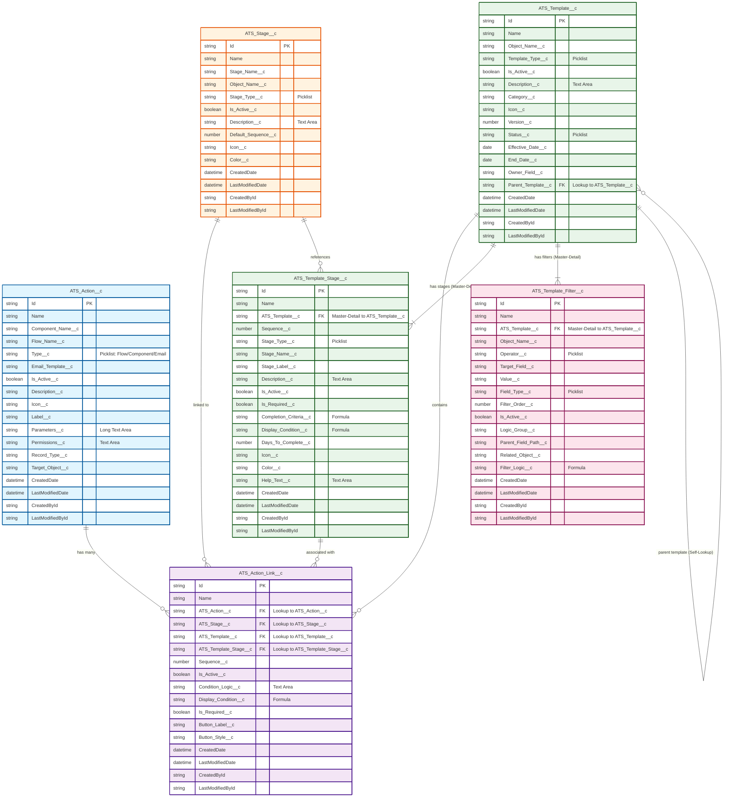

# ATS Package - Action and Template Configuration ERD

## Entity Relationship Diagram

## Object Descriptions

### ATS_Action__c (Actions)
- **Purpose**: Stores reusable actions that can be triggered at different stages
- **Key Fields**:
  - `Type__c`: Determines the action type (Flow, Component, or Email)
  - `Component_Name__c`: Lightning component name for Component type actions
  - `Flow_Name__c`: Flow API name for Flow type actions
  - `Email_Template__c`: Email template ID for Email type actions
  - `Parameters__c`: JSON parameters passed to the action

### ATS_Action_Link__c (Action Links)
- **Purpose**: Junction object that links actions to stages and templates
- **Key Relationships**:
  - Links to `ATS_Action__c` (the action to execute)
  - Links to `ATS_Stage__c` (generic stage reference)
  - Links to `ATS_Template__c` (template context)
  - Links to `ATS_Template_Stage__c` (specific template stage)
- **Key Fields**:
  - `Sequence__c`: Order of execution when multiple actions exist
  - `Display_Condition__c`: Formula to determine visibility
  - `Is_Required__c`: Whether the action must be completed

### ATS_Template_Stage__c (Template Stages)
- **Purpose**: Defines stages within a template with Master-Detail to ATS_Template__c
- **Key Fields**:
  - `Sequence__c`: Order of stages in the template
  - `Stage_Type__c`: Type of stage (e.g., Approval, Review, Action)
  - `Completion_Criteria__c`: Formula to determine when stage is complete
  - `Days_To_Complete__c`: SLA for stage completion

### ATS_Template_Filter__c (Template Filters)
- **Purpose**: Defines filtering criteria for template applicability
- **Key Fields**:
  - `Object_Name__c`: Target object for the filter
  - `Target_Field__c`: Field to evaluate
  - `Operator__c`: Comparison operator (equals, not equals, contains, etc.)
  - `Value__c`: Value to compare against
  - `Filter_Order__c`: Order of filter evaluation

### ATS_Template__c (Templates)
- **Purpose**: Master template object that defines the overall process
- **Key Fields**:
  - `Object_Name__c`: Primary object the template applies to
  - `Template_Type__c`: Type of template
  - `Parent_Template__c`: Self-lookup for template inheritance
  - `Version__c`: Template version number

### ATS_Stage__c (Stages)
- **Purpose**: Generic stage definitions that can be reused across templates
- **Key Fields**:
  - `Stage_Name__c`: Unique identifier for the stage
  - `Object_Name__c`: Object this stage applies to
  - `Default_Sequence__c`: Default ordering when added to templates

## Relationship Summary

1. **Templates to Stages**: One-to-Many (Master-Detail)
   - A template has multiple stages defined through `ATS_Template_Stage__c`

2. **Templates to Filters**: One-to-Many (Master-Detail)
   - A template has multiple filters to determine applicability

3. **Actions to Templates/Stages**: Many-to-Many (via Action Links)
   - Actions can be reused across different templates and stages
   - The `ATS_Action_Link__c` junction object manages these relationships

4. **Stage Reusability**:
   - `ATS_Stage__c` provides reusable stage definitions
   - `ATS_Template_Stage__c` creates template-specific stage instances

## Color Coding Legend
- 🔵 **Blue**: Action objects (ATS_Action__c)
- 🟣 **Purple**: Link/Junction objects (ATS_Action_Link__c)
- 🟢 **Green**: Template objects (ATS_Template__c, ATS_Template_Stage__c)
- 🟠 **Orange**: Stage objects (ATS_Stage__c)
- 🔴 **Pink**: Filter objects (ATS_Template_Filter__c)