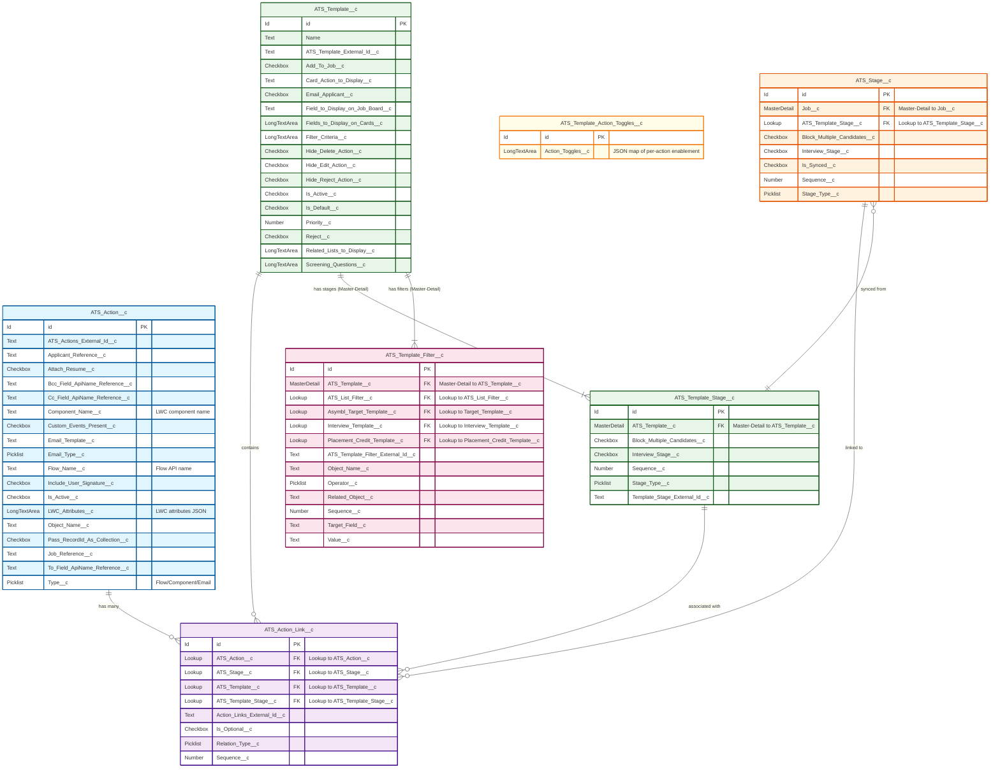

# ATS Package - Action and Template Configuration ERD

> **Revision note (2026-10-30)**: Rebuilt against real field metadata. The prior revision invented numerous fields on every object here (`ATS_Action__c.Icon__c`/`Label__c`/`Parameters__c`/`Record_Type__c`, `ATS_Template__c.Version__c`/`Category__c`/`Parent_Template__c`/`Effective_Date__c`, `ATS_Stage__c.Default_Sequence__c`/`Color__c`, `ATS_Template_Filter__c.Filter_Order__c`/`Logic_Group__c`) that do not exist in the package. It also did not cover the new `ATS_Template_Action_Toggles__c` object. All fields below are verified against `force-app/main/default/objects/ATS_Action*,ATS_Template*/fields`.

## Entity Relationship Diagram

## Object Descriptions

### ATS_Action__c (Actions)
- **Purpose**: Stores reusable actions that can be triggered at different stages
- **Key Fields**:
  - `Type__c`: Determines the action type (Flow, Component, or Email)
  - `Component_Name__c`: Lightning component name for Component type actions
  - `Flow_Name__c`: Flow API name for Flow type actions
  - `Email_Template__c` / `Email_Type__c`: Email template reference and category for Email type actions
  - `LWC_Attributes__c`: JSON parameters passed to the action's component
  - `Attach_Resume__c`, `Include_User_Signature__c`, `Pass_RecordId_As_Collection__c`: behavior toggles for email-type actions

### ATS_Action_Link__c (Action Links)
- **Purpose**: Junction object that links actions to stages and templates
- **Key Relationships**:
  - Links to `ATS_Action__c` (the action to execute)
  - Links to `ATS_Stage__c` (stage reference)
  - Links to `ATS_Template__c` (template context)
  - Links to `ATS_Template_Stage__c` (specific template stage)
- **Key Fields**:
  - `Sequence__c`: Order of execution when multiple actions exist
  - `Is_Optional__c`: Whether the action must be completed
  - `Relation_Type__c`: Classifies the nature of the link

### ATS_Template_Stage__c (Template Stages)
- **Purpose**: Defines stages within a template with Master-Detail to ATS_Template__c
- **Key Fields**:
  - `Sequence__c`: Order of stages in the template
  - `Stage_Type__c`: Type of stage
  - `Interview_Stage__c`: Marks the stage as an interview step
  - `Block_Multiple_Candidates__c`: Prevents more than one candidate occupying the stage simultaneously

### ATS_Template_Filter__c (Template Filters)
- **Purpose**: Defines filtering criteria for template applicability, and (new) target-template assignment criteria
- **Key Fields**:
  - `Object_Name__c` / `Target_Field__c` / `Operator__c` / `Value__c`: Standard filter criterion shape
  - `Asymbl_Target_Template__c` *(new)*: Links a filter row to Target Template assignment logic, reusing the same filter-criteria object across the Template, Interview Template, Placement Credit Template, and Target Template domains

### ATS_Template__c (Templates)
- **Purpose**: Master template object that defines the overall job stage/action process
- **Key Fields**:
  - `Filter_Criteria__c`: Master-Detail-linked `ATS_Template_Filter__c` records define when this template auto-applies
  - `Is_Default__c`: Default template flag
  - `Screening_Questions__c` *(new)*: Screening question configuration/JSON carried onto jobs created from this template
  - `Add_To_Job__c` / `Email_Applicant__c` / `Reject__c`: Stage-transition automation toggles

### ATS_Template_Action_Toggles__c (new object)
- **Purpose**: A lightweight companion object (single `Action_Toggles__c` long text/JSON field) that stores per-template action enablement state, letting admins disable a configured action without deleting the underlying `ATS_Action_Link__c`

### ATS_Stage__c (Job-Level Stages)
- **Purpose**: The job-specific, materialized stage instances created from `ATS_Template_Stage__c` when a Job is built from a template
- **Key Fields**:
  - `Is_Synced__c`: Whether the job's stage configuration still matches its template
  - `Interview_Stage__c`: Marks interview-type stages

## Relationship Summary

1. **Templates to Stages**: One-to-Many (Master-Detail) — a template has multiple stages defined through `ATS_Template_Stage__c`
2. **Templates to Filters**: One-to-Many (Master-Detail) — a template has multiple filters to determine applicability
3. **Actions to Templates/Stages**: Many-to-Many (via Action Links) — actions can be reused across different templates and stages via the `ATS_Action_Link__c` junction object
4. **Template Stage to Job Stage**: `ATS_Stage__c` (job-level) references `ATS_Template_Stage__c` (template-level) to stay synchronized when the template changes
5. **Template to Action Toggles**: Each template's enabled/disabled action state is tracked independently in `ATS_Template_Action_Toggles__c`

## Color Coding Legend
- 🔵 **Blue**: Action objects (ATS_Action__c)
- 🟣 **Purple**: Link/Junction objects (ATS_Action_Link__c)
- 🟢 **Green**: Template objects (ATS_Template__c, ATS_Template_Stage__c)
- 🟠 **Orange**: Stage objects (ATS_Stage__c)
- 🔴 **Pink**: Filter objects (ATS_Template_Filter__c)
- 🟡 **Yellow**: Action Toggle object (ATS_Template_Action_Toggles__c, new)
