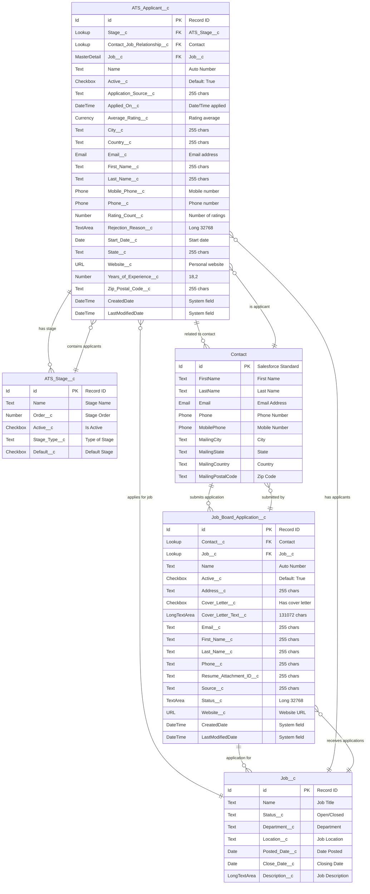

# ATS Package - Applicant Management ERD

## Entity Relationship Diagram

## Object Descriptions

### ATS_Applicant__c (Custom Object)
**Purpose**: Core object for managing job applicants within the ATS system
- **Color**: Primary object (Blue in diagram)
- **Key Relationships**:
  - Master-Detail with Job__c (child of Job)
  - Lookup to ATS_Stage__c (current application stage)
  - Lookup to Contact (applicant's contact record)

### Job_Board_Application__c (Custom Object)
**Purpose**: Manages external job board applications before conversion to ATS_Applicant__c
- **Color**: Secondary object (Green in diagram)
- **Key Relationships**:
  - Lookup to Contact (applicant contact)
  - Lookup to Job__c (job being applied for)

### Related Standard & Custom Objects

#### Job__c (Custom Object)
- Parent object for applicants
- Contains job posting details

#### ATS_Stage__c (Custom Object)
- Defines recruitment pipeline stages
- Referenced by ATS_Applicant__c

#### Contact (Standard Object)
- Salesforce standard Contact object
- Central record for applicant information

## Relationship Cardinality Notation

- `||--o{` : One to many (mandatory)
- `||--o{` : One to many (optional)
- `}o--||` : Many to one (mandatory)
- `||--||` : One to one

## Field Types Legend

- **PK**: Primary Key
- **FK**: Foreign Key
- **MasterDetail**: Master-Detail Relationship
- **Lookup**: Lookup Relationship
- **Text**: Text field with character limit
- **TextArea**: Long text area
- **LongTextArea**: Rich text area
- **Checkbox**: Boolean field
- **Currency**: Currency field
- **Number**: Numeric field with precision
- **Date/DateTime**: Date or DateTime field
- **Email**: Email field
- **Phone**: Phone field
- **URL**: URL field

## Data Flow

1. **Job Board Application** → **Contact** → **ATS Applicant**
   - External applications create/update Contact records
   - Contacts are linked to ATS_Applicant__c records

2. **ATS Applicant** → **Stage Movement**
   - Applicants progress through ATS_Stage__c records
   - Stage history tracked via Stage__c lookup

3. **Job** → **Applications**
   - One Job can have multiple ATS_Applicant__c records
   - One Job can receive multiple Job_Board_Application__c entries