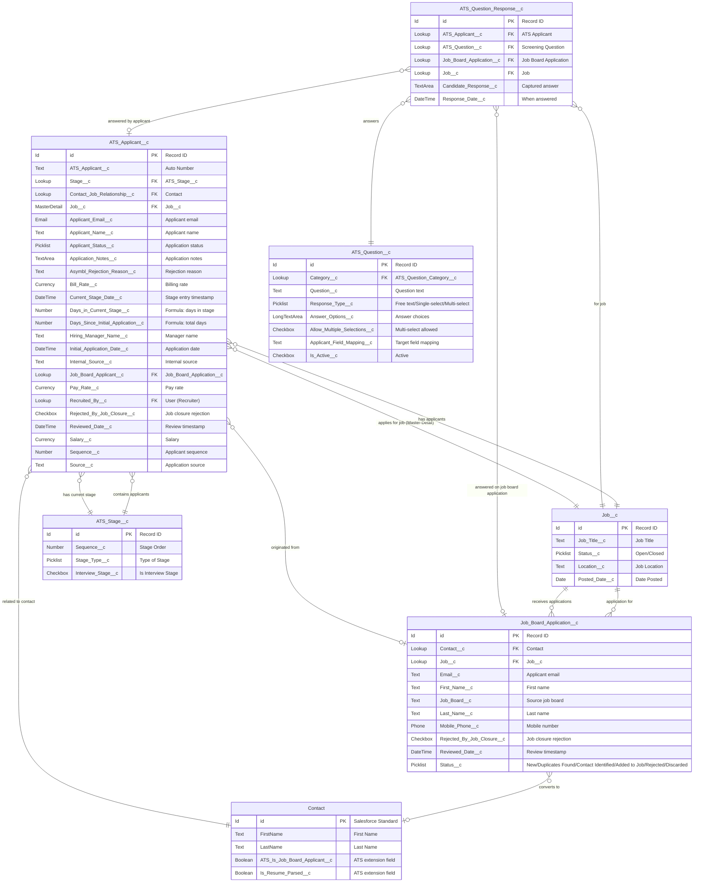

# ATS Package - Applicant Management ERD

> **Revision note (2026-10-30)**: Rebuilt against real field metadata for `ATS_Applicant__c`, `Job_Board_Application__c`, and the new screening-question response objects. The prior revision's field list (e.g. `Applied_On__c`, `Average_Rating__c`, `City__c`, `Country__c`, `First_Name__c`/`Last_Name__c` on ATS_Applicant__c, `Cover_Letter_Text__c`/`Resume_Attachment_ID__c` on Job_Board_Application__c) did **not** match the actual object schema and has been replaced. It also did not cover the new screening-question response flow.

## Entity Relationship Diagram

## Object Descriptions

### ATS_Applicant__c (Custom Object)
**Purpose**: Core object for managing job applicants within the ATS system
- **Color**: Primary object (Blue in diagram)
- **Key Relationships**:
  - Master-Detail with Job__c (child of Job)
  - Lookup to ATS_Stage__c (current application stage, via `Stage__c`)
  - Lookup to Contact (applicant's contact record, via `Contact_Job_Relationship__c`)
  - Lookup to Job_Board_Application__c (if sourced from an external application)

### Job_Board_Application__c (Custom Object)
**Purpose**: Manages external job board applications before conversion to ATS_Applicant__c
- **Color**: Secondary object (Green in diagram)
- **Key Relationships**:
  - Lookup to Contact (applicant contact, once identified/created)
  - Lookup to Job__c (job being applied for)
  - `Status__c` tracks the application through New → Duplicates Found / Contact Identified → Added to Job, or Rejected/Discarded

### ATS_Question_Response__c / ATS_Question__c (New screening question domain)
**Purpose**: Captures candidate answers to configurable screening questions, whether submitted via the external career site, the Digital Recruiter conversational flow, or linked directly to an `ATS_Applicant__c`
- **Key Relationships**:
  - Lookup to `ATS_Question__c` (the question asked)
  - Lookup to either `ATS_Applicant__c` or `Job_Board_Application__c` depending on which stage of the pipeline the response was captured at
  - Lookup to `Job__c` for reporting

### Related Standard & Custom Objects

#### Job__c (Custom Object)
- Parent object for applicants; see [Job Management ERD](ERD_Job_Management.md) for the complete field list

#### ATS_Stage__c (Custom Object)
- Defines recruitment pipeline stages; referenced by ATS_Applicant__c via `Stage__c`

#### Contact (Standard Object)
- Salesforce standard Contact object, extended with ATS-specific fields (`ATS_Is_Job_Board_Applicant__c`, `ATS_Job_Board_Application__c`, `Is_Resume_Parsed__c`, `Asymbl_Parsed_Resume__c`, `Matching_Jobs_Last_Refreshed__c`) — see [Standard Object Extensions ERD](ERD_Standard_Object_Extensions.md)

## Relationship Cardinality Notation

- `||--o{` : One to many
- `}o--||` : Many to one
- `}o--o|` : Many to zero-or-one (optional lookup)
- `||--||` : One to one

## Field Types Legend

- **PK**: Primary Key
- **FK**: Foreign Key
- **MasterDetail**: Master-Detail Relationship
- **Lookup**: Lookup Relationship
- **Text**: Text field with character limit
- **TextArea**: Long text area
- **LongTextArea**: Rich text area
- **Checkbox**: Boolean field
- **Currency**: Currency field
- **Number**: Numeric field with precision
- **Date/DateTime**: Date or DateTime field
- **Email**: Email field
- **Phone**: Phone field
- **Picklist**: Single-select picklist

## Data Flow

1. **Job Board Application → Contact → ATS Applicant**
   - External applications create `Job_Board_Application__c` records, with screening answers captured in `ATS_Question_Response__c`
   - Once a contact is identified/created and the application is approved, an `ATS_Applicant__c` is created and linked back via `Job_Board_Applicant__c`

2. **ATS Applicant → Stage Movement**
   - Applicants progress through ATS_Stage__c records via the `Stage__c` lookup
   - Stage history is tracked separately via `ATS_Stage_Tracking__c` (see [Missing Objects Complete ERD](ERD_Missing_Objects_Complete.md))

3. **Job → Applications**
   - One Job can have multiple ATS_Applicant__c records (Master-Detail) and multiple Job_Board_Application__c entries (Lookup), each optionally gated by configured screening questions (`ATS_Job_Screening_Question__c`)
