# ATS Package Configuration Metadata ERD

> **Revision note (2026-10-30)**: Completely rebuilt. The prior revision invented a large number of metadata types that **do not exist** in the package — `ATS_Calendar_Integration__mdt`, `ATS_Email_Template__mdt`, `ATS_Document_Template__mdt`, `ATS_Workflow_Configuration__mdt`, `ATS_Permission_Set_Mapping__mdt`, `ATS_Notification_Settings__mdt` — and the generic `Application__c`/`Candidate__c` objects it related them to also do not exist (the real applicant object is `ATS_Applicant__c`). This revision lists all **22 real** custom metadata types present under `force-app/main/default/objects/*__mdt` on `master`, several of which (the matching-intelligence and resume-mapping types) were added to the package after the prior documentation revision and were previously undocumented entirely.

This document provides a comprehensive Entity Relationship Diagram (ERD) for all Configuration Metadata objects in the ATS (Applicant Tracking System) package.

## Metadata Categories

The 22 metadata objects are organized into five functional categories:
- **Settings** (Light Blue): General configuration and system settings
- **Mappings** (Light Green): Field and object mappings (job board, timesheet, resume parsing)
- **Integrations** (Light Coral): External system integrations
- **Matching Intelligence** (Light Purple, new category): Candidate/job matching and qualification scoring configuration
- **UI / Feature Config** (Light Yellow): Job description/view templates, field-type config, feature gating

## ERD Diagram

```mermaid
erDiagram
    %% Settings Metadata (Light Blue)
    Generic_Setting__mdt {
        string Account_Candidate_Pool_Name__c
        string Candidate_Related_Lists__c
        string Search_Sources__c
        boolean Log_Candidate_Searches__c
        boolean Is_TK_Parsing_Enabled__c
        boolean Asymbl_Screening_Fallback__c
        string Asymbl_Screening_Template_Name__c
        string Org_Mode__c
        string Org_Wide_Email_Address__c
        boolean Show_Rejection_Reason__c
        "...49 fields total - see main doc"
    }

    ATS_Integration_Settings__mdt {
        string Account_Name__c
        string Encryption_Key__c
        string Endpoint_URL__c
        string Password__c
        string Username__c
    }

    ATS_Platform_Event_Restriction__mdt {
        boolean Enable_on_Account__c
        boolean Enable_on_Contact__c
        boolean Enable_on_Job__c
        boolean Enable_on_Offer__c
        boolean Enable_on_Placement__c
        boolean Enable_on_ATS_Applicant__c
    }

    Feature_Gate__mdt {
        boolean Launch__c
        boolean Enterprise__c
        boolean Ultimate__c
    }

    ATS_Applicant_Field_Type_Config__mdt {
        string String_Data_Type__c
        string Picklist_Data_Type__c
        string Currency_Data_Type__c
        string Date_Data_Type__c
        string Datetime_Data_Type__c
        string Boolean_Data_Type__c
        string Reference_Data_Type__c
        "...15 field-type config fields"
    }

    %% Mappings Metadata (Light Green)
    ATS_Job_Object_Mapping__mdt {
        string Lookup_Name_on_Applicant_Object__c
        string Lookup_Name_on_Interview_Object__c
        string Lookup_Name_on_Mapped_Object__c
        string Lookup_Name_on_Screening_Question__c
        string Lookup_Name_on_Stage_Object__c
        string Object_Name__c
        boolean Is_Trigger_Deployed__c
        number Days_Prior__c
    }

    ATS_JSON_Mapping__mdt {
        string Field_Api_Name__c
        string Field_Label__c
        string Object_Api_Name__c
        boolean Is_Active__c
        boolean Is_CDATA__c
        boolean Remove_HTML__c
        number Text_Length__c
    }

    ATS_Timesheet_Object_Mapping__mdt {
        string Object_Name__c
        string Timesheet_Status_Field_Mapping__c
        string Timesheet_Status_Field_Value__c
        string Void_Timesheet_Status_Field_Value__c
        string Timesheet_Revenue_Amount_Field_Mapping__c
        string Timesheet_Profit_Amount_Field_Mapping__c
        boolean Is_Trigger_Deployed__c
    }

    ATS_Job_Board_Application_Mapping__mdt {
        string ATS_Applicant_Mapping__c
        string Contact_Mapping__c
        boolean Is_Person_Account_Mapped__c
        string Person_Account_Mapping__c
    }

    TK_Field_Mapping__mdt {
        string Field_Api_Name__c
        string Field_Label__c
        string Field_Type__c
        boolean Is_Active__c
        boolean Is_Required__c
        boolean Is_Protected__c
        string Mapped_Field__c
        string Mapped_Object__c
        string Section__c
    }

    ATS_Resume_Field_Mapping__mdt {
        string Field_Api_Name_New__c
        string Field_Type_New__c
        boolean Is_Active_New__c
        boolean Is_Protected__c
        string Mapped_Field__c
        string Mapped_Object__c
        string Record_Type_Api_Name_New__c
        string Section_New__c
    }

    ATS_Skill_Summary_Mapping__mdt {
        string Field_Name__c
        string Mapped_Field_Name__c
        string Mapped_Object_Name__c
    }

    ATS_Work_Experience_Mapping__mdt {
        string Field_Name__c
        string Mapped_Field_Name__c
        string Mapped_Object_Name__c
    }

    %% Integrations Metadata (Light Coral)
    ATS_Email_Integration__mdt {
        string API_key__c
        boolean Create_Activity_Record__c
        datetime Email_Activity_Last_Job_Run_Time__c
        string Encryption_Key__c
        string Endpoint_URL__c
        boolean Is_Active__c
    }

    ATS_SMS_Integration__mdt {
        string Account_ID__c
        string Authentication_Token__c
        boolean Create_Activity_Record__c
        string Encryption_Key__c
        string From_Number__c
        boolean Is_Integration_Active__c
        string URL__c
    }

    ATS_Zoom_Integration_Data__mdt {
        string Auth_URL__c
        string Base_Url__c
        string Client_Id__c
        string Client_Secret__c
        string Encryption_Key__c
        datetime Last_Refresh_Date__c
        string Refresh_Token__c
        string Token_URL__c
    }

    %% Matching Intelligence Metadata (Light Purple, new category)
    ATS_Qualification_Config__mdt {
        boolean Asymbl_Active__c
        string Asymbl_Compare_Value__c
        string Asymbl_Field_API_Name__c
        string Asymbl_Gate_Key__c
        boolean Asymbl_Is_Blocking__c
        string Asymbl_Job_Type__c
        string Asymbl_Operator__c
        number Asymbl_Reduction__c
        number Asymbl_Sort_Order__c
    }

    ATS_Talent_Intelligence_Data__mdt {
        string Authentication_Key__c
        string Encryption_Key__c
        string Talent_Intelligence_URL__c
    }

    ATS_Job_Intelligence_Setting__mdt {
        string Asymbl_Job_Type__c
        number Asymbl_Number_Value__c
        string Asymbl_Period_Type__c
        string Asymbl_Setting_Key__c
        string Asymbl_Stage_Type__c
        string Asymbl_Text_Value__c
    }

    %% UI / Feature Config (Light Yellow)
    ATS_Job_View_List__mdt {
        string Filter_JSON__c
        number Index__c
        string Field_Set_API_Name__c
        string Additional_Text_Top__c
        string Additional_Text_Bottom__c
    }

    ATS_Job_Description_Template__mdt {
        string Template__c
    }

    ATS_Demo_Data_Info__mdt {
        string Created_Record_Ids_JSON__c
        string Interview_Template_Record_Id_JSON__c
        string Placement_Credit_Record_Ids_JSON__c
    }

    %% Custom Objects (for reference)
    Job__c {
        string Job_Title__c
        string Status__c
    }

    ATS_Applicant__c {
        string Applicant_Name__c
        string Applicant_Status__c
    }

    Contact {
        string FirstName
        string LastName
    }

    %% Relationships (logical, not formal lookups unless noted)
    Generic_Setting__mdt ||--o{ Job__c : "configures (org-wide settings)"
    Generic_Setting__mdt ||--o{ ATS_Applicant__c : "configures"
    Generic_Setting__mdt ||--o{ Contact : "configures"

    ATS_Job_Object_Mapping__mdt ||--o{ Job__c : "maps object relationships to"
    ATS_JSON_Mapping__mdt ||--o{ Job__c : "maps fields for external posting"
    ATS_Timesheet_Object_Mapping__mdt ||--o{ Job__c : "maps timesheet fields"
    ATS_Job_Board_Application_Mapping__mdt ||--o{ Contact : "maps job board fields"

    TK_Field_Mapping__mdt ||--o{ Contact : "maps parsed resume fields"
    ATS_Resume_Field_Mapping__mdt ||--o{ Contact : "maps parsed resume fields (newer)"
    ATS_Skill_Summary_Mapping__mdt ||--o{ Contact : "maps parsed skill summary"
    ATS_Work_Experience_Mapping__mdt ||--o{ Contact : "maps parsed work experience"

    ATS_Integration_Settings__mdt ||--|| ATS_Email_Integration__mdt : "related integration config"
    ATS_Integration_Settings__mdt ||--|| ATS_SMS_Integration__mdt : "related integration config"
    ATS_Integration_Settings__mdt ||--|| ATS_Zoom_Integration_Data__mdt : "related integration config"

    ATS_Qualification_Config__mdt ||--o{ Job__c : "defines qualification gates for"
    ATS_Talent_Intelligence_Data__mdt ||--|| ATS_Job_Intelligence_Setting__mdt : "backs matching intelligence for"
    ATS_Job_Intelligence_Setting__mdt ||--o{ Job__c : "tunes matching behavior for"

    ATS_Platform_Event_Restriction__mdt ||--o{ Job__c : "restricts platform events on"
    Feature_Gate__mdt ||--o{ Job__c : "gates features for (org-wide)"
```

## Metadata Object Details

### Settings Category (Light Blue)

#### Generic_Setting__mdt
Central configuration hub for the ATS system (49 fields in the current schema — nearly double the ~28 documented in the prior revision). Controls account/candidate pool naming, related-list configuration, mass-action definitions, screening fallback behavior, candidate-search logging/visibility, interview feedback email recipients and title patterns, org-wide/reply-to email addresses, and feature toggles like `Is_TK_Parsing_Enabled__c`.

#### ATS_Integration_Settings__mdt
Generic integration credential holder (endpoint URL, username/password, encryption key) used as a fallback/legacy pattern alongside the dedicated per-service `__mdt` types below.

#### ATS_Platform_Event_Restriction__mdt *(new since prior revision)*
Per-object kill switch controlling whether `ATS_Record_Action__e` fires for Account, Contact, Job, Offer, Placement, and ATS_Applicant records — useful for disabling event-driven automation during large data loads.

#### Feature_Gate__mdt *(new since prior revision)*
Three booleans (`Launch__c`, `Enterprise__c`, `Ultimate__c`) gating feature availability by package/licensing tier.

#### ATS_Applicant_Field_Type_Config__mdt *(new since prior revision)*
Maps each Salesforce field type to its corresponding dynamic-UI configuration field, used by applicant-facing dynamic form rendering.

### Mappings Category (Light Green)

#### ATS_Job_Object_Mapping__mdt
Defines how job-related objects map to applicant/interview/stage/screening-question lookups for generic object-agnostic automation. New field: `Lookup_Name_on_Screening_Question__c`.

#### ATS_JSON_Mapping__mdt
Field-level mapping for external job board JSON/XML posting feeds. New field: `Is_CDATA__c` (controls CDATA wrapping for XML output).

#### ATS_Timesheet_Object_Mapping__mdt
Maps external timesheet system fields (status, revenue, profit, dates) onto Placement/Placement_Credit. New field: `Void_Timesheet_Status_Field_Value__c`.

#### ATS_Job_Board_Application_Mapping__mdt
Maps job board application fields to Contact/Applicant fields. New fields: `Is_Person_Account_Mapped__c`, `Person_Account_Mapping__c` (Person Account support).

#### TK_Field_Mapping__mdt
Legacy/primary TextKernel resume parsing field mapping (unchanged structure from prior revision).

#### ATS_Resume_Field_Mapping__mdt / ATS_Skill_Summary_Mapping__mdt / ATS_Work_Experience_Mapping__mdt *(all new since prior revision)*
A newer, more granular resume-mapping framework that runs alongside `TK_Field_Mapping__mdt`: `ATS_Resume_Field_Mapping__mdt` handles general field mapping with record-type awareness, while the Skill Summary and Work Experience mapping types handle those specific resume sections independently.

### Integrations Category (Light Coral)

#### ATS_Email_Integration__mdt
Configures the Twilio SendGrid email integration (API key, endpoint, activity logging).

#### ATS_SMS_Integration__mdt
Configures Twilio SMS (account ID, auth token, from number).

#### ATS_Zoom_Integration_Data__mdt
Stores Zoom OAuth credentials and token refresh state.

> **Correction**: the prior revision invented a standalone `ATS_Calendar_Integration__mdt` for Google/Outlook calendar sync — this does not exist. Calendar sync configuration lives within the existing `Generic_Setting__mdt` event-creation fields (`Is_Enable_Event_Creation__c`/`Event_Creation_Type__c`) and the Google remote site settings, not a dedicated metadata type.

### Matching Intelligence Category (Light Purple, new category)

#### ATS_Qualification_Config__mdt
Defines individual qualification "gates" (field, operator, compare value, blocking vs. non-blocking, score reduction) evaluated by `ATS_QualificationGateEngine` to produce `Qualification_Run__c` records.

#### ATS_Talent_Intelligence_Data__mdt
Connection details (URL, auth key, encryption key) for the external Talent Intelligence service.

#### ATS_Job_Intelligence_Setting__mdt
Tunable key/value settings (numeric or text) scoped by job type, period type, and stage type, used to configure matching behavior without a deployment.

### UI / Feature Config Category (Light Yellow)

#### ATS_Job_View_List__mdt
Defines configurable job list views (filter JSON, field set, display order, and new top/bottom supplementary text fields).

#### ATS_Job_Description_Template__mdt
Stores reusable job description template content (single `Template__c` long text field).

#### ATS_Demo_Data_Info__mdt
Tracks IDs of records created by the package's demo-data installer, for clean rollback/removal.

## Key Relationships

1. **Settings to Objects**: `Generic_Setting__mdt` and `ATS_Platform_Event_Restriction__mdt` influence behavior across all major custom objects org-wide (not formal lookup relationships — referenced by Apex at runtime via `getInstance()`/`getAll()`)
2. **Mappings to Data Flow**: Field/object mapping metadata controls data synchronization for job board, timesheet, and resume-parsing integrations
3. **Integrations to External Systems**: Dedicated per-service metadata types (Email, SMS, Zoom) plus the generic `ATS_Integration_Settings__mdt` connect to external services
4. **Matching Intelligence to Jobs/Candidates**: `ATS_Qualification_Config__mdt` and `ATS_Job_Intelligence_Setting__mdt` tune the scoring behavior that produces `Qualification_Run__c` and `ATS_Match_Cache__c` records (see [Missing Objects Complete ERD](ERD_Missing_Objects_Complete.md))
5. **Feature Gating**: `Feature_Gate__mdt` is consulted by UI components and Apex to conditionally enable functionality based on license tier

## Usage Notes

- All metadata objects follow the `__mdt` naming convention and are packaged/deployable
- Most integration metadata objects include an `Is_Active__c`/`Is_Integration_Active__c` field for enabling/disabling configurations
- Relationships shown represent logical connections consulted at runtime by Apex, not necessarily formal Salesforce lookup relationships (custom metadata types do not support standard lookup fields to non-metadata objects)
- **22 metadata types confirmed** via `force-app/main/default/objects/*__mdt` directory listing on `master` — this is the authoritative count; the prior revision's "15+" estimate undercounted, and several of the specific types it named do not exist
