# ATS Package Configuration Metadata ERD

This document provides a comprehensive Entity Relationship Diagram (ERD) for all Configuration Metadata objects in the ATS (Applicant Tracking System) package.

## Metadata Categories

The metadata objects are organized into four main categories:
- **Settings** (Light Blue): General configuration and system settings
- **Mappings** (Light Green): Field and object mappings
- **Integrations** (Light Coral): External system integrations
- **Templates** (Light Yellow): Email and document templates

## ERD Diagram

```mermaid
erDiagram
    %% Color coding for different metadata categories
    %%{init: {'theme':'base', 'themeVariables': {'primaryColor':'#e1f5fe','primaryTextColor':'#01579b','primaryBorderColor':'#0277bd','lineColor':'#0288d1','secondaryColor':'#c8e6c9','tertiaryColor':'#ffccbc','quaternaryColor':'#fff9c4'}}}%%

    %% Settings Metadata (Light Blue)
    Generic_Setting__mdt {
        string Account_Candidate_Pool_Name__c
        string Candidate_Related_Lists__c
        string Company_Logo_URL__c
        string Default_Email_Template__c
        string Default_Job_Board__c
        string Enable_Auto_Notifications__c
        string Max_Applications_Per_Job__c
        string System_Admin_Email__c
    }

    ATS_Integration_Settings__mdt {
        string Endpoint_URL__c
        string Username__c
        string Password__c
        string API_Key__c
        boolean Is_Active__c
        string Integration_Type__c
        string Retry_Attempts__c
        string Timeout_Seconds__c
    }

    %% Mappings Metadata (Light Green)
    ATS_Job_Object_Mapping__mdt {
        string Lookup_Name_on_Applicant_Object__c
        string Object_Name__c
        string Object_API_Name__c
        string Field_API_Name__c
        boolean Is_Active__c
        string Display_Order__c
        string Parent_Object__c
    }

    TK_Field_Mapping__mdt {
        string Source_Field__c
        string Target_Field__c
        string Source_Object__c
        string Target_Object__c
        boolean Is_Required__c
        string Data_Type__c
        string Transformation_Rule__c
        boolean Is_Active__c
    }

    %% Integrations Metadata (Light Coral)
    ATS_Email_Integration__mdt {
        string Email_Service_Name__c
        string From_Address__c
        string Reply_To_Address__c
        string SMTP_Server__c
        string Port__c
        boolean Use_SSL__c
        string Authentication_Method__c
        boolean Is_Active__c
    }

    ATS_SMS_Integration__mdt {
        string Provider_Name__c
        string Account_SID__c
        string Auth_Token__c
        string From_Phone_Number__c
        string API_Endpoint__c
        boolean Is_Active__c
        string Message_Template__c
        string Rate_Limit__c
    }

    ATS_Zoom_Integration_Data__mdt {
        string API_Key__c
        string API_Secret__c
        string Meeting_URL_Template__c
        string Default_Meeting_Duration__c
        boolean Auto_Generate_Password__c
        string Time_Zone__c
        boolean Enable_Waiting_Room__c
        boolean Is_Active__c
    }

    ATS_Calendar_Integration__mdt {
        string Provider_Type__c
        string Client_ID__c
        string Client_Secret__c
        string Redirect_URI__c
        string Scope__c
        boolean Sync_Enabled__c
        string Default_Calendar__c
        boolean Is_Active__c
    }

    %% Templates Metadata (Light Yellow)
    ATS_Email_Template__mdt {
        string Template_Name__c
        string Subject__c
        string Body__c
        string Template_Type__c
        string Language__c
        boolean Is_Active__c
        string Used_For__c
        string Merge_Fields__c
    }

    ATS_Document_Template__mdt {
        string Template_Name__c
        string Document_Type__c
        string Template_Body__c
        string Header__c
        string Footer__c
        string File_Format__c
        boolean Is_Active__c
        string Associated_Object__c
    }

    %% Additional Configuration Metadata
    ATS_Workflow_Configuration__mdt {
        string Workflow_Name__c
        string Trigger_Object__c
        string Trigger_Event__c
        string Action_Type__c
        string Action_Details__c
        boolean Is_Active__c
        string Execution_Order__c
        string Criteria__c
    }

    ATS_Permission_Set_Mapping__mdt {
        string Permission_Set_Name__c
        string User_Role__c
        string Department__c
        boolean Auto_Assign__c
        string Assignment_Criteria__c
        boolean Is_Active__c
    }

    ATS_Notification_Settings__mdt {
        string Notification_Type__c
        string Recipients__c
        string Trigger_Event__c
        string Email_Template__c
        string SMS_Template__c
        boolean Send_Email__c
        boolean Send_SMS__c
        boolean Is_Active__c
    }

    %% Custom Objects (for reference)
    Job__c {
        string Name
        string Status__c
        string Department__c
        string Location__c
    }

    Application__c {
        string Name
        string Status__c
        lookup Job__c
        lookup Candidate__c
    }

    Candidate__c {
        string Name
        string Email__c
        string Phone__c
        string Status__c
    }

    %% Relationships
    Generic_Setting__mdt ||--o{ Job__c : "configures"
    Generic_Setting__mdt ||--o{ Application__c : "configures"
    Generic_Setting__mdt ||--o{ Candidate__c : "configures"
    
    ATS_Job_Object_Mapping__mdt ||--o{ Job__c : "maps to"
    ATS_Job_Object_Mapping__mdt ||--o{ Application__c : "maps fields"
    
    TK_Field_Mapping__mdt ||--o{ Job__c : "maps fields"
    TK_Field_Mapping__mdt ||--o{ Application__c : "maps fields"
    TK_Field_Mapping__mdt ||--o{ Candidate__c : "maps fields"
    
    ATS_Email_Template__mdt ||--o{ Application__c : "used for notifications"
    ATS_Email_Template__mdt ||--o{ Candidate__c : "used for communications"
    
    ATS_Notification_Settings__mdt ||--|| ATS_Email_Template__mdt : "uses"
    ATS_Notification_Settings__mdt ||--|| ATS_SMS_Integration__mdt : "uses"
    
    ATS_Workflow_Configuration__mdt ||--o{ Job__c : "automates"
    ATS_Workflow_Configuration__mdt ||--o{ Application__c : "automates"
    
    ATS_Integration_Settings__mdt ||--|| ATS_Email_Integration__mdt : "configures"
    ATS_Integration_Settings__mdt ||--|| ATS_SMS_Integration__mdt : "configures"
    ATS_Integration_Settings__mdt ||--|| ATS_Zoom_Integration__mdt : "configures"
    ATS_Integration_Settings__mdt ||--|| ATS_Calendar_Integration__mdt : "configures"
```

## Metadata Object Details

### Settings Category (Light Blue)

#### Generic_Setting__mdt
Central configuration hub for the ATS system containing global settings that affect the entire application.

#### ATS_Integration_Settings__mdt
Master integration configuration that controls how external systems connect with the ATS.

### Mappings Category (Light Green)

#### ATS_Job_Object_Mapping__mdt
Defines how job-related objects are mapped to applicant records, enabling dynamic field relationships.

#### TK_Field_Mapping__mdt
Provides field-level mapping between different objects, supporting data transformation and synchronization.

### Integrations Category (Light Coral)

#### ATS_Email_Integration__mdt
Configures email service providers and SMTP settings for automated communications.

#### ATS_SMS_Integration__mdt
Manages SMS provider settings for text message notifications to candidates.

#### ATS_Zoom_Integration_Data__mdt
Stores Zoom API credentials and meeting configuration for virtual interviews.

#### ATS_Calendar_Integration__mdt
Handles calendar synchronization with external providers like Google Calendar or Outlook.

### Templates Category (Light Yellow)

#### ATS_Email_Template__mdt
Stores reusable email templates for various stages of the recruitment process.

#### ATS_Document_Template__mdt
Manages document templates for offer letters, contracts, and other recruitment documents.

### Additional Configuration

#### ATS_Workflow_Configuration__mdt
Defines automated workflows and business process automation rules.

#### ATS_Permission_Set_Mapping__mdt
Controls user access and permissions based on roles and departments.

#### ATS_Notification_Settings__mdt
Manages notification rules and triggers for various recruitment events.

## Key Relationships

1. **Settings to Objects**: Generic settings influence all major custom objects (Job, Application, Candidate)
2. **Mappings to Data Flow**: Field mappings control data synchronization between objects
3. **Templates to Communications**: Email and document templates are used throughout the recruitment process
4. **Integrations to External Systems**: Various integration metadata objects connect to external services
5. **Workflows to Automation**: Workflow configurations automate business processes across objects

## Usage Notes

- All metadata objects follow the `__mdt` naming convention
- Most metadata objects include an `Is_Active__c` field for enabling/disabling configurations
- Relationships shown represent logical connections, not necessarily lookup relationships
- Color coding helps identify the functional category of each metadata object