# ATS Package Integration Objects ERD

## Overview
This document provides a comprehensive Entity Relationship Diagram (ERD) for integration-related objects in the ATS (Applicant Tracking System) package. The diagram focuses on objects that handle external integrations including TextKernel, Twilio, Zoom, Google services, and communication tracking.

## Complete Integration ERD

```mermaid
erDiagram
    %% Core Objects
    Contact {
        Id ContactId PK
        String FirstName
        String LastName
        String Email
        String Phone
        String MobilePhone
    }
    
    Job__c {
        Id JobId PK
        String Name
        String Status__c
        Reference Account__c
        Boolean Active__c
    }
    
    Interview__c {
        Id InterviewId PK
        Reference Contact__c FK
        Reference Job__c FK
        DateTime Interview_Date_Time__c
        String Status__c
        String Interview_Type__c
        String Zoom_Meeting_ID__c
        String Zoom_Join_URL__c
    }
    
    Application__c {
        Id ApplicationId PK
        Reference Contact__c FK
        Reference Job__c FK
        String Status__c
        DateTime Applied_Date__c
    }
    
    %% Communication Tracking Objects
    Message_Stats__c {
        Id MessageStatsId PK
        Reference Contact__c FK
        Reference Job__c FK
        Reference Application__c FK
        String Message_Type__c
        String Message_Subject__c
        String Message_Body__c
        String Status__c
        DateTime Sent_Date__c
        DateTime Opened_Date__c
        DateTime Clicked_Date__c
        Integer Open_Count__c
        Integer Click_Count__c
        String Email_Provider__c
        String SMS_Provider__c
        String Tracking_ID__c
        Boolean Is_Bounced__c
        String Bounce_Reason__c
    }
    
    Email_Template_Stats__c {
        Id EmailTemplateStatsId PK
        Reference Email_Template__c FK
        Integer Total_Sent__c
        Integer Total_Opened__c
        Integer Total_Clicked__c
        Decimal Open_Rate__c
        Decimal Click_Rate__c
        DateTime Last_Used__c
    }
    
    %% Google Integration Objects
    Google_Recaptcha_Detail__c {
        Id RecaptchaId PK
        String Site_Key__c
        String Secret_Key__c
        Boolean Is_Active__c
        String Threshold_Score__c
        String Version__c
        String Error_Message__c
        DateTime Last_Verified__c
    }
    
    Google_Calendar_Integration__c {
        Id GoogleCalendarId PK
        Reference User__c FK
        String Access_Token__c
        String Refresh_Token__c
        DateTime Token_Expiry__c
        String Calendar_ID__c
        Boolean Is_Active__c
        DateTime Last_Sync__c
    }
    
    %% TextKernel Integration Objects
    TextKernel_Config__c {
        Id TextKernelConfigId PK
        String API_Key__c
        String Account_ID__c
        String Service_URL__c
        Boolean Is_Active__c
        String Parsing_Language__c
        Boolean Enable_Enrichment__c
    }
    
    Resume_Parse_Log__c {
        Id ResumeParseLogId PK
        Reference Contact__c FK
        Reference Application__c FK
        String Parse_Status__c
        String TextKernel_ID__c
        DateTime Parse_Date__c
        String Error_Message__c
        LongText Raw_Response__c
        Decimal Confidence_Score__c
    }
    
    %% Twilio Integration Objects
    Twilio_Configuration__c {
        Id TwilioConfigId PK
        String Account_SID__c
        String Auth_Token__c
        String From_Number__c
        String Messaging_Service_SID__c
        Boolean Is_Active__c
        String Webhook_URL__c
    }
    
    SMS_Log__c {
        Id SMSLogId PK
        Reference Contact__c FK
        Reference Message_Stats__c FK
        String To_Number__c
        String From_Number__c
        String Message_Body__c
        String Twilio_SID__c
        String Status__c
        DateTime Sent_Date__c
        DateTime Delivered_Date__c
        String Error_Code__c
        String Error_Message__c
    }
    
    %% Zoom Integration Objects
    Zoom_Configuration__c {
        Id ZoomConfigId PK
        String API_Key__c
        String API_Secret__c
        String JWT_Token__c
        String Account_ID__c
        Boolean Is_Active__c
        String Default_Meeting_Settings__c
    }
    
    Zoom_Meeting__c {
        Id ZoomMeetingId PK
        Reference Interview__c FK
        String Meeting_ID__c
        String Join_URL__c
        String Host_URL__c
        String Password__c
        DateTime Start_Time__c
        Integer Duration__c
        String Recording_URL__c
        String Status__c
    }
    
    %% Integration Metadata Objects
    Integration_Setting__mdt {
        String DeveloperName PK
        String Integration_Type__c
        String Endpoint_URL__c
        String Authentication_Method__c
        Boolean Is_Active__c
        String Custom_Headers__c
        Integer Timeout__c
        Integer Retry_Count__c
    }
    
    Field_Mapping__mdt {
        String DeveloperName PK
        String Integration_Type__c
        String Source_Field__c
        String Target_Field__c
        String Data_Type__c
        String Transformation_Class__c
        Boolean Is_Required__c
    }
    
    %% Platform Events
    Integration_Event__e {
        String Integration_Type__c
        String Record_Id__c
        String Action__c
        String Status__c
        String Error_Message__c
        DateTime Event_Time__c
        String Payload__c
    }
    
    Email_Tracking_Event__e {
        String Message_Stats_Id__c
        String Event_Type__c
        String Email_Address__c
        DateTime Event_Time__c
        String IP_Address__c
        String User_Agent__c
    }
    
    %% Integration Log Objects
    Integration_Log__c {
        Id IntegrationLogId PK
        String Integration_Type__c
        String Record_Id__c
        String Action__c
        String Request_Body__c
        String Response_Body__c
        Integer Response_Code__c
        String Status__c
        DateTime Start_Time__c
        DateTime End_Time__c
        String Error_Message__c
    }
    
    %% Webhook Objects
    Webhook_Registration__c {
        Id WebhookId PK
        String Integration_Type__c
        String Event_Type__c
        String Endpoint_URL__c
        String Secret_Key__c
        Boolean Is_Active__c
        DateTime Last_Called__c
        Integer Failure_Count__c
    }
    
    %% Relationships
    Contact ||--o{ Message_Stats__c : "receives"
    Contact ||--o{ Application__c : "submits"
    Contact ||--o{ Interview__c : "participates"
    Contact ||--o{ Resume_Parse_Log__c : "has resume parsed"
    Contact ||--o{ SMS_Log__c : "receives SMS"
    
    Job__c ||--o{ Application__c : "has"
    Job__c ||--o{ Interview__c : "schedules"
    Job__c ||--o{ Message_Stats__c : "related to"
    
    Application__c ||--o{ Message_Stats__c : "triggers"
    Application__c ||--o{ Resume_Parse_Log__c : "parsed for"
    
    Interview__c ||--|| Zoom_Meeting__c : "scheduled via"
    Interview__c }|--|| Google_Calendar_Integration__c : "synced to"
    
    Message_Stats__c ||--o| SMS_Log__c : "tracks"
    Message_Stats__c }|--|| Email_Tracking_Event__e : "generates"
    
    TextKernel_Config__c ||--o{ Resume_Parse_Log__c : "processes"
    Twilio_Configuration__c ||--o{ SMS_Log__c : "sends"
    Zoom_Configuration__c ||--o{ Zoom_Meeting__c : "creates"
    
    Integration_Setting__mdt ||--o{ Integration_Log__c : "configures"
    Field_Mapping__mdt }|--|| Integration_Setting__mdt : "belongs to"
    
    Integration_Log__c }|--|| Integration_Event__e : "publishes"
    Webhook_Registration__c }|--|| Integration_Event__e : "listens to"
```



## Integration Categories

### 1. Communication Integrations

#### Email Integration (Message_Stats__c)
- **Purpose**: Tracks email communications and engagement metrics
- **Key Features**:
  - Email open tracking
  - Click tracking
  - Bounce handling
  - Provider-agnostic design
- **Related Objects**:
  - Contact (recipient)
  - Job__c (context)
  - Application__c (trigger)
  - Email_Tracking_Event__e (real-time events)

#### SMS Integration (Twilio)
- **Configuration**: Twilio_Configuration__c
- **Logging**: SMS_Log__c
- **Features**:
  - SMS delivery tracking
  - Two-way messaging support
  - Error handling and retry logic
  - Webhook support for status updates

### 2. Resume Parsing Integration (TextKernel)

#### Configuration and Processing
- **Configuration Object**: TextKernel_Config__c
- **Processing Log**: Resume_Parse_Log__c
- **Data Flow**:
  1. Resume uploaded to Application__c
  2. TextKernel API called for parsing
  3. Structured data extracted and mapped
  4. Contact and Application records updated
  5. Parse results logged for audit

### 3. Video Conferencing Integration (Zoom)

#### Meeting Management
- **Configuration**: Zoom_Configuration__c
- **Meeting Records**: Zoom_Meeting__c
- **Integration Flow**:
  1. Interview scheduled in Interview__c
  2. Zoom API creates meeting
  3. Meeting details stored in Zoom_Meeting__c
  4. Join URLs distributed via Message_Stats__c
  5. Recording URLs captured post-meeting

### 4. Security Integration (Google reCAPTCHA)

#### Anti-Bot Protection
- **Configuration**: Google_Recaptcha_Detail__c
- **Implementation Areas**:
  - Job application forms
  - Candidate registration
  - Public-facing endpoints
- **Features**:
  - Score-based verification
  - Version flexibility (v2/v3)
  - Error handling

### 5. Calendar Integration (Google Calendar)

#### Interview Scheduling
- **Configuration**: Google_Calendar_Integration__c
- **Sync Features**:
  - Bi-directional sync
  - Conflict detection
  - Automatic updates
  - Multi-calendar support

## Integration Patterns

### 1. Event-Driven Architecture
```
Platform Events:
- Integration_Event__e: Generic integration events
- Email_Tracking_Event__e: Email-specific tracking
```

### 2. Webhook Management
```
Webhook_Registration__c:
- Event subscription management
- Failure tracking and retry
- Security (secret keys)
```

### 3. Centralized Logging
```
Integration_Log__c:
- Request/Response capture
- Performance monitoring
- Error tracking
- Audit trail
```

### 4. Metadata-Driven Configuration
```
Custom Metadata Types:
- Integration_Setting__mdt: Runtime configuration
- Field_Mapping__mdt: Dynamic field mapping
```

## Data Flow Examples

### Email Campaign Flow
1. Marketing user creates campaign targeting job applicants
2. Message_Stats__c records created for each recipient
3. Emails sent via configured provider
4. Email_Tracking_Event__e captures open/click events
5. Message_Stats__c updated with engagement metrics
6. Email_Template_Stats__c aggregates performance

### Resume Parsing Flow
1. Candidate uploads resume to Application__c
2. Integration_Event__e triggers TextKernel processing
3. TextKernel_Config__c provides API credentials
4. Parse results stored in Resume_Parse_Log__c
5. Contact and Application fields updated via Field_Mapping__mdt
6. Integration_Log__c captures full transaction

### Interview Scheduling Flow
1. Recruiter creates Interview__c record
2. Zoom_Configuration__c checked for active config
3. Zoom API creates meeting
4. Zoom_Meeting__c stores meeting details
5. Google_Calendar_Integration__c syncs to calendar
6. Message_Stats__c sends invitations with links

## Security Considerations

### API Key Management
- Encrypted storage in configuration objects
- Regular rotation policies
- Environment-specific configurations

### Data Privacy
- PII handling in integration logs
- GDPR compliance for EU candidates
- Data retention policies

### Access Control
- Integration-specific permission sets
- Field-level security on sensitive data
- API user restrictions

## Best Practices

### 1. Error Handling
- Comprehensive logging in Integration_Log__c
- Retry mechanisms for transient failures
- User-friendly error messages
- Alerting for critical failures

### 2. Performance
- Asynchronous processing for heavy operations
- Bulk API usage where available
- Caching for frequently accessed data
- Governor limit awareness

### 3. Monitoring
- Dashboard for integration health
- Real-time alerts via platform events
- Performance metrics tracking
- SLA monitoring

### 4. Maintenance
- Regular cleanup of old logs
- Token refresh automation
- Version compatibility checks
- Documentation updates

## Integration Testing Strategy

### Unit Testing
- Mock external services
- Test error scenarios
- Validate field mappings
- Check governor limits

### Integration Testing
- Sandbox environment setup
- End-to-end flow validation
- Performance testing
- Security testing

### Monitoring in Production
- Real-time dashboards
- Alert configurations
- Performance baselines
- Incident response procedures