# ATS Package Integration Objects ERD

> **Revision note (2026-10-30)**: This document was **entirely rewritten**. The prior revision was almost completely fabricated: none of `TextKernel_Config__c`, `Resume_Parse_Log__c`, `Twilio_Configuration__c`, `SMS_Log__c`, `Zoom_Configuration__c`, `Zoom_Meeting__c`, `Google_Calendar_Integration__c`, `Integration_Setting__mdt`, `Field_Mapping__mdt`, `Integration_Event__e`, `Email_Tracking_Event__e`, `Integration_Log__c`, `Webhook_Registration__c`, `Email_Template_Stats__c`, or `Application__c` exist anywhere in the `bpats` package. This revision documents the **real** integration-layer objects and metadata verified directly against `force-app/main/default/objects` and `manifest/package.xml` on `master`.

## Overview
This document provides a comprehensive Entity Relationship Diagram (ERD) for integration-related objects in the ATS (Applicant Tracking System) package. The diagram focuses on objects that handle external integrations including TextKernel (resume parsing), Twilio (email/SMS), Zoom/Google Meet (video interviews), Google services (reCAPTCHA, Calendar), and the newer Talent Intelligence matching service.

## Complete Integration ERD

```mermaid
erDiagram
    %% Core Objects
    Contact {
        Id Id PK
        Text FirstName
        Text LastName
        Boolean Is_Resume_Parsed__c "ATS extension"
        Text Parsing_Error__c "ATS extension"
        Text Asymbl_Parsed_Resume__c "ATS extension"
    }

    Job__c {
        Id Id PK
        Text Job_Title__c
        Picklist Status__c
        DateTime Matching_Candidates_Last_Refreshed__c
    }

    Interview__c {
        Id Id PK
        Lookup Candidate__c FK
        Lookup Job__c FK
        DateTime Interview_Date__c
        Picklist Status__c
        Picklist Online_Platforms__c "None/Google Meet/Zoom Meeting"
        Text Zoom_Meeting_Id__c
        Text Event_Id__c "Calendar event ID"
    }

    Job_Board_Application__c {
        Id Id PK
        Lookup Contact__c FK
        Lookup Job__c FK
        Picklist Status__c
    }

    %% Communication Tracking Objects
    Message_Stats__c {
        Id Id PK
        Lookup Parent__c FK "Polymorphic"
        Number Blocks__c
        Number Bounces__c
        Number Clicks__c
        Date Date__c
        Number Delivered__c
        Text External_Key__c
        Number Opens__c
        Picklist Stats_Type__c
        Number Unique_Clicks__c
        Number Unique_Opens__c
    }

    EmailMessage {
        Id Id PK
        Text FromAddress
        Text Subject
        Number Clicks_Count__c "ATS extension"
        Boolean Is_Incoming__c "ATS extension"
        DateTime Last_Event_Time__c "ATS extension"
        Text Message_Type__c "ATS extension"
        Phone Mobile_Phone__c "ATS extension"
        Text Status__c "ATS extension"
        Text Twilio_External_Message_Id__c "ATS extension"
    }

    %% Google Integration Objects
    Google_Recaptcha_Detail__c {
        Id Id PK
        Text Client_Id__c
        Text Key__c
    }

    %% Custom Metadata - Integration Configuration
    ATS_Integration_Settings__mdt {
        Text Account_Name__c
        Text Encryption_Key__c
        Text Endpoint_URL__c
        Text Password__c
        Text Username__c
    }

    ATS_Email_Integration__mdt {
        Text API_key__c
        Boolean Create_Activity_Record__c
        DateTime Email_Activity_Last_Job_Run_Time__c
        Text Encryption_Key__c
        Text Endpoint_URL__c
        Boolean Is_Active__c
    }

    ATS_SMS_Integration__mdt {
        Text Account_ID__c
        Text Authentication_Token__c
        Boolean Create_Activity_Record__c
        Text Encryption_Key__c
        Text From_Number__c
        Boolean Is_Integration_Active__c
        Text URL__c
    }

    ATS_Zoom_Integration_Data__mdt {
        Text Auth_URL__c
        Text Base_Url__c
        Text Client_Id__c
        Text Client_Secret__c
        Text Encryption_Key__c
        DateTime Last_Refresh_Date__c
        Text Refresh_Token__c
        Text Token_URL__c
    }

    TK_Field_Mapping__mdt {
        Text Field_Api_Name__c
        Text Field_Label__c
        Text Field_Type__c
        Boolean Is_Active__c
        Boolean Is_Required__c
        Text Mapped_Field__c
        Text Mapped_Object__c
        Text Section__c
    }

    ATS_Resume_Field_Mapping__mdt {
        Text Field_Api_Name_New__c
        Text Mapped_Field__c
        Text Mapped_Object__c
        Text Section_New__c
    }

    ATS_Talent_Intelligence_Data__mdt {
        Text Authentication_Key__c
        Text Encryption_Key__c
        Text Talent_Intelligence_URL__c
    }

    %% Matching Intelligence Objects
    ATS_Match_Cache__c {
        Id Id PK
        Lookup Candidate__c FK "Contact"
        Lookup Job__c FK
        LongTextArea Payload__c "Cached match result"
        Number Sequence__c
    }

    Qualification_Run__c {
        Id Id PK
        Lookup Asymbl_Job__c FK
        Checkbox Asymbl_Is_Qualified__c
        Picklist Asymbl_Risk_Tier__c
        DateTime Asymbl_Run_Date__c
        Text Asymbl_Run_Key__c
        Number Asymbl_Unmet_Count__c
    }

    ATS_Candidate_Search_Log__c {
        Id Id PK
        Number Candidates_Added__c
        LongTextArea Filters__c
        Text Keywords__c
        DateTime Last_Searched__c
        Number Results_Found__c
    }

    %% Platform Events
    ATS_Record_Action__e {
        Text Event_Type__c
        Text Object_Api_Name__c
        Text Payload__c
        Text Record_Id__c
    }

    Add_to_ATS__e {
        Text PayloadFields "See package metadata for authoritative field list"
    }

    ATS_Platform_Event_Restriction__mdt {
        Boolean Enable_on_Account__c
        Boolean Enable_on_Contact__c
        Boolean Enable_on_Job__c
        Boolean Enable_on_Offer__c
        Boolean Enable_on_Placement__c
        Boolean Enable_on_ATS_Applicant__c
    }

    %% Relationships
    Contact ||--o{ Message_Stats__c : "receives (via Parent__c)"
    Job_Board_Application__c ||--o{ Message_Stats__c : "receives (via Parent__c)"
    Interview__c ||--o{ Message_Stats__c : "receives (via Parent__c)"

    EmailMessage }o--|| Contact : "RelatedToId (standard)"

    Contact ||--o{ ATS_Match_Cache__c : "matched against jobs"
    Job__c ||--o{ ATS_Match_Cache__c : "cached matches"
    Job__c ||--o{ Qualification_Run__c : "qualification runs"

    TK_Field_Mapping__mdt ||--o{ Contact : "maps resume data onto"
    ATS_Resume_Field_Mapping__mdt ||--o{ Contact : "maps resume data onto (newer)"
    ATS_Talent_Intelligence_Data__mdt ||--o{ ATS_Match_Cache__c : "configures scoring service for"
    ATS_Talent_Intelligence_Data__mdt ||--o{ Qualification_Run__c : "configures scoring service for"

    ATS_Email_Integration__mdt ||--o{ EmailMessage : "configures sending for"
    ATS_SMS_Integration__mdt ||--o{ EmailMessage : "configures SMS sending for"
    ATS_Zoom_Integration_Data__mdt ||--o{ Interview__c : "configures Zoom meetings for"

    Google_Recaptcha_Detail__c ||--o{ Job_Board_Application__c : "protects application forms for"

    ATS_Platform_Event_Restriction__mdt ||--o{ ATS_Record_Action__e : "restricts publication of"
```

## Integration Categories

### 1. Communication Integrations

#### Email/SMS Integration (Message_Stats__c)
- **Purpose**: Tracks email and SMS communication engagement metrics
- **Key Features**: open/click/bounce/delivery tracking via a polymorphic `Parent__c` lookup (can reference Contact, Job_Board_Application__c, Interview__c, etc. depending on `Stats_Type__c`), block/unique-open/unique-click counters
- **Configuration**: `ATS_Email_Integration__mdt` (SendGrid via Twilio) and `ATS_SMS_Integration__mdt` (Twilio SMS)
- **Standard Object Extension**: `EmailMessage` carries ATS-specific tracking fields (`Clicks_Count__c`, `Opens_Count__c`, `Last_Event_Time__c`, `Is_Incoming__c`, `Twilio_External_Message_Id__c`)

### 2. Resume Parsing Integration (TextKernel)

#### Configuration and Processing
- **Legacy/Primary Mapping**: `TK_Field_Mapping__mdt`
- **Newer Granular Mapping** *(added since prior revision)*: `ATS_Resume_Field_Mapping__mdt`, `ATS_Skill_Summary_Mapping__mdt`, `ATS_Work_Experience_Mapping__mdt`
- **Result Tracking on Contact**: `Is_Resume_Parsed__c`, `Parsing_Error__c`, `Asymbl_Parsed_Resume__c` (new)
- **Relevant Apex**: `ATS_TKIntegrationService`, `ATS_TKIntegrationBatch`, `ATS_TKResumeParsingInvocable`, `ATS_TKIntegrationCalloutMock`
- **Data Flow**:
  1. Resume file uploaded via ContentVersion (flagged `Is_Primary__c` if primary resume)
  2. TextKernel API called for parsing
  3. Structured data extracted and mapped via the `*_Mapping__mdt` metadata
  4. Contact fields updated; `Is_Resume_Parsed__c`/`Parsing_Error__c` reflect outcome

### 3. Video Conferencing Integration (Zoom / Google Meet)

#### Meeting Management
- **Configuration**: `ATS_Zoom_Integration_Data__mdt` (OAuth client credentials, token refresh)
- **Meeting Reference on Interview**: `Interview__c.Zoom_Meeting_Id__c`, `Interview__c.Online_Platforms__c` (supports both Zoom Meeting and Google Meet), `Interview__c.Event_Id__c` (calendar event)
- **Remote Site Settings**: `ZoomAuthenticationAPI`, `ZoomAuthentication`
- **Relevant Apex**: `ATS_GoogleAuthService`, `ATS_ZoomAuthCallback` (Visualforce)

> **Correction**: there is no dedicated `Zoom_Meeting__c` object — all Zoom meeting state lives directly on `Interview__c`.

### 4. Security Integration (Google reCAPTCHA)

#### Anti-Bot Protection
- **Configuration**: `Google_Recaptcha_Detail__c` (`Client_Id__c`, `Key__c`)
- **Implementation Areas**: Job application forms on the `BP_ATS` public site

### 5. Calendar Integration (Google Calendar)

- Calendar sync behavior is controlled through `Generic_Setting__mdt` fields (`Is_Enable_Event_Creation__c`, `Event_Creation_Type__c`) plus the `Google` remote site setting — there is **no** dedicated `Google_Calendar_Integration__c` object

### 6. Candidate/Job Matching Intelligence *(new category — not present in prior revision)*

#### Talent Intelligence Service
- **Configuration**: `ATS_Talent_Intelligence_Data__mdt` (service URL, auth key), `ATS_Job_Intelligence_Setting__mdt` (tunable scoring settings), `ATS_Qualification_Config__mdt` (qualification gate rules)
- **Result Objects**: `ATS_Match_Cache__c` (cached candidate-job match payloads), `Qualification_Run__c` (per-run qualification scoring outcome, risk tier, unmet-gate count)
- **Search Analytics**: `ATS_Candidate_Search_Log__c` logs keyword/filter search activity for the `Candidate_Search_Logs` custom Report Type
- **Relevant Apex**: `ATS_QualificationGateEngine`, `ATS_QualificationPrecompute`, `ATS_MatchCacheController`

### 7. Platform Event Architecture

- **ATS_Record_Action__e**: generic record-action event (`Event_Type__c`, `Object_Api_Name__c`, `Payload__c`, `Record_Id__c`), publication of which can be disabled per-object via `ATS_Platform_Event_Restriction__mdt`
- **Add_to_ATS__e**: cross-object event used to trigger "add to ATS" workflows from Contact-centric flows (`Add_to_ATS_From_Contact` flow)

> **Correction**: the prior revision invented `Integration_Event__e`, `Email_Tracking_Event__e`, `Integration_Log__c`, and `Webhook_Registration__c`. None of these exist — the package's event-driven architecture consists of exactly the two platform events listed above, governed by `ATS_Platform_Event_Restriction__mdt`.

## Security Considerations

### API Key Management
- Credentials are stored on dedicated custom metadata types (`ATS_Zoom_Integration_Data__mdt`, `ATS_SMS_Integration__mdt`, `ATS_Email_Integration__mdt`, `ATS_Talent_Intelligence_Data__mdt`, `ATS_Integration_Settings__mdt`), most with a paired `Encryption_Key__c` field
- `ATS_RemoteSiteSettingService` manages the underlying Remote Site Settings (Google, TwilioSMS, ZoomAuthenticationAPI, ZoomAuthentication)

### Data Privacy
- PII handling occurs primarily through Contact extension fields and `ATS_Log__c` (which supports a `Preserve_Log__c` flag for retaining specific log entries)

### Access Control
- `ATS_Manage_Search_Sources` custom permission gates who can configure candidate search source settings
- Field-level security should be applied to all integration credential fields

## Best Practices

### 1. Error Handling
- `ATS_Log__c` captures class/method/stack-trace detail for integration failures
- Mock classes (`ATS_TKIntegrationCalloutMock`) support safe test coverage of callouts

### 2. Performance
- `ATS_Match_Cache__c` exists specifically to avoid recomputing expensive candidate/job match scoring on every view
- Batch classes (`ATS_TKIntegrationBatch`, `ATS_TwilioEmailActivityBatch`, `ATS_SMSIntegrationBatch`) handle bulk integration processing within governor limits

### 3. Monitoring
- `ATS_TwilioEmailStatsScheduler` periodically refreshes `Message_Stats__c`
- `Matching_Candidates_Last_Refreshed__c` (Job__c) / `Matching_Jobs_Last_Refreshed__c` (Contact) expose staleness of matching-intelligence data directly on the records themselves

### 4. Maintenance
- Regularly review `ATS_Platform_Event_Restriction__mdt` settings when performing large data loads to avoid unnecessary event volume
- Rotate credentials in the integration metadata types on a defined schedule
