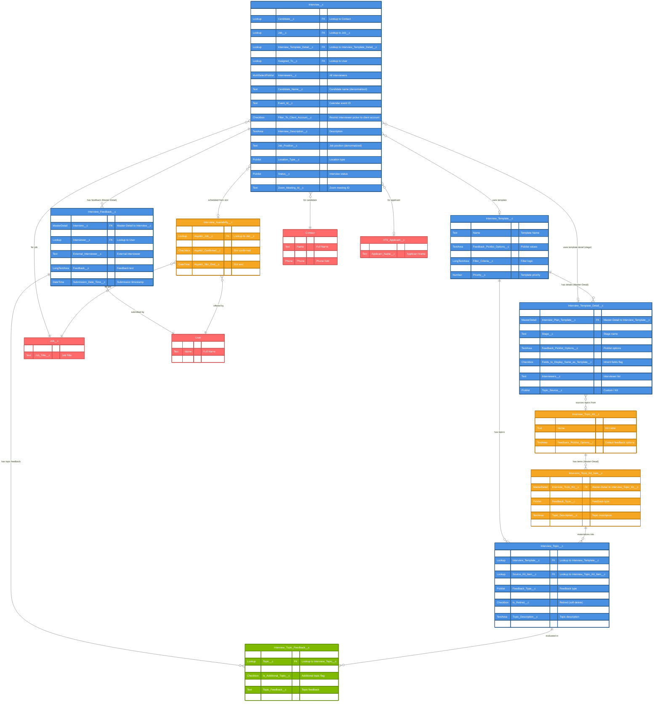

# Interview Management ERD - ATS Package

> **Revision note (2026-10-30)**: Completely rebuilt against real field metadata. The prior revision invented a large number of fields and objects that do not exist — `Stage_Application__c`, `Interview__c.Interview_Score__c`/`Average_Rating__c`/`Time_Zone__c`, `Interview_Template__c.Parent_Template__c`/`Template_Version__c`/`Pass_Rate__c`, `Interview_Topic__c.Parent_Topic__c`/`Difficulty_Level__c`/`Assessment_Type__c`, and most of `Interview_Feedback__c`'s rating/visibility fields. It also predates the real **Interview Topic Kit** and **Interview Availability** domains added to the package since the prior revision. All fields below are verified against `force-app/main/default/objects/Interview*/fields`.

## Entity Relationship Diagram

## Object Relationships Summary

### Interview__c (Primary Object)
- **Master Object for**: Interview_Feedback__c (Master-Detail)
- **Related to**: Contact (via `Candidate__c`), Job__c (via `Job__c`), ATS_Applicant__c (via `ATS_Applicant__c`)
- **Optional relationship to**: Interview_Template__c, Interview_Template_Detail__c (for the specific stage), Interview_Availability__c (the slot it was booked against)

### Interview_Template__c / Interview_Template_Detail__c (Configuration Objects)
- **Interview_Template__c** defines overall feedback format/filter criteria and owns multiple `Interview_Template_Detail__c` (one per interview stage)
- **Interview_Template_Detail__c** determines, per stage, whether topics are `Custom`-authored directly as `Interview_Topic__c` records, or sourced from a reusable `Interview_Topic_Kit__c` (`Topic_Source__c` = Kit)

### Interview_Topic_Kit__c / Interview_Topic_Kit_Item__c (new domain)
- A **Topic Kit** is a reusable library of interview topics (e.g., "Standard Technical Screen") authored once
- **Kit Items** are cloned into live `Interview_Topic__c` records (via `ATS_CloneInterviewTopicKit`) when attached to a template detail; the resulting topic retains a `Source_Kit_Item__c` lookup back to its origin for traceability

### Interview_Feedback__c (Detail Object)
- **Child of**: Interview__c (Master-Detail relationship)
- **Submitted by**: User (via `Interviewer__c`/`Submitted_By__c` lookups)
- **Topic-level detail**: `Interview_Topic_Feedback__c` records capture per-topic ratings/comments tied to a specific `Interview_Topic__c`

### Interview_Topic__c (Reference Data)
- **Sourced from**: Either direct authoring on a template detail, or a Topic Kit Item (`Source_Kit_Item__c`)
- **Retirement**: `Is_Retired__c` soft-deletes a topic from active use while preserving historical `Interview_Topic_Feedback__c` records that reference it
- There is **no** parent/child topic hierarchy (`Parent_Topic__c` does not exist) — reuse is achieved exclusively through Topic Kits

### Interview_Availability__c (new object)
- Interviewer-submitted time slots (`Asymbl_Slot_Start__c`/`Asymbl_Slot_End__c`) offered for a given Job; once confirmed (`Asymbl_Confirmed__c`) and consumed, the resulting `Interview__c` links back via `Asymbl_Interview_Availability__c`

## Key Features

1. **Interview Scheduling & Management**
   - Complete interview lifecycle tracking, calendar event ID capture, automation-aware scheduling flag (`Is_Scheduled_By_Automation__c`)
   - Interviewer-submitted availability slots feed directly into scheduling

2. **Template-Based Interviews with Reusable Topic Kits**
   - Reusable interview templates, broken into per-stage details
   - Topic Kits let teams define a topic library once and reuse it across many templates/stages, instead of re-authoring per template

3. **Comprehensive Feedback System**
   - Interview-level feedback plus topic-level feedback (`Interview_Topic_Feedback__c`) with asked/not-asked tracking and per-topic rating
   - Retired topics preserve historical feedback integrity

4. **Video Conferencing Integration**
   - `Online_Platforms__c` supports both Zoom Meeting and Google Meet
   - `Zoom_Meeting_Id__c` captures the Zoom-specific meeting reference

## Field Type Legend

- **PK**: Primary Key
- **FK**: Foreign Key
- **Lookup**: Lookup relationship field
- **MasterDetail**: Master-Detail relationship field
- **Text**: Text fields with specified length
- **TextArea / LongTextArea**: Long text fields for detailed content
- **Number**: Numeric fields with precision
- **DateTime/Date**: Date and time fields
- **Checkbox**: Boolean fields
- **Picklist / MultiSelectPicklist**: Single/multi-select picklist
- **Formula**: Calculated fields (none currently defined on these objects beyond what's noted)
