# Interview Management ERD - ATS Package

## Entity Relationship Diagram

```mermaid
erDiagram
    %% Color coding for different object types
    Interview__c {
        Id Id PK "Record ID"
        Name Text "Auto Number"
        Candidate__c Lookup FK "Lookup to Contact"
        Stage_Application__c Lookup FK "Lookup to Stage_Application__c"
        Interviewers__c Text "Multi-select picklist"
        Interview_Date__c DateTime "Date/Time field"
        Interview_Type__c Picklist "Phone/Video/In-Person"
        Interview_Status__c Picklist "Scheduled/Completed/Cancelled/No Show"
        Interview_Location__c Text "Text(255)"
        Interview_Duration_Minutes__c Number "Number(3,0)"
        Interview_Notes__c LongTextArea "Long Text Area(32768)"
        Interview_Result__c Picklist "Pass/Fail/On Hold/Pending"
        Interview_Score__c Number "Number(3,2)"
        Interview_Template__c Lookup FK "Lookup to Interview_Template__c"
        Send_Calendar_Invite__c Checkbox "Boolean"
        Calendar_Event_Id__c Text "Text(255)"
        Meeting_Link__c URL "URL field"
        Time_Zone__c Picklist "Picklist of time zones"
        Reminder_Sent__c Checkbox "Boolean"
        Feedback_Submitted__c Checkbox "Boolean"
        Average_Rating__c Number "Formula - Number(3,2)"
        Total_Feedback_Count__c Number "Roll-up Summary"
        Next_Interview_Date__c DateTime "Date/Time field"
        Previous_Interview_Date__c DateTime "Date/Time field"
        CreatedDate DateTime "System field"
        CreatedById Lookup "System field"
        LastModifiedDate DateTime "System field"
        LastModifiedById Lookup "System field"
        OwnerId Lookup "System field"
    }

    Interview_Template__c {
        Id Id PK "Record ID"
        Name Text "Text(80)"
        Template_Name__c Text UK "Text(255) - Unique"
        Description__c LongTextArea "Long Text Area(32768)"
        Interview_Type__c Picklist "Phone/Video/In-Person"
        Default_Duration_Minutes__c Number "Number(3,0)"
        Active__c Checkbox "Boolean"
        Department__c Picklist "Multi-select picklist"
        Job_Level__c Picklist "Entry/Mid/Senior/Executive"
        Required_Interviewers__c Number "Number(2,0)"
        Interview_Topics__c Text "Multi-select picklist"
        Evaluation_Criteria__c LongTextArea "Long Text Area(32768)"
        Question_Bank__c LongTextArea "Long Text Area(32768)"
        Scoring_Guidelines__c LongTextArea "Long Text Area(32768)"
        Template_Owner__c Lookup "Lookup to User"
        Last_Used_Date__c Date "Date field"
        Usage_Count__c Number "Number(5,0)"
        Average_Interview_Score__c Number "Formula - Number(3,2)"
        Pass_Rate__c Percent "Formula - Percent(3,2)"
        Template_Version__c Number "Number(3,1)"
        Parent_Template__c Lookup FK "Self-lookup"
        CreatedDate DateTime "System field"
        CreatedById Lookup "System field"
        LastModifiedDate DateTime "System field"
        LastModifiedById Lookup "System field"
        OwnerId Lookup "System field"
    }

    Interview_Feedback__c {
        Id Id PK "Record ID"
        Name Text "Auto Number"
        Interview__c MasterDetail FK "Master-Detail to Interview__c"
        Interviewer__c Lookup FK "Lookup to User"
        Interview_Topic__c Lookup FK "Lookup to Interview_Topic__c"
        Rating__c Number "Number(1,0) - 1 to 5"
        Technical_Skills_Rating__c Number "Number(1,0) - 1 to 5"
        Communication_Rating__c Number "Number(1,0) - 1 to 5"
        Problem_Solving_Rating__c Number "Number(1,0) - 1 to 5"
        Cultural_Fit_Rating__c Number "Number(1,0) - 1 to 5"
        Overall_Comments__c LongTextArea "Long Text Area(32768)"
        Strengths__c LongTextArea "Long Text Area(5000)"
        Areas_of_Improvement__c LongTextArea "Long Text Area(5000)"
        Recommendation__c Picklist "Strong Hire/Hire/No Hire/Strong No Hire"
        Follow_Up_Questions__c LongTextArea "Long Text Area(5000)"
        Red_Flags__c LongTextArea "Long Text Area(5000)"
        Feedback_Submitted_Date__c DateTime "Date/Time field"
        Time_to_Submit_Feedback__c Number "Formula - Number(3,0)"
        Late_Feedback__c Checkbox "Formula - Boolean"
        Feedback_Quality_Score__c Number "Formula - Number(3,2)"
        Anonymous_Feedback__c Checkbox "Boolean"
        Feedback_Visibility__c Picklist "Public/Private/Manager Only"
        CreatedDate DateTime "System field"
        CreatedById Lookup "System field"
        LastModifiedDate DateTime "System field"
        LastModifiedById Lookup "System field"
    }

    Interview_Topic__c {
        Id Id PK "Record ID"
        Name Text "Text(80)"
        Topic_Name__c Text UK "Text(255) - Unique"
        Topic_Category__c Picklist "Technical/Behavioral/Domain/Other"
        Description__c LongTextArea "Long Text Area(5000)"
        Active__c Checkbox "Boolean"
        Difficulty_Level__c Picklist "Easy/Medium/Hard/Expert"
        Time_Allocation_Minutes__c Number "Number(3,0)"
        Assessment_Type__c Picklist "Coding/Whiteboard/Discussion/Case Study"
        Required_Skills__c Text "Multi-select picklist"
        Sample_Questions__c LongTextArea "Long Text Area(32768)"
        Evaluation_Rubric__c LongTextArea "Long Text Area(32768)"
        Parent_Topic__c Lookup FK "Self-lookup"
        Topic_Order__c Number "Number(3,0)"
        Department__c Picklist "Multi-select picklist"
        Job_Level__c Picklist "Entry/Mid/Senior/Executive"
        Usage_Count__c Number "Roll-up Summary"
        Average_Rating__c Number "Formula - Number(3,2)"
        Last_Updated_Date__c Date "Date field"
        Topic_Owner__c Lookup "Lookup to User"
        CreatedDate DateTime "System field"
        CreatedById Lookup "System field"
        LastModifiedDate DateTime "System field"
        LastModifiedById Lookup "System field"
        OwnerId Lookup "System field"
    }

    %% Related Objects
    Contact {
        Id Id PK "Standard Object"
        Name Text "Full Name"
        Email Email "Email field"
        Phone Phone "Phone field"
    }

    Stage_Application__c {
        Id Id PK "Custom Object"
        Name Text "Record Name"
        Job_Application__c Lookup "Lookup to Job_Application__c"
        Stage__c Picklist "Stage Name"
    }

    User {
        Id Id PK "Standard Object"
        Name Text "Full Name"
        Email Email "Email field"
        IsActive Checkbox "Boolean"
    }

    %% Relationships
    Interview__c ||--o{ Interview_Feedback__c : "has feedback"
    Interview__c }o--|| Contact : "for candidate"
    Interview__c }o--|| Stage_Application__c : "for stage"
    Interview__c }o--o| Interview_Template__c : "uses template"
    
    Interview_Template__c ||--o{ Interview__c : "used by"
    Interview_Template__c }o--o| Interview_Template__c : "parent template"
    Interview_Template__c }o--|| User : "owned by"
    
    Interview_Feedback__c }o--|| User : "submitted by"
    Interview_Feedback__c }o--o| Interview_Topic__c : "for topic"
    
    Interview_Topic__c ||--o{ Interview_Feedback__c : "evaluated in"
    Interview_Topic__c }o--o| Interview_Topic__c : "parent topic"
    Interview_Topic__c }o--|| User : "owned by"

    %% Styling
    classDef primaryObject fill:#4A90E2,stroke:#2E5C8A,stroke-width:3px,color:#FFFFFF
    classDef relatedObject fill:#7FBA00,stroke:#5C8700,stroke-width:2px,color:#FFFFFF
    classDef standardObject fill:#FF6B6B,stroke:#CC5555,stroke-width:2px,color:#FFFFFF

    class Interview__c,Interview_Template__c,Interview_Feedback__c,Interview_Topic__c primaryObject
    class Stage_Application__c relatedObject
    class Contact,User standardObject
```

## Object Relationships Summary

### Interview__c (Primary Object)
- **Master Object for**: Interview_Feedback__c (Master-Detail)
- **Child of**: Contact (via Candidate__c lookup), Stage_Application__c (via lookup)
- **Optional relationship to**: Interview_Template__c (via lookup)

### Interview_Template__c (Configuration Object)
- **Self-referencing**: Parent_Template__c for versioning
- **Referenced by**: Interview__c for template-based interviews
- **Owned by**: User (Template_Owner__c)

### Interview_Feedback__c (Detail Object)
- **Child of**: Interview__c (Master-Detail relationship)
- **Submitted by**: User (via Interviewer__c lookup)
- **Categorized by**: Interview_Topic__c (optional lookup)

### Interview_Topic__c (Reference Data)
- **Self-referencing**: Parent_Topic__c for topic hierarchy
- **Referenced by**: Interview_Feedback__c for categorization
- **Owned by**: User (Topic_Owner__c)

## Key Features

1. **Interview Scheduling & Management**
   - Complete interview lifecycle tracking
   - Calendar integration with event IDs
   - Time zone support
   - Automated reminders

2. **Template-Based Interviews**
   - Reusable interview templates
   - Version control with parent templates
   - Department and job level specific templates
   - Usage tracking and performance metrics

3. **Comprehensive Feedback System**
   - Multi-dimensional rating system
   - Topic-based evaluation
   - Anonymous feedback option
   - Visibility controls

4. **Topic Management**
   - Hierarchical topic structure
   - Difficulty levels and time allocation
   - Assessment type categorization
   - Evaluation rubrics

## Field Type Legend

- **PK**: Primary Key
- **FK**: Foreign Key
- **UK**: Unique Key
- **Lookup**: Lookup relationship field
- **MasterDetail**: Master-Detail relationship field
- **Text**: Text fields with specified length
- **Number**: Numeric fields with precision
- **DateTime/Date**: Date and time fields
- **Checkbox**: Boolean fields
- **Picklist**: Single-select picklist
- **LongTextArea**: Long text fields for detailed content
- **Formula**: Calculated fields
- **Roll-up Summary**: Aggregated fields from child records