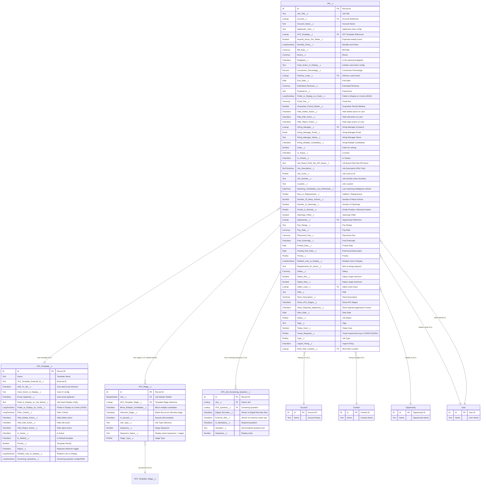

# Job Management ERD - ATS Package

> **Revision note (2026-10-30)**: This ERD was completely rebuilt against the real `Job__c`, `ATS_Template__c`, and `ATS_Stage__c` field metadata on `master`. The prior revision contained numerous fabricated fields (`Department__c`, `Min_Salary__c`/`Max_Salary__c`, `Is_Confidential__c`, `Is_Remote__c`, `External_Job_ID__c`, `Application_Deadline__c`, `Stage_Configuration__c`, `Approval_Process__c`, and more) that do not exist anywhere in the package. All fields below are verified against `force-app/main/default/objects/{Job__c,ATS_Template__c,ATS_Stage__c}/fields`.

## Entity Relationship Diagram

## Legend

### Relationship Notation
- `||--o{` : One-to-Many (1:N) relationship
- `}o--||` : Many-to-One (N:1) relationship
- `||--||` : One-to-One (1:1) relationship
- `}o--o{` : Many-to-Many (M:N) relationship

### Field Type Abbreviations
- **PK**: Primary Key
- **FK**: Foreign Key
- **Text**: Text field (255 characters)
- **TextArea**: Text Area field (4,096 characters)
- **LongTextArea**: Long Text Area field (32,768 characters)
- **RichTextArea**: Rich Text Area field (supports HTML formatting)
- **Lookup**: Lookup relationship field
- **MasterDetail**: Master-Detail relationship field
- **Currency**: Currency field
- **Number**: Number field
- **Date**: Date field
- **DateTime**: Date/Time field
- **Checkbox**: Boolean/Checkbox field
- **Picklist**: Single-select picklist field
- **Percent**: Percentage field

### Object Type Color Coding
- **Job__c**: Primary business object (darker shade)
- **ATS_Template__c**: Configuration/Template object (medium shade)
- **ATS_Stage__c**: Child/Detail object (lighter shade)
- **ATS_Job_Screening_Question__c**: Screening configuration object (new domain)
- **Account/Contact/Opportunity/User**: Standard Salesforce objects (lightest shade)

## Key Relationships

1. **Job__c to ATS_Stage__c** (1:N Master-Detail)
   - A Job can have multiple stages
   - Stages cannot exist without a parent Job; cascade delete applies

2. **Job__c to ATS_Template__c** (N:1 Lookup)
   - Multiple Jobs can use the same template
   - Template defines the standard process for jobs, including screening questions (`Screening_Questions__c`) and card/UI action toggles

3. **Job__c to Account** (N:1 Lookup)
   - Multiple Jobs can belong to one Account — represents the client/company relationship

4. **Job__c to Contact** (N:1 Lookup via Hiring_Manager__c)
   - Each Job has a Hiring Manager who is a Contact

5. **Job__c to User** (Multiple N:1 Lookups)
   - `Delivery_Lead__c`: User responsible for delivery
   - `Sales_Lead__c`: User responsible for sales

6. **Job__c to Opportunity** (N:1 Lookup)
   - Jobs can be linked to sales opportunities

7. **Job__c to ATS_Job_Screening_Question__c** (1:N Lookup)
   - A Job can have multiple configured screening questions, each independently toggleable for the Digital Recruiter flow and/or the external career site

## Business Logic Notes

1. **ATS_Stage__c** records are automatically created when a Job__c is created, based on the selected ATS_Template__c; `Is_Synced__c` tracks whether the job's stages still match the template
2. The **Sequence__c** field in ATS_Stage__c determines the order of stages in the hiring process; `Interview_Stage__c` flags stages that represent an interview step
3. **Is_Active__c** fields allow for soft deactivation and template versioning
4. **Filter_Criteria__c** in ATS_Template__c contains structured text/JSON for dynamic template-to-job matching, evaluated against `ATS_Template_Filter__c` records
5. **Salary_Min__c / Salary_Max__c** replace what the prior documentation revision incorrectly called `Min_Salary__c`/`Max_Salary__c`; there is no `Department__c`, `Is_Confidential__c`, or `External_Job_ID__c` field on Job__c
6. **Matching_Candidates_Last_Refreshed__c** is populated by the candidate/job matching intelligence layer (see `ATS_Match_Cache__c` and `Qualification_Run__c` in the [Missing Objects Complete ERD](ERD_Missing_Objects_Complete.md))
