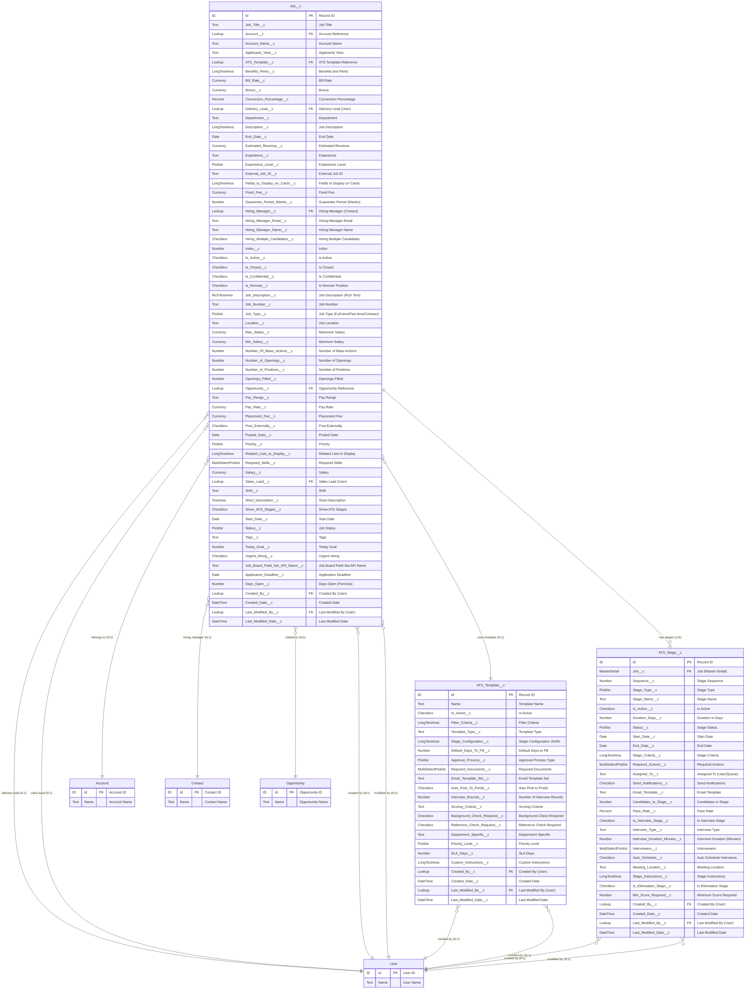

# Job Management ERD - ATS Package

## Entity Relationship Diagram

## Legend

### Relationship Notation
- `||--o{` : One-to-Many (1:N) relationship
- `}o--||` : Many-to-One (N:1) relationship
- `||--||` : One-to-One (1:1) relationship
- `}o--o{` : Many-to-Many (M:N) relationship

### Field Type Abbreviations
- **PK**: Primary Key
- **FK**: Foreign Key
- **Text**: Text field (255 characters)
- **TextArea**: Text Area field (4,096 characters)
- **LongTextArea**: Long Text Area field (32,768 characters)
- **RichTextArea**: Rich Text Area field (supports HTML formatting)
- **Lookup**: Lookup relationship field
- **MasterDetail**: Master-Detail relationship field
- **Currency**: Currency field
- **Number**: Number field
- **Date**: Date field
- **DateTime**: Date/Time field
- **Checkbox**: Boolean/Checkbox field
- **Picklist**: Single-select picklist field
- **MultiSelectPicklist**: Multi-select picklist field
- **Percent**: Percentage field

### Object Type Color Coding
- **Job__c**: Primary business object (darker shade)
- **ATS_Template__c**: Configuration/Template object (medium shade)
- **ATS_Stage__c**: Child/Detail object (lighter shade)
- **Account/Contact/Opportunity/User**: Standard Salesforce objects (lightest shade)

## Key Relationships

1. **Job__c to ATS_Stage__c** (1:N Master-Detail)
   - A Job can have multiple stages
   - Stages cannot exist without a parent Job
   - Cascade delete applies

2. **Job__c to ATS_Template__c** (N:1 Lookup)
   - Multiple Jobs can use the same template
   - Template defines the standard process for jobs

3. **Job__c to Account** (N:1 Lookup)
   - Multiple Jobs can belong to one Account
   - Represents the client/company relationship

4. **Job__c to Contact** (N:1 Lookup via Hiring_Manager__c)
   - Each Job has a Hiring Manager who is a Contact
   - Represents the person responsible for hiring decisions

5. **Job__c to User** (Multiple N:1 Lookups)
   - Delivery_Lead__c: User responsible for delivery
   - Sales_Lead__c: User responsible for sales
   - Created_By__c/Last_Modified_By__c: Audit fields

6. **Job__c to Opportunity** (N:1 Lookup)
   - Jobs can be linked to sales opportunities
   - Tracks revenue potential and sales pipeline

7. **Audit Fields**
   - All custom objects track Created By/Date and Last Modified By/Date
   - These link to the User object for audit trail

## Business Logic Notes

1. **ATS_Stage__c** records are automatically created when a Job__c is created, based on the selected ATS_Template__c
2. The **Sequence__c** field in ATS_Stage__c determines the order of stages in the hiring process
3. **Is_Active__c** fields allow for soft deletion and template versioning
4. **Filter_Criteria__c** in ATS_Template__c likely contains JSON or structured text for dynamic filtering
5. Stage progression is tracked through Status__c fields and date stamps