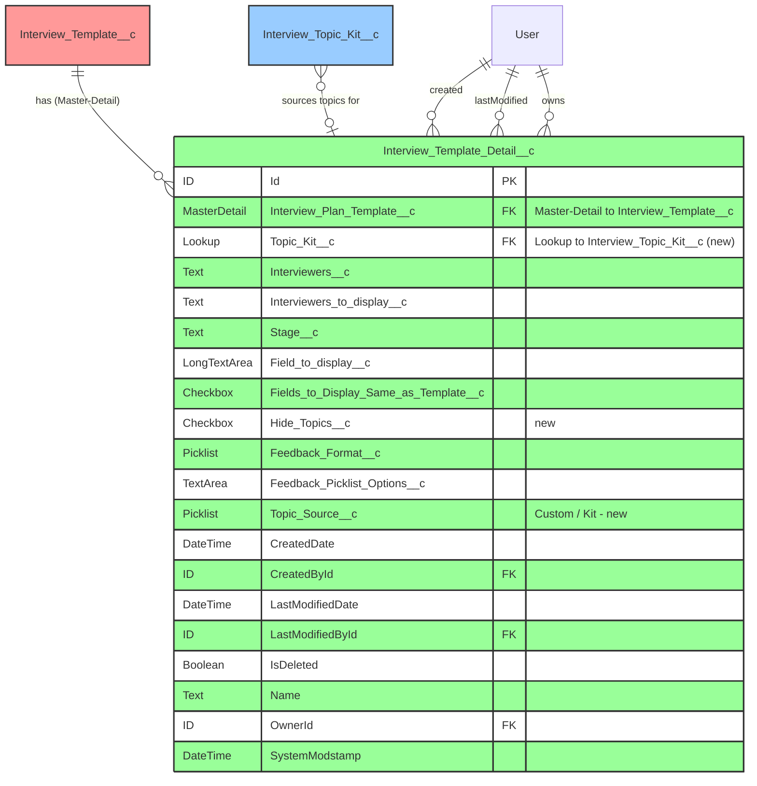
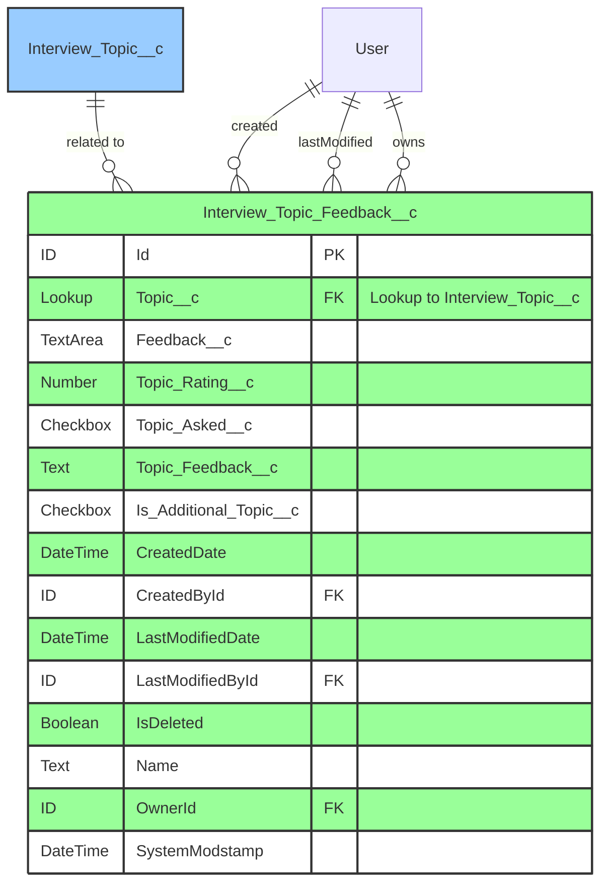
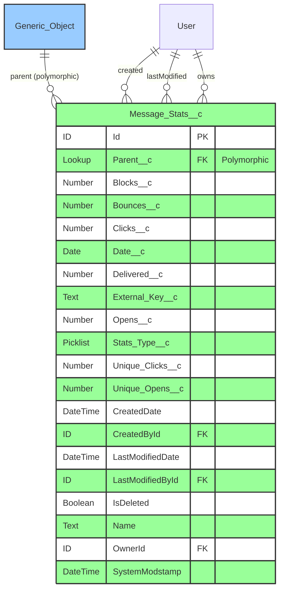
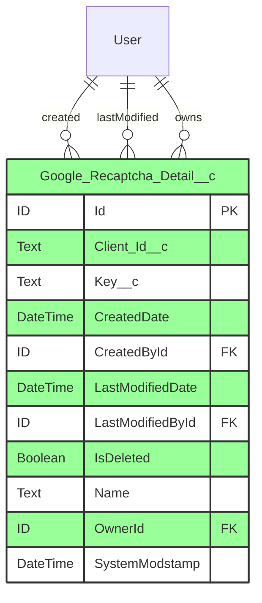
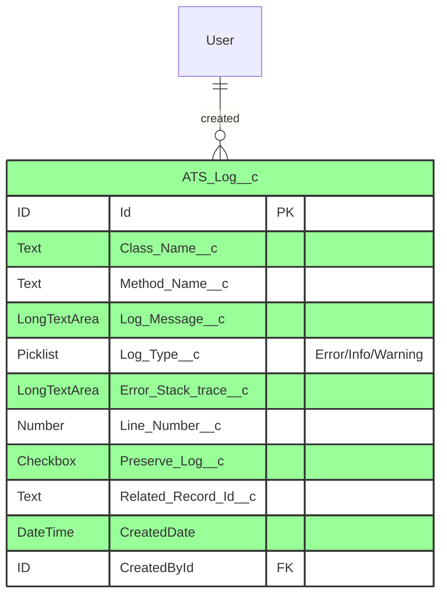
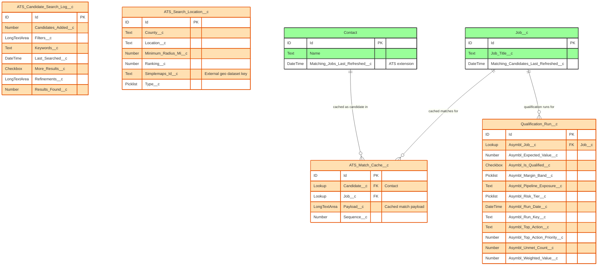

# ERD Diagrams for Supporting, Log, and Matching Objects

> **Revision note (2026-10-30)**: Refreshed against `master`. Prior content for `Interview_Template_Detail__c`, `Interview_Topic_Feedback__c`, `Message_Stats__c`, and `Google_Recaptcha_Detail__c` was largely accurate but has been corrected (e.g. `Interview_Topic_Feedback__c` has no `Interview_Feedback__c` lookup field — it relates only via `Topic__c`; `Message_Stats__c` has no `Spam_Reports__c`/`Unsubscribes__c` fields). This revision also adds full coverage for the candidate/job matching intelligence objects (`ATS_Match_Cache__c`, `ATS_Candidate_Search_Log__c`, `ATS_Search_Location__c`, `Qualification_Run__c`) and `ATS_Log__c`, none of which appeared in the prior revision of this file.

This document contains comprehensive Entity Relationship Diagrams (ERD) for objects that are not fully detailed in the primary domain-specific ERDs (Job Management, Applicant Management, Interview Management, Placement/Credit/Target Management).

## 1. Interview_Template_Detail__c

## 2. Interview_Topic_Feedback__c

> **Correction**: the prior revision of this ERD included a direct `Interview_Feedback__c` lookup field on `Interview_Topic_Feedback__c`. That field does not exist on the object in current metadata — the only custom relationship field is `Topic__c`.

## 3. Message_Stats__c

> **Correction**: the prior revision invented `Spam_Reports__c` and `Unsubscribes__c` fields. These do not exist on `Message_Stats__c` in current metadata — the full field set is exactly the 12 fields listed above.

## 4. Google_Recaptcha_Detail__c

> **Correction**: the prior revision invented `Site_Key__c`, `Recaptcha_URL__c`, `Version__c`, `Domain__c` fields. The object's actual complete field set is exactly `Client_Id__c` and `Key__c`.

## 5. ATS_Log__c

## 6. Candidate/Job Matching Intelligence Objects (new domain)

### Qualification_Run__c Notes
- `Asymbl_Run_Key__c` functions as an idempotency/dedup key for repeated runs against the same job/candidate pairing
- `Asymbl_Unmet_Count__c` reflects how many `ATS_Qualification_Config__mdt` gates were not satisfied
- `Asymbl_Risk_Tier__c` and `Asymbl_Margin_Band__c` are categorical outputs of the scoring engine (`ATS_QualificationGateEngine`)

### ATS_Search_Location__c Notes
- Supports radius-based candidate search; `Simplemaps_Id__c` ties the record to the Simplemaps third-party geographic reference dataset
- `Ranking__c` likely controls display/priority order in location-based search results

## 7. Remaining Custom Metadata Types Not Separately Diagrammed

The following metadata types are covered in full field-level detail in the [Configuration Metadata ERD](ERD_Configuration_Metadata.md) and are referenced here only for completeness of the "nothing missing" verification pass:

- `ATS_Demo_Data_Info__mdt`, `ATS_Job_View_List__mdt`, `ATS_Job_Description_Template__mdt` (UI/config)
- `ATS_Applicant_Field_Type_Config__mdt`, `ATS_Platform_Event_Restriction__mdt`, `Feature_Gate__mdt` (new since prior revision)
- `ATS_Qualification_Config__mdt`, `ATS_Talent_Intelligence_Data__mdt`, `ATS_Job_Intelligence_Setting__mdt` (new matching-intelligence config)
- `ATS_Resume_Field_Mapping__mdt`, `ATS_Skill_Summary_Mapping__mdt`, `ATS_Work_Experience_Mapping__mdt` (new resume-mapping config)

## Relationship Summary

### Interview_Template_Detail__c Relationships:
- **Master-Detail** with Interview_Template__c (parent, via `Interview_Plan_Template__c`)
- **Lookup** to Interview_Topic_Kit__c (new) when sourcing topics from a reusable kit
- **Lookup** relationships with User (CreatedBy, LastModifiedBy, Owner)

### Interview_Topic_Feedback__c Relationships:
- **Lookup** to Interview_Topic__c only (no direct Interview_Feedback__c relationship field)
- **Lookup** relationships with User (CreatedBy, LastModifiedBy, Owner)

### Message_Stats__c Relationships:
- **Lookup** to Parent (polymorphic — can reference multiple object types depending on `Stats_Type__c`)
- **Lookup** relationships with User (CreatedBy, LastModifiedBy, Owner)

### Google_Recaptcha_Detail__c Relationships:
- No custom relationship fields; standard User audit lookups only

### Matching Intelligence Object Relationships:
- `ATS_Match_Cache__c`: Lookup to Contact and Job__c
- `Qualification_Run__c`: Lookup to Job__c (`Asymbl_Job__c`)
- `ATS_Candidate_Search_Log__c` / `ATS_Search_Location__c`: no formal object relationships in current metadata — standalone reference/log data

### Custom Metadata Type Relationships:
All metadata types have standard relationships with User for audit fields (CreatedBy, LastModifiedBy); custom metadata types do not support lookup fields to non-metadata objects, so all "relationships" to core ATS objects are logical (consulted via Apex), not formal schema relationships.

## Color Coding Legend
- 🔴 **Red**: Master-Detail Relationships
- 🔵 **Blue**: Lookup Relationships
- 🟢 **Green**: Standard Objects
- 🟠 **Orange**: Matching Intelligence Objects (new category)

## Field Type Definitions
- **Text**: Standard text field (up to 255 characters)
- **TextArea**: Long text area (up to 4,096/32,768 characters depending on field)
- **LongTextArea**: Long text area (larger capacity, up to 131,072 characters)
- **Number**: Numeric field with decimal support
- **Checkbox**: Boolean field (true/false)
- **Picklist**: Single-select dropdown
- **Date**: Date without time
- **DateTime**: Date with time
- **Lookup**: Reference to another record
- **MasterDetail**: Parent-child relationship with cascade delete

## Important Notes

1. **Interview_Template_Detail__c** has a Master-Detail relationship with Interview_Template__c, meaning child records are automatically deleted when the parent is deleted and inherit its sharing settings
2. **Message_Stats__c** uses a polymorphic `Parent__c` lookup, which can reference different object types depending on `Stats_Type__c`
3. **Google_Recaptcha_Detail__c** has a genuinely minimal two-field schema — there is no encryption or versioning field on this object despite what the prior documentation revision claimed
4. All Custom Metadata Types (`__mdt`) are deployable and packaged with the application
5. These objects support interview management, messaging analytics, security, and (new) candidate/job matching intelligence features of the ATS package
