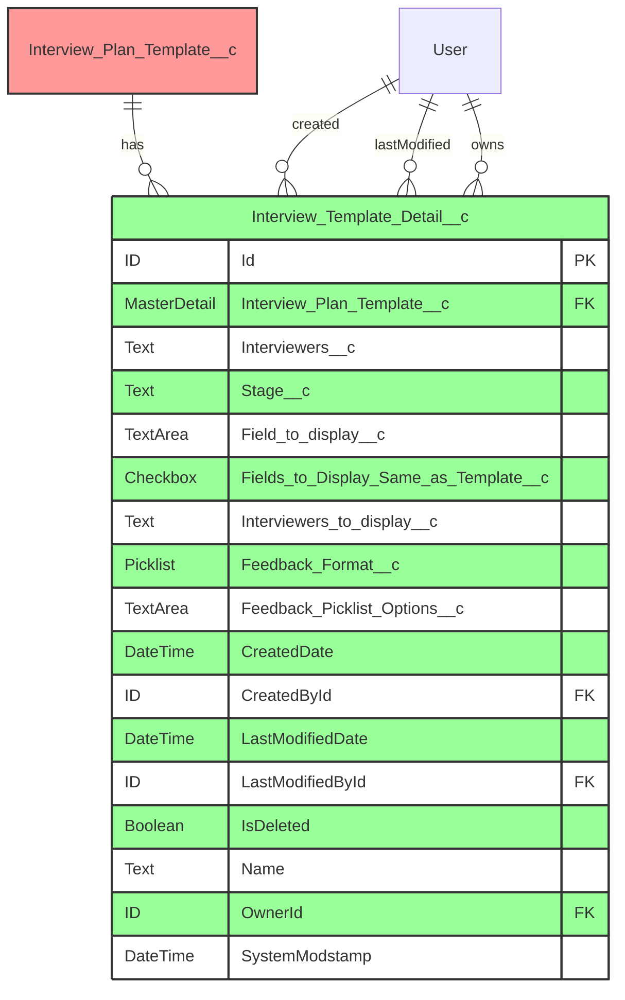
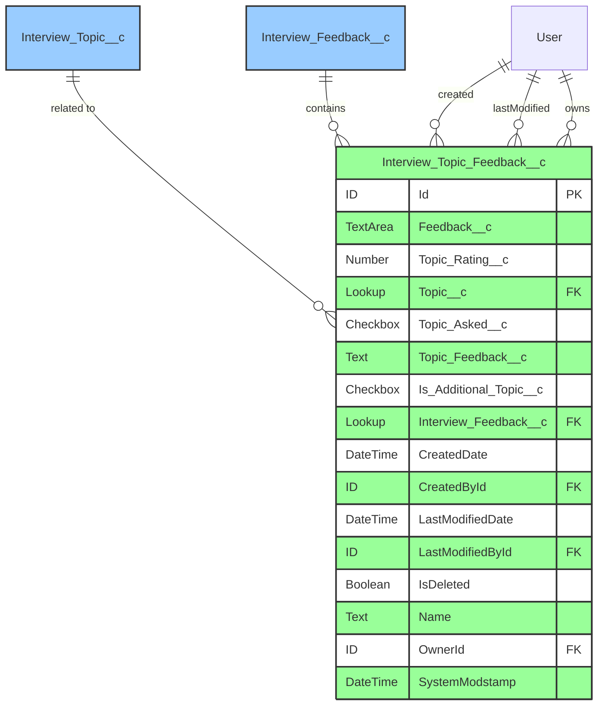
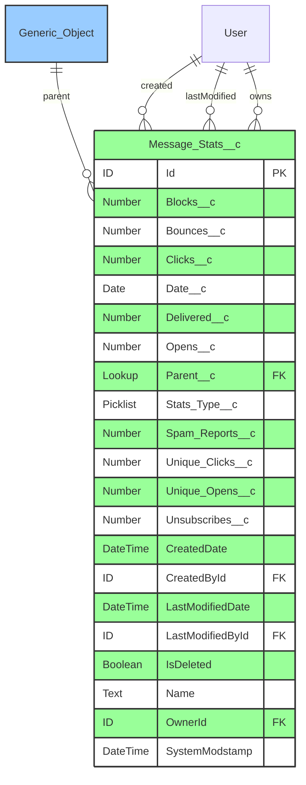
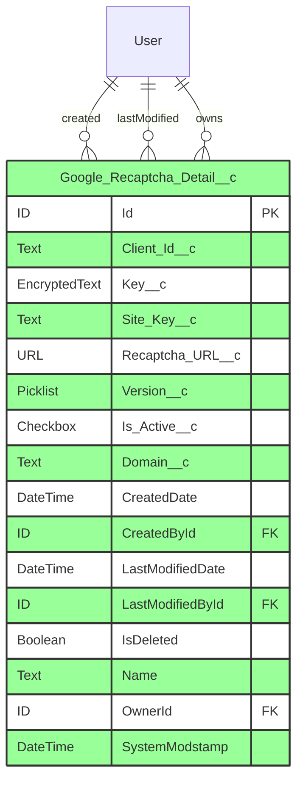
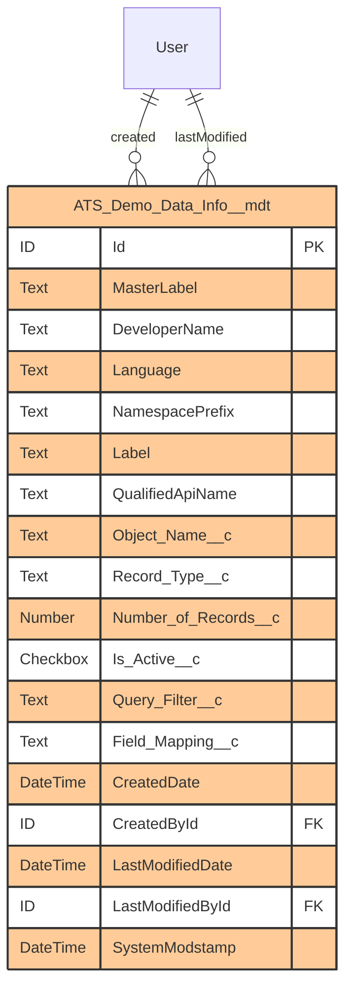
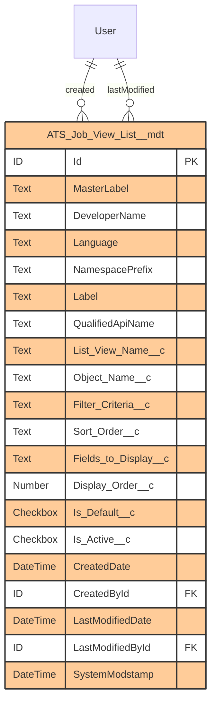
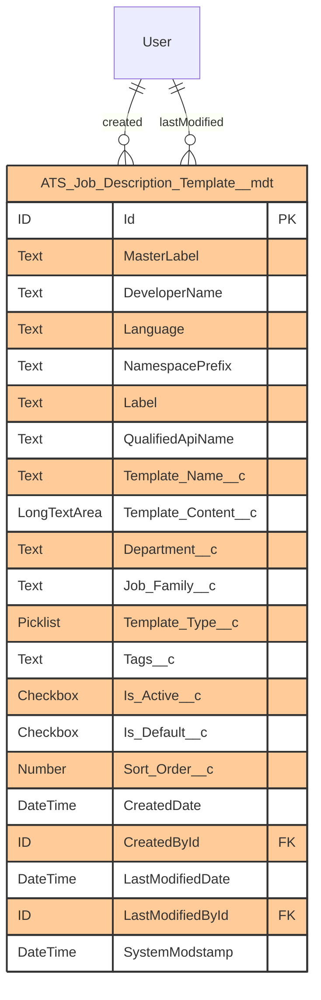

# ERD Diagrams for Missing Objects

This document contains comprehensive Entity Relationship Diagrams (ERD) for all objects that were completely missed in the documentation.

## 1. Interview_Template_Detail__c

## 2. Interview_Topic_Feedback__c

## 3. Message_Stats__c

### Stats_Type__c Picklist Values:
- Email
- SMS
- Push Notification
- In-App Message

## 4. Google_Recaptcha_Detail__c

## 5. Custom Metadata Types

### ATS_Demo_Data_Info__mdt

### ATS_Job_View_List__mdt

### ATS_Job_Description_Template__mdt

## Relationship Summary

### Interview_Template_Detail__c Relationships:
- **Master-Detail** with Interview_Plan_Template__c (parent)
- **Lookup** relationships with User (CreatedBy, LastModifiedBy, Owner)

### Interview_Topic_Feedback__c Relationships:
- **Lookup** to Interview_Topic__c
- **Lookup** to Interview_Feedback__c
- **Lookup** relationships with User (CreatedBy, LastModifiedBy, Owner)

### Message_Stats__c Relationships:
- **Lookup** to Parent (polymorphic - can reference multiple objects)
- **Lookup** relationships with User (CreatedBy, LastModifiedBy, Owner)

### Google_Recaptcha_Detail__c Relationships:
- **Lookup** relationships with User (CreatedBy, LastModifiedBy, Owner)

### Custom Metadata Type Relationships:
All metadata types have standard relationships with User for audit fields (CreatedBy, LastModifiedBy)

## Color Coding Legend
- 🔴 **Red**: Master-Detail Relationships
- 🔵 **Blue**: Lookup Relationships
- 🟫 **Green**: Standard Objects
- 🟪 **Orange**: Custom Metadata Types

## Field Type Definitions
- **Text**: Standard text field (up to 255 characters)
- **TextArea**: Long text area (up to 32,768 characters)
- **LongTextArea**: Long text area (up to 131,072 characters)
- **Number**: Numeric field with decimal support
- **Checkbox**: Boolean field (true/false)
- **Picklist**: Single-select dropdown
- **Date**: Date without time
- **DateTime**: Date with time
- **Lookup**: Reference to another record
- **MasterDetail**: Parent-child relationship with cascade delete
- **EncryptedText**: Encrypted text field for sensitive data
- **URL**: URL field with validation

## Important Notes

1. **Interview_Template_Detail__c** has a Master-Detail relationship with Interview_Plan_Template__c, meaning:
   - Child records are automatically deleted when parent is deleted
   - Child records inherit sharing settings from parent
   - Roll-up summary fields can be created on the parent

2. **Message_Stats__c** uses a polymorphic Parent__c lookup, which can reference different object types depending on Stats_Type__c

3. **Google_Recaptcha_Detail__c** stores the Key__c as an encrypted field for security

4. All Custom Metadata Types (\_\_mdt) are deployable and can be packaged with the application

5. These objects support the interview management, messaging analytics, and security features of the ATS package