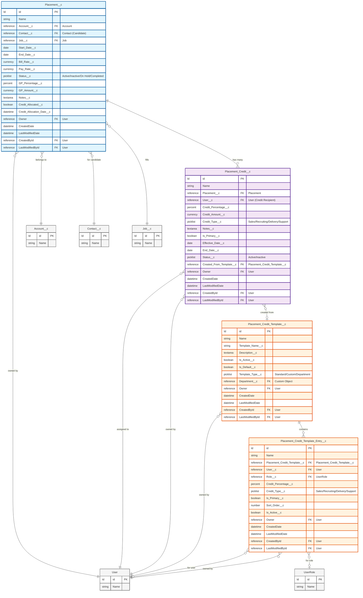
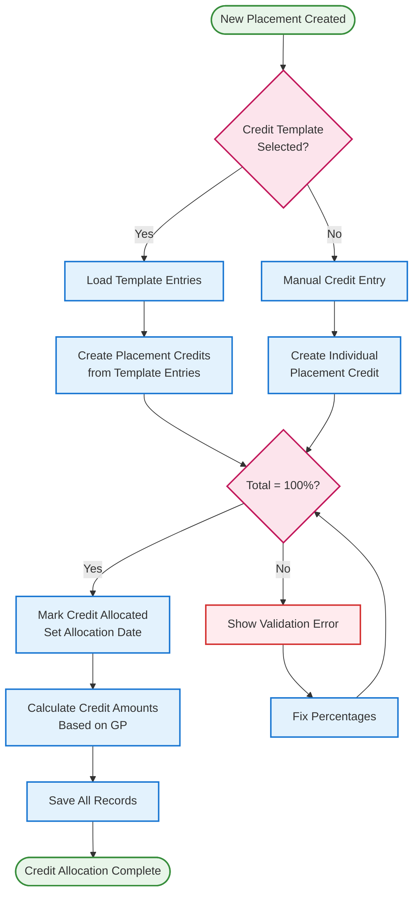

# Placement and Credit Management ERD

## Entity Relationship Diagram

## Credit Allocation Flow

## Object Descriptions

### Placement__c
- **Purpose**: Represents a candidate placement for a job at a client company
- **Key Features**:
  - Tracks placement details (dates, rates, status)
  - Calculates GP (Gross Profit) percentage and amount
  - Links to Account (client), Contact (candidate), and Job
  - Tracks credit allocation status and date

### Placement_Credit__c
- **Purpose**: Represents credit allocation for a specific user on a placement
- **Key Features**:
  - Assigns percentage or amount-based credit to users
  - Supports different credit types (Sales, Recruiting, Delivery, Support)
  - Can be created from templates or manually
  - Tracks effective and end dates for credit periods
  - Supports primary credit designation

### Placement_Credit_Template__c
- **Purpose**: Defines reusable credit allocation templates
- **Key Features**:
  - Creates standard credit allocation patterns
  - Can be department-specific or company-wide
  - Supports default template designation
  - Active/inactive status for template management

### Placement_Credit_Template_Entry__c
- **Purpose**: Individual entries within a credit template
- **Key Features**:
  - Defines credit percentage for specific users or roles
  - Supports role-based credit allocation
  - Maintains sort order for display purposes
  - Can be activated/deactivated independently

## Relationship Cardinality

- **Placement to Placement Credit**: One-to-Many
  - One placement can have multiple credit allocations
  - Each credit must belong to exactly one placement

- **Placement Credit Template to Template Entries**: One-to-Many
  - One template contains multiple entries
  - Each entry belongs to exactly one template

- **Placement Credit to Template**: Many-to-One (Optional)
  - Credits can be created from a template
  - Credits can also be created manually without a template

## Business Rules

1. **Credit Allocation Validation**:
   - Total credit percentages for a placement should equal 100%
   - Primary credit designation should be unique per placement

2. **Template Usage**:
   - Only active templates can be used for new credit allocations
   - Default templates are automatically suggested for new placements

3. **Credit Types**:
   - Each credit entry must have a valid credit type
   - Credit types determine reporting and commission calculations

4. **Temporal Validity**:
   - Credits can have effective and end dates
   - Only active credits within valid date ranges are considered for calculations