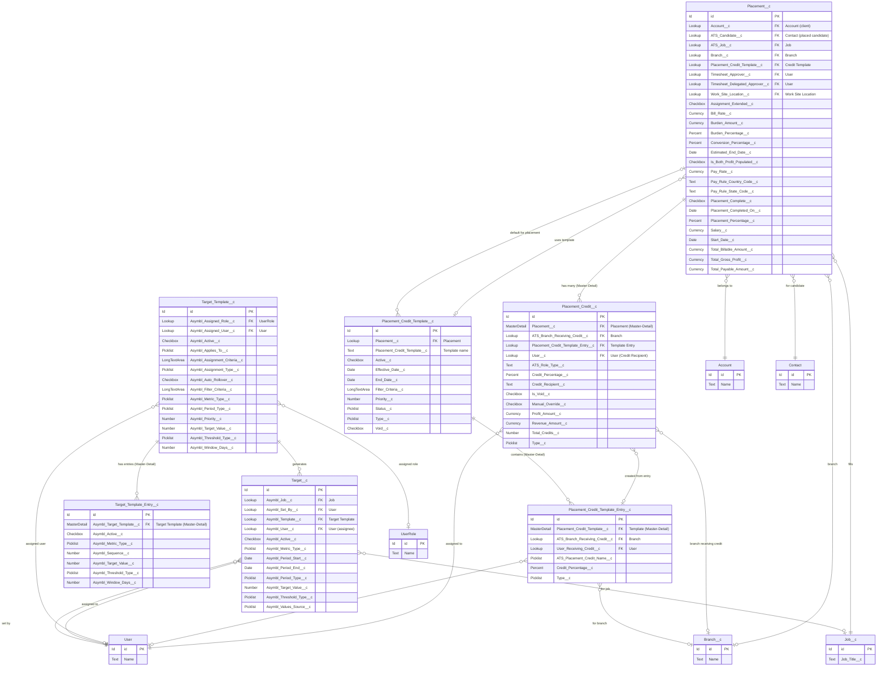
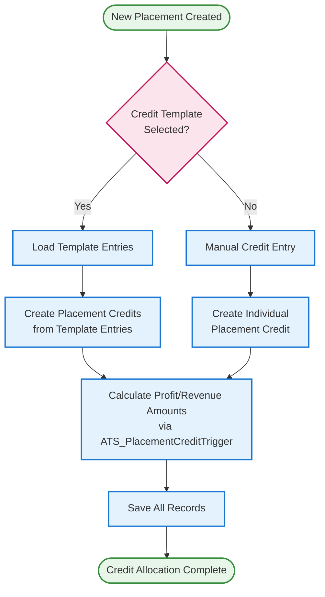
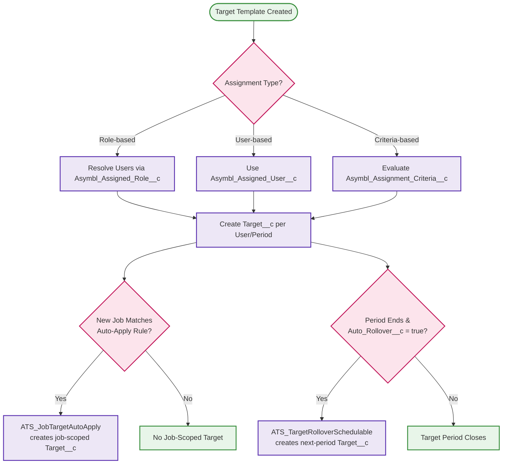

# Placement, Credit, and Target Management ERD

> **Revision note (2026-10-30)**: Rebuilt against real field metadata. The prior revision used generic/plausible-sounding but fabricated fields on every object in this file (`Placement__c.GP_Percentage__c`/`GP_Amount__c`/`Credit_Allocated__c`, `Placement_Credit__c.Credit_Amount__c`/`Is_Primary__c`, `Placement_Credit_Template__c.Template_Type__c`/`Department__c`, `Placement_Credit_Template_Entry__c.Role__c`/`Sort_Order__c`) — none of these exist. It also entirely omitted the new **Target / Target Template** KPI domain, which has no placement-credit overlap in the real schema but is documented here alongside it since both are compensation/performance-adjacent and were introduced together in the same package revision cycle.

## Entity Relationship Diagram

## Credit Allocation Flow

> **Note**: the prior revision's flow diagram depicted a `Total = 100%?` validation gate and a `Credit_Allocated__c`/`Credit_Allocation_Date__c` completion step. Neither of those fields exists on `Placement__c` or `Placement_Credit__c` in the current schema; percentage totals are not formally validated by a dedicated field in this object model. This diagram has been corrected to reflect the actual trigger-driven calculation flow (`ATS_PlacementCreditTrigger`/`ATS_PlacementCreditTriggerHandler`).

## Target Assignment Flow (new domain)

## Object Descriptions

### Placement__c
- **Purpose**: Represents a candidate placement for a job at a client company
- **Key Features**: tracks placement dates/rates/status, burden amount/percentage, gross profit totals (`Total_Gross_Profit__c`), timesheet approver chain, and links to Account (client), Contact (candidate via `ATS_Candidate__c`), and Job (via `ATS_Job__c`)

### Placement_Credit__c
- **Purpose**: Represents credit allocation for a specific user on a placement
- **Key Features**: percentage- and amount-based credit (`Credit_Percentage__c`, `Profit_Amount__c`, `Revenue_Amount__c`), can be created from a `Placement_Credit_Template_Entry__c` or manually, supports voiding (`Is_Void__c`) and manual override

### Placement_Credit_Template__c / Placement_Credit_Template_Entry__c
- **Purpose**: Defines reusable credit allocation templates and their per-recipient entries
- **Key Features**: active/void/status lifecycle, filter criteria for automatic template selection, entries assign a named credit role (`ATS_Placement_Credit_Name__c`) to a specific user and/or branch

### Target_Template__c / Target_Template_Entry__c / Target__c *(new domain)*
- **Purpose**: Defines and materializes recruiter/team KPI goals
- **Key Features**:
  - `Target_Template__c` defines the metric type, period cadence, assignment rule (by role, user, or filter criteria), and whether unmet targets auto-roll into the next period
  - `Target_Template_Entry__c` defines graduated threshold/value breakpoints within a template
  - `Target__c` is the materialized, assigned instance for a specific user and period, optionally scoped to a specific job (auto-applied via `ATS_JobTargetAutoApply` when a new job matches a template's criteria)

## Relationship Cardinality

- **Placement to Placement Credit**: One-to-Many (Master-Detail) — one placement can have multiple credit allocations; each credit belongs to exactly one placement
- **Placement Credit Template to Template Entries**: One-to-Many (Master-Detail)
- **Placement Credit to Template Entry**: Many-to-One (Optional) — credits can be created from a template entry or manually
- **Target Template to Target Template Entry**: One-to-Many (Master-Detail)
- **Target Template to Target**: One-to-Many — a template can generate many materialized Target records across users/periods

## Business Rules

1. **Credit Calculation**: Profit/Revenue amounts on `Placement_Credit__c` are calculated via `ATS_PlacementCreditTriggerHandler`, not a dedicated validation field
2. **Template Usage**: `Active__c`/`Void__c` on `Placement_Credit_Template__c` control whether a template is eligible for new placements
3. **Credit Types**: `Type__c` on both `Placement_Credit__c` and `Placement_Credit_Template_Entry__c` determines reporting and commission category
4. **Target Rollover**: `Asymbl_Auto_Rollover__c` on `Target_Template__c` drives `ATS_TargetRolloverSchedulable`, which creates the next period's `Target__c` automatically for templates that opt in
5. **Target Auto-Apply**: `ATS_JobTargetAutoApply` evaluates new `Job__c` records against active Target Template assignment criteria to automatically create job-scoped targets
