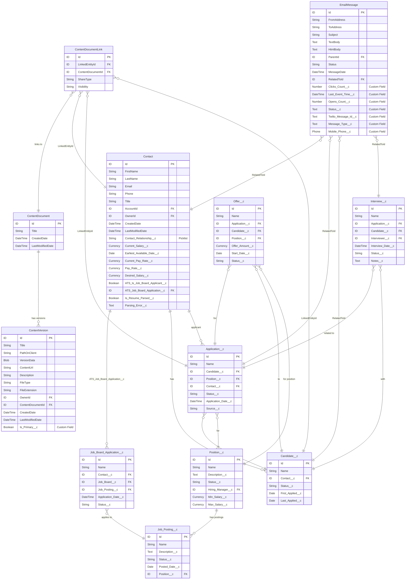

# ERD: Standard Object Extensions - ATS Package

## Overview
This ERD illustrates how standard Salesforce objects are extended with custom fields to support the ATS (Applicant Tracking System) package functionality.

## Standard Object Extensions Details

### 1. Contact Object Extensions

The Contact object is extended with ATS-specific fields to capture candidate information:

| Field API Name | Field Type | Description | Relationship |
|----------------|------------|-------------|--------------|
| Contact_Relationship__c | Picklist | Type of relationship with the contact | - |
| Current_Salary__c | Currency | Contact's current salary | - |
| Earliest_Available_Date__c | Date | When the contact can start work | - |
| Current_Pay_Rate__c | Currency | Current hourly/daily rate | - |
| Pay_Rate__c | Currency | Desired pay rate | - |
| Desired_Salary__c | Currency | Expected salary | - |
| ATS_Is_Job_Board_Applicant__c | Checkbox | Indicates if contact applied via job board | - |
| ATS_Job_Board_Application__c | Lookup | Links to Job Board Application | Job_Board_Application__c |
| Is_Resume_Parsed__c | Checkbox | Indicates if resume was parsed | - |
| Parsing_Error__c | Text | Error details if parsing failed | - |

### 2. ContentVersion Object Extensions

ContentVersion is extended to manage document priorities:

| Field API Name | Field Type | Description | Usage |
|----------------|------------|-------------|--------|
| Is_Primary__c | Checkbox | Marks primary document (e.g., main resume) | Used to identify the main resume among multiple documents |

**Relationships:**
- ContentVersion → ContentDocument (Standard)
- ContentDocument → ContentDocumentLink → Contact/Application/Candidate (via LinkedEntityId)

### 3. EmailMessage Object Extensions

EmailMessage is extended for email tracking and SMS capabilities:

| Field API Name | Field Type | Description | Integration |
|----------------|------------|-------------|-------------|
| Clicks_Count__c | Number | Number of link clicks in email | Email tracking |
| Last_Event_Time__c | DateTime | Timestamp of last interaction | Email tracking |
| Opens_Count__c | Number | Number of email opens | Email tracking |
| Status__c | Text | Custom status tracking | Workflow management |
| Twilio_Message_Id__c | Text | Twilio SMS message identifier | SMS integration |
| Message_Type__c | Text | Type of message (Email/SMS) | Multi-channel comms |
| Mobile_Phone__c | Phone | Mobile number for SMS | SMS delivery |

**Relationships:**
- EmailMessage → Contact (via RelatedToId)
- EmailMessage → Application__c (via RelatedToId)
- EmailMessage → Candidate__c (via RelatedToId)
- EmailMessage → Interview__c (via RelatedToId)

## Integration Patterns

### 1. Document Management
- Resumes and documents are stored as ContentVersion records
- Is_Primary__c identifies the main resume
- ContentDocumentLink connects documents to Contacts, Applications, and Candidates

### 2. Communication Tracking
- EmailMessage tracks all communications with candidates
- Extended fields enable email open/click tracking
- SMS capabilities through Twilio integration

### 3. Job Board Integration
- Contact.ATS_Is_Job_Board_Applicant__c flags job board applicants
- Contact.ATS_Job_Board_Application__c links to the specific application
- Enables tracking of application sources

### 4. Resume Parsing
- Contact.Is_Resume_Parsed__c indicates parsing status
- Contact.Parsing_Error__c captures any parsing errors
- Integrates with resume parsing services

## Key Relationships Summary

1. **Contact ↔ ATS Objects**
   - Contact → Job_Board_Application__c (via lookup)
   - Contact → Candidate__c (1:many)
   - Contact → Application__c (1:many)

2. **ContentVersion ↔ ATS Objects**
   - ContentVersion → ContentDocument → ContentDocumentLink → ATS Objects
   - Supports multiple document attachments per record

3. **EmailMessage ↔ ATS Objects**
   - EmailMessage → Various ATS objects via RelatedToId
   - Enables activity tracking across the recruitment process

## Implementation Notes

1. **Data Model Considerations**
   - Standard objects are extended rather than replaced
   - Maintains Salesforce standard functionality
   - Enables reporting across standard and custom fields

2. **Security Model**
   - Field-level security should be configured for custom fields
   - Sharing rules apply to both standard and custom fields
   - Consider field accessibility for different user profiles

3. **Performance Optimization**
   - Index custom lookup fields for better query performance
   - Consider data archiving for historical email messages
   - Implement selective queries on extended objects