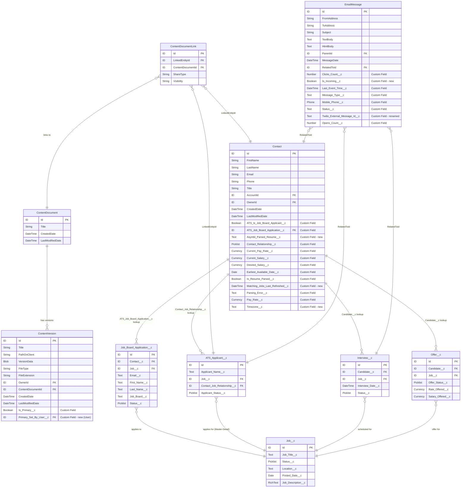

# ERD: Standard Object Extensions - ATS Package

> **Revision note (2026-10-30)**: Rebuilt against real field metadata for Contact, ContentVersion, and EmailMessage. The prior revision's Contact/ContentVersion/EmailMessage field lists were broadly accurate but incomplete (missing `Asymbl_Parsed_Resume__c`, `Matching_Jobs_Last_Refreshed__c`, `Timezone__c` on Contact; `Primary_Set_By_User__c` on ContentVersion; `Is_Incoming__c` on EmailMessage; and used the stale field name `Twilio_Message_Id__c` instead of the current `Twilio_External_Message_Id__c`). The prior revision's Mermaid diagram also invented an entire parallel object model (`Job_Posting__c`, `Position__c`, `Candidate__c`, `Application__c`) that **does not exist** in this package — those have been removed and replaced with the real ATS objects (`Job__c`, `ATS_Applicant__c`, `Job_Board_Application__c`).

## Overview
This ERD illustrates how standard Salesforce objects are extended with custom fields to support the ATS (Applicant Tracking System) package functionality.

## Standard Object Extensions Details

### 1. Contact Object Extensions

The Contact object is extended with 13 ATS-specific custom fields (up from 10 in the prior documentation revision):

| Field API Name | Field Type | Description | Status |
|----------------|------------|-------------|--------|
| ATS_Is_Job_Board_Applicant__c | Checkbox | Indicates if contact applied via job board | unchanged |
| ATS_Job_Board_Application__c | Lookup | Links to Job Board Application | unchanged |
| Asymbl_Parsed_Resume__c | Text/Lookup | Reference to the parsed resume record/file | **new** |
| Contact_Relationship__c | Picklist | Type of relationship with the contact | unchanged |
| Current_Pay_Rate__c | Currency | Current hourly/daily rate | unchanged |
| Current_Salary__c | Currency | Contact's current salary | unchanged |
| Desired_Salary__c | Currency | Expected salary | unchanged |
| Earliest_Available_Date__c | Date | When the contact can start work | unchanged |
| Is_Resume_Parsed__c | Checkbox | Indicates if resume was parsed | unchanged |
| Matching_Jobs_Last_Refreshed__c | DateTime | Last time candidate-matching intelligence ran for this contact | **new** |
| Parsing_Error__c | Text | Error details if parsing failed | unchanged |
| Pay_Rate__c | Currency | Desired pay rate | unchanged |
| Timezone__c | Text/Picklist | Contact's timezone, used for interview scheduling | **new** |

### 2. ContentVersion Object Extensions

ContentVersion is extended with 2 custom fields (up from 1 in the prior documentation revision):

| Field API Name | Field Type | Description | Status |
|----------------|------------|-------------|--------|
| Is_Primary__c | Checkbox | Marks primary document (e.g., main resume) | unchanged |
| Primary_Set_By_User__c | Lookup(User) | Tracks who marked the file as primary | **new** |

**Relationships:**
- ContentVersion → ContentDocument (Standard)
- ContentDocument → ContentDocumentLink → Contact/ATS_Applicant__c (via LinkedEntityId)

### 3. EmailMessage Object Extensions

EmailMessage is extended with 8 custom fields (up from 7 in the prior documentation revision):

| Field API Name | Field Type | Description | Status |
|----------------|------------|-------------|--------|
| Clicks_Count__c | Number | Number of link clicks in email | unchanged |
| Is_Incoming__c | Checkbox | Flags inbound vs. outbound messages | **new** |
| Last_Event_Time__c | DateTime | Timestamp of last interaction | unchanged |
| Message_Type__c | Text | Type of message (Email/SMS) | unchanged |
| Mobile_Phone__c | Phone | Mobile number for SMS | unchanged |
| Opens_Count__c | Number | Number of email opens | unchanged |
| Status__c | Text | Custom status tracking | unchanged |
| Twilio_External_Message_Id__c | Text | Twilio SMS/email message identifier | **renamed** from `Twilio_Message_Id__c` |

**Relationships:**
- EmailMessage → Contact (via RelatedToId)
- EmailMessage → ATS_Applicant__c (via RelatedToId)
- EmailMessage → Interview__c (via RelatedToId)

> **Correction**: the prior revision's field name `Twilio_Message_Id__c` is stale — the current field is `Twilio_External_Message_Id__c`.

## Integration Patterns

### 1. Document Management
- Resumes and documents are stored as ContentVersion records
- `Is_Primary__c` identifies the main resume; `Primary_Set_By_User__c` provides an audit trail of who designated it
- ContentDocumentLink connects documents to Contacts and ATS_Applicant__c records

### 2. Communication Tracking
- EmailMessage tracks all communications with candidates, now distinguishing inbound vs. outbound via `Is_Incoming__c`
- Extended fields enable email open/click tracking
- SMS capabilities through Twilio integration, referenced via `Twilio_External_Message_Id__c`

### 3. Job Board Integration
- `Contact.ATS_Is_Job_Board_Applicant__c` flags job board applicants
- `Contact.ATS_Job_Board_Application__c` links to the specific application
- Enables tracking of application sources

### 4. Resume Parsing & Matching Intelligence
- `Contact.Is_Resume_Parsed__c` indicates parsing status; `Contact.Parsing_Error__c` captures any parsing errors
- `Contact.Asymbl_Parsed_Resume__c` (new) references the parsed resume output
- `Contact.Matching_Jobs_Last_Refreshed__c` (new) exposes staleness of the candidate-job matching intelligence cache directly on the Contact record (see [Integration Objects ERD](ERD_Integration_Objects.md) for `ATS_Match_Cache__c`)

## Key Relationships Summary

1. **Contact ↔ ATS Objects**
   - Contact → Job_Board_Application__c (via lookup)
   - Contact → ATS_Applicant__c (1:many, via `Contact_Job_Relationship__c`)
   - Contact → Interview__c, Offer__c, Placement__c (1:many)

2. **ContentVersion ↔ ATS Objects**
   - ContentVersion → ContentDocument → ContentDocumentLink → ATS Objects
   - Supports multiple document attachments per record, with primary-document tracking

3. **EmailMessage ↔ ATS Objects**
   - EmailMessage → Various ATS objects via RelatedToId
   - Enables activity tracking across the recruitment process, including interview feedback reminder emails

## Implementation Notes

1. **Data Model Considerations**
   - Standard objects are extended rather than replaced
   - Maintains Salesforce standard functionality
   - Enables reporting across standard and custom fields

2. **Security Model**
   - Field-level security should be configured for custom fields
   - Sharing rules apply to both standard and custom fields
   - Consider field accessibility for different user profiles

3. **Performance Optimization**
   - Index custom lookup fields for better query performance
   - Consider data archiving for historical email messages
   - Implement selective queries on extended objects
