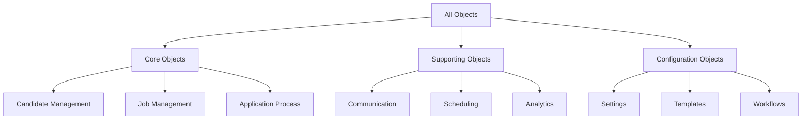
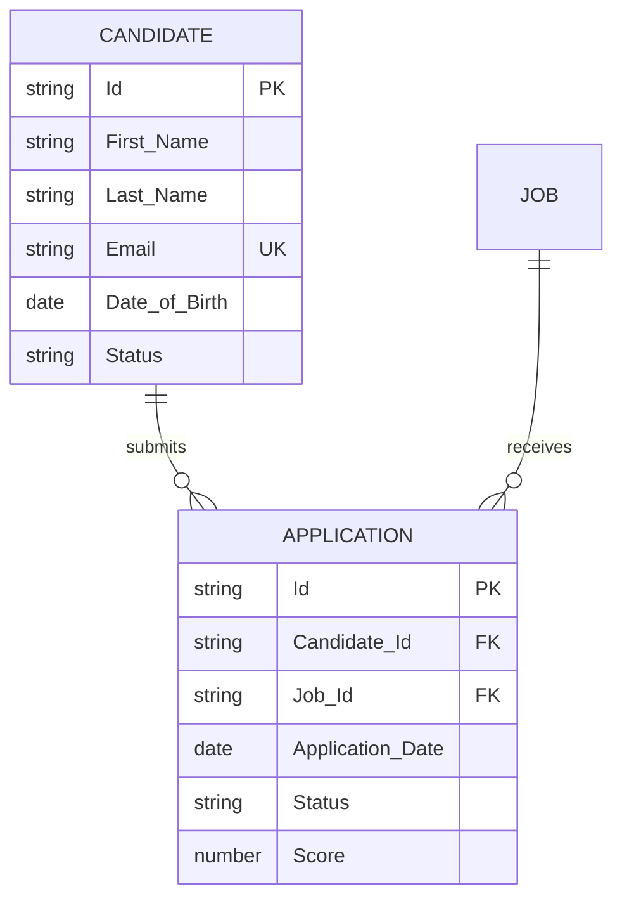

# Claude Framework: Comprehensive Salesforce Package Documentation Methodology

## Overview

This document outlines the systematic approach and framework developed to analyze, understand, and document complex Salesforce packages using Claude AI. The methodology was specifically applied to analyze an ATS (Applicant Tracking System) package containing 100+ custom objects, providing a scalable and repeatable process for Salesforce package documentation.

### Key Objectives
- Parse and understand package.xml structure efficiently
- Categorize objects by functional domains
- Map complex relationships between objects
- Generate comprehensive technical documentation
- Create visual representations (ERD diagrams)
- Establish reusable documentation patterns
- **Ensure complete coverage using ULTRATHINK methodology**

## ULTRATHINK Gap Analysis Methodology

### Overview
ULTRATHINK is a systematic verification approach that ensures no components are missed during documentation. It emphasizes complete component discovery, cross-verification, and iterative gap analysis.

### Component Count Verification Process

1. **Read Complete package.xml**
   ```python
   # Handle large files with pagination
   total_content = ""
   offset = 0
   limit = 2000
   
   while True:
       chunk = read_file(path="package.xml", offset=offset, limit=limit)
       if not chunk or chunk == "":
           break
       total_content += chunk
       offset += limit
   ```

2. **Extract and Count All Component Types**
   ```xml
   <types>
       <members>*</members>
       <name>ApexClass</name>
   </types>
   <!-- Count each <members> tag within each <types> section -->
   ```

3. **Create Verification Matrix**
   ```
   Component Type | package.xml Count | Documented | Gap Analysis
   --------------|-------------------|------------|-------------
   ApexClass     | 72                | 72         | ✓ Complete
   QuickAction   | 1                 | 0          | ⚠ Missing!
   CustomTab     | 6                 | 0          | ⚠ Missing!
   ```

### UI Component Discovery Pattern

**Critical UI Components Often Missed:**
- **QuickAction** (e.g., Parse_Resume quick action)
- **CustomTab** (Navigation elements)
- **Layout** (Page layouts)
- **CompactLayout** (Mobile/highlight panels)
- **ListView** (Default views)
- **StaticResource** (Images, CSS, JS)

**Discovery Process:**
```python
def discover_ui_components(package_xml):
    ui_types = [
        'QuickAction', 'CustomTab', 'Layout', 
        'CompactLayout', 'ListView', 'FlexiPage',
        'StaticResource', 'RecordType'
    ]
    
    for ui_type in ui_types:
        components = extract_components(package_xml, ui_type)
        if components and len(components) > 0:
            document_ui_components(ui_type, components)
```

## Methodology

### 1. Package.xml Parsing Strategy

The foundation of our analysis begins with systematic parsing of the package.xml file:

```xml
<!-- Example package.xml structure -->
<Package xmlns="http://soap.sforce.com/2006/04/metadata">
    <types>
        <members>ATS_Application__c</members>
        <members>ATS_Candidate__c</members>
        <members>ATS_Job__c</members>
        <name>CustomObject</name>
    </types>
    <version>57.0</version>
</Package>
```

**Parsing Approach:**
1. Extract all CustomObject members
2. Identify naming patterns (prefixes, suffixes)
3. Group related objects by naming conventions
4. Create initial object inventory
5. **ULTRATHINK: Verify total component count matches sum of all types**

### 2. Object Categorization Approach

We developed a domain-driven categorization system:



**Categorization Criteria:**
- **Functional Domain**: What business process does it support?
- **Data Volume**: Is it transactional or reference data?
- **Relationship Density**: How many other objects does it connect to?
- **Usage Pattern**: CRUD frequency and access patterns

### 3. Relationship Mapping Technique

We employed a multi-pass approach to identify and document relationships:

#### Pass 1: Direct References
```python
# Pseudo-code for relationship detection
for each object in package:
    for each field in object:
        if field.type == 'Lookup' or field.type == 'MasterDetail':
            record_relationship(
                from_object=object,
                to_object=field.reference_to,
                type=field.type,
                field_name=field.name
            )
```

#### Pass 2: Indirect Relationships
- Junction objects (many-to-many relationships)
- Polymorphic references (WhoId, WhatId patterns)
- Custom relationship patterns

#### Pass 3: Business Logic Relationships
- Process dependencies
- Workflow connections
- Data flow patterns

### 4. Field Analysis Methodology

Comprehensive field analysis framework:

```yaml
Field Analysis Template:
  - Field Name: API name of the field
  - Data Type: Salesforce field type
  - Business Purpose: Why this field exists
  - Validation Rules: Constraints and requirements
  - Dependencies: Related fields or objects
  - Usage Patterns: How the field is typically used
```

**Field Categories:**
1. **Identity Fields**: Unique identifiers, external IDs
2. **Relationship Fields**: Lookups, Master-Detail
3. **Business Data Fields**: Core business information
4. **Metadata Fields**: Tracking and audit fields
5. **Calculated Fields**: Formula and rollup fields

### 5. Documentation Structure Decisions

We established a hierarchical documentation structure:

```
Documentation/
├── Overview/
│   ├── Package_Summary.md
│   ├── Architecture_Overview.md
│   └── Business_Context.md
├── Object_Groups/
│   ├── Core_Objects/
│   ├── Supporting_Objects/
│   └── Configuration_Objects/
├── ERD_Diagrams/
│   ├── Complete_ERD.md
│   ├── Domain_Specific_ERDs/
│   └── Relationship_Maps/
├── Field_Dictionaries/
│   └── [Object_Name]_Fields.md
└── Integration_Guides/
    ├── API_Patterns.md
    └── Best_Practices.md
```

## Analysis Framework

### Step 1: Package.xml Parsing Strategy

**Automated Extraction Process:**

```javascript
// Example parsing logic
function parsePackageXML(xmlContent) {
    const parser = new DOMParser();
    const xmlDoc = parser.parseFromString(xmlContent, "text/xml");
    
    const customObjects = [];
    const objectNodes = xmlDoc.querySelectorAll('types > members');
    
    objectNodes.forEach(node => {
        if (node.parentNode.querySelector('name').textContent === 'CustomObject') {
            customObjects.push({
                name: node.textContent,
                category: categorizeObject(node.textContent),
                prefix: extractPrefix(node.textContent)
            });
        }
    });
    
    return customObjects;
}

function categorizeObject(objectName) {
    // Domain-specific categorization logic
    if (objectName.includes('Candidate')) return 'Candidate Management';
    if (objectName.includes('Job')) return 'Job Management';
    if (objectName.includes('Application')) return 'Application Process';
    // ... more categories
}
```

### Step 2: Object Categorization Approach

**Multi-Dimensional Categorization Matrix:**

| Dimension | Categories | Criteria |
|-----------|------------|----------|
| Functional Domain | Core, Supporting, Configuration | Business process alignment |
| Data Volume | High, Medium, Low | Expected record count |
| Access Pattern | Transactional, Reference, Archive | CRUD frequency |
| Integration Level | Internal, External, Both | API exposure |

### Step 3: Relationship Mapping Technique

**Relationship Detection Algorithm:**

```python
class RelationshipMapper:
    def __init__(self):
        self.relationships = []
        self.relationship_types = {
            'Lookup': 'Many-to-One',
            'MasterDetail': 'One-to-Many (Cascade)',
            'Junction': 'Many-to-Many'
        }
    
    def analyze_object(self, object_metadata):
        for field in object_metadata.fields:
            if self.is_relationship_field(field):
                self.relationships.append({
                    'from': object_metadata.name,
                    'to': field.reference_to,
                    'type': self.relationship_types[field.type],
                    'field': field.name,
                    'required': field.required
                })
    
    def generate_erd_notation(self):
        # Convert to Mermaid ERD syntax
        for rel in self.relationships:
            yield f"{rel['from']} {self.get_cardinality(rel)} {rel['to']} : {rel['field']}"
```

### Step 4: Field Analysis Methodology

**Comprehensive Field Analysis Template:**

```yaml
Field_Analysis:
  Object: ATS_Application__c
  Fields:
    - Name: Status__c
      Type: Picklist
      Values: [New, In Review, Interview, Offer, Rejected, Withdrawn]
      Business_Logic: |
        Tracks application lifecycle stage.
        Triggers workflow rules for notifications.
        Drives dashboard analytics.
      Validation_Rules:
        - Cannot move backwards in process (except to Withdrawn)
        - Requires reason for Rejected status
      Dependencies:
        - Stage_Changed_Date__c (auto-updated)
        - Stage_Changed_By__c (auto-populated)
```

### Step 5: Documentation Structure Decisions

**Modular Documentation Approach:**

1. **Component-Based Structure**: Each object gets its own documentation module
2. **Cross-Reference System**: Hyperlinked relationships between documents
3. **Version Control Integration**: Git-based change tracking
4. **Automated Generation**: Scripts to regenerate documentation from metadata

## Repository Structure Best Practices

### Single Source of Truth Principle

**Avoid Duplication:**
- One location per package (e.g., /ASM/ not /Asymbl/Asymbl Packages/ASM/)
- Clear folder hierarchy
- No redundant documentation
- Consistent navigation patterns

**Repository Structure Example:**
```
/Repository-Root
├── README.md           # Main navigation
├── Claude.md           # This methodology
├── /ATS/               # ATS Package
│   ├── README.md
│   └── ...
└── /ASM/               # ASM Package
    ├── README.md
    └── ...
```

## Best Practices Discovered

### Naming Conventions

**Object Naming Patterns:**
```
Pattern: [Prefix]_[BusinessEntity]_[Suffix]__c

Examples:
- ATS_Candidate__c (Core object)
- ATS_Interview_Schedule__c (Process object)
- ATS_Email_Template__c (Configuration object)
```

**Field Naming Patterns:**
```
Pattern: [BusinessTerm]_[Type]__c

Examples:
- Application_Status__c (Picklist)
- Total_Interviews__c (Number/Rollup)
- Candidate_Email__c (Email)
```

### Relationship Patterns Identified

1. **Hub-and-Spoke Pattern**
   - Central object (e.g., Candidate) with multiple related objects
   - Common in person-centric domains

2. **Process Chain Pattern**
   - Objects linked in sequence (Application → Interview → Offer)
   - Represents business process flow

3. **Junction Object Pattern**
   - Many-to-many relationships (Candidate ↔ Skill via Candidate_Skill__c)
   - Enables complex associations

### Common Field Types and Usage

| Field Type | Common Usage | Best Practice |
|------------|--------------|---------------|
| Lookup | Optional relationships | Use when child can exist independently |
| Master-Detail | Required relationships | Use for strong parent-child bonds |
| Formula | Calculated values | Keep logic simple, document thoroughly |
| Picklist | Status/Type fields | Use global value sets for reusability |
| Number | Quantities/Scores | Define precision and scale carefully |

### Integration Patterns

**API Integration Patterns:**
1. **Bulk Operations**: Use Bulk API for high-volume data operations
2. **Event-Driven**: Platform Events for real-time integrations
3. **Scheduled Sync**: Batch Apex for periodic data synchronization
4. **External Services**: Named Credentials for secure API calls

## Documentation Standards

### ERD Diagram Conventions

**Mermaid ERD Syntax Standards:**



### Color Coding Scheme

```yaml
Color_Scheme:
  Core_Objects:
    Background: "#E3F2FD"  # Light Blue
    Border: "#1976D2"      # Dark Blue
  Supporting_Objects:
    Background: "#F3E5F5"  # Light Purple
    Border: "#7B1FA2"      # Dark Purple
  Configuration_Objects:
    Background: "#E8F5E9"  # Light Green
    Border: "#388E3C"      # Dark Green
  External_Objects:
    Background: "#FFF3E0"  # Light Orange
    Border: "#F57C00"      # Dark Orange
```

### Notation Standards

**Relationship Notation:**
- `||--||` : One-to-One
- `||--o{` : One-to-Many
- `o{--o{` : Many-to-Many
- `||--o|` : One-to-Zero-or-One

**Field Notation:**
- `PK` : Primary Key
- `FK` : Foreign Key
- `UK` : Unique Key
- `*` : Required Field
- `?` : Optional Field

## Automation Approach

### Parallel Agent Strategy

**Multi-Agent Architecture:**

```python
class DocumentationOrchestrator:
    def __init__(self):
        self.agents = {
            'parser': PackageParserAgent(),
            'analyzer': RelationshipAnalyzerAgent(),
            'documenter': DocumentGeneratorAgent(),
            'validator': QualityAssuranceAgent()
        }
    
    async def process_package(self, package_path):
        # Parallel execution of independent tasks
        tasks = [
            self.agents['parser'].parse_package(package_path),
            self.agents['analyzer'].prepare_analysis_framework()
        ]
        
        parse_results, framework = await asyncio.gather(*tasks)
        
        # Sequential processing of dependent tasks
        relationships = await self.agents['analyzer'].analyze_relationships(parse_results)
        documentation = await self.agents['documenter'].generate_docs(parse_results, relationships)
        validation_report = await self.agents['validator'].validate_documentation(documentation)
        
        return {
            'documentation': documentation,
            'validation': validation_report
        }
```

### Task Distribution Strategy

**Workload Distribution Model:**

1. **Parsing Tasks** (Can be parallelized)
   - Object extraction
   - Field inventory
   - Metadata collection

2. **Analysis Tasks** (Sequential with some parallelization)
   - Relationship mapping
   - Dependency analysis
   - Pattern recognition

3. **Documentation Tasks** (Highly parallelizable)
   - Individual object documentation
   - ERD generation per domain
   - Field dictionary creation

4. **Integration Tasks** (Sequential)
   - Cross-reference validation
   - Index generation
   - Final assembly

### Error Recovery Strategies

**Common Issues and Solutions:**

1. **GitHub API Errors**
   ```python
   def push_with_retry(file_path, content, max_retries=3):
       for attempt in range(max_retries):
           try:
               # Get latest SHA
               current_sha = get_file_sha(file_path)
               # Push with current SHA
               return push_file(file_path, content, sha=current_sha)
           except SHA_MISMATCH_ERROR:
               if attempt < max_retries - 1:
                   time.sleep(2 ** attempt)  # Exponential backoff
               else:
                   raise
   ```

2. **Component Count Mismatches**
   - Always read complete package.xml
   - Handle pagination for large files
   - Verify totals match sum of components

3. **Repository Duplication**
   - Use single folder per package
   - Avoid nested structures
   - Consolidate duplicate content

### GitHub Integration Workflow

**Automated Documentation Pipeline:**

```yaml
name: Documentation Generation Pipeline

on:
  push:
    paths:
      - 'force-app/main/default/objects/**'
      - 'manifest/package.xml'

jobs:
  generate-docs:
    runs-on: ubuntu-latest
    steps:
      - uses: actions/checkout@v3
      
      - name: Parse Package Structure
        run: |
          python scripts/parse_package.py \
            --package manifest/package.xml \
            --output temp/parsed_objects.json
      
      - name: Analyze Relationships
        run: |
          python scripts/analyze_relationships.py \
            --input temp/parsed_objects.json \
            --metadata force-app/main/default/objects \
            --output temp/relationships.json
      
      - name: Generate Documentation
        run: |
          python scripts/generate_docs.py \
            --objects temp/parsed_objects.json \
            --relationships temp/relationships.json \
            --output docs/
      
      - name: Generate ERD Diagrams
        run: |
          python scripts/generate_erd.py \
            --relationships temp/relationships.json \
            --output docs/diagrams/
      
      - name: ULTRATHINK Verification
        run: |
          python scripts/verify_completeness.py \
            --package manifest/package.xml \
            --docs docs/ \
            --output temp/verification_report.json
      
      - name: Commit Documentation
        run: |
          git config user.name "Documentation Bot"
          git config user.email "docs-bot@example.com"
          git add docs/
          git commit -m "Auto-generated documentation update"
          git push
```

## Implementation Guidelines

### Prerequisites

1. **Tools Required:**
   - XML parsing library (e.g., xml2js, lxml)
   - Mermaid CLI for diagram generation
   - Git for version control
   - Markdown processor

2. **Access Requirements:**
   - Read access to package.xml
   - Metadata API access (for detailed field information)
   - Repository write permissions

### Step-by-Step Implementation

1. **Setup Phase:**
   ```bash
   # Initialize documentation structure
   mkdir -p docs/{overview,objects,diagrams,fields}
   
   # Install required tools
   npm install -g @mermaid-js/mermaid-cli
   pip install lxml pyyaml mermaid-py
   ```

2. **Extraction Phase:**
   ```python
   # Extract and categorize objects
   python extract_objects.py --package manifest/package.xml
   ```

3. **Analysis Phase:**
   ```python
   # Analyze relationships and dependencies
   python analyze_relationships.py --objects output/objects.json
   ```

4. **Generation Phase:**
   ```python
   # Generate documentation
   python generate_documentation.py --template templates/object_doc.md
   ```

5. **Validation Phase:**
   ```python
   # Validate completeness and accuracy
   python validate_documentation.py --docs docs/
   ```

6. **ULTRATHINK Verification:**
   ```python
   # Run gap analysis
   python ultrathink_verify.py --package manifest/package.xml --docs docs/
   ```

## Common Pitfalls and Solutions

### Pitfall 1: Incomplete Component Discovery
**Issue**: Missing UI components like QuickActions, Tabs, Layouts
**Solution**: Use ULTRATHINK verification matrix to ensure all component types are checked

### Pitfall 2: Incorrect Component Counts
**Issue**: Reported counts don't match actual package.xml
**Solution**: Read complete file with pagination, verify totals

### Pitfall 3: Repository Structure Duplication
**Issue**: Same content in multiple locations
**Solution**: Single folder per package, clear hierarchy

### Pitfall 4: SHA Mismatch Errors
**Issue**: GitHub API rejects updates due to stale SHA
**Solution**: Implement retry logic with fresh SHA retrieval

## Conclusion

This framework provides a comprehensive, scalable approach to documenting complex Salesforce packages. By combining automated parsing, intelligent categorization, systematic documentation generation, and the ULTRATHINK verification methodology, we can transform opaque package structures into clear, maintainable technical documentation.

The methodology is designed to be:
- **Repeatable**: Same process works for any Salesforce package
- **Scalable**: Handles packages with 10 or 1000 objects
- **Maintainable**: Documentation updates as package evolves
- **Collaborative**: Multiple team members can contribute
- **Complete**: ULTRATHINK ensures nothing is missed

This framework serves as both a documentation standard and a practical guide for teams looking to understand and document their Salesforce implementations effectively.