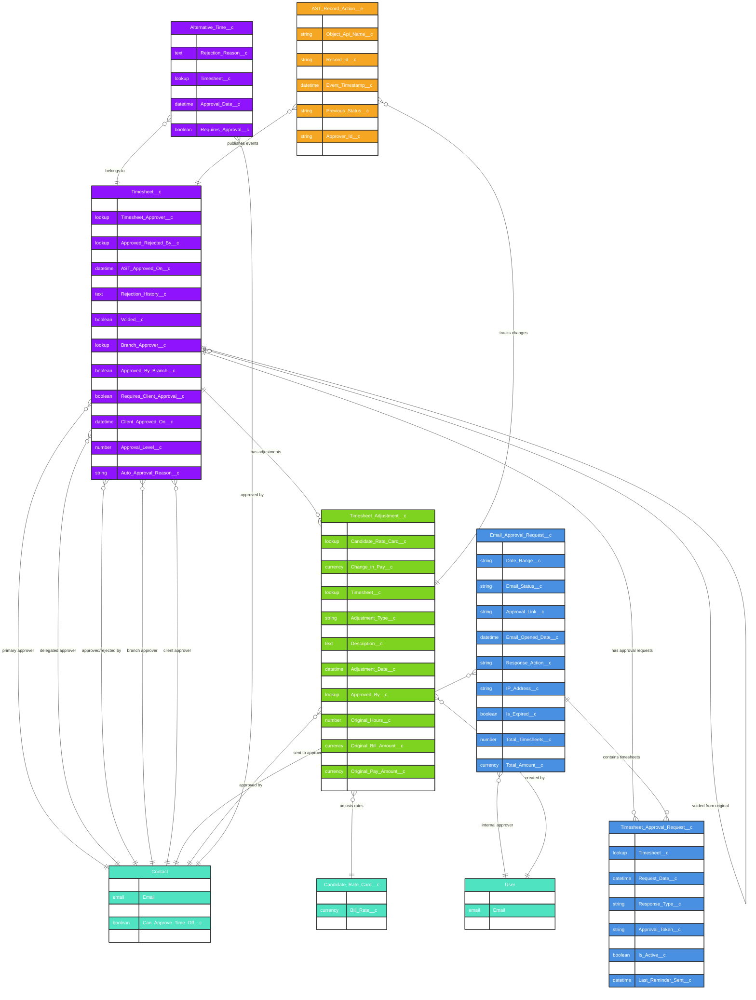

# Asymbl Time Package - Approval & Adjustment System ERD

## Overview

This document provides a comprehensive Entity Relationship Diagram (ERD) for the Approval and Adjustment components of the Asymbl Time package. These objects work together to manage timesheet approvals, handle adjustments to submitted timesheets, and provide email-based approval workflows for enhanced flexibility and mobile access.

### Key Components:
1. **Timesheet_Adjustment__c** - Tracks adjustments and changes to timesheet data
2. **Timesheet_Approval_Request__c** - Junction object linking timesheets to approval requests  
3. **Email_Approval_Request__c** - Manages email-based approval workflows
4. **AST_Record_Action__e** - Platform event for real-time workflow notifications
5. **Timesheet__c** - Extended with approval-related fields

## Entity Relationship Diagram



## Object Descriptions

### 1. Timesheet_Adjustment__c (Adjustment Tracking)

**Purpose**: Tracks all adjustments made to timesheets after initial submission, maintaining a complete audit trail of changes for compliance and reconciliation.

**Key Features:**
- Records changes to hours, rates, and amounts
- Tracks both billing and pay adjustments
- Maintains adjustment approval workflow
- Links to specific rate cards for recalculation
- Supports voiding of incorrect adjustments
- Complete audit trail with timestamps and approvers

**Business Use Cases:**
- Correcting data entry errors after submission
- Applying retroactive rate changes
- Handling client-requested modifications
- Managing payroll corrections
- Tracking financial impact of changes

### 2. Timesheet_Approval_Request__c (Approval Request Junction)

**Purpose**: Junction object that links timesheets to email approval requests, enabling bulk approval scenarios and tracking individual timesheet approval status.

**Key Features:**
- Links multiple timesheets to single approval request
- Tracks individual response status
- Manages security tokens for email approvals
- Handles token expiration and renewal
- Supports reminder notifications
- Maintains response audit trail

**Business Use Cases:**
- Bulk timesheet approvals
- Individual timesheet tracking within bulk requests
- Approval delegation scenarios
- Token-based security for email approvals

### 3. Email_Approval_Request__c (Email-Based Approval)

**Purpose**: Enables secure email-based timesheet approval workflows, allowing approvers to review and approve timesheets from any device without logging into Salesforce.

**Key Features:**
- Generates secure, time-limited approval links
- Tracks email delivery and opening
- Captures approval/rejection with comments
- Records IP address and user agent for security
- Supports bulk approval scenarios
- Provides summary information in emails

**Security Features:**
- Unique security tokens per request
- Configurable token expiration (default 72 hours)
- IP address logging for audit
- One-time use tokens
- Encrypted approval links

### 4. Timesheet__c (Extended for Approvals)

**Purpose**: Core timesheet object extended with comprehensive approval workflow fields supporting multi-level approval chains.

**Approval Levels:**
1. **Manager Approval** - Direct supervisor
2. **Branch Approval** - Regional or department head
3. **Client Approval** - Customer sign-off when required
4. **Finance Approval** - For adjustments or exceptions

**Key Features:**
- Multi-level approval routing
- Delegation support for out-of-office
- Rejection tracking with reasons
- Auto-approval capabilities
- Complete approval history
- Status workflow management

### 5. AST_Record_Action__e (Platform Event)

**Purpose**: Real-time event streaming for approval actions, enabling immediate notifications and integration with external systems.

**Event Types:**
- Timesheet_Submitted
- Timesheet_Approved
- Timesheet_Rejected
- Adjustment_Created
- Approval_Request_Sent
- Approval_Reminder_Sent

**Use Cases:**
- Real-time notifications to approvers
- Integration with external approval systems
- Audit log streaming
- Workflow automation triggers
- Dashboard updates

## Field Details

### Timesheet_Adjustment__c Key Fields

| Field | Type | Description | Business Logic |
|-------|------|-------------|----------------|
| Active__c | Checkbox | Whether adjustment is active | Inactive adjustments are ignored |
| Change_in_Bill__c | Currency | Billing amount change | Can be positive or negative |
| Change_in_Pay__c | Currency | Pay amount change | Can be positive or negative |
| Date_of_Change__c | Date | When change occurred | For retroactive adjustments |
| Adjustment_Type__c | Picklist | Hours, Rate, Both | Categorizes adjustment |
| Approval_Status__c | Picklist | Pending, Approved, Rejected | Tracks approval state |
| Original_Hours__c | Number | Hours before adjustment | For audit trail |
| Adjusted_Hours__c | Number | Hours after adjustment | New value |

### Email_Approval_Request__c Key Fields

| Field | Type | Description | Business Logic |
|-------|------|-------------|----------------|
| Request_Type__c | Picklist | Single, Bulk, Delegated | Type of approval request |
| Email_Status__c | Picklist | Pending, Sent, Opened, Responded | Email tracking |
| Security_Token__c | Text(255) | Unique encrypted token | One-time use |
| Is_Expired__c | Checkbox | Token expiration status | Checked on access |
| Total_Timesheets__c | Number | Count of linked timesheets | For bulk approvals |
| Total_Amount__c | Currency | Sum of timesheet amounts | Quick reference |
| IP_Address__c | Text(45) | Responder's IP | Security audit |

### Timesheet_Approval_Request__c Key Fields

| Field | Type | Description | Business Logic |
|-------|------|-------------|----------------|
| Request_Status__c | Picklist | Pending, Approved, Rejected | Individual status |
| Approval_Token__c | Text(255) | Timesheet-specific token | Unique per timesheet |
| Token_Expiry__c | DateTime | Token expiration time | Inherits from parent |
| Reminder_Count__c | Number | Number of reminders sent | For escalation |
| Response_Type__c | Picklist | Email, System, Mobile | How approval was given |

## Business Logic and Workflows

### 1. Email Approval Workflow

```
1. Timesheet Submission
   ├── Manager identified from timesheet
   ├── Email approval request created
   ├── Security token generated (UUID)
   └── Approval link created with token

2. Email Generation
   ├── Summary of timesheets included
   ├── Total hours and amounts
   ├── Secure approval/reject links
   └── Token embedded in URL

3. Email Delivery
   ├── Email sent to approver
   ├── Delivery tracked
   ├── Opens tracked (if enabled)
   └── Reminder scheduled

4. Approval Response
   ├── Token validated
   ├── Not expired check
   ├── IP address captured
   ├── Action recorded
   └── Token invalidated

5. System Update
   ├── Timesheet status updated
   ├── Approval timestamp set
   ├── Platform event published
   └── Next approval triggered (if multi-level)
```

### 2. Adjustment Workflow

```
1. Adjustment Request
   ├── Reason documented
   ├── Original values captured
   ├── New values calculated
   └── Financial impact assessed

2. Approval Routing
   ├── Based on adjustment amount
   ├── Manager approval (< $500)
   ├── Director approval (< $2000)
   └── VP approval (>= $2000)

3. Application
   ├── Timesheet updated
   ├── Rate card referenced
   ├── Audit trail created
   └── Notifications sent

4. Reconciliation
   ├── Payroll notified
   ├── Client billing adjusted
   ├── Reports updated
   └── GL entries created
```

### 3. Multi-Level Approval Logic

```
Level 1: Direct Manager
├── Standard approval for all timesheets
├── Can delegate to another manager
└── 48-hour SLA

Level 2: Branch/Department
├── Required for overtime > 10 hours
├── Required for holiday work
└── 24-hour SLA after Level 1

Level 3: Client
├── Required when contract specifies
├── Can be parallel with internal
└── 72-hour SLA

Level 4: Finance
├── Required for adjustments
├── Required for exceptions
└── 24-hour SLA
```

### 4. Auto-Approval Rules

Timesheets can be auto-approved when:
- Total hours <= 40 and no overtime
- No adjustments or exceptions
- Previous 3 timesheets approved without changes
- Auto-approval enabled for account
- Within standard work hours

### 5. Delegation Logic

```
Primary Approver Unavailable
├── Check delegation settings
├── Find active delegated approver
├── Verify delegation date range
├── Route to delegate
└── Notify both parties

Delegation Types:
- Temporary (date range)
- Permanent (role change)
- Conditional (amount/type based)
```

## Security Considerations

### 1. Email Approval Security

**Token Generation**:
- Cryptographically secure random tokens
- One-time use enforcement
- Time-based expiration
- Token rotation on each use

**URL Security**:
- HTTPS required
- Encrypted parameters
- No sensitive data in URL
- Short URL service integration

### 2. Audit Trail Requirements

**Tracked Actions**:
- All approval/rejection actions
- Adjustment creation and approval
- Delegation changes
- Auto-approval triggers
- Failed approval attempts

**Compliance Data**:
- User identification
- Timestamp (UTC)
- IP address and location
- Action taken
- Previous/new values

### 3. Access Control

**Permission Levels**:
- View own timesheets only
- Approve direct reports
- Approve department
- System administration
- Audit read-only access

## Integration Points

### 1. Email Service Integration
- SMTP configuration for sending
- Email tracking service
- Bounce handling
- Template management

### 2. Platform Events
- Real-time status updates
- External system notifications
- Mobile app push notifications
- Analytics streaming

### 3. Reporting Integration
- Approval cycle time metrics
- Adjustment frequency analysis
- Approver performance tracking
- Compliance reporting

## Performance Optimizations

### 1. Bulk Processing
- Batch email generation
- Bulk approval operations
- Efficient token validation
- Optimized queries for large datasets

### 2. Caching Strategy
- Approval hierarchy caching
- Token validation caching
- Email template caching
- Configuration caching

### 3. Asynchronous Processing
- Email sending queued
- Reminder scheduling
- Report generation
- Notification delivery

## Maintenance and Monitoring

### 1. Token Housekeeping
- Expired token cleanup (daily)
- Failed attempt monitoring
- Token usage analytics
- Security breach detection

### 2. Email Monitoring
- Delivery success rates
- Open rates tracking
- Response time metrics
- Bounce management

### 3. Approval Metrics
- Average approval time
- Bottleneck identification
- Delegation usage
- Auto-approval rates

This comprehensive approval and adjustment system provides the flexibility, security, and audit capabilities required for enterprise timesheet management while maintaining ease of use through email-based approvals and intelligent automation.