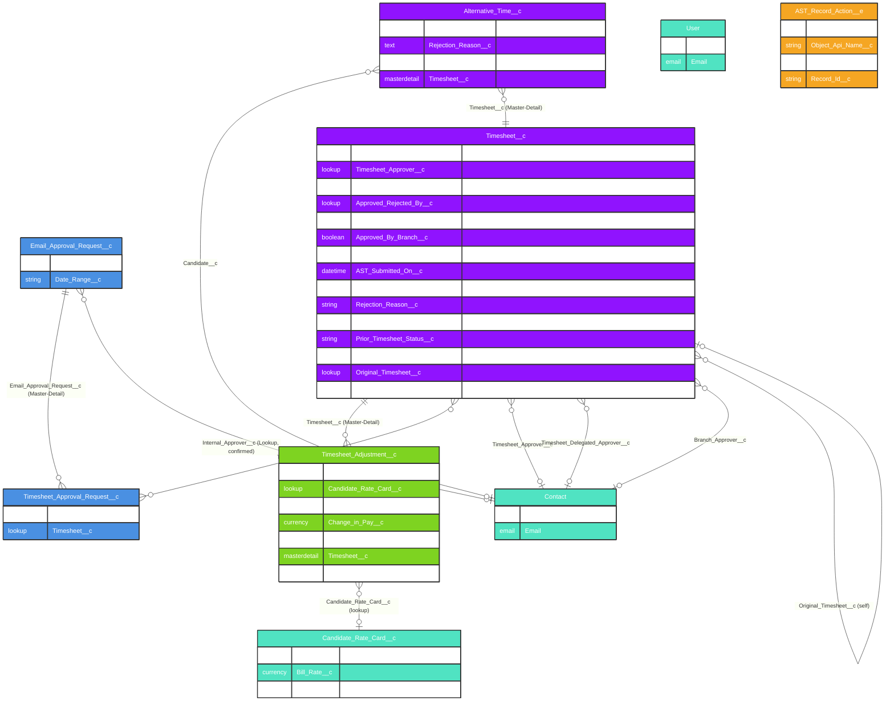

# Asymbl Time Package - Approval & Adjustment System ERD

## Overview

This document provides an Entity Relationship Diagram (ERD) for the Approval and Adjustment components of the Asymbl Time package. All fields and relationships below were verified directly against `force-app/main/default/objects/*/fields/*.field-meta.xml` and `AST_EmailServiceHandler.cls` on the `master` branch (commit `38a8d3eb`, 2026-10-30). These objects are substantially smaller and simpler than previously documented — there is no token-based email security layer, no IP/user-agent tracking, and no multi-tier dollar-threshold adjustment approval routing in the current codebase.

### Key Components:
1. **Timesheet_Adjustment__c** - Tracks post-submission changes to a timesheet's bill/pay amounts (Master-Detail child of Timesheet__c)
2. **Timesheet_Approval_Request__c** - Junction linking a Timesheet to an Email_Approval_Request__c batch
3. **Email_Approval_Request__c** - Minimal record representing a batch of timesheets sent to one approver for email-based approval
4. **AST_Record_Action__e** - Platform event for real-time UI/event-driven notifications
5. **Timesheet__c** - Extended with branch/final approval fields

## Entity Relationship Diagram



## Object Descriptions

### 1. Timesheet_Adjustment__c (Master-Detail child of Timesheet__c)

**Purpose**: Tracks post-submission changes to a timesheet's billable/payable dollar amounts.

**Verified fields (6 custom fields total):**
- `Active__c` (Checkbox)
- `Candidate_Rate_Card__c` (Lookup)
- `Change_in_Bill__c` / `Change_in_Pay__c` (Currency)
- `Date_of_Change__c` (Date)
- `Is_Voided_Timesheet_Adjustment__c` (Checkbox)
- `Timesheet__c` (Master-Detail, **not** a lookup as previously documented)

**Not present**: `Adjustment_Type__c`, `Adjustment_Reason__c`, `Approval_Status__c`, `Approved_By__c`/`Approved_Date__c`, `Original_Hours__c`/`Adjusted_Hours__c`, `Original_Bill_Amount__c`/`Adjusted_Bill_Amount__c`, `Created_By_User__c`. There is **no separate approval workflow for adjustments** — adjustments simply roll up into `Timesheet__c.Number_of_Adjustments__c`, `Total_Adjusted_Bill__c`, and `Total_Adjusted_Pay__c`.

### 2. Timesheet_Approval_Request__c (Junction Object)

**Purpose**: Links one or more Timesheets to a single `Email_Approval_Request__c` batch, so one inbound email reply can act on multiple timesheets at once.

**Verified fields:** `Email_Approval_Request__c` (Master-Detail), `Timesheet__c` (Lookup). **No other fields exist** — no status, no token, no response type, no reminder count.

### 3. Email_Approval_Request__c (Email-Based Approval Batch)

**Purpose**: Represents a batch of timesheets routed to one approver for reply-to-email approval.

**Verified fields:** `Internal_Approver__c` (Lookup), `Date_Range__c` (Text). **No other fields exist** on this object — no approver email field, no security/approval token, no email-opened/response timestamps, no IP address or user-agent capture, no expiry flag, no total-hours/total-amount summary fields.

### 4. Timesheet__c (Approval-Relevant Fields)

**Purpose**: Core timesheet object carrying the actual approval state and branch-approval metadata.

**Approval-related fields that exist:**
- `Status__c` — the single source of truth for approval state (see Status Workflow below)
- `Timesheet_Approver__c`, `Timesheet_Delegated_Approver__c`, `Approved_Rejected_By__c` — all `Contact` lookups
- `Branch_Approver__c`, `Approved_By_Branch__c`, `Branch_Approved_On__c` — the one additional ("branch") approval stage
- `AST_Submitted_On__c`, `AST_Approved_On__c` — timestamps
- `Rejection_Reason__c` (Picklist/Text) and `Rejection_History__c` (Long Text Area) — rejection tracking
- `Prior_Timesheet_Status__c` — last status before the current one (for resubmission logic)

**Not present**: `Client_Approver__c`/`Client_Approved_On__c`, `Requires_Client_Approval__c`, `Approval_Process_Type__c`, `Approval_Level__c`, `Auto_Approved__c`/`Auto_Approval_Reason__c`, `Approval_Comments__c`. There is **no Client approval tier, no Finance approval tier, and no auto-approval capability** in the current data model — only Branch and Final (implicit) stages exist, matching the 7-value `Status__c` picklist.

### 5. AST_Record_Action__e (Platform Event)

**Purpose**: Lightweight real-time event used for UI refresh / cross-component notification (paired with the `ASTMessageChannel` Lightning Message Channel).

**Verified fields (4 total):** `Event_Type__c`, `Object_Api_Name__c`, `Payload__c`, `Record_Id__c`. **Not present**: `User_Id__c`, `Event_Timestamp__c`, `Action_Type__c`, `Previous_Status__c`/`New_Status__c`, `Approver_Id__c`, `Additional_Context__c`.

## Field Details

### Timesheet_Adjustment__c Key Fields

| Field | Type | Description |
|-------|------|-------------|
| Timesheet__c | Master-Detail(Timesheet__c) | Parent timesheet (deleted if timesheet is deleted) |
| Active__c | Checkbox | Whether the adjustment currently counts toward totals |
| Change_in_Bill__c / Change_in_Pay__c | Currency | Signed delta applied to the timesheet totals |
| Date_of_Change__c | Date | When the change was recorded |
| Is_Voided_Timesheet_Adjustment__c | Checkbox | Marks the adjustment as voided |
| Candidate_Rate_Card__c | Lookup | Rate card referenced for recalculation context |

### Email_Approval_Request__c Key Fields

| Field | Type | Description |
|-------|------|-------------|
| Internal_Approver__c | Lookup | The approver this batch was routed to |
| Date_Range__c | Text | Human-readable date range covered by the batch |

### Timesheet_Approval_Request__c Key Fields

| Field | Type | Description |
|-------|------|-------------|
| Email_Approval_Request__c | Master-Detail | Parent batch request |
| Timesheet__c | Lookup | The individual timesheet included in the batch |

## Business Logic and Workflows (as implemented)

### 1. Email (Reply-to-Email) Approval Workflow — `AST_EmailServiceHandler.cls`

```
1. AST_SendTimesheetsEmailBatchable sends a PDF-attached email to the approver,
   creating an Email_Approval_Request__c + one Timesheet_Approval_Request__c per timesheet.
2. The approver replies to the email with free text, e.g. "approve", "approve all",
   "reject {reason}", or "reject all {reason}".
3. Salesforce Inbound Email Service invokes AST_EmailServiceHandler.handleInboundEmail().
4. The handler parses the HTML body to extract:
   - the reply text (approve/reject + optional reason)
   - the Email_Approval_Request__c Id ("earId") embedded as a hidden element in the
     original outbound email HTML
5. All Timesheet_Approval_Request__c records for that earId are queried to resolve the
   set of Timesheet__c Ids.
6. Only timesheets currently in Status__c IN ('Submitted for Approval', 'Approved by Branch')
   are eligible to be updated.
7. Matching timesheets are bulk-updated to Approved or Rejected (with Rejection_Reason__c
   set from the parsed reply text).
```

There is **no clickable secure link, no token, no expiry, and no IP/device tracking** in this flow — approval is driven entirely by parsing the plain-text reply to an email the approver already received, matched to records already linked by Id.

### 2. Adjustment Workflow (actual)

```
1. A Timesheet_Adjustment__c is created with Change_in_Bill__c / Change_in_Pay__c and
   Date_of_Change__c.
2. Timesheet__c rollups (Number_of_Adjustments__c, Total_Adjusted_Bill__c,
   Total_Adjusted_Pay__c) reflect Active__c, non-voided adjustments.
3. Is_Voided_Timesheet_Adjustment__c / Active__c = false excludes an adjustment from
   the rollups without deleting the record.
```

There is **no dollar-threshold-based approval routing** (e.g. "Director approval if >= $2000") and **no separate adjustment approval status** in the current metadata — any adjustment that is `Active__c = true` and not voided counts toward the timesheet totals immediately.

### 3. Timesheet Status Workflow (verified picklist, `Timesheet__c.Status__c`)

```
New (default; created by AST_CreateTimesheetsBatchable / placement trigger)
  ↓ (candidate enters time)
Draft
  ↓ (candidate submits)
Submitted for Approval
  ↓ (optional branch approval step)
Approved by Branch
  ↓ (final approval)
Approved (Approved_Rejected_By__c + AST_Approved_On__c set)

Rejected (Rejection_Reason__c + Rejection_History__c set; candidate can edit and resubmit
  → Prior_Timesheet_Status__c records the prior state)

Void (reachable from Approved via AST_VoidTimesheetController; Original_Timesheet__c
  links to a newly created replacement)
```

This is a **two-stage** internal approval chain (Branch, then final/Approved) — there is no Client approval tier and no Finance approval tier encoded in the data model.

## What Was Removed From This Document

The following previously documented concepts do not exist anywhere in the `master` branch metadata or Apex and have been removed: `Approval_Token__c`/`Token_Expiry__c`, `Security_Token__c`/`Is_Expired__c`, `IP_Address__c`/`User_Agent__c`, `Email_Status__c`/`Email_Opened_Date__c`, `Request_Type__c` (Single/Bulk/Delegated), `Reminder_Count__c`/`Last_Reminder_Sent__c`, `Client_Approver__c`/`Requires_Client_Approval__c`, `Auto_Approved__c`/`Auto_Approval_Reason__c`, dollar-threshold adjustment approval routing, and a 4-level (Manager/Branch/Client/Finance) approval hierarchy. Readers relying on earlier versions of this document for integration or audit design should disregard those fields entirely.

This simplified approval and adjustment model reflects what is actually shipped: a two-stage internal status workflow plus a lightweight, Id-correlated (not token-secured) reply-to-email approval channel.
