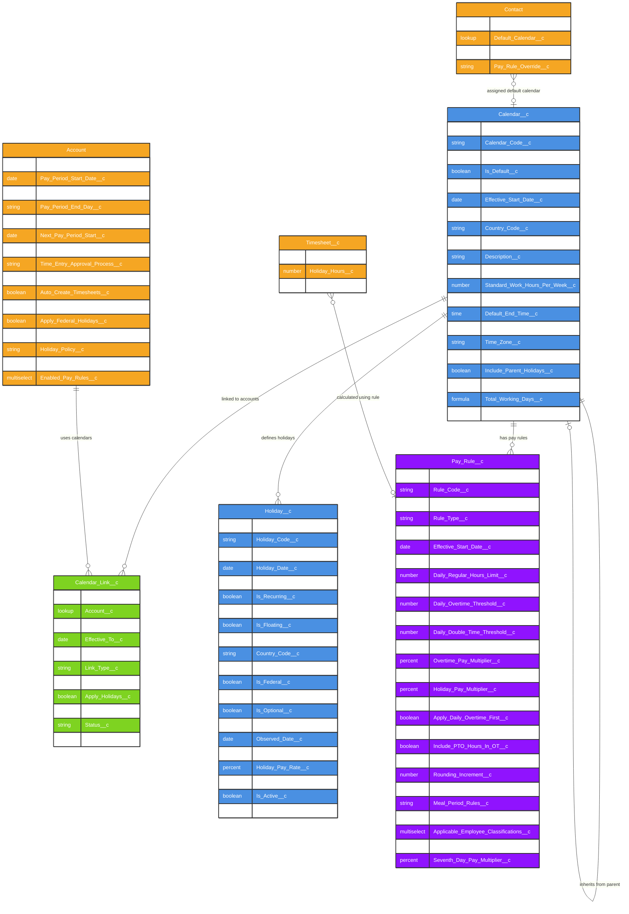

# Asymbl Time Package - Calendar & Holiday Management System ERD

## Overview

This document provides an Entity Relationship Diagram (ERD) for the Calendar and Holiday Management components of the Asymbl Time package. These objects work together to define working calendars, holidays, pay rules, and their associations with accounts for proper time tracking and payroll calculations.

### Key Components:
1. **Calendar__c** - Defines working calendars with business hours and rules
2. **Calendar_Link__c** - Junction object linking calendars to accounts
3. **Holiday__c** - Holiday definitions with dates and observance rules
4. **Pay_Rule__c** - Overtime and pay calculation rules
5. **Account** - Extended with pay period configurations

## Entity Relationship Diagram



## Object Descriptions

### 1. Calendar__c (Core Calendar Object)
The master calendar object that defines working days, hours, and serves as a container for holidays and pay rules. Supports hierarchical calendars with parent-child relationships.

**Key Features:**
- Defines standard working hours and days
- Country and state-specific configurations
- Can inherit holidays from parent calendars
- Supports multiple calendar types (Standard, Shift-based, Custom)
- Time zone aware for global operations

### 2. Calendar_Link__c (Junction Object)
Links calendars to accounts with effective dating, allowing organizations to change calendars over time or use different calendars for different purposes.

**Key Features:**
- Effective dated relationships
- Primary/secondary calendar designation
- Selective application of holidays and pay rules
- Override capabilities for specific rules

### 3. Holiday__c (Holiday Definition Object)
Comprehensive holiday tracking with support for fixed, floating, and recurring holidays with complex observance rules.

**Key Features:**
- Fixed and floating holiday support
- Federal, state, and custom holidays
- Observance rules (e.g., Monday observance for weekend holidays)
- Holiday pay rate configurations
- Employee type eligibility

### 4. Pay_Rule__c (Overtime & Pay Calculation Rules)
Defines complex pay rules including daily and weekly overtime thresholds, double-time rules, and special calculations.

**Key Features:**
- Daily and weekly overtime thresholds
- Double-time configurations
- Holiday pay multipliers
- State-specific compliance rules
- Consecutive day overtime (e.g., 7th day rules)
- Rounding and break rules

### 5. Account (Extended for Pay Periods)
Standard Account object extended with pay period configurations and calendar associations.

**Key Features:**
- Pay period definitions and frequencies
- Calendar and holiday policy settings
- Timesheet automation controls
- Approval process configurations

## Field Details

### Calendar__c Key Fields

| Field | Type | Description | Business Logic |
|-------|------|-------------|----------------|
| Calendar_Code__c | Text(20) | Unique calendar identifier | Used for integration and quick reference |
| Is_Default__c | Checkbox | System default calendar | Only one can be default at a time |
| Calendar_Type__c | Picklist | Standard, Shift, Custom, Compressed | Determines calculation methods |
| Standard_Work_Hours_Per_Day__c | Number(3,1) | Default daily hours (e.g., 8.0) | Used for holiday pay calculations |
| Working_Days__c | Multi-Select | Mon;Tue;Wed;Thu;Fri;Sat;Sun | Defines regular working days |
| Parent_Calendar__c | Lookup | Hierarchical calendar reference | Inherits holidays if configured |
| Country_Code__c | Text(2) | ISO country code | Filters applicable holidays |
| State_Province_Code__c | Text(5) | State/Province code | Regional holiday filtering |

### Holiday__c Key Fields

| Field | Type | Description | Business Logic |
|-------|------|-------------|----------------|
| Holiday_Type__c | Picklist | Federal, State, Company, Religious, Other | Categorizes holidays |
| Is_Recurring__c | Checkbox | Annual recurrence | Auto-generates for future years |
| Recurrence_Pattern__c | Picklist | Fixed_Date, Nth_Weekday, Last_Weekday, Easter_Based | Calculation method |
| Floating_Rule__c | Text | "3rd Monday of January" | Complex date calculations |
| Observance_Rule__c | Picklist | Actual_Day, Nearest_Weekday, Monday_If_Weekend | Weekend adjustment rules |
| Holiday_Pay_Rate__c | Percent | 150%, 200%, etc. | Premium pay multiplier |
| Applicable_Employee_Types__c | Multi-Select | Full_Time;Part_Time;Contract;Hourly | Eligibility rules |

### Pay_Rule__c Key Fields

| Field | Type | Description | Business Logic |
|-------|------|-------------|----------------|
| Daily_Regular_Hours_Limit__c | Number(3,1) | Standard day (e.g., 8) | Hours before OT kicks in |
| Weekly_Regular_Hours_Limit__c | Number(3,1) | Standard week (e.g., 40) | Weekly OT threshold |
| Daily_Overtime_Threshold__c | Number(3,1) | Daily OT start (e.g., 8) | When 1.5x pay begins |
| Daily_Double_Time_Threshold__c | Number(3,1) | Daily DT start (e.g., 12) | When 2x pay begins |
| Overtime_Calculation_Method__c | Picklist | Daily_First, Weekly_First, Greater_Of | Calculation precedence |
| Apply_Daily_Overtime_First__c | Checkbox | Process daily before weekly | California compliance |
| Consecutive_Day_Overtime_Threshold__c | Number | Days before special OT (e.g., 7) | 7th day rules |
| Rounding_Rules__c | Picklist | None, Nearest_Quarter, Nearest_Tenth | Time rounding method |

### Calendar_Link__c Key Fields

| Field | Type | Description | Business Logic |
|-------|------|-------------|----------------|
| Link_Type__c | Picklist | Primary, Secondary, Override | Relationship type |
| Effective_From__c | Date | Start date of association | Time-bound relationships |
| Apply_Holidays__c | Checkbox | Use calendar's holidays | Selective feature application |
| Apply_Pay_Rules__c | Checkbox | Use calendar's pay rules | Selective rule application |
| Override_Rules__c | Long Text | JSON override configuration | Custom rule modifications |

## Business Logic and Calculations

### 1. Holiday Observance Rules

```
IF Holiday falls on Saturday THEN
    IF Observance_Rule = 'Monday_If_Weekend' THEN
        Observed_Date = Holiday_Date + 2 days
    ELSE IF Observance_Rule = 'Nearest_Weekday' THEN
        Observed_Date = Holiday_Date - 1 day (Friday)
    ELSE
        Observed_Date = Holiday_Date
END IF
```

### 2. Overtime Calculation Priority

```
Daily OT Calculation:
- Regular Hours = MIN(Hours_Worked, Daily_Regular_Hours_Limit)
- Daily_OT = MIN(MAX(Hours_Worked - Daily_Regular_Hours_Limit, 0), 
                 Daily_Double_Time_Threshold - Daily_Regular_Hours_Limit)
- Daily_DT = MAX(Hours_Worked - Daily_Double_Time_Threshold, 0)

Weekly OT Calculation:
- Total_Regular_Week = SUM(Daily_Regular) for week
- Weekly_OT = MAX(Total_Regular_Week - Weekly_Regular_Hours_Limit, 0)

Final OT (depends on Overtime_Calculation_Method):
- If 'Daily_First': Use daily calculations as primary
- If 'Weekly_First': Recalculate based on weekly totals
- If 'Greater_Of': Use whichever produces more OT hours
```

### 3. Holiday Pay Calculations

```
Holiday Pay = Standard_Work_Hours_Per_Day × Base_Pay_Rate × Holiday_Pay_Rate_Multiplier

If employee works on holiday:
    Total_Pay = (Hours_Worked × Base_Pay_Rate × Holiday_Pay_Rate_Multiplier) + Holiday_Pay
```

### 4. Calendar Hierarchy

```
Child Calendar inherits from Parent:
- Holidays (if Include_Parent_Holidays__c = true)
- Can override specific holidays
- Can add additional local holidays
- Pay rules are calendar-specific (not inherited)
```

### 5. Pay Period Calculations

```
Next_Pay_Period_Start = Previous_End_Date + 1 day
Next_Pay_Period_End = Next_Pay_Period_Start + Pay_Period_Duration_Days - 1

If Pay_Period_Type = 'Semi_Monthly':
    Period 1: 1st - 15th
    Period 2: 16th - End of Month
```

## Relationship Explanations

### 1. Calendar to Calendar_Link (1:M)
- A calendar can be linked to multiple accounts
- Links are time-bound with effective dates
- Allows calendar changes without losing history

### 2. Account to Calendar_Link (1:M)
- An account can have multiple calendar associations
- Primary calendar for standard operations
- Secondary calendars for special scenarios

### 3. Calendar to Holiday (1:M)
- Each calendar defines its own holiday schedule
- Holidays are calendar-specific
- Child calendars can inherit parent holidays

### 4. Calendar to Pay_Rule (1:M)
- Multiple pay rules per calendar
- Different rules for different employee types
- State-specific compliance rules

### 5. Calendar Parent-Child (Self-referencing)
- Supports hierarchical calendar structures
- National → Regional → Local calendars
- Inheritance of holidays and settings

## Implementation Considerations

### 1. Data Integrity Rules
- Only one primary calendar link per account at any time
- Calendar effective dates cannot overlap for same account
- Holiday observed dates must be calculated on save
- Pay rules must have non-overlapping employee classifications

### 2. Performance Optimizations
- Index Calendar_Code__c for quick lookups
- Cache holiday calculations for current year
- Pre-calculate pay periods for next 12 months
- Use formula fields for derived calculations

### 3. Compliance Requirements
- State-specific overtime rules (e.g., California daily OT)
- Federal holiday observance standards
- Industry-specific requirements (healthcare, retail)
- Audit trail for pay rule changes

### 4. Integration Points
- Sync with external payroll systems
- Import holidays from government sources
- Export calendar data for reporting
- API access for time clock systems

This Calendar and Holiday Management system provides comprehensive support for complex time tracking scenarios while maintaining flexibility for various business requirements and compliance needs.