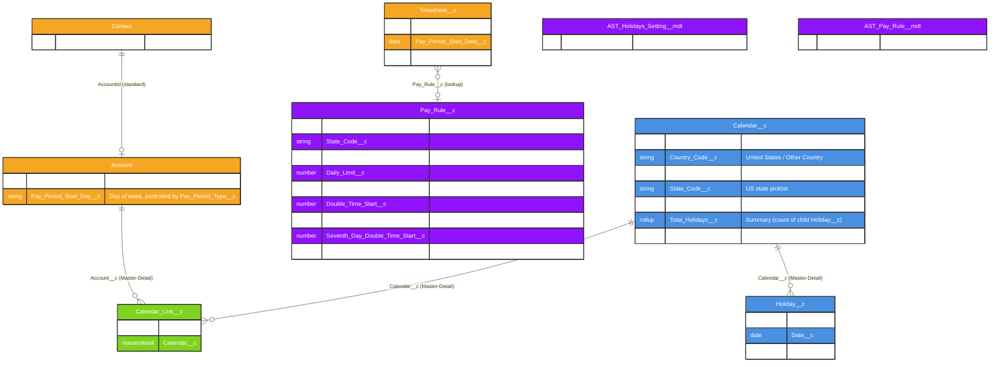

# Asymbl Time Package - Calendar & Holiday Management System ERD

## Overview

This document provides an Entity Relationship Diagram (ERD) for the Calendar, Holiday, and Pay Rule components of the Asymbl Time package. All fields and relationships below were verified directly against `force-app/main/default/objects/*/fields/*.field-meta.xml` on the `master` branch (commit `38a8d3eb`, 2026-10-30), and represent a **much simpler** data model than previously documented — there is no calendar hierarchy, no floating-holiday engine, and no calendar-to-pay-rule relationship in the current package.

### Key Components:
1. **Calendar__c** - A minimal calendar record (country/state/year/color) that Holidays roll up to
2. **Calendar_Link__c** - A junction object linking a Calendar to an Account (dual master-detail; no other fields)
3. **Holiday__c** - Holiday definitions (date + description only), master-detail child of Calendar__c
4. **Pay_Rule__c** - Standalone overtime/double-time calculation rules, referenced directly from `Timesheet__c`
5. **Account** - Extended with 2 pay-period fields

## Entity Relationship Diagram



## Object Descriptions

### 1. Calendar__c
A minimal container record that Holidays attach to and that Accounts link to via `Calendar_Link__c`.

**Verified fields (7 custom fields total):**
- `Is_Default__c` (Checkbox)
- `Country_Code__c` (Picklist: `United States`, `Other Country`)
- `State_Code__c` (Picklist: full US state list)
- `Year__c` (Text)
- `Color__c` (Picklist of hex color codes — purely a UI display aid, e.g. in `astCalendarCard` / `astHolidayCalendar`)
- `Total_Holidays__c` (Summary rollup of child `Holiday__c` records)
- `Total_Linked_Account__c` (Summary rollup of child `Calendar_Link__c` records)

**Not present** (despite prior documentation): `Calendar_Code__c`, `Calendar_Type__c`, `Standard_Work_Hours_Per_Day__c`, `Working_Days__c`, `Default_Start_Time__c`/`Default_End_Time__c`, `Parent_Calendar__c`, `Time_Zone__c`, `Include_Parent_Holidays__c`. There is **no calendar hierarchy** in this package.

### 2. Calendar_Link__c (Junction Object)
A pure junction object between `Account` and `Calendar__c`, implemented as a **dual master-detail** (master-detail to both parents simultaneously) — sharing model `ControlledByParent`.

**Verified fields:** `Account__c` (Master-Detail → Account), `Calendar__c` (Master-Detail → Calendar__c). No other custom fields exist on this object — no effective dating, no primary/secondary flag, no override-rules JSON, and no apply-holidays/apply-pay-rules toggles.

### 3. Holiday__c (Master-Detail child of Calendar__c)
A simple dated holiday record, sharing model `ControlledByParent`.

**Verified fields:** `Calendar__c` (Master-Detail), `Date__c` (Date), `Description__c` (Long Text Area). There is **no** `Holiday_Type__c`, `Is_Recurring__c`, `Recurrence_Pattern__c`, `Is_Floating__c`/`Floating_Rule__c`, `Observance_Rule__c`/`Observed_Date__c`, `Holiday_Pay_Rate__c`, or employee-type eligibility field on this object. Floating-holiday logic, recurrence, and weekend-observance adjustment do not exist in the current data model.

A separate, unrelated mechanism — `AST_Holidays_Setting__mdt.US_Holidays_JSON__c` — ships a single JSON blob of default US holidays as Custom Metadata, used to seed suggested holidays rather than to drive a holiday calculation engine.

### 4. Pay_Rule__c (Standalone Overtime/Double-Time Rule)
**Not related to `Calendar__c` at all** — there is no lookup field connecting `Pay_Rule__c` to `Calendar__c` in either direction. `Pay_Rule__c` is referenced directly from `Timesheet__c.Pay_Rule__c` (lookup), and that single Pay Rule governs the entire timesheet's OT/DT calculation.

**Verified fields (9 custom fields total):**
- `Country_Code__c` / `State_Code__c` (same picklists as Calendar__c)
- `Type__c` (Picklist, restricted): `Weekly`, `Weekly + Daily`, `Weekly + Daily (Double Time)`
- `Daily_Limit__c` / `Weekly_Limit__c` (Number) — hours before OT
- `Double_Time_Start__c` (Number) — hours before DT
- `Seventh_Day__c` (Picklist): `No`, `Overtime`, `Double Time`, `Both`
- `Seventh_Day_Double_Time_Start__c` (Number)
- `Enable_Attestation__c` (Checkbox)

**Not present**: `Rounding_Rules__c`, `Break_Rules__c`/`Meal_Period_Rules__c`, `Holiday_Pay_Multiplier__c`, `Overtime_Calculation_Method__c`, `Apply_Daily_Overtime_First__c`, `Applicable_Employee_Classifications__c`, `Effective_Start_Date__c`/`Effective_End_Date__c`. There is also a separate `AST_Pay_Rule__mdt.Pay_Rule_JSON__c` (single JSON field) shipping default pay rule presets as Custom Metadata, independent of the `Pay_Rule__c` sObject.

### 5. Account (Extended for Pay Periods)
Exactly **2** custom fields added by this package:
- `Pay_Period_Type__c` (Picklist, restricted): `Weekly`, `Bi-Weekly`, `Bi-Monthly`
- `Pay_Period_Start_Day__c` (Picklist, controlled by `Pay_Period_Type__c`): day of week

**Not present**: `Pay_Period_Duration_Days__c`, `Payroll_Frequency__c`, `Next_Pay_Period_Start__c`/`Next_Pay_Period_End__c`, `Time_Entry_Approval_Process__c`, `Auto_Create_Timesheets__c`, `Default_Calendar_Code__c`, `Apply_Federal_Holidays__c`/`Apply_State_Holidays__c`, `Overtime_Policy__c`. Next-pay-period generation is handled procedurally by `AST_CreateTimesheetsBatchable`/`AST_GenerateNextTimesheet`, not by additional Account configuration fields.

### 6. Contact (Extended)
Exactly **1** custom field: `Employment_Classification__c` (Picklist, restricted): `Exempt`, `Non-Exempt` (default `Non-Exempt`). There is no `Default_Calendar__c`, `Holiday_Eligibility__c`, or `Pay_Rule_Override__c` field on Contact.

## Field Details

### Calendar__c Key Fields

| Field | Type | Description |
|-------|------|-------------|
| Is_Default__c | Checkbox | System default calendar flag |
| Country_Code__c | Picklist | `United States` / `Other Country` |
| State_Code__c | Picklist | Full US state list |
| Year__c | Text | Free-text year label |
| Color__c | Picklist | Hex color code for UI display |
| Total_Holidays__c | Summary (rollup) | Count/sum from child `Holiday__c` |
| Total_Linked_Account__c | Summary (rollup) | Count/sum from child `Calendar_Link__c` |

### Holiday__c Key Fields

| Field | Type | Description |
|-------|------|-------------|
| Calendar__c | Master-Detail | Parent calendar |
| Date__c | Date | Holiday date |
| Description__c | Long Text Area | Free-text description |

### Pay_Rule__c Key Fields

| Field | Type | Description |
|-------|------|-------------|
| Type__c | Picklist | `Weekly`, `Weekly + Daily`, `Weekly + Daily (Double Time)` |
| Daily_Limit__c | Number | Hours/day before OT |
| Weekly_Limit__c | Number | Hours/week before OT |
| Double_Time_Start__c | Number | Hours before DT begins |
| Seventh_Day__c | Picklist | `No`, `Overtime`, `Double Time`, `Both` |
| Seventh_Day_Double_Time_Start__c | Number | Hours threshold for 7th-day DT |
| Enable_Attestation__c | Checkbox | Whether break attestation is required under this rule |

### Calendar_Link__c Fields

| Field | Type | Description |
|-------|------|-------------|
| Account__c | Master-Detail(Account) | Parent account |
| Calendar__c | Master-Detail(Calendar__c) | Linked calendar |

## Business Logic

### 1. OT/DT Calculation (actual implementation)

Performed in `AST_TimeEntryTriggerHelper.updateHoursOnTimeEntries()` against the single `Pay_Rule__c` linked to the parent `Timesheet__c`:

```
Based on Pay_Rule__c.Type__c:
- 'Weekly': OT calculated only against Weekly_Limit__c
- 'Weekly + Daily': OT calculated against both Daily_Limit__c and Weekly_Limit__c
- 'Weekly + Daily (Double Time)': adds Double_Time_Start__c as a DT threshold

7th consecutive day worked in the period:
- Seventh_Day__c = 'Overtime' -> all hours on 7th day paid at OT
- Seventh_Day__c = 'Double Time' -> all hours on 7th day paid at DT after Seventh_Day_Double_Time_Start__c
- Seventh_Day__c = 'Both' -> combination
- Seventh_Day__c = 'No' -> no special 7th-day treatment
```

### 2. Holiday Seeding (not a calculation engine)

`AST_Holidays_Setting__mdt.US_Holidays_JSON__c` provides a JSON list of default US holidays that admin tooling can use to pre-populate `Holiday__c` records under a Calendar. There is no automatic weekend-observance shifting, no recurrence generation for future years, and no holiday pay-rate multiplier anywhere in the data model.

### 3. Pay Period Determination

`Account.Pay_Period_Type__c` + `Account.Pay_Period_Start_Day__c` determine the cadence; actual period boundary calculation and next-timesheet creation are handled by `AST_CreateTimesheetsBatchable` (scheduled daily) and the `AST_GenerateNextTimesheet` invocable, not by calendar metadata.

## Relationship Explanations

### 1. Account to Calendar (M:M via Calendar_Link__c)
`Calendar_Link__c` is a dual master-detail junction — both `Account__c` and `Calendar__c` are master-detail parents. This is an unusual but valid Salesforce pattern (a true many-to-many junction with cascade-delete from either side) rather than a lookup-based, effective-dated association as previously documented.

### 2. Calendar to Holiday (1:M — Master-Detail)
Each calendar can have any number of holiday records; deleting a Calendar cascades to delete its Holidays.

### 3. Timesheet to Pay Rule (M:1 — Lookup)
Each Timesheet references exactly one `Pay_Rule__c`; `Pay_Rule__c` has no relationship back to `Calendar__c`.

### 4. No Calendar-to-Pay-Rule or Calendar-to-Contact Relationship
Contrary to previous documentation, there is no lookup from `Calendar__c` to `Pay_Rule__c`, and no lookup from `Contact` to `Calendar__c`. Calendars currently serve only to group Holidays and link to Accounts.

## Implementation Considerations

### Data Integrity
- No validation rules exist on `Calendar__c`, `Calendar_Link__c`, `Holiday__c`, or `Pay_Rule__c` in the current metadata (all 22 package validation rules live on `Rate_Card_Template__c`/`Rate_Card_Template_Detail__c` and one on `Time_Entry__c` — see the Rate Card Management ERD and Time & Attendance Core ERD).
- Because `Calendar_Link__c` is dual master-detail, an Account/Calendar pairing cannot be re-pointed after creation without deleting and recreating the link record (standard Salesforce master-detail constraint).

### Compliance Notes
- State-specific OT/DT compliance (e.g., California daily-OT and 7th-day rules) is expressed entirely through `Pay_Rule__c.Daily_Limit__c` / `Double_Time_Start__c` / `Seventh_Day__c` configuration, not through a separate rules engine or formula layer.

This Calendar and Pay Rule model is intentionally lightweight: Calendars primarily exist to group Holidays and associate them with Accounts; all time-calculation logic is driven by the standalone `Pay_Rule__c` object referenced directly from each Timesheet.
