# Asymbl Time Package - Configuration and Metadata ERD

## Overview

This document provides a comprehensive Entity Relationship Diagram (ERD) for the Configuration and Metadata objects in the Asymbl Time package. These metadata types and configuration objects form the backbone of the system's flexibility, allowing administrators to configure field mappings, system settings, and business rules without code changes.

The configuration architecture consists of:

1. **Custom Metadata Types** - Deployable configuration that controls system behavior
2. **Custom Settings** - Org-specific configuration for runtime behavior
3. **Platform Events** - Real-time event streaming for system actions
4. **System Objects** - Logging and audit trail capabilities

## Configuration Architecture Overview

The Asymbl Time package uses a layered configuration approach:

- **System Level**: Global settings via `AST_Generic_Setting__mdt`
- **Field Mapping Level**: Dynamic field mappings for integrations
- **Business Rules Level**: Pay rules and holiday configurations
- **Operational Level**: Logging and event streaming

## Entity Relationship Diagram

```mermaid
erDiagram
    AST_Generic_Setting__mdt {
        string DeveloperName
        string MasterLabel
        boolean Enable_Complex_Rate_Card_Management__c
        boolean Enable_Time_Entry_Validation__c
        boolean Enable_Auto_Approval__c
        boolean Enable_Holiday_Processing__c
        boolean Enable_External_Integration__c
        number Default_Break_Duration__c
        string Default_Timesheet_Status__c
        string Default_Pay_Period_Type__c
        boolean Enable_Debug_Logging__c
        string Integration_Endpoint__c
        string API_Version__c
        number Timeout_Value__c
        boolean Enable_Bulk_Processing__c
        number Batch_Size__c
    }

    AST_Placement_Object_Mapping__mdt {
        string DeveloperName
        string MasterLabel
        string Source_Object__c
        string Source_Field__c
        string Target_Object__c
        string Target_Field__c
        string Field_Type__c
        boolean Is_Required__c
        string Default_Value__c
        string Transformation_Class__c
        number Sequence__c
        boolean Active__c
        string Description__c
        string Mapping_Direction__c
    }

    AST_Job_Object_Mapping__mdt {
        string DeveloperName
        string MasterLabel
        string Source_Object__c
        string Source_Field__c
        string Target_Object__c
        string Target_Field__c
        string Field_Type__c
        boolean Is_Required__c
        string Default_Value__c
        string Transformation_Class__c
        number Sequence__c
        boolean Active__c
        string Description__c
        string Mapping_Direction__c
    }

    AST_External_User_Mapping__mdt {
        string DeveloperName
        string MasterLabel
        string External_System__c
        string External_User_Id__c
        lookup Salesforce_User__c
        string External_Username__c
        string External_Email__c
        boolean Active__c
        datetime Last_Sync_Date__c
        string Sync_Status__c
        string External_Role__c
        string Permission_Set__c
        text Additional_Attributes__c
    }

    AST_Holidays_Setting__mdt {
        string DeveloperName
        string MasterLabel
        date Holiday_Date__c
        string Holiday_Name__c
        string Holiday_Type__c
        boolean Is_Paid__c
        boolean Is_Company_Wide__c
        string Applicable_Regions__c
        string Applicable_Departments__c
        boolean Active__c
        string Description__c
        number Pay_Multiplier__c
        boolean Counts_As_Work_Day__c
        string Alternative_Work_Day__c
    }

    AST_Pay_Rule__mdt {
        string DeveloperName
        string MasterLabel
        string Rule_Type__c
        string Rule_Name__c
        number Threshold_Hours__c
        number Multiplier__c
        string Applicable_Days__c
        string Calculation_Method__c
        boolean Active__c
        number Priority__c
        string Condition_Formula__c
        boolean Apply_To_Holidays__c
        boolean Apply_To_Weekends__c
        string State_Province__c
        string Description__c
        datetime Effective_Start_Date__c
        datetime Effective_End_Date__c
    }

    AST_Log__c {
        string Log_Type__c
        string Category__c
        string Message__c
        text Details__c
        string Source_Class__c
        string Source_Method__c
        string User__c
        datetime Timestamp__c
        string Related_Record_Id__c
        string Related_Object__c
        string Severity__c
        string Integration_Name__c
        text Request_Body__c
        text Response_Body__c
        string Status_Code__c
        number Execution_Time__c
        string Transaction_Id__c
    }

    AST_Record_Action__e {
        string Action_Type__c
        string Object_Name__c
        string Record_Id__c
        string User_Id__c
        datetime Action_Timestamp__c
        text Old_Values__c
        text New_Values__c
        string Related_Records__c
        string Transaction_Context__c
        string Source_System__c
        boolean Is_Bulk_Action__c
        number Batch_Size__c
        string Status__c
        text Error_Message__c
    }

    Timesheet__c {
        lookup Candidate__c
        string Status__c
        date Pay_Period_Start_Date__c
        date Pay_Period_End_Date__c
    }

    Time_Entry__c {
        lookup Timesheet__c
        date Date__c
        time Start_Time__c
        time End_Time__c
    }

    Contact {
        string Employee_Id__c
        string External_Id__c
    }

    User {
        string Username
        string Email
    }

    %% Relationships
    AST_Generic_Setting__mdt ||--|| AST_Pay_Rule__mdt : "configures rules"
    AST_Generic_Setting__mdt ||--|| AST_Holidays_Setting__mdt : "enables processing"
    
    AST_Placement_Object_Mapping__mdt }o--|| Timesheet__c : "maps fields to"
    AST_Job_Object_Mapping__mdt }o--|| Time_Entry__c : "maps fields to"
    
    AST_External_User_Mapping__mdt }o--|| User : "maps to SF user"
    AST_External_User_Mapping__mdt }o--|| Contact : "relates to contact"
    
    AST_Holidays_Setting__mdt }o--|| Time_Entry__c : "affects entries"
    AST_Pay_Rule__mdt }o--|| Time_Entry__c : "calculates rates"
    
    AST_Log__c }o--|| Timesheet__c : "logs actions"
    AST_Log__c }o--|| Time_Entry__c : "logs changes"
    
    AST_Record_Action__e }o--|| Timesheet__c : "publishes events"
    AST_Record_Action__e }o--|| Time_Entry__c : "tracks changes"

    %% Color coding
    classDef metadataObject fill:#4A90E2,stroke:#333,stroke-width:2px,color:#fff
    classDef mappingObject fill:#7ED321,stroke:#333,stroke-width:2px,color:#fff
    classDef systemObject fill:#9013FE,stroke:#333,stroke-width:2px,color:#fff
    classDef eventObject fill:#F5A623,stroke:#333,stroke-width:2px,color:#fff
    classDef coreObject fill:#50E3C2,stroke:#333,stroke-width:2px,color:#fff

    class AST_Generic_Setting__mdt,AST_Holidays_Setting__mdt,AST_Pay_Rule__mdt metadataObject
    class AST_Placement_Object_Mapping__mdt,AST_Job_Object_Mapping__mdt,AST_External_User_Mapping__mdt mappingObject
    class AST_Log__c systemObject
    class AST_Record_Action__e eventObject
    class Timesheet__c,Time_Entry__c,Contact,User coreObject
```



## Detailed Metadata Type Descriptions

### 1. AST_Generic_Setting__mdt (System Configuration)

**Purpose**: Central configuration hub for system-wide settings that control feature enablement, default values, and integration parameters.

**Key Characteristics**:
- Deployable across environments
- Controls feature flags for major functionality
- Defines system defaults and thresholds
- Manages integration endpoints and parameters
- No code changes required for configuration updates

**Common Settings**:
- Feature enablement flags (Complex Rate Cards, Auto-Approval, etc.)
- Default values (Break Duration, Timesheet Status)
- Integration configuration (Endpoints, API versions, Timeouts)
- Processing parameters (Batch sizes, Debug settings)

### 2. AST_Placement_Object_Mapping__mdt (Field Mapping Configuration)

**Purpose**: Defines dynamic field mappings between placement-related objects, enabling flexible data synchronization without hardcoding.

**Key Characteristics**:
- Bi-directional mapping support
- Field-level transformation capabilities
- Sequence-based processing order
- Active/Inactive toggle for quick changes
- Support for default values and required field validation

**Use Cases**:
- Mapping placement fields to timesheet fields
- Synchronizing data with external systems
- Custom field mapping for client-specific requirements

### 3. AST_Job_Object_Mapping__mdt (Job Field Mapping)

**Purpose**: Similar to placement mappings but specifically for job-related data synchronization.

**Key Characteristics**:
- Identical structure to placement mappings
- Separate configuration for job-specific logic
- Supports complex transformations via Apex classes
- Maintains mapping direction for data flow clarity

**Use Cases**:
- Job requirements to time entry validations
- Rate card selection based on job attributes
- Integration with job boards or ATS systems

### 4. AST_External_User_Mapping__mdt (User Integration Mapping)

**Purpose**: Maps external system users to Salesforce users, maintaining synchronization across platforms.

**Key Characteristics**:
- Tracks external user identifiers
- Maintains sync status and timestamps
- Maps permissions and roles
- Stores additional attributes in JSON format
- Supports multiple external systems

**Use Cases**:
- SSO integration mapping
- External timesheet system user sync
- Permission set assignment based on external roles
- Multi-system user federation

### 5. AST_Holidays_Setting__mdt (Holiday Configuration)

**Purpose**: Defines company holidays and their treatment in time calculations.

**Key Characteristics**:
- Date-based holiday definitions
- Regional and departmental applicability
- Pay multiplier configuration
- Paid/Unpaid designation
- Alternative work day mapping

**Use Cases**:
- Automatic holiday pay calculation
- Time entry validation on holidays
- Regional holiday variations
- Floating holiday management

### 6. AST_Pay_Rule__mdt (Pay Rule Engine)

**Purpose**: Configures complex pay rules for overtime, double-time, and special circumstances.

**Key Characteristics**:
- Rule-based calculation engine
- Priority-based rule application
- Conditional logic via formulas
- State/Province specific rules
- Date effectiveness for compliance

**Use Cases**:
- Overtime calculation after 40 hours
- Daily overtime rules (e.g., after 8 hours)
- Weekend and holiday premiums
- State-specific labor law compliance
- Union agreement implementations

### 7. AST_Log__c (System Logging)

**Purpose**: Comprehensive logging system for debugging, auditing, and integration monitoring.

**Key Characteristics**:
- Multiple log types and categories
- Performance metrics tracking
- Integration request/response logging
- Related record linking
- Transaction correlation

**Use Cases**:
- Debug troubleshooting
- Integration monitoring
- Performance analysis
- Audit trail maintenance
- Error tracking and resolution

### 8. AST_Record_Action__e (Platform Events)

**Purpose**: Real-time event streaming for system actions, enabling event-driven architecture.

**Key Characteristics**:
- Asynchronous event publishing
- Bulk action support
- Change tracking with old/new values
- Cross-system event propagation
- Transaction context preservation

**Use Cases**:
- Real-time integration triggers
- Change data capture
- Workflow automation
- External system notifications
- Audit event streaming

## Configuration Field Details

### AST_Generic_Setting__mdt Fields

| Field | Type | Description |
|-------|------|-------------|
| Enable_Complex_Rate_Card_Management__c | Checkbox | Enables advanced rate card features |
| Enable_Time_Entry_Validation__c | Checkbox | Activates validation rules for time entries |
| Enable_Auto_Approval__c | Checkbox | Allows automatic timesheet approval |
| Enable_Holiday_Processing__c | Checkbox | Enables holiday detection and processing |
| Default_Break_Duration__c | Number | Standard break duration in minutes |
| Default_Timesheet_Status__c | Text | Initial status for new timesheets |
| Integration_Endpoint__c | Text | External system integration URL |
| Batch_Size__c | Number | Records per batch for bulk processing |

### Field Mapping Metadata Fields

| Field | Type | Description |
|-------|------|-------------|
| Source_Object__c | Text | API name of source object |
| Source_Field__c | Text | API name of source field |
| Target_Object__c | Text | API name of target object |
| Target_Field__c | Text | API name of target field |
| Field_Type__c | Picklist | Data type for validation |
| Transformation_Class__c | Text | Apex class for custom transformation |
| Sequence__c | Number | Processing order |
| Active__c | Checkbox | Enable/disable mapping |

### AST_Pay_Rule__mdt Fields

| Field | Type | Description |
|-------|------|-------------|
| Rule_Type__c | Picklist | Type of rule (Overtime, Double Time, etc.) |
| Threshold_Hours__c | Number | Hours threshold for rule activation |
| Multiplier__c | Number | Pay rate multiplier |
| Applicable_Days__c | Multi-Picklist | Days of week rule applies |
| Calculation_Method__c | Picklist | How to calculate (Daily, Weekly, etc.) |
| Condition_Formula__c | Text | Additional conditions in formula syntax |
| Priority__c | Number | Rule evaluation order |

## Usage and Implementation Notes

### 1. Configuration Deployment

**Best Practices**:
- Use change sets or metadata API for deployment
- Test configurations in sandbox first
- Document all custom settings
- Version control metadata files
- Use descriptive Developer Names

### 2. Field Mapping Implementation

```apex
// Example: Using field mappings in Apex
List<AST_Placement_Object_Mapping__mdt> mappings = [
    SELECT Source_Field__c, Target_Field__c, Transformation_Class__c
    FROM AST_Placement_Object_Mapping__mdt
    WHERE Active__c = true
    ORDER BY Sequence__c
];

for(AST_Placement_Object_Mapping__mdt mapping : mappings) {
    // Apply mapping logic
    if(mapping.Transformation_Class__c != null) {
        // Call transformation class
    }
}
```

### 3. Pay Rule Processing

```apex
// Example: Applying pay rules
List<AST_Pay_Rule__mdt> rules = [
    SELECT Rule_Type__c, Threshold_Hours__c, Multiplier__c
    FROM AST_Pay_Rule__mdt
    WHERE Active__c = true
    AND State_Province__c = :stateCode
    ORDER BY Priority__c
];

// Apply rules in priority order
```

### 4. Event-Driven Architecture

```apex
// Example: Publishing platform events
AST_Record_Action__e actionEvent = new AST_Record_Action__e(
    Action_Type__c = 'Timesheet_Submitted',
    Object_Name__c = 'Timesheet__c',
    Record_Id__c = timesheetId,
    User_Id__c = UserInfo.getUserId(),
    Action_Timestamp__c = DateTime.now()
);

EventBus.publish(actionEvent);
```

### 5. Logging Best Practices

```apex
// Example: Comprehensive logging
AST_Log__c log = new AST_Log__c(
    Log_Type__c = 'Integration',
    Category__c = 'Timesheet_Sync',
    Message__c = 'Syncing timesheet to external system',
    Related_Record_Id__c = timesheetId,
    Related_Object__c = 'Timesheet__c',
    Transaction_Id__c = getTransactionId()
);

insert log;
```

## Integration Patterns

### 1. External System Integration

The metadata configuration supports various integration patterns:
- **Field Mapping**: Dynamic field synchronization
- **User Mapping**: Identity federation
- **Event Streaming**: Real-time updates
- **Logging**: Complete audit trail

### 2. Configuration Hierarchy

1. **Global Settings** (AST_Generic_Setting__mdt)
2. **Business Rules** (AST_Pay_Rule__mdt, AST_Holidays_Setting__mdt)
3. **Field Mappings** (Placement/Job mappings)
4. **User Mappings** (External user sync)
5. **Runtime Logging** (AST_Log__c)
6. **Event Publishing** (AST_Record_Action__e)

### 3. Data Flow

```
External System → Field Mappings → Salesforce Objects
                ↓                         ↓
           User Mappings            Platform Events
                ↓                         ↓
           Pay Rules              External Notifications
                ↓
          Logging & Audit
```

## Security Considerations

1. **Metadata Security**:
   - Protected by Salesforce platform security
   - Profile/Permission set access required
   - Cannot be modified by end users

2. **Field Mapping Security**:
   - Validate field-level security in mappings
   - Check object permissions before mapping
   - Sanitize transformation inputs

3. **Logging Security**:
   - Mask sensitive data in logs
   - Implement retention policies
   - Control access to log records

4. **Event Security**:
   - Validate event subscribers
   - Implement event filtering
   - Monitor event consumption

## Performance Optimization

1. **Metadata Caching**:
   - Cache frequently accessed metadata
   - Implement lazy loading patterns
   - Use platform cache where appropriate

2. **Bulk Processing**:
   - Use configured batch sizes
   - Implement governor limit monitoring
   - Process mappings in bulk

3. **Event Optimization**:
   - Batch event publishing
   - Implement retry logic
   - Monitor event bus limits

## Maintenance and Monitoring

1. **Regular Reviews**:
   - Audit active configurations quarterly
   - Review unused mappings
   - Check log retention
   - Validate rule effectiveness

2. **Monitoring Checklist**:
   - [ ] Log volume and growth
   - [ ] Event publishing success rate
   - [ ] Mapping execution time
   - [ ] Rule calculation accuracy
   - [ ] Integration endpoint health

3. **Documentation Requirements**:
   - Document all custom configurations
   - Maintain mapping spreadsheets
   - Track rule changes and reasons
   - Keep integration documentation current

This comprehensive configuration and metadata architecture provides the flexibility and control needed for enterprise-grade time and attendance management while maintaining security, performance, and maintainability.