# Asymbl Time Package - Configuration and Metadata ERD

## Overview

This document provides an Entity Relationship Diagram (ERD) for the Configuration and Metadata objects in the Asymbl Time package. All fields below were verified directly against `force-app/main/default/objects/*/fields/*.field-meta.xml` on the `master` branch (commit `38a8d3eb`, 2026-10-30). This domain required the most extensive correction of any document in this set: nearly every field previously documented for `AST_Generic_Setting__mdt`, `AST_Holidays_Setting__mdt`, `AST_Pay_Rule__mdt`, and `AST_Log__c` does not exist in the shipped metadata. Two real configuration objects (`AST_CSV_Column_Mapping__mdt`, `AST_Time_Type__c`) were previously undocumented entirely.

The configuration architecture consists of:

1. **Custom Metadata Types** (9 total) — deployable configuration
2. **`AST_Time_Type__c`** — a true custom object (not `__mdt`) used for per-state time-off type configuration
3. **`AST_Log__c`** — a simple debug/error log object
4. **`AST_Record_Action__e`** — Platform Event for lightweight real-time notification

## Entity Relationship Diagram

```mermaid
erDiagram
    AST_Generic_Setting__mdt {
        string DeveloperName
        string MasterLabel
        boolean Approval_Email_Service__c
        url Community_URL__c
        number Days_Prior__c
        number Decimal_Places__c
        picklist Default_Timesheet_Type__c
        text Deletion_Frequency__c
        boolean Enable_Complex_Rate_Card_Management__c
        text Reply_To_Email_Address__c
        text Senders_Email_Id__c
        picklist Senders_Email_Type__c "Org Wide Email Address / ..."
    }

    AST_Placement_Object_Mapping__mdt {
        string DeveloperName
        string MasterLabel
        string Object_Name__c
        string Asymbl_Time_Field_Name__c
        string Asymbl_Time_Field_Label__c
        string Asymbl_Time_Field_Type__c
        string Mapped_Field_API_Name__c
        boolean Is_Active__c
        boolean Is_Mapping_Completed__c
        boolean Required__c
        number Sequence__c
        string Placement_Lookup_Field__c
        string Placement_Lookup_On_Candidate_Rate_Card__c
        string Placement_Lookup_On_Time_Type__c
    }

    AST_Job_Object_Mapping__mdt {
        string DeveloperName
        string MasterLabel
        string Object_Name__c
        string Asymbl_Time_Field_Name__c
        string Asymbl_Time_Field_Label__c
        string Asymbl_Time_Field_Type__c
        string Mapped_Field_API_Name__c
        boolean Is_Active__c
        boolean Is_Mapping_Completed__c
        boolean Required__c
        number Sequence__c
    }

    AST_External_User_Mapping__mdt {
        string DeveloperName
        string MasterLabel
        string Contact_Mapping__c
        boolean Enable_User_Creation__c
        text Filter_Mapping_JSON__c
    }

    AST_Holidays_Setting__mdt {
        string DeveloperName
        string MasterLabel
        text US_Holidays_JSON__c "Single JSON blob of default US holidays"
    }

    AST_Pay_Rule__mdt {
        string DeveloperName
        string MasterLabel
        text Pay_Rule_JSON__c "Single JSON blob of default pay rules"
    }

    AST_CSV_Column_Mapping__mdt {
        string DeveloperName
        string MasterLabel
        boolean Is_Active__c
        string Label_Name__c
        string Time_Entry_API_Name__c
        string Time_Off_API_Name__c
    }

    AST_Time_Type__c {
        boolean Is_Default__c
        string States_Code__c
        string Time_Types__c
    }

    AST_Log__c {
        string Class_Name__c
        text Error_Stack_trace__c
        number Line_Number__c
        text Log_Message__c
        string Log_Type__c
        string Method_Name__c
        boolean Preserve_Log__c
        string Related_Record_Id__c
    }

    AST_Record_Action__e {
        string Event_Type__c
        string Object_Api_Name__c
        text Payload__c
        string Record_Id__c
    }

    Timesheet__c {
        lookup Candidate__c
        string Status__c
        date Pay_Period_Start_Date__c
        date Pay_Period_End_Date__c
    }

    Time_Entry__c {
        masterdetail Timesheet__c
        date Date__c
    }

    %% Relationships (all Custom Metadata Types are config lookups consumed by Apex at runtime —
    %% there are no formal CustomMetadata relationship fields pointing at Timesheet__c / Time_Entry__c)
    AST_Placement_Object_Mapping__mdt }o..o{ Timesheet__c : "consumed by AST_PlacementTriggerHelper (no formal FK)"
    AST_Job_Object_Mapping__mdt }o..o{ Timesheet__c : "consumed by job-sync Apex (no formal FK)"
    AST_CSV_Column_Mapping__mdt }o..o{ Time_Entry__c : "consumed by CSV import/export Apex (no formal FK)"
    AST_Log__c }o..o{ Timesheet__c : "Related_Record_Id__c is a free-text Id, not a relationship field"

    %% Color coding
    classDef metadataObject fill:#4A90E2,stroke:#333,stroke-width:2px,color:#fff
    classDef mappingObject fill:#7ED321,stroke:#333,stroke-width:2px,color:#fff
    classDef systemObject fill:#9013FE,stroke:#333,stroke-width:2px,color:#fff
    classDef eventObject fill:#F5A623,stroke:#333,stroke-width:2px,color:#fff
    classDef coreObject fill:#50E3C2,stroke:#333,stroke-width:2px,color:#fff

    class AST_Generic_Setting__mdt,AST_Holidays_Setting__mdt,AST_Pay_Rule__mdt,AST_CSV_Column_Mapping__mdt,AST_Time_Type__c metadataObject
    class AST_Placement_Object_Mapping__mdt,AST_Job_Object_Mapping__mdt,AST_External_User_Mapping__mdt mappingObject
    class AST_Log__c systemObject
    class AST_Record_Action__e eventObject
    class Timesheet__c,Time_Entry__c coreObject
```



**Important structural note**: Custom Metadata Types in this package are consumed by Apex via SOQL queries at runtime (e.g. `[SELECT ... FROM AST_Placement_Object_Mapping__mdt WHERE Is_Active__c = true]`) — they do not have formal Salesforce relationship/lookup fields pointing at `Timesheet__c`/`Time_Entry__c`/`Contact`. The dotted relationship lines above represent **logical, code-level** consumption, not schema-level foreign keys. Treat any ERD line into/out of a `__mdt` object as informational rather than a literal FK.

## Detailed Metadata Type Descriptions

### 1. AST_Generic_Setting__mdt (System Configuration)

**Verified fields (10 custom fields):**
- `Approval_Email_Service__c` (Checkbox) — whether reply-to-email approval is enabled
- `Community_URL__c` (URL) — base Experience Cloud site URL used in notification emails
- `Days_Prior__c` (Number) — lead time for batch timesheet creation
- `Decimal_Places__c` (Number) — precision used for hour/rate display and rounding
- `Default_Timesheet_Type__c` (Picklist) — default value applied to new `Timesheet__c.Timesheet_Type__c`
- `Deletion_Frequency__c` (Text) — controls `AST_LogDeletionBatchable` cadence
- `Enable_Complex_Rate_Card_Management__c` (Checkbox) — gates the Rate Card Template filter/priority engine
- `Reply_To_Email_Address__c` (Text) — reply-to address used on outbound approval emails
- `Senders_Email_Id__c` (Text) — sender identifier for outbound email
- `Senders_Email_Type__c` (Picklist, e.g. `Org Wide Email Address`) — how the sender identity is resolved

**Not present** (previously fabricated): `Enable_Time_Entry_Validation__c`, `Enable_Auto_Approval__c`, `Enable_Holiday_Processing__c`, `Enable_External_Integration__c`, `Default_Break_Duration__c`, `Default_Pay_Period_Type__c`, `Enable_Debug_Logging__c`, `Integration_Endpoint__c`, `API_Version__c`, `Timeout_Value__c`, `Enable_Bulk_Processing__c`, `Batch_Size__c`.

### 2. AST_Placement_Object_Mapping__mdt / AST_Job_Object_Mapping__mdt (Field Mapping Configuration)

**Purpose**: Each metadata record represents **one mapped field row** (not a bulk mapping config) between an external Placement/Job object (any ATS/CRM, with `bpats__Placement__c`/`bpats__Job__c` as a soft-coded default — see the Package Overview) and an ASYMBL Time field.

**Verified fields shared by both:**
- `Object_Name__c` — target external object API name
- `Asymbl_Time_Field_Name__c` / `Asymbl_Time_Field_Label__c` / `Asymbl_Time_Field_Type__c` — the AST-side field this row maps to
- `Mapped_Field_API_Name__c` — the external object's field API name
- `Is_Active__c` / `Is_Mapping_Completed__c` / `Required__c` — status flags
- `Sequence__c` — admin UI display order

**Additional fields on `AST_Placement_Object_Mapping__mdt` only:**
- `Placement_Lookup_Field__c`, `Placement_Lookup_On_Candidate_Rate_Card__c`, `Placement_Lookup_On_Time_Type__c` — support mapping the external Placement lookup onto `Candidate_Rate_Card__c` and `AST_Time_Type__c`

**Not present**: `Source_Object__c`/`Source_Field__c`/`Target_Object__c`/`Target_Field__c` (the real field names are `Object_Name__c`/`Mapped_Field_API_Name__c`/`Asymbl_Time_Field_Name__c`), `Field_Type__c` (real name is `Asymbl_Time_Field_Type__c`), `Default_Value__c`, `Transformation_Class__c`, `Description__c`, `Mapping_Direction__c`. There is **no Apex transformation-class hook or bidirectional mapping flag** in the current metadata — mapping is a straightforward field-to-field correspondence used to generate dynamic SOQL/DML.

### 3. AST_External_User_Mapping__mdt (Experience Cloud User Provisioning)

**Verified fields (3 total):** `Contact_Mapping__c` (Text), `Enable_User_Creation__c` (Checkbox), `Filter_Mapping_JSON__c` (Long Text — JSON-encoded filter criteria for which Contacts should get a portal user auto-created).

**Not present**: `External_System__c`, `External_User_Id__c`, `Salesforce_User__c`, `External_Username__c`/`External_Email__c`, `Last_Sync_Date__c`/`Sync_Status__c`, `External_Role__c`, `Permission_Set__c`, `Additional_Attributes__c`. This is **not** a generic external-identity-federation object — it is specifically a Contact→Experience Cloud user auto-provisioning trigger input, consumed by `AST_CommunityUserTriggerHelper`.

### 4. AST_Holidays_Setting__mdt (Holiday Defaults)

**Verified fields: exactly 1** — `US_Holidays_JSON__c` (Long Text Area), a single JSON blob of default US holiday dates/names used to seed `Holiday__c` records. There is no structured `Holiday_Date__c`/`Holiday_Name__c`/`Holiday_Type__c`/`Is_Paid__c`/`Pay_Multiplier__c` field set — all of that was fabricated in prior documentation. This metadata type does not implement a holiday rules engine.

### 5. AST_Pay_Rule__mdt (Pay Rule Defaults)

**Verified fields: exactly 1** — `Pay_Rule_JSON__c` (Long Text Area), a single JSON blob of default pay rule presets by country/state, used to seed `Pay_Rule__c` records. There is no `Rule_Type__c`/`Threshold_Hours__c`/`Multiplier__c`/`Condition_Formula__c`/`Priority__c` field set on this metadata type — those fields exist on the `Pay_Rule__c` sObject instead (see the Calendar & Holiday ERD), not here.

### 6. AST_CSV_Column_Mapping__mdt (CSV Import/Export Mapping) — Previously Undocumented

**Purpose**: Maps a human-readable spreadsheet column label to the corresponding `Time_Entry__c`/`Alternative_Time__c` API field name, for bulk CSV upload/download of time data.

**Verified fields (4 total):** `Is_Active__c` (Checkbox), `Label_Name__c` (Text — the column header shown to users), `Time_Entry_API_Name__c` (Text), `Time_Off_API_Name__c` (Text).

### 7. AST_Time_Type__c (True Custom Object, not Custom Metadata) — Previously Undocumented

**Purpose**: Per-state configuration of which Alternative Time types (Sick/PTO/Holiday) are available and which is the default.

**Verified fields (3 total):** `Is_Default__c` (Checkbox), `States_Code__c` (Text/Picklist — applicable state), `Time_Types__c` (Text — likely a multi-select or delimited list of applicable `Alternative_Timesheet_Types` values). Unlike the other configuration objects in this document, `AST_Time_Type__c` is a true custom object (editable via the `astTimeTypeContainer`/`astTimeTypes` LWCs at runtime), not a deployable Custom Metadata Type.

### 8. AST_Log__c (System Logging)

**Verified fields (8 total):** `Class_Name__c`, `Method_Name__c`, `Line_Number__c` (Number), `Log_Message__c`, `Log_Type__c`, `Error_Stack_trace__c` (Long Text), `Preserve_Log__c` (Checkbox — exempts the record from `AST_LogDeletionBatchable` cleanup), `Related_Record_Id__c` (Text — a free-text Id string, not a relationship field).

**Not present**: `Category__c`, `Details__c`, `User__c`, `Timestamp__c` (standard `CreatedDate` is used instead), `Related_Object__c`, `Severity__c`, `Integration_Name__c`, `Request_Body__c`/`Response_Body__c`, `Status_Code__c`, `Execution_Time__c`, `Transaction_Id__c`. This is a **simple Apex debug/error log**, created via `AST_LogHandler.createLog(className, methodName, message, logType, relatedRecordId)` — not a full integration/audit logging subsystem.

### 9. AST_Record_Action__e (Platform Event)

**Verified fields (4 total):** `Event_Type__c`, `Object_Api_Name__c`, `Payload__c` (Long Text — likely JSON), `Record_Id__c`. Paired at runtime with the `ASTMessageChannel` Lightning Message Channel for same-page LWC-to-LWC notification. **Not present**: `User_Id__c`, `Event_Timestamp__c`, `Old_Values__c`/`New_Values__c`, `Related_Records__c`, `Transaction_Context__c`, `Source_System__c`, `Is_Bulk_Action__c`, `Batch_Size__c`, `Status__c`, `Error_Message__c`. This event is a lightweight notification signal, not a change-data-capture or audit-event stream.

## Configuration Field Reference Tables

### AST_Generic_Setting__mdt Fields

| Field | Type | Description |
|-------|------|-------------|
| Approval_Email_Service__c | Checkbox | Enables reply-to-email approval |
| Community_URL__c | URL | Experience Cloud base URL for email links |
| Days_Prior__c | Number | Lead time for next-timesheet batch creation |
| Decimal_Places__c | Number | Hour/rate rounding precision |
| Default_Timesheet_Type__c | Picklist | Default `Timesheet__c.Timesheet_Type__c` value |
| Enable_Complex_Rate_Card_Management__c | Checkbox | Enables Rate Card Template filter/priority engine |
| Reply_To_Email_Address__c | Text | Reply-to address on approval emails |
| Senders_Email_Id__c / Senders_Email_Type__c | Text / Picklist | Outbound email sender identity |

### Field Mapping Metadata Fields (Placement/Job)

| Field | Type | Description |
|-------|------|-------------|
| Object_Name__c | Text | External object API name |
| Asymbl_Time_Field_Name__c | Text | AST field this row maps to |
| Mapped_Field_API_Name__c | Text | External field API name |
| Is_Active__c | Checkbox | Enable/disable this mapping row |
| Sequence__c | Number | Admin UI ordering |

### AST_Log__c Fields

| Field | Type | Description |
|-------|------|-------------|
| Class_Name__c / Method_Name__c | Text | Origin of the log entry |
| Line_Number__c | Number | Source line, if captured |
| Log_Message__c | Text | Summary message |
| Error_Stack_trace__c | Long Text | Full stack trace, for errors |
| Preserve_Log__c | Checkbox | Exempt from scheduled deletion |

## Usage and Implementation Notes

### Field Mapping Implementation (actual pattern)

```apex
// Example: Using field mappings in Apex
List<AST_Placement_Object_Mapping__mdt> mappings = [
    SELECT Asymbl_Time_Field_Name__c, Mapped_Field_API_Name__c
    FROM AST_Placement_Object_Mapping__mdt
    WHERE Is_Active__c = true
    ORDER BY Sequence__c
];
```

### Logging

```apex
// Actual logging pattern (AST_LogHandler)
AST_LogHandler.createLog('MyClass', 'myMethod', 'Information message', 'Information', null);
```

### Event Publishing

```apex
AST_Record_Action__e actionEvent = new AST_Record_Action__e(
    Event_Type__c = 'TimesheetSubmitted',
    Object_Api_Name__c = 'Timesheet__c',
    Record_Id__c = timesheetId,
    Payload__c = JSON.serialize(someContext)
);
EventBus.publish(actionEvent);
```

## Configuration Hierarchy (actual)

1. **Global Settings** — `AST_Generic_Setting__mdt` (single/org-wide record consumed throughout the package)
2. **External Integration Field Mappings** — `AST_Placement_Object_Mapping__mdt`, `AST_Job_Object_Mapping__mdt` (many rows, one per mapped field)
3. **User Provisioning** — `AST_External_User_Mapping__mdt`
4. **Seed/Default Data (JSON blobs)** — `AST_Holidays_Setting__mdt`, `AST_Pay_Rule__mdt`
5. **Import/Export Mapping** — `AST_CSV_Column_Mapping__mdt`
6. **Time-Off Type Configuration** — `AST_Time_Type__c` (true object, not metadata)
7. **Runtime Logging** — `AST_Log__c`
8. **Event Publishing** — `AST_Record_Action__e`

This configuration layer is intentionally minimal: most metadata types here carry single-digit field counts, and two (`AST_Holidays_Setting__mdt`, `AST_Pay_Rule__mdt`) are single-field JSON seed records rather than structured rule engines. Readers should not assume the elaborate, multi-field configuration surface described in pre-2026-10-30 documentation exists in the shipped package.
