# Asymbl Time Package - Rate Card Management ERD

## Overview

This document provides an Entity Relationship Diagram (ERD) for the Rate Card Management system in the Asymbl Time package. All fields and relationships below were verified directly against `force-app/main/default/objects/*/fields/*.field-meta.xml` and `validationRules/*.validationRule-meta.xml` on the `master` branch (commit `38a8d3eb`, 2026-10-30). This domain's data model was found to be largely accurate in prior documentation; corrections below are narrower than in the other ERD documents.

The five main objects in the Rate Card Management system are:

1. **Rate_Card_Template__c** - Template definitions for standardized rate structures, scoped to an Account
2. **Rate_Card_Template_Detail__c** - Time-based rate variations within templates (Master-Detail)
3. **Candidate_Rate_Card__c** - Candidate-specific rate card instances
4. **Candidate_Rate_Card_Detail__c** - Candidate-specific rate card detail instances (Master-Detail)
5. **AST_Rate_Card_Template_Filter__c** - Dynamic filter criteria for template assignment (Lookup, not Master-Detail)

## Entity Relationship Diagram

```mermaid
erDiagram
    Rate_Card_Template__c {
        lookup Account__c
        boolean Active__c
        boolean Is_Default__c
        string Rate_Card_Type__c "Hourly/Daily/Unit/Location/Shift/Time Based"
        string AST_Rate_Card_Detail_Type__c "Hourly/Daily/Unit"
        picklist Pay_Type__c "Standard/Range/Fixed/Markup"
        picklist Bill_Type__c "Standard/Range/Fixed/Markup/Non-Billable"
        currency Fixed_Pay_Rate__c
        currency Fixed_Bill_Rate__c
        currency Pay_Rate_Low__c
        currency Pay_Rate_High__c
        currency Bill_Rate_Low__c
        currency Bill_Rate_High__c
        percent Markup__c
        percent Burden__c
        percent Overtime_Pay_Rate_Markup__c
        percent Overtime_Bill_Rate_Markup__c
        percent Double_Time_Pay_Rate_Markup__c
        percent Double_Time_Bill_Rate_Markup__c
        number Priority__c
        boolean Allow_Partial_Units__c
        string Unit_Label_Plural__c
        picklist Timesheet_Interface__c
        picklist Timesheet_Secondary_Interface__c
        string Default_Pay_Rate_Field_Reference__c
        string Default_Bill_Rate_Field_Reference__c
        text Filter_Criteria__c
        rollup Number_Of_Details__c
    }

    Rate_Card_Template_Detail__c {
        masterdetail Rate_Card_Template__c
        number Sequence__c
        time Start_Time__c
        time End_Time__c
        picklist Pay_Type__c
        picklist Bill_Type__c
        currency Fixed_Pay_Rate__c
        currency Fixed_Bill_Rate__c
        currency Pay_Rate_Low__c
        currency Pay_Rate_High__c
        currency Bill_Rate_Low__c
        currency Bill_Rate_High__c
        percent Markup__c
        string Default_Pay_Rate_Field_Reference__c
        string Default_Bill_Rate_Field_Reference__c
    }

    Candidate_Rate_Card__c {
        date Start_Date__c
        date End_Date__c
        string Status__c "FORMULA: Active/Expired/Upcoming/Void"
        boolean Void__c
        boolean Manual_Override__c
        string Rate_Card_Type__c
        string Rate_Card_Detail_Type__c
        lookup Rate_Card_Template__c
        currency Pay_Rate__c
        currency Bill_Rate__c
        currency OT_Pay_Rate__c
        currency OT_Bill_Rate__c
        currency DT_Pay_Rate__c
        currency DT_Bill_Rate__c
        percent Burden__c
        currency Burden_Amount__c
    }

    Candidate_Rate_Card_Detail__c {
        masterdetail Candidate_Rate_Card__c
        lookup Rate_Card_Template_Detail__c
        number Sequence__c
        time Start_Time__c
        time End_Time__c
        currency Pay_Rate__c
        currency Bill_Rate__c
        currency OT_Pay_Rate__c
        currency OT_Bill_Rate__c
        currency DT_Pay_Rate__c
        currency DT_Bill_Rate__c
        percent Burden__c
        currency Burden_Amount__c
    }

    AST_Rate_Card_Template_Filter__c {
        lookup Rate_Card_Template__c
        number Sequence__c
        string Object_Name__c
        string Target_Field__c
        string Operator__c
        string Value__c
    }

    Account {
        string Pay_Period_Type__c
        string Pay_Period_Start_Day__c
    }

    Timesheet__c {
        lookup Candidate_Rate_Card__c
    }

    Time_Entry__c {
        lookup Candidate_Rate_Card__c
        lookup Candidate_Rate_Card_Detail__c
    }

    Alternative_Time__c {
        lookup Candidate_Rate_Card__c
        lookup Candidate_Rate_Card_Detail__c
    }

    %% Relationships
    Rate_Card_Template__c ||--o{ Rate_Card_Template_Detail__c : "Rate_Card_Template__c (Master-Detail)"
    Rate_Card_Template__c ||--o{ AST_Rate_Card_Template_Filter__c : "Rate_Card_Template__c (Lookup, NOT Master-Detail)"
    Rate_Card_Template__c }o--o{ Candidate_Rate_Card__c : "Rate_Card_Template__c (Lookup)"
    Rate_Card_Template__c }o--o| Account : "Account__c (Lookup)"

    Candidate_Rate_Card__c ||--o{ Candidate_Rate_Card_Detail__c : "Candidate_Rate_Card__c (Master-Detail)"
    Candidate_Rate_Card__c }o--o{ Timesheet__c : "referenced by Timesheet__c.Candidate_Rate_Card__c"
    Candidate_Rate_Card__c }o--o{ Time_Entry__c : "referenced by Time_Entry__c.Candidate_Rate_Card__c"
    Candidate_Rate_Card__c }o--o{ Alternative_Time__c : "referenced by Alternative_Time__c.Candidate_Rate_Card__c"

    Candidate_Rate_Card_Detail__c }o--o| Rate_Card_Template_Detail__c : "Rate_Card_Template_Detail__c (Lookup)"
    Time_Entry__c }o--o| Candidate_Rate_Card_Detail__c : "Candidate_Rate_Card_Detail__c (Lookup)"

    %% Color coding
    classDef templateObject fill:#4A90E2,stroke:#333,stroke-width:2px,color:#fff
    classDef candidateObject fill:#7ED321,stroke:#333,stroke-width:2px,color:#fff
    classDef filterObject fill:#9013FE,stroke:#333,stroke-width:2px,color:#fff
    classDef externalObject fill:#F5A623,stroke:#333,stroke-width:2px,color:#fff

    class Rate_Card_Template__c,Rate_Card_Template_Detail__c templateObject
    class Candidate_Rate_Card__c,Candidate_Rate_Card_Detail__c candidateObject
    class AST_Rate_Card_Template_Filter__c filterObject
    class Account,Timesheet__c,Time_Entry__c,Alternative_Time__c externalObject
```

## Important Correction: `Candidate_Rate_Card__c` Has No Direct Candidate Lookup

`Candidate_Rate_Card__c` has **no lookup field to `Contact`**. The candidate association is established indirectly: `Timesheet__c.Candidate__c` (the candidate) and `Timesheet__c.Candidate_Rate_Card__c` (the rate card) both point from the same Timesheet record. There is no way to query "all rate cards for Candidate X" directly off `Candidate_Rate_Card__c` without joining through `Timesheet__c` or `Time_Entry__c`/`Alternative_Time__c`.

## Object Descriptions

### 1. Rate_Card_Template__c (Template Object)
Master template defining standardized rate structures per `Account__c` (Lookup with `deleteConstraint: SetNull` — if the Account is deleted, the template survives with `Account__c` cleared rather than being cascade-deleted).

**Key Characteristics:**
- Pay/Bill calculation types: `Standard`, `Range`, `Fixed`, `Markup` (Bill Type adds `Non-Billable`) — shared `Pay_Type` / `Bill_Type` global value sets
- `Rate_Card_Type__c`: `Hourly`, `Daily`, `Unit`, `Location`, `Shift`, `Time Based`
- `AST_Rate_Card_Detail_Type__c`: `Hourly`, `Daily`, `Unit`
- `Timesheet_Interface__c` / `Timesheet_Secondary_Interface__c` control which time-entry UI (Start/End, Time In/Out, Total Hours, Unit, Daily, Start/End Flexible, Total Hours Flexible) is presented
- `Filter_Criteria__c` (Long Text) stores a human-readable/compiled summary of the related `AST_Rate_Card_Template_Filter__c` records
- `Number_Of_Details__c` rollup counts child `Rate_Card_Template_Detail__c` records

### 2. Rate_Card_Template_Detail__c (Master-Detail child of Rate_Card_Template__c)
Time-window-based rate variations.

**Key Characteristics:**
- `Start_Time__c` / `End_Time__c` define the applicable window
- Mirrors the parent's Pay/Bill type structure for that specific window
- 9 validation rules enforce rate integrity (see Validation Rules section below)

### 3. Candidate_Rate_Card__c (Candidate Object)
Candidate-specific instance, generated from (via lookup to) a template.

**Key Characteristics:**
- `Status__c` is a **formula field**: `IF(Void__c, "Void", IF(Start_Date__c <= TODAY() && (End_Date__c >= TODAY() || blank), "Active", IF(End_Date__c < TODAY(), "Expired", "Upcoming")))` — it cannot be set directly by a user or Apex DML
- `Manual_Override__c` (Checkbox) allows bypassing template-driven defaults
- No direct Contact/candidate lookup (see correction above)
- Links back to source `Rate_Card_Template__c` via lookup

### 4. Candidate_Rate_Card_Detail__c (Master-Detail child of Candidate_Rate_Card__c)
Candidate-specific time-window rate variations, mirroring `Rate_Card_Template_Detail__c` via a lookup reference to the originating template detail.

### 5. AST_Rate_Card_Template_Filter__c (Filter Object — Lookup, not Master-Detail)
Dynamic filter criteria for automatic template assignment, evaluated against a target object/field/operator/value. **Relationship to `Rate_Card_Template__c` is a Lookup** (sharing model `ReadWrite`, confirming it is independently owned, not cascade-deleted with its template).

## Field Details

### Rate_Card_Template__c Key Fields

| Field | Type | Description |
|-------|------|-------------|
| Account__c | Lookup | Account this template belongs to |
| Active__c | Checkbox | Whether template is currently active |
| Is_Default__c | Checkbox | Default template for the account |
| Rate_Card_Type__c | Picklist | `Hourly`, `Daily`, `Unit`, `Location`, `Shift`, `Time Based` |
| Pay_Type__c / Bill_Type__c | Picklist (Global Value Set) | `Standard`/`Range`/`Fixed`/`Markup` (+`Non-Billable` for Bill) |
| Fixed_Pay_Rate__c / Fixed_Bill_Rate__c | Currency | Used when type = `Fixed` |
| Pay_Rate_Low__c / Pay_Rate_High__c / Bill_Rate_Low__c / Bill_Rate_High__c | Currency | Used when type = `Range` |
| Markup__c | Percent | Used when type = `Markup` |
| Burden__c | Percent | Burden percentage for total cost calculation |
| Priority__c | Number | Priority for template selection when multiple match |
| Filter_Criteria__c | Long Text | Summary of filter logic |
| Number_Of_Details__c | Rollup (Summary) | Count of child detail records |

### Rate_Card_Template_Detail__c Key Fields

| Field | Type | Description |
|-------|------|-------------|
| Rate_Card_Template__c | Master-Detail | Parent template |
| Sequence__c | Number | Order of detail records |
| Start_Time__c / End_Time__c | Time | Window for this rate |
| Pay_Type__c / Bill_Type__c | Picklist | Calculation method for this window |
| Default_Pay_Rate_Field_Reference__c / Default_Bill_Rate_Field_Reference__c | Text | Field-reference strings used for dynamic rate resolution |

### Candidate_Rate_Card__c Key Fields

| Field | Type | Description |
|-------|------|-------------|
| Start_Date__c / End_Date__c | Date | Effective window |
| Status__c | Formula (Text) | `Active` / `Expired` / `Upcoming` / `Void` — derived, not editable |
| Void__c | Checkbox | Drives the `Void` formula branch |
| Manual_Override__c | Checkbox | Bypasses template-derived rate values |
| Rate_Card_Template__c | Lookup | Source template |
| Pay_Rate__c / Bill_Rate__c | Currency | Regular rates |
| OT_Pay_Rate__c / OT_Bill_Rate__c | Currency | Overtime rates |
| DT_Pay_Rate__c / DT_Bill_Rate__c | Currency | Double-time rates |
| Burden__c / Burden_Amount__c | Percent / Currency | Burden calculation |

### AST_Rate_Card_Template_Filter__c Key Fields

| Field | Type | Description |
|-------|------|-------------|
| Rate_Card_Template__c | Lookup (not Master-Detail) | Associated template |
| Sequence__c | Number | Filter evaluation order |
| Object_Name__c | Text | Target object API name |
| Target_Field__c | Text | Field to evaluate |
| Operator__c | Picklist | Comparison operator |
| Value__c | Text | Value to compare against |

## Validation Rules (verified — 21 of the package's 22 total live in this domain)

### Rate_Card_Template__c (9 rules)
`Bill_Rate_Low_Greater_Than_High`, `Check_for_Filter_Criteria`, `Detail_Type_Daily_Interface_Unit`, `Detail_Type_Hourly_Interface_Unit_Daily`, `Detail_Type_Unit_Interface_Not_Unit`, `Fixed_Pay_Rate_Greater_Fixed_Bill_Rate`, `Low_Bill_Less_Than_Fixed_Pay`, `Markup_Less_Than_Zero`, `Pay_High_Greater_Than_Fixed_Bill_Rate`, `Pay_Rate_Low_Greater_Than_High`, `Pay_Rate_and_Bill_Rate_less_than_Zero`, `Range_Pay_Rates_Greater_Range_Bill_Rates`

### Rate_Card_Template_Detail__c (9 rules)
`Bill_Rate_Low_Greater_Than_High`, `End_Time_Cannot_Be_Before_Start_Time`, `Fixed_Pay_Rate_Greater_Fixed_Bill_Rate`, `Low_Bill_Less_Than_Fixed_Pay`, `Markup_Less_Than_Zero`, `Pay_High_Greater_Than_Fixed_Bill_Rate`, `Pay_Rate_Low_Greater_Than_High`, `Pay_Rate_and_Bill_Rate_less_than_Zero`, `Range_Pay_Rates_Greater_Range_Bill_Rates`

These enforce rate integrity (low ≤ high, pay ≤ bill where applicable, markup ≥ 0, end time after start time, and consistency between `AST_Rate_Card_Detail_Type__c` and the selected Timesheet Interface). No validation rules exist on `Candidate_Rate_Card__c`, `Candidate_Rate_Card_Detail__c`, or `AST_Rate_Card_Template_Filter__c`.

## Relationship Explanations

### 1. Template to Template Detail (1:M — Master-Detail)
Confirmed Master-Detail; deletion of a template cascades to its details.

### 2. Template to Filter Criteria (1:M — Lookup, not Master-Detail)
`AST_Rate_Card_Template_Filter__c` records are independently owned (`ReadWrite` sharing) and are **not** deleted automatically if the parent template is deleted — this is a correction from prior documentation, which incorrectly described this as Master-Detail.

### 3. Template to Candidate Rate Card (1:M — Lookup)
Candidate rate cards retain a lookup back to their source template; no cascade delete.

### 4. Candidate Rate Card to Details (1:M — Master-Detail)
Confirmed Master-Detail, mirroring the template/detail structure.

### 5. Rate Card Usage
`Timesheet__c`, `Time_Entry__c`, and `Alternative_Time__c` all reference `Candidate_Rate_Card__c` by lookup; `Time_Entry__c` and `Alternative_Time__c` additionally reference `Candidate_Rate_Card_Detail__c` for window-specific rates.

## Business Rules and Logic

### 1. Rate Type Hierarchies
- **Standard/Fixed**: Single rate regardless of hours
- **Range**: Rate must fall within defined min/max bounds (enforced by validation rules)
- **Markup**: Bill rate calculated as pay rate + markup percentage
- **Non-Billable** (Bill Type only): No billing occurs for this rate

### 2. Template Assignment Logic
1. `AST_RateCardTemplateFilterController` / `AST_BooleanEvaluation` evaluate `AST_Rate_Card_Template_Filter__c` criteria against placement/job data
2. Multiple templates may match — `Priority__c` determines selection
3. `Is_Default__c` template used if no filters match
4. `Manual_Override__c` on the resulting `Candidate_Rate_Card__c` allows bypassing the computed rate

### 3. Status Management
`Candidate_Rate_Card__c.Status__c` is always computed — administrators cannot directly set a rate card to "Active"; they can only set `Start_Date__c`/`End_Date__c`/`Void__c`, and the formula derives the display status.

### 4. Complex Rate Card Management Gate
All of the dynamic filter/priority/multi-tier behavior above is only active when `AST_Generic_Setting__mdt.Enable_Complex_Rate_Card_Management__c = true`.

This rate card management system provides flexible pay/bill structuring for staffing scenarios, with rate integrity enforced primarily through validation rules on the Template objects rather than through Apex-level business logic on the Candidate-level records.
