# Asymbl Time Package - Rate Card Management ERD

## Overview

This document provides a comprehensive Entity Relationship Diagram (ERD) for the Rate Card Management system in the Asymbl Time package. The Rate Card Management system handles the complex pricing and billing structures for staffing and contingent workforce management, supporting multiple rate types, time-based variations, and sophisticated assignment criteria.

The five main objects in the Rate Card Management system are:

1. **Rate_Card_Template__c** - Template definitions for standardized rate structures
2. **Rate_Card_Template_Detail__c** - Time-based rate variations within templates
3. **Candidate_Rate_Card__c** - Candidate-specific rate card instances
4. **Candidate_Rate_Card_Detail__c** - Candidate-specific rate card detail instances
5. **AST_Rate_Card_Template_Filter__c** - Dynamic filter criteria for template assignment

## Entity Relationship Diagram

```mermaid
erDiagram
    Rate_Card_Template__c {
        lookup Account__c
        boolean Active__c
        boolean Is_Default__c
        string Rate_Card_Type__c
        string AST_Rate_Card_Detail_Type__c
        string Pay_Type__c
        string Bill_Type__c
        currency Fixed_Pay_Rate__c
        currency Fixed_Bill_Rate__c
        currency Pay_Rate_Low__c
        currency Pay_Rate_High__c
        currency Bill_Rate_Low__c
        currency Bill_Rate_High__c
        percent Markup__c
        percent Burden__c
        percent Overtime_Bill_Rate_Markup__c
        percent Double_Time_Bill_Rate_Markup__c
        number Priority__c
        boolean Allow_Partial_Units__c
        string Unit_Label_Plural__c
        picklist Timesheet_Interface__c
        picklist Timesheet_Secondary_Interface__c
        rollup Number_Of_Details__c
    }

    Rate_Card_Template_Detail__c {
        master_detail Rate_Card_Template__c
        number Sequence__c
        time Start_Time__c
        time End_Time__c
        string Pay_Type__c
        string Bill_Type__c
        currency Fixed_Pay_Rate__c
        currency Fixed_Bill_Rate__c
        currency Pay_Rate_Low__c
        currency Pay_Rate_High__c
        currency Bill_Rate_Low__c
        currency Bill_Rate_High__c
        percent Markup__c
        string Default_Pay_Rate_Field_Reference__c
        string Default_Bill_Rate_Field_Reference__c
    }

    Candidate_Rate_Card__c {
        date Start_Date__c
        date End_Date__c
        string Status__c
        boolean Void__c
        string Rate_Card_Type__c
        string Rate_Card_Detail_Type__c
        lookup Rate_Card_Template__c
        currency Pay_Rate__c
        currency Bill_Rate__c
        currency OT_Pay_Rate__c
        currency OT_Bill_Rate__c
        currency DT_Pay_Rate__c
        currency DT_Bill_Rate__c
        percent Burden__c
        currency Burden_Amount__c
    }

    Candidate_Rate_Card_Detail__c {
        master_detail Candidate_Rate_Card__c
        lookup Rate_Card_Template_Detail__c
        number Sequence__c
        time Start_Time__c
        time End_Time__c
        currency Pay_Rate__c
        currency Bill_Rate__c
        currency OT_Pay_Rate__c
        currency OT_Bill_Rate__c
        currency DT_Pay_Rate__c
        currency DT_Bill_Rate__c
        percent Burden__c
        currency Burden_Amount__c
    }

    AST_Rate_Card_Template_Filter__c {
        master_detail Rate_Card_Template__c
        number Sequence__c
        string Object_Name__c
        string Target_Field__c
        string Operator__c
        string Value__c
    }

    Account {
        string Pay_Period_Type__c
        string Pay_Period_Start_Day__c
    }

    Timesheet__c {
        lookup Candidate_Rate_Card__c
    }

    Time_Entry__c {
        lookup Candidate_Rate_Card__c
        lookup Candidate_Rate_Card_Detail__c
    }

    %% Relationships
    Rate_Card_Template__c ||--o{ Rate_Card_Template_Detail__c : "contains details"
    Rate_Card_Template__c ||--o{ AST_Rate_Card_Template_Filter__c : "has filters"
    Rate_Card_Template__c ||--o{ Candidate_Rate_Card__c : "generates"
    Rate_Card_Template__c }o--|| Account : "belongs to"
    
    Candidate_Rate_Card__c ||--o{ Candidate_Rate_Card_Detail__c : "contains details"
    Candidate_Rate_Card__c ||--o{ Timesheet__c : "used by"
    Candidate_Rate_Card__c ||--o{ Time_Entry__c : "applied to"
    
    Candidate_Rate_Card_Detail__c }o--|| Rate_Card_Template_Detail__c : "based on"
    Time_Entry__c }o--|| Candidate_Rate_Card_Detail__c : "uses specific detail"

    %% Color coding
    classDef templateObject fill:#4A90E2,stroke:#333,stroke-width:2px,color:#fff
    classDef candidateObject fill:#7ED321,stroke:#333,stroke-width:2px,color:#fff
    classDef filterObject fill:#9013FE,stroke:#333,stroke-width:2px,color:#fff
    classDef externalObject fill:#F5A623,stroke:#333,stroke-width:2px,color:#fff

    class Rate_Card_Template__c,Rate_Card_Template_Detail__c templateObject
    class Candidate_Rate_Card__c,Candidate_Rate_Card_Detail__c candidateObject
    class AST_Rate_Card_Template_Filter__c filterObject
    class Account,Timesheet__c,Time_Entry__c externalObject
```

## Object Descriptions

### 1. Rate_Card_Template__c (Template Object)
The master template object that defines standardized rate card structures. Templates serve as blueprints for creating candidate-specific rate cards and can be assigned to accounts with specific criteria.

**Key Characteristics:**
- Defines pay and bill rate structures (fixed, range-based, or markup-based)
- Supports multiple rate calculation types through Pay_Type__c and Bill_Type__c
- Handles overtime and double-time markup configurations
- Can be set as default for automatic assignment
- Supports priority-based selection when multiple templates match

### 2. Rate_Card_Template_Detail__c (Template Object)
Time-based rate variations within a template. Allows different rates for different times of day or shifts.

**Key Characteristics:**
- Master-detail relationship with Rate_Card_Template__c
- Defines time windows with Start_Time__c and End_Time__c
- Each detail can have its own rate structure
- Supports field references for dynamic rate calculation
- Sequenced for proper time coverage

### 3. Candidate_Rate_Card__c (Candidate Object)
Candidate-specific instances of rate cards, created from templates but customizable per placement.

**Key Characteristics:**
- Date-effective with Start_Date__c and End_Date__c
- Maintains all rate types: Regular, Overtime (OT), and Double Time (DT)
- Tracks status and can be voided
- Links back to originating template
- Used by timesheets for rate calculations

### 4. Candidate_Rate_Card_Detail__c (Candidate Object)
Candidate-specific rate card details for time-based variations.

**Key Characteristics:**
- Master-detail relationship with Candidate_Rate_Card__c
- Mirrors structure of template details but with candidate-specific rates
- Links to both parent rate card and template detail
- Used by time entries for precise rate determination

### 5. AST_Rate_Card_Template_Filter__c (Filter Object)
Dynamic filter criteria for automatic template assignment based on business rules.

**Key Characteristics:**
- Master-detail relationship with Rate_Card_Template__c
- Supports multiple operators (equals, not equals, less than, greater than, contains)
- Can filter on any field from the target object
- Sequenced for complex logic construction
- Enables sophisticated assignment rules

## Field Details

### Rate_Card_Template__c Key Fields

| Field | Type | Description |
|-------|------|-------------|
| Account__c | Lookup | Account this template belongs to |
| Active__c | Checkbox | Whether template is currently active |
| Is_Default__c | Checkbox | Default template for the account |
| Rate_Card_Type__c | Picklist | Type of rate card (Hourly, Daily, Unit-based) |
| AST_Rate_Card_Detail_Type__c | Picklist | Detail type (None, Location & Shift, Time-based) |
| Pay_Type__c | Picklist | Pay calculation method (Fixed, Range, Markup) |
| Bill_Type__c | Picklist | Bill calculation method (Fixed, Range, Markup) |
| Fixed_Pay_Rate__c | Currency | Fixed pay rate when Pay_Type = Fixed |
| Fixed_Bill_Rate__c | Currency | Fixed bill rate when Bill_Type = Fixed |
| Pay_Rate_Low__c | Currency | Minimum pay rate for range |
| Pay_Rate_High__c | Currency | Maximum pay rate for range |
| Markup__c | Percent | Markup percentage over pay rate |
| Burden__c | Percent | Burden percentage for total cost calculation |
| Priority__c | Number | Priority for template selection |

### Rate_Card_Template_Detail__c Key Fields

| Field | Type | Description |
|-------|------|-------------|
| Rate_Card_Template__c | Master-Detail | Parent template |
| Sequence__c | Number | Order of detail records |
| Start_Time__c | Time | Start time for this rate |
| End_Time__c | Time | End time for this rate |
| Pay_Type__c | Picklist | Pay calculation for this time period |
| Bill_Type__c | Picklist | Bill calculation for this time period |
| Fixed_Pay_Rate__c | Currency | Fixed pay rate for this period |
| Fixed_Bill_Rate__c | Currency | Fixed bill rate for this period |
| Markup__c | Percent | Markup for this time period |

### Candidate_Rate_Card__c Key Fields

| Field | Type | Description |
|-------|------|-------------|
| Start_Date__c | Date | Effective start date |
| End_Date__c | Date | Effective end date |
| Status__c | Picklist | Current status (Active, Inactive, Expired) |
| Rate_Card_Template__c | Lookup | Source template |
| Pay_Rate__c | Currency | Regular pay rate |
| Bill_Rate__c | Currency | Regular bill rate |
| OT_Pay_Rate__c | Currency | Overtime pay rate |
| OT_Bill_Rate__c | Currency | Overtime bill rate |
| DT_Pay_Rate__c | Currency | Double-time pay rate |
| DT_Bill_Rate__c | Currency | Double-time bill rate |
| Burden__c | Percent | Burden percentage |
| Burden_Amount__c | Currency | Calculated burden amount |

### AST_Rate_Card_Template_Filter__c Key Fields

| Field | Type | Description |
|-------|------|-------------|
| Rate_Card_Template__c | Master-Detail | Parent template |
| Sequence__c | Number | Filter evaluation order |
| Object_Name__c | Text | Target object API name |
| Target_Field__c | Text | Field to evaluate |
| Operator__c | Picklist | Comparison operator |
| Value__c | Text | Value to compare against |

## Relationship Explanations

### 1. Template to Template Detail (1:M - Master-Detail)
- Templates can have multiple time-based detail records
- Details define rate variations throughout the day
- Deletion of template cascades to all details

### 2. Template to Filter Criteria (1:M - Master-Detail)
- Templates can have multiple filter criteria
- Filters determine automatic assignment eligibility
- Complex logic can be built using multiple filters

### 3. Template to Candidate Rate Card (1:M - Lookup)
- Templates generate multiple candidate-specific rate cards
- Candidate rate cards maintain reference to source template
- Allows tracking of which template was used

### 4. Candidate Rate Card to Details (1:M - Master-Detail)
- Mirrors the template/detail structure at candidate level
- Provides candidate-specific rate variations
- Maintains link to original template detail

### 5. Rate Card Usage Relationships
- Timesheets reference the active candidate rate card
- Time entries can reference specific rate card details
- Enables precise rate calculation based on time worked

## Business Rules and Logic

### 1. Rate Type Hierarchies
- **Fixed**: Single rate applies regardless of hours
- **Range**: Rate must fall within defined min/max bounds
- **Markup**: Bill rate calculated as pay rate + markup percentage

### 2. Detail Type Classifications
- **None**: Single rate structure for all hours
- **Location & Shift**: Different rates by location/shift
- **Time-based**: Different rates by time of day

### 3. Template Assignment Logic
1. System evaluates filter criteria against placement/job data
2. Multiple templates may match - priority determines selection
3. Default template used if no filters match
4. Manual override always possible

### 4. Rate Calculation Flow
1. Time entry created with date/time
2. System identifies applicable candidate rate card
3. If time-based details exist, finds matching detail by time
4. Applies regular/OT/DT rules based on hours worked
5. Calculates pay and bill amounts

### 5. Validation Rules
- Pay rates cannot exceed bill rates (for range types)
- Markup must be greater than zero
- Time-based details cannot overlap
- End time must be after start time
- Only one default template per account

### 6. Status Management
- Templates can be activated/deactivated
- Candidate rate cards track their own status
- Voided rate cards maintain audit trail
- Date effectiveness ensures proper historical tracking

## Complex Rate Card Management

When Complex Rate Card Management is enabled (via AST_Generic_Setting__mdt.Enable_Complex_Rate_Card_Management__c):
- Supports sophisticated multi-tier rate structures
- Enables time-based rate variations
- Allows location and shift differentials
- Provides dynamic assignment based on business rules
- Maintains complete audit trail of rate changes

This comprehensive rate card management system provides the flexibility needed for complex staffing scenarios while maintaining data integrity and supporting accurate financial calculations throughout the time and attendance process.