# Asymbl Time Package - Core Time & Attendance ERD

## Overview

This document provides an Entity Relationship Diagram (ERD) for the core Time & Attendance objects in the Asymbl Time package. The three main objects are:

1. **Timesheet__c** - Main timesheet object that aggregates time entries for a pay period
2. **Time_Entry__c** - Individual time entries recording daily work hours
3. **Alternative_Time__c** - Time off, holidays, and other non-working time entries

## Entity Relationship Diagram

```mermaid
erDiagram
    Timesheet__c {
        string Status__c
        date Pay_Period_Start_Date__c
        date Pay_Period_End_Date__c
        lookup Candidate__c
        lookup Candidate_Rate_Card__c
        lookup Timesheet_Approver__c
        lookup Timesheet_Delegated_Approver__c
        string Rejection_Reason__c
        text Rejection_History__c
        currency Total_Bill__c
        currency Total_Pay__c
        currency Total_Candidate_Pay__c
        number Regular_Hours__c
        number Overtime_Hours__c
        number Double_Time_Hours__c
        currency Bill_Rate__c
        currency Pay_Rate__c
        currency Overtime_Bill_Rate__c
        currency Overtime_Pay_Rate__c
        currency Double_Time_Bill_Rate__c
        currency Double_Time_Pay_Rate__c
        percent Burden__c
        currency Gross_Profit__c
        percent Gross_Margin_New__c
        number Total_Hours_Logged__c
        number Total_Units_Worked__c
        string Timesheet_Type__c
        text Comments__c
        datetime AST_Submitted_On__c
        datetime AST_Approved_On__c
        string Prior_Timesheet_Status__c
        boolean Voided__c
        lookup Original_Timesheet__c
    }

    Time_Entry__c {
        date Date__c
        time Start_Time__c
        time End_Time__c
        time Secondary_Start_Time__c
        time Secondary_End_Time__c
        number Break__c
        boolean Is_Holiday_Entry__c
        boolean Did_Not_Work__c
        lookup Timesheet__c
        lookup Candidate_Rate_Card__c
        lookup Candidate_Rate_Card_Detail__c
        number Regular_Hours__c
        number Overtime_Hours__c
        number Double_Time_Hours__c
        currency Bill_Rate__c
        currency Pay_Rate__c
        currency Overtime_Bill_Rate__c
        currency Overtime_Pay_Rate__c
        currency Double_Time_Bill_Rate__c
        currency Double_Time_Pay_Rate__c
        currency Regular_Pay__c
        currency Overtime_Pay__c
        currency Double_Time_Pay__c
        currency Regular_Billable_Amount__c
        currency Overtime_Billable_Amount__c
        currency Double_Time_Billable_Amount__c
        number Total_Hours_Worked__c
        number Total_Units_Worked__c
        text Description__c
        number AST_Sequence__c
        string AST_Unique_Key__c
    }

    Alternative_Time__c {
        date Date__c
        time Start_Time__c
        time End_Time__c
        lookup Candidate__c
        lookup Timesheet__c
        boolean Is_Holiday_Entry__c
        boolean Is_Billable__c
        boolean Is_Payable__c
        string Status__c
        text Description__c
        text Rejection_Reason__c
        number Total_Hours__c
        number Total_Time_Off_Hours__c
        number AST_Sequence__c
    }

    Candidate_Rate_Card__c {
        date Start_Date__c
        date End_Date__c
        string Status__c
        string Rate_Card_Type__c
        string Rate_Card_Detail_Type__c
        currency Pay_Rate__c
        currency Bill_Rate__c
        currency OT_Pay_Rate__c
        currency OT_Bill_Rate__c
        currency DT_Pay_Rate__c
        currency DT_Bill_Rate__c
        percent Burden__c
        currency Burden_Amount__c
        lookup Rate_Card_Template__c
        boolean Void__c
    }

    Contact {
        string Employment_Classification__c
    }

    Rate_Card_Template__c {
        string Rate_Card_Type__c
        boolean Active__c
    }

    %% Relationships
    Timesheet__c ||--o{ Time_Entry__c : "contains"
    Timesheet__c ||--o{ Alternative_Time__c : "contains"
    Timesheet__c }o--|| Contact : "belongs to candidate"
    Timesheet__c }o--|| Contact : "approved by"
    Timesheet__c }o--|| Contact : "delegated approver"
    Timesheet__c }o--|| Candidate_Rate_Card__c : "uses rate card"
    Time_Entry__c }o--|| Candidate_Rate_Card__c : "uses rate card"
    Alternative_Time__c }o--|| Contact : "belongs to candidate"
    Candidate_Rate_Card__c }o--|| Rate_Card_Template__c : "based on template"
    Timesheet__c }o--|| Timesheet__c : "voided from original"

    %% Color coding
    classDef coreObject fill:#4A90E2,stroke:#333,stroke-width:2px,color:#fff
    classDef supportObject fill:#7ED321,stroke:#333,stroke-width:2px,color:#fff
    classDef externalObject fill:#F5A623,stroke:#333,stroke-width:2px,color:#fff

    class Timesheet__c,Time_Entry__c,Alternative_Time__c coreObject
    class Candidate_Rate_Card__c,Rate_Card_Template__c supportObject
    class Contact externalObject
```

## Object Descriptions

### 1. Timesheet__c (Core Object)
The main timesheet object that represents a complete timesheet for a specific pay period. It aggregates all time entries and calculates totals for hours, pay, and billing.

**Key Characteristics:**
- Tracks timesheet lifecycle through Status__c field
- Links to candidate (Contact) and approvers
- Calculates regular, overtime, and double-time hours
- Handles billing and pay rate calculations
- Supports voiding with reference to original timesheet

### 2. Time_Entry__c (Core Object)
Individual daily time entries that record actual work performed. Each entry belongs to a timesheet and captures detailed time information.

**Key Characteristics:**
- Records start/end times with optional secondary time periods
- Calculates hours distribution (regular, OT, DT)
- Links to specific rate cards for billing/pay calculations
- Supports break time tracking
- Can mark holidays and non-working days

### 3. Alternative_Time__c (Core Object)
Handles time off, holidays, and other non-standard time entries that need to be tracked separately from regular work hours.

**Key Characteristics:**
- Tracks time off and holiday entries
- Has its own approval status independent of timesheet
- Can be marked as billable or payable
- Links to both candidate and timesheet

## Field Details

### Timesheet__c Key Fields

| Field | Type | Description |
|-------|------|-------------|
| Status__c | Picklist | Current status (Draft, Submitted, Approved, Rejected, etc.) |
| Pay_Period_Start_Date__c | Date | Start date of the pay period |
| Pay_Period_End_Date__c | Date | End date of the pay period |
| Candidate__c | Lookup(Contact) | The worker/candidate this timesheet belongs to |
| Candidate_Rate_Card__c | Lookup | Rate card used for this timesheet |
| Timesheet_Approver__c | Lookup(Contact) | Primary approver for the timesheet |
| Total_Hours_Logged__c | Number | Total hours recorded across all entries |
| Total_Bill__c | Currency | Total billable amount |
| Total_Pay__c | Currency | Total payable amount |
| Voided__c | Checkbox | Indicates if timesheet has been voided |
| Original_Timesheet__c | Lookup(Timesheet__c) | Reference to original if this is a replacement |

### Time_Entry__c Key Fields

| Field | Type | Description |
|-------|------|-------------|
| Date__c | Date | Date of the time entry |
| Start_Time__c | Time | Clock-in time |
| End_Time__c | Time | Clock-out time |
| Timesheet__c | Master-Detail(Timesheet__c) | Parent timesheet |
| Total_Hours_Worked__c | Number | Total hours for this entry |
| Regular_Hours__c | Number | Regular hours portion |
| Overtime_Hours__c | Number | Overtime hours portion |
| Double_Time_Hours__c | Number | Double-time hours portion |
| Bill_Rate__c | Currency | Billing rate for regular hours |
| Pay_Rate__c | Currency | Pay rate for regular hours |

### Alternative_Time__c Key Fields

| Field | Type | Description |
|-------|------|-------------|
| Date__c | Date | Date of the time off/holiday |
| Candidate__c | Lookup(Contact) | The worker taking time off |
| Timesheet__c | Lookup(Timesheet__c) | Associated timesheet |
| Is_Holiday_Entry__c | Checkbox | Indicates if this is a holiday |
| Is_Billable__c | Checkbox | Whether this time is billable |
| Is_Payable__c | Checkbox | Whether this time is payable |
| Status__c | Picklist | Approval status of the time off |
| Total_Hours__c | Number | Total hours of time off |

## Relationship Explanations

### 1. Timesheet to Time Entry (1:M - Master-Detail)
- A timesheet contains multiple time entries, typically one per working day
- Time entries cannot exist without a parent timesheet
- Deletion of a timesheet cascades to all related time entries

### 2. Timesheet to Alternative Time (1:M - Lookup)
- A timesheet can have multiple alternative time entries
- Alternative time entries maintain their own approval status
- Relationship is looser than time entries, allowing independent management

### 3. Timesheet to Contact (M:1 - Lookups)
- Multiple lookup relationships exist:
  - **Candidate__c**: The worker who owns the timesheet
  - **Timesheet_Approver__c**: Primary approver
  - **Timesheet_Delegated_Approver__c**: Backup approver

### 4. Rate Card Relationships
- Both Timesheet and Time Entry objects reference Candidate Rate Cards
- Rate cards determine billing and pay rates
- Rate cards are based on templates but customized per candidate

### 5. Timesheet Voiding Relationship
- **Original_Timesheet__c** creates a self-referencing relationship
- Allows tracking of voided timesheets and their replacements
- Maintains audit trail for corrections

## Business Rules and Constraints

1. **Status Workflow**: Timesheets follow a defined status progression from Draft → Submitted → Approved/Rejected
2. **Pay Period Integrity**: Time entries must fall within the timesheet's pay period dates
3. **Rate Card Validity**: Rate cards must be active and valid for the timesheet period
4. **Approval Hierarchy**: Approvers must be designated before submission
5. **Voiding Protection**: Voided timesheets cannot be modified (validation rule)
6. **Hour Calculations**: System automatically calculates OT and DT based on pay rules

This ERD represents the core time tracking functionality of the Asymbl Time package, enabling comprehensive time and attendance management with support for complex pay rules, multiple approval levels, and detailed audit trails.