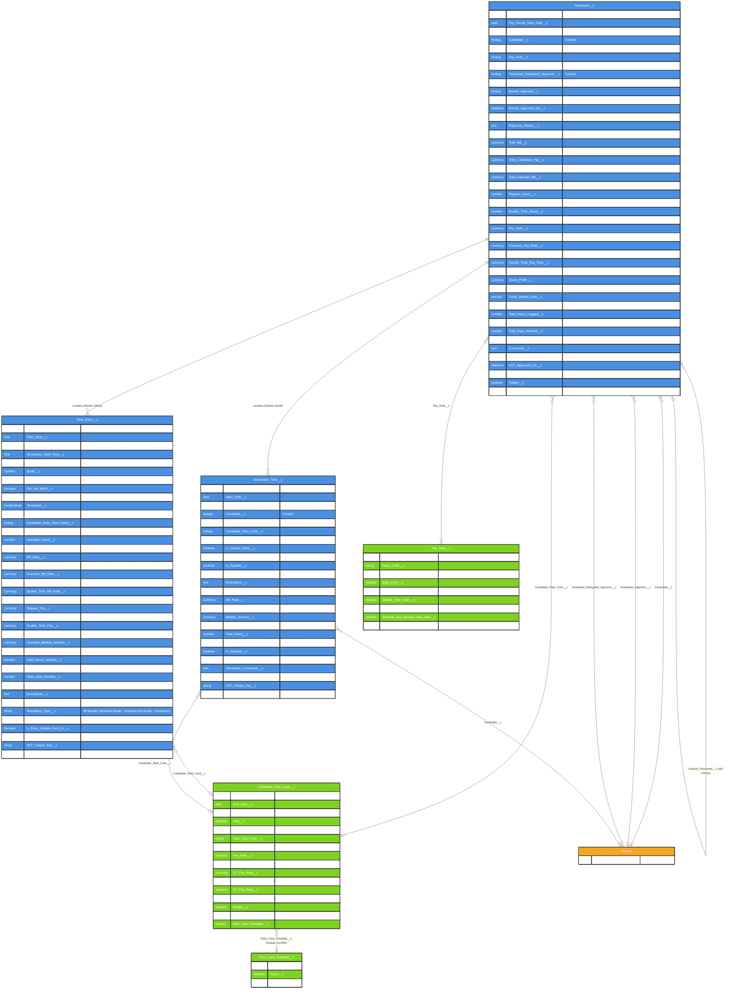

# Asymbl Time Package - Core Time & Attendance ERD

## Overview

This document provides an Entity Relationship Diagram (ERD) for the core Time & Attendance objects in the Asymbl Time package. The three main objects are:

1. **Timesheet__c** - Main timesheet object that aggregates time entries for a pay period
2. **Time_Entry__c** - Individual time entries recording daily work hours (Master-Detail child of Timesheet__c)
3. **Alternative_Time__c** - Time off, holidays, and other non-working time entries (Master-Detail child of Timesheet__c)

All field names and relationship types below were verified directly against `force-app/main/default/objects/*/fields/*.field-meta.xml` on the `master` branch (commit `38a8d3eb`, 2026-10-30).

## Entity Relationship Diagram

## Object Descriptions

### 1. Timesheet__c (Core Object)
The main timesheet object representing a candidate's pay period. Aggregates all time entries and calculates totals for hours, pay, and billing. Sharing model is `Read` with Apex-managed sharing granting the candidate, approver, and delegated approver read/write access.

**Key Characteristics:**
- 7-value restricted `Status__c` picklist: `New`, `Draft`, `Submitted for Approval`, `Approved by Branch`, `Approved`, `Rejected`, `Void` (default `New`)
- Direct lookups to `Contact` for candidate, primary approver, and delegated approver
- Direct lookup to `Pay_Rule__c` — one Pay Rule governs OT/DT calculation for the whole timesheet
- Calculates Regular/Overtime/Double-Time hours and associated pay/bill amounts, including "Adjusted" variants reflecting `Timesheet_Adjustment__c` records
- Supports voiding via `Voided__c` + `Original_Timesheet__c` self-lookup

### 2. Time_Entry__c (Master-Detail child of Timesheet__c)
Individual daily time entries. **Cannot exist without a parent Timesheet** (sharing model `ControlledByParent`).

**Key Characteristics:**
- Primary and secondary start/end time windows (split-shift support)
- `Break__c` (number) for break duration
- Attestation fields: `Is_Attested__c`, `Attestation_Type__c`, `Attestation_Comments__c`
- `AST_Sequence__c` / `AST_Unique_Key__c` used for idempotent upsert during resubmission (`AST_Updated_In_Resubmission__c`)
- Links to `Candidate_Rate_Card__c` and, for time-based/location/shift rate cards, `Candidate_Rate_Card_Detail__c`

### 3. Alternative_Time__c (Master-Detail child of Timesheet__c)
Time off and holiday tracking, separate from regular work hours. **Cannot exist without a parent Timesheet**.

**Key Characteristics:**
- Own `Status__c` lifecycle independent of the Timesheet's status: `Draft`, `Submitted`, `Approved`, `Rejected` (no `New`/`Void` values here, unlike `Timesheet__c`)
- Direct lookup to `Contact` (`Candidate__c`) in addition to the parent Timesheet
- `Is_Billable__c` / `Is_Payable__c` flags with corresponding `Billable_Amount__c` / `Payable_Amount__c`
- Alternative time type values (`Alternative_Timesheet_Types` global value set) are `Sick`, `PTO`, `Holiday`

## Field Details

### Timesheet__c Key Fields

| Field | Type | Description |
|-------|------|-------------|
| Status__c | Picklist (restricted) | `New`, `Draft`, `Submitted for Approval`, `Approved by Branch`, `Approved`, `Rejected`, `Void` |
| Pay_Period_Start_Date__c / Pay_Period_End_Date__c | Date | Pay period boundaries |
| Candidate__c | Lookup(Contact) | The worker/candidate |
| Candidate_Rate_Card__c | Lookup(Candidate_Rate_Card__c) | Rate card applied to the whole timesheet |
| Pay_Rule__c | Lookup(Pay_Rule__c) | Governs OT/DT bucketing |
| Timesheet_Approver__c / Timesheet_Delegated_Approver__c | Lookup(Contact) | Primary / backup approver |
| Branch_Approver__c / Approved_By_Branch__c / Branch_Approved_On__c | Lookup / Checkbox / DateTime | Branch-level approval stage |
| Total_Hours_Logged__c | Number | Total hours across all entries |
| Total_Bill__c / Total_Pay__c / Total_Candidate_Pay__c | Currency | Billing/pay totals |
| Voided__c / Original_Timesheet__c | Checkbox / Lookup (self) | Voiding and replacement tracking |

### Time_Entry__c Key Fields

| Field | Type | Description |
|-------|------|-------------|
| Date__c | Date | Date of the time entry |
| Start_Time__c / End_Time__c | Time | Primary clock-in/out |
| Secondary_Start_Time__c / Secondary_End_Time__c | Time | Split-shift secondary window |
| Timesheet__c | Master-Detail(Timesheet__c) | Parent timesheet |
| Regular_Hours__c / Overtime_Hours__c / Double_Time_Hours__c | Number | Hour buckets |
| Bill_Rate__c / Pay_Rate__c | Currency | Rates applied to regular hours |
| Is_Attested__c / Attestation_Type__c | Checkbox / Picklist | Break attestation |

### Alternative_Time__c Key Fields

| Field | Type | Description |
|-------|------|-------------|
| Date__c | Date | Date of the time off/holiday |
| Candidate__c | Lookup(Contact) | The worker taking time off |
| Timesheet__c | Master-Detail(Timesheet__c) | Parent timesheet |
| Is_Holiday_Entry__c | Checkbox | Indicates if this is a holiday |
| Is_Billable__c / Is_Payable__c | Checkbox | Billing/pay eligibility |
| Status__c | Picklist | `Draft`, `Submitted`, `Approved`, `Rejected` |
| Total_Hours__c / Total_Time_Off_Hours__c | Number | Total hours of time off |

## Relationship Explanations

### 1. Timesheet to Time Entry (1:M — Master-Detail)
Time entries cannot exist without a parent timesheet. Deletion of a timesheet cascades to all related time entries.

### 2. Timesheet to Alternative Time (1:M — Master-Detail)
Alternative time is also master-detail (not a loose lookup as previously documented) — it maintains its own `Status__c` but is still deleted if the parent timesheet is deleted.

### 3. Timesheet to Contact (M:1 — Lookups)
Three separate lookups: `Candidate__c` (worker), `Timesheet_Approver__c` (primary approver), `Timesheet_Delegated_Approver__c` (backup approver). There is a fourth approval-related lookup, `Branch_Approver__c`, also to `Contact`.

### 4. Rate Card and Pay Rule Relationships
`Timesheet__c` references both a `Candidate_Rate_Card__c` and a `Pay_Rule__c` directly. `Time_Entry__c` and `Alternative_Time__c` also reference `Candidate_Rate_Card__c` (and its detail) directly — `Candidate_Rate_Card__c` itself has no lookup back to `Contact`; the candidate association flows through the Timesheet.

### 5. Timesheet Voiding Relationship
`Original_Timesheet__c` creates a self-referencing lookup used by `AST_VoidTimesheetController` to track voided/replacement timesheets.

## Business Rules and Constraints

1. **Status Workflow**: `New → Draft → Submitted for Approval → Approved by Branch → Approved`, with `Rejected` looping back to `Draft`/resubmission and `Void` as a terminal state reachable from `Approved`.
2. **OT/DT Calculation**: Performed entirely in `AST_TimeEntryTriggerHelper.updateHoursOnTimeEntries()` against the single `Pay_Rule__c` linked to the Timesheet (Daily limit, Weekly limit, Double Time start, 7th-day rule).
3. **Rate Card Validity**: `Candidate_Rate_Card__c.Status__c` is a formula (`Active`/`Expired`/`Upcoming`/`Void`) — there is no manual status field to set; validity is always date- and void-flag-derived.
4. **Sharing**: Apex-managed sharing (`Timesheet__Share`) grants candidate + both approvers read/write; `Time_Entry__c`/`Alternative_Time__c` inherit sharing from the parent Timesheet.
5. **Voiding**: Voided timesheets are tracked via `Voided__c` + `Original_Timesheet__c`. There is no validation rule on `Timesheet__c` itself enforcing immutability; the one relevant validation rule in this domain is `Time_Entry__c.Prevent_Update_When_Voided`, which blocks edits to a time entry once its timesheet has been voided. All 21 other package validation rules live on `Rate_Card_Template__c` / `Rate_Card_Template_Detail__c` (rate range/markup integrity checks — see the Rate Card Management ERD).

This ERD represents the core time tracking functionality of the Asymbl Time package as implemented on `master` as of 2026-10-30.
